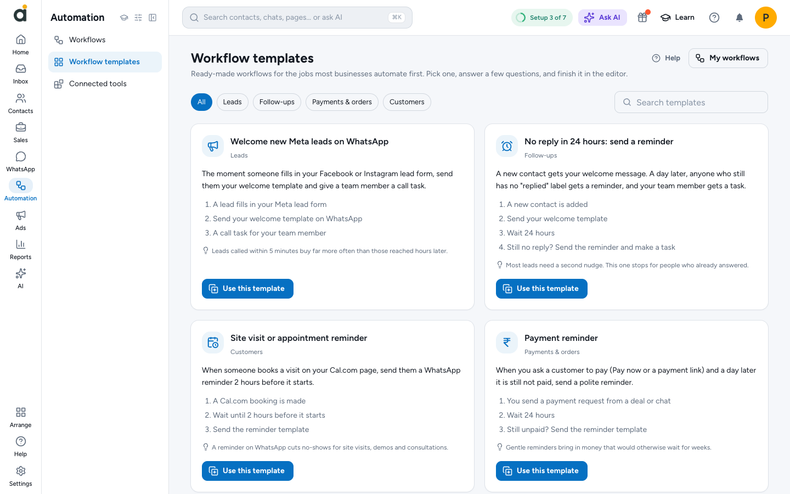
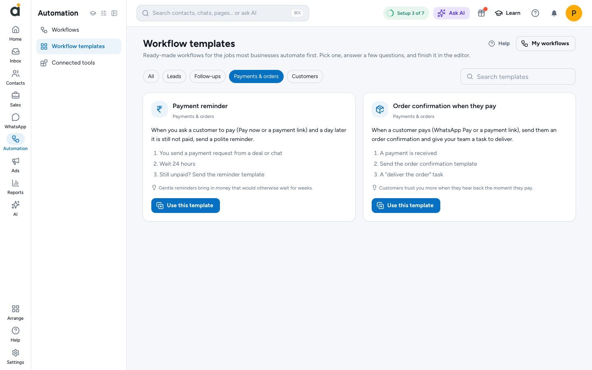
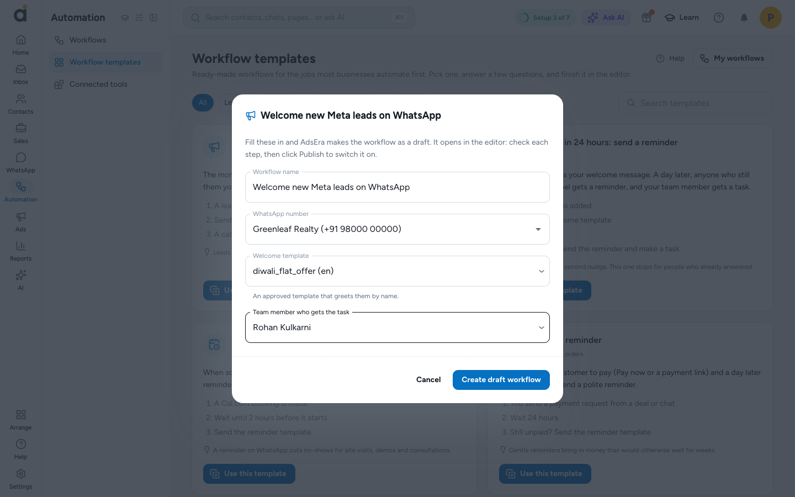
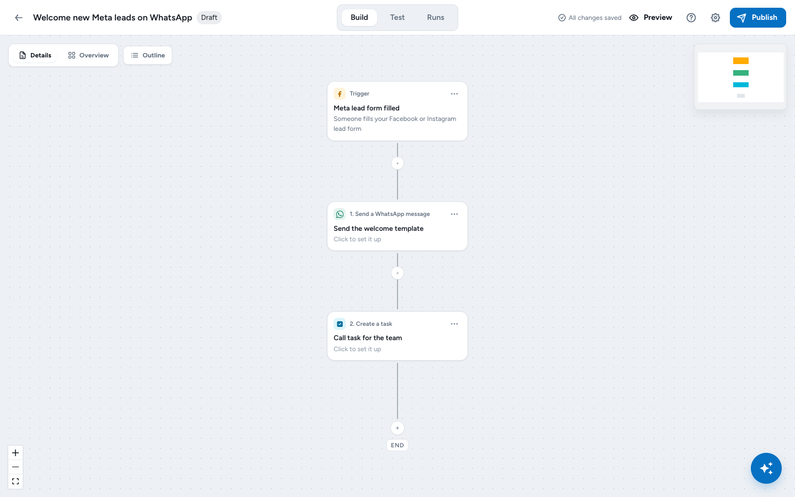

**Workflow templates** are ready-made workflows for the jobs most businesses automate first. Pick one, answer a few questions (which WhatsApp number, which approved template to send, who gets the task) and AdsEra makes it as a **draft** workflow. It opens in the editor, where you check each step and click **Publish**. Nothing runs before that.

**Where:** **Automation → Workflow templates**. [Open it →](https://app.adsera.in/dashboard/flow/templates)

**Before you start:**
- Approved WhatsApp templates for the messages the workflow sends (make them in **WhatsApp → Templates**).
- The **Workflows** permission to create workflows.

## Use a template

<Steps>
<Step title="Pick a group or search">
**All**, **Leads**, **Follow-ups**, **Payments & orders** or **Customers**, or type in **Search templates**.

</Step>
<Step title="Read the card">What it does, its steps, and why it helps.</Step>
<Step title="Click Use this template">
A window asks only what this template needs.

</Step>
<Step title="Answer the questions">See the table below.</Step>
<Step title="Click Create draft workflow">
It opens in the editor as a **Draft**.

</Step>
<Step title="Finish it in the editor">Click each WhatsApp step and fill the template's variables (like their name). Test it ([how](/help/automation/test-and-runs)), then click **Publish**.</Step>
</Steps>

### The questions

| Question | What to pick | Example |
| --- | --- | --- |
| **Workflow name** | Keep it or rename it | Welcome new Meta leads on WhatsApp |
| **WhatsApp number** | The number it sends from. Starts on your [primary number](/help/channel/whatsapp/primary-number) | Greenleaf Realty |
| A template (**Welcome template**, **Reminder template**…) | An **approved** template on that number | baner_welcome |
| **Team member who gets the task** | Who gets the task the workflow makes | Rohan Kulkarni |
| A label | The label the workflow looks for ("they replied", "hot lead", "cold lead") | Hot lead |
| **Form** | The AdsEra form that starts it | Site visit request |
| **Date field** | The contact field with the date (birthday or anniversary) | Birthday |

**Create draft workflow** stays greyed out until every question is answered. "No approved templates on this number yet" means you need to make one in WhatsApp → Templates first.

## The templates

| Template | Starts when | What it does | Needs |
| --- | --- | --- | --- |
| **Welcome new Meta leads on WhatsApp** | A Meta lead form is filled in | Sends your welcome template, then a call task | Ad account connected |
| **No reply in 24 hours: send a reminder** | A new contact is added | Welcome template; 24 hours later, if they don't have your "replied" label, a reminder template and a call task | A "replied" label you put on chats that answered (by hand or with an auto-reply) |
| **Site visit or appointment reminder** | A Cal.com booking is made | Waits until 2 hours before it, sends a reminder (skipped if it's already past) | Cal.com connected |
| **Payment reminder** | You send a payment request | Waits 24 hours, checks the payment, sends a reminder if still unpaid | WhatsApp Pay or Razorpay |
| **New form lead: give it an owner and a task** | An AdsEra form is filled in | Makes your team member the owner and gives them a call task | A form |
| **Missed call: WhatsApp them and make a task** | A WhatsApp call ends | If it was missed, sends your "sorry we missed you" template and a call-back task | After creating it, copy its webhook address into **Settings → Webhooks** with the event **call.ended** |
| **Hot lead label: tell the team** | A contact gets your "hot" label | A "call now" task for your team member | A label |
| **Birthday or anniversary greeting** | Every day at 9:00 AM | Finds contacts whose date is today and sends your greeting (up to 100 contacts a day) | A date field on contacts |
| **Re-engage cold leads every week** | Every Monday at 10:00 AM | Sends your comeback offer to contacts with your "cold" label (up to 100 a week) | A label, a Marketing template |
| **Order confirmation when they pay** | A payment is received | Sends an order confirmation and a "deliver the order" task | WhatsApp Pay or Razorpay |

<Note>Templates send WhatsApp **templates** (approved by Meta), so they reach people even outside the 24-hour window. Map each template's variables in the editor before you publish.</Note>

## After you create it

- It's a normal workflow: change, add or remove any step.
- It's listed in **Automation → Workflows** as a draft until you publish it.
- To stop it later, switch it off on the Workflows list.

## Troubleshooting

| What you see | Fix |
| --- | --- |
| No approved templates on this number yet | Make one in WhatsApp → Templates and wait for Meta's approval. |
| No labels yet / No forms yet / No date field yet | Make one first (on a contact, in Contacts → Forms, or Contacts → Fields & settings). |
| "Could not make the workflow" | Your plan's workflow limit may be reached (My plan), or you lack the Workflows permission. |
| A WhatsApp step fails when testing | Open the step and fill the template's variables. |

## Questions

<AccordionGroup>
<Accordion title="Can I use the same template twice?">Yes: each use makes a new draft workflow.</Accordion>
<Accordion title="Why does the no-reply template need a label?">Workflows can't yet tell on their own that someone replied, so the reminder skips anyone with your "replied" label. Put it on the chat when they answer (an auto-reply can do it).</Accordion>
<Accordion title="Can I suggest a template?">Ask your AdsEra contact, or build it with Ask AI in the editor.</Accordion>
</AccordionGroup>

## Related

<CardGroup cols={2}>
<Card title="Workflows" href="/help/automation/workflows">Build and publish workflows.</Card>
<Card title="Triggers" href="/help/automation/triggers">What can start a workflow.</Card>
<Card title="Steps" href="/help/automation/steps">Every step you can add.</Card>
<Card title="Test and runs" href="/help/automation/test-and-runs">Test before you publish.</Card>
</CardGroup>
