A **workflow** is a list of steps AdsEra runs by itself, for every person, when something happens. For example:

- a new Meta ad lead gets a WhatsApp welcome at once, a reminder a day later if they didn't reply, and a call task for your sales team;
- everyone who books a site visit on Cal.com gets a WhatsApp reminder the day before and the directions by email 2 hours before;
- someone who sends **PRICE** on WhatsApp is asked their budget and gets the right price list.

**Where:** **Automation → Workflows** in the left menu. [Open it →](https://app.adsera.in/dashboard/flow/list)

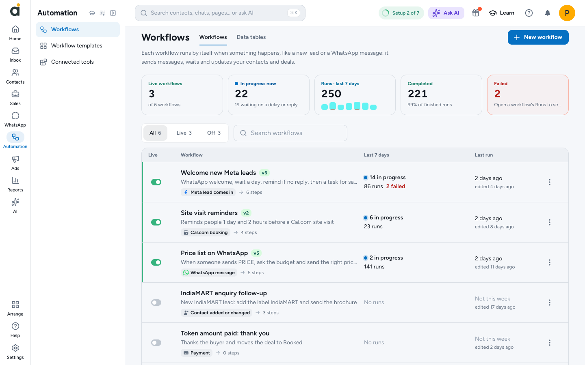

<Note>
Start from a ready-made one in [Workflow templates](/help/automation/workflow-templates), or build it from steps, which takes a few minutes. **Build with AI** in the editor can build it for you from one sentence (see [below](#build-a-workflow-with-ai)).
</Note>

## How a workflow works

1. **A trigger starts it** for one person: a new lead, a message, a form, a booking, a payment, a time of day. There are [11 triggers](/help/automation/triggers).
2. **The steps run in order**, top to bottom: send a WhatsApp message, wait a day, check if they replied, create a deal. There are [22 steps](/help/automation/steps).
3. **Each person goes through it on their own.** If 50 leads come in today, 50 runs start. You see each one under [Runs](/help/automation/test-and-runs#runs).

## The Workflows page

When you have no workflows yet, the page shows what one looks like and **Create your first workflow**:

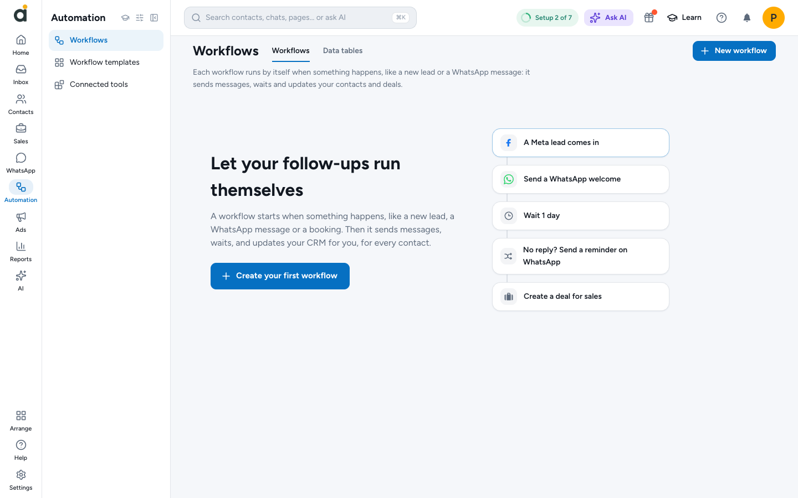

Once you have some, it shows:

| Part | What it tells you |
| --- | --- |
| **Live workflows** | How many are switched on, of all your workflows |
| **In progress now** | People inside a workflow right now, and how many of them are waiting (on a **Wait** step or for a reply) |
| **Runs · last 7 days** | How many times a workflow started for someone, with one bar per day (the red part failed) |
| **Completed** | Runs that went all the way through, and what share of finished runs that is |
| **Failed** | Runs that stopped on an error. Open the workflow's **Runs** to see why |
| **All / Live / Off** | Show every workflow, only live ones, or only switched-off ones |
| **Search workflows** | Find one by its name |

Each row shows:

| Column | What it shows |
| --- | --- |
| **Live** | The switch: green is live. Click it to turn the workflow on or off |
| **Workflow** | The name, the live version (like **v3**), what it does, what starts it (like **Meta lead comes in**) and how many steps it has. **No trigger yet** means it can't start |
| **Last 7 days** | People in it now (**14 in progress**), runs this week and how many **failed** |
| **Last run** | When it last started for someone, and when it was last edited |
| **⋮** | **Open editor**, **Duplicate**, **Delete workflow** |

Click a row to open the workflow in the editor.

## Make a workflow

<Steps>
<Step title="Click New workflow">
At the top right of **Automation → Workflows**.

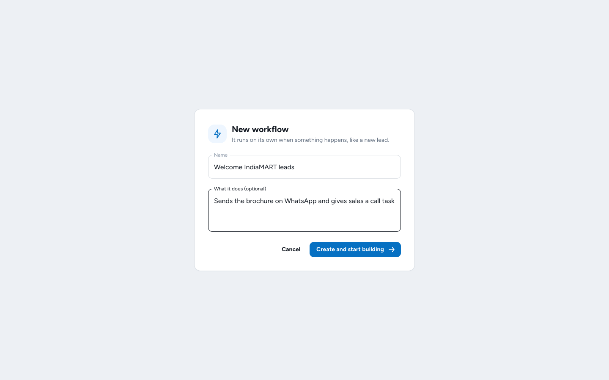
</Step>
<Step title="Name it">
**Name** is needed and only your team sees it, like *Welcome new Meta leads*. **What it does (optional)** is one line for your team.
</Step>
<Step title="Click Create and start building">
The editor opens on an empty workflow and asks **Choose a trigger**.

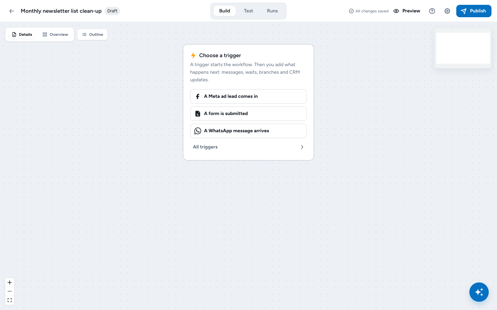
</Step>
<Step title="Pick what starts it">
Click **A Meta ad lead comes in**, **A form is submitted** or **A WhatsApp message arrives**, or **All triggers** for every one. Its settings open on the right: set it up and click **Save**. See [every trigger](/help/automation/triggers).
</Step>
<Step title="Add the steps">
Click the **+** under the trigger and pick a step, like **Send a WhatsApp message**. Set it up and **Save**. Keep adding with the **+** on each line. See [every step](/help/automation/steps).
</Step>
<Step title="Test it, then publish">
Click **Test** at the top and run it on yourself. When it works, click **Publish**: the workflow is live. See [Test, publish and runs](/help/automation/test-and-runs).
</Step>
</Steps>

<Warning>
**Which plan do I need?** Workflows are part of your plan, and the number you can have depends on it (see **Settings → My plan**). When they're used up, **New workflow** opens an upgrade window instead:

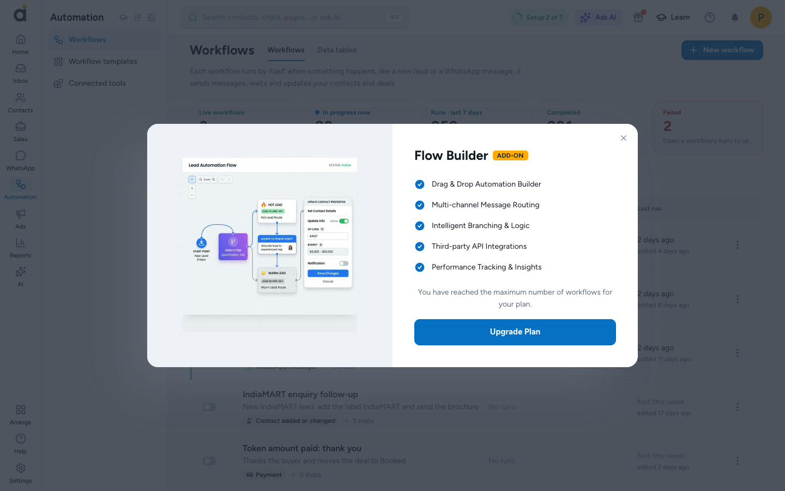
</Warning>

## The editor

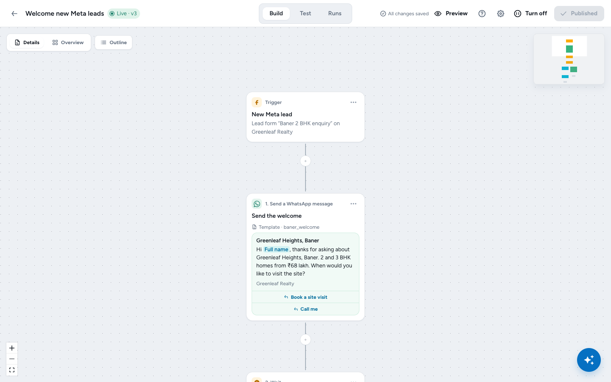

The editor opens showing the whole workflow, or, when it is too long to read that way, its first steps at a readable size. Scroll, or use **⛶** (bottom left) to see it all.

| Part | What it does |
| --- | --- |
| **←** (top left) | Back to all workflows |
| **Live · v3** / **Off · v3** / **Draft** | Live on its 3rd published version; switched off; or never published |
| **Build** | Where you make the steps |
| **Test** | Run it once on a contact and watch each step ([how](/help/automation/test-and-runs#test-a-workflow)) |
| **Runs** | Everyone who went through it ([how](/help/automation/test-and-runs#runs)) |
| **All changes saved** | Every change saves by itself. On a live workflow it says **Draft saved, not live yet** until you publish |
| **Preview** | The messages on a phone, in order |
| **?** (Help) | Lessons and guides for the editor |
| Settings wheel | Name, retries, failure email, stop rules ([settings](/help/automation/test-and-runs#workflow-settings)) |
| **Publish** / **Publish changes** / **Published** / **Turn off** | Switch it on, make your draft live, or switch it off ([how](/help/automation/test-and-runs#publish-and-versions)) |
| **Details / Overview** | Show each card in full, or small to see a big workflow at once |
| **Outline** | A plain list of the steps; click one to jump to it |
| **+ / − / ⛶** (bottom left) | Zoom in, zoom out, fit the whole workflow |
| Round button (bottom right) | **Build with AI** |

On the canvas, steps run from top to bottom and are numbered. A **+** on a line adds a step there. **If / else** and buttons split the path into labelled columns (like **Replied** and **Otherwise**). Every path ends in **END**. A step's **⋯** deletes it.

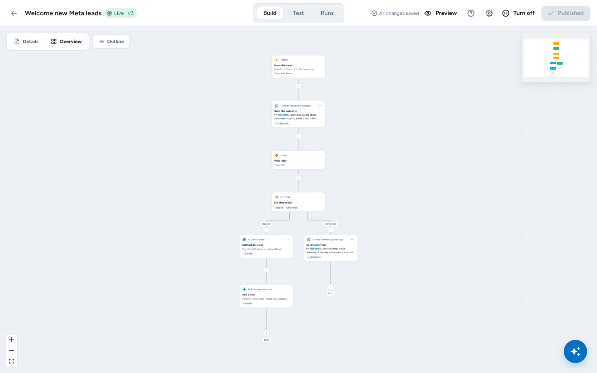

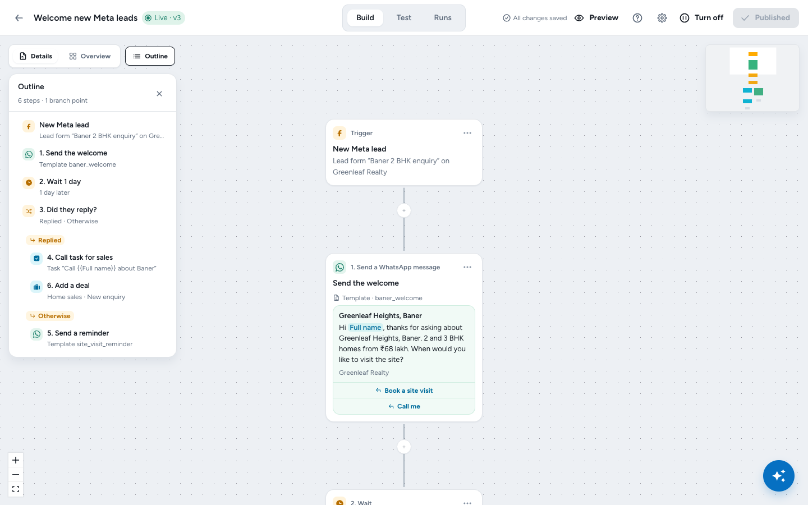

## Preview the messages

Click **Preview**: a phone shows what the lead gets, in order, with the buttons and the waits. Click a message to open its step.

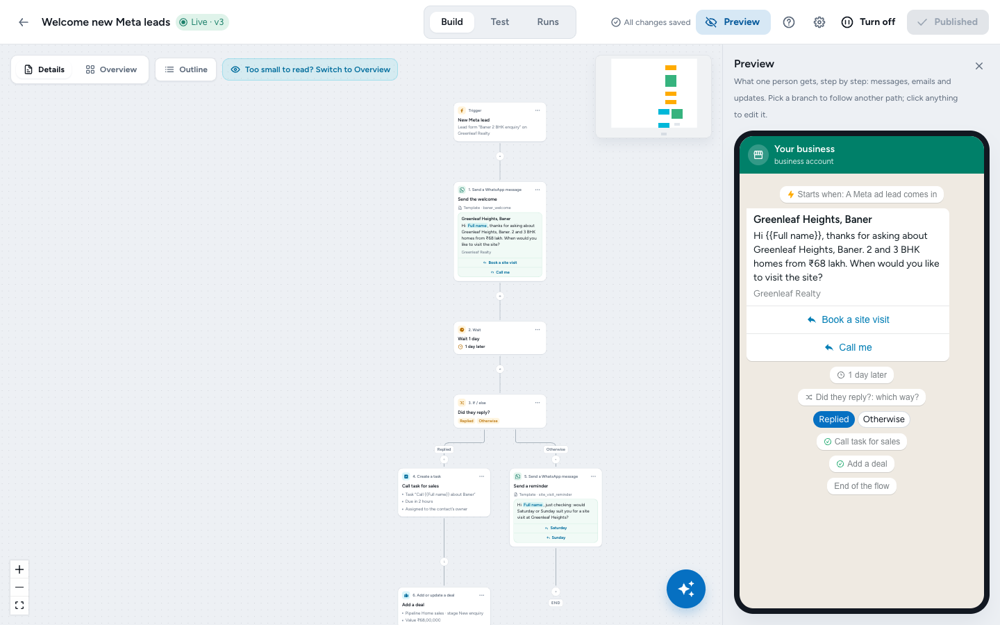

## Build a workflow with AI

Click the round button at the bottom right of the canvas: **Build with AI** opens.

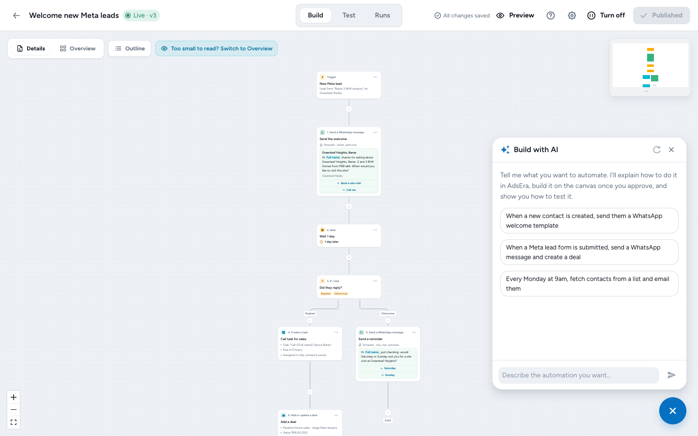

<Steps>
<Step title="Describe it">
Type what should happen in your own words, or click an example. For example: *When a Meta lead comes in, send the welcome template, wait a day, and if they don't reply send a reminder and create a call task.*
</Step>
<Step title="Answer its questions">
It asks what it needs, like which template or which lead form, and shows the plan.
</Step>
<Step title="Say yes">
It builds the steps on the canvas. Check each one, [test it](/help/automation/test-and-runs#test-a-workflow), then **Publish**.
</Step>
</Steps>

It uses [AI credits](/help/ai/credits). The circle-arrow button starts a **New chat**.

## Turn a workflow on or off, duplicate or delete it

- **On / off:** click the switch on its row (or **Publish** / **Turn off** in the editor). Turning on publishes what you built; if something is missing (like a trigger), a red message says what. Turning off a workflow with people in it asks first:

  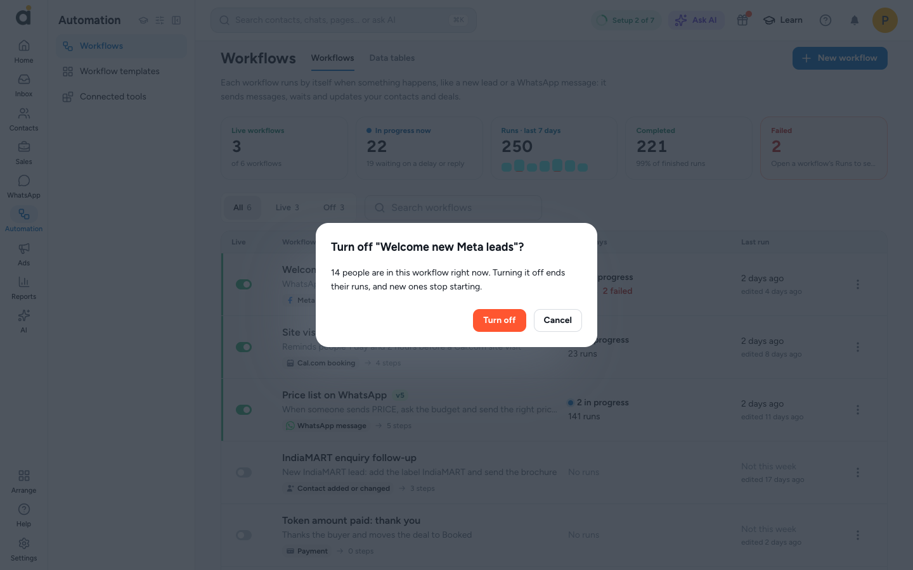

- **Duplicate:** **⋮ → Duplicate** makes a full copy named “… (copy)”, switched off.

  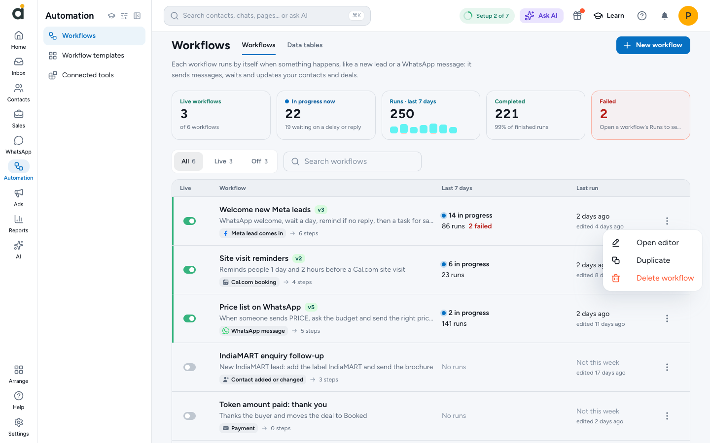

- **Delete:** **⋮ → Delete workflow** asks first. Its steps and run history go with it, and a live workflow stops.

  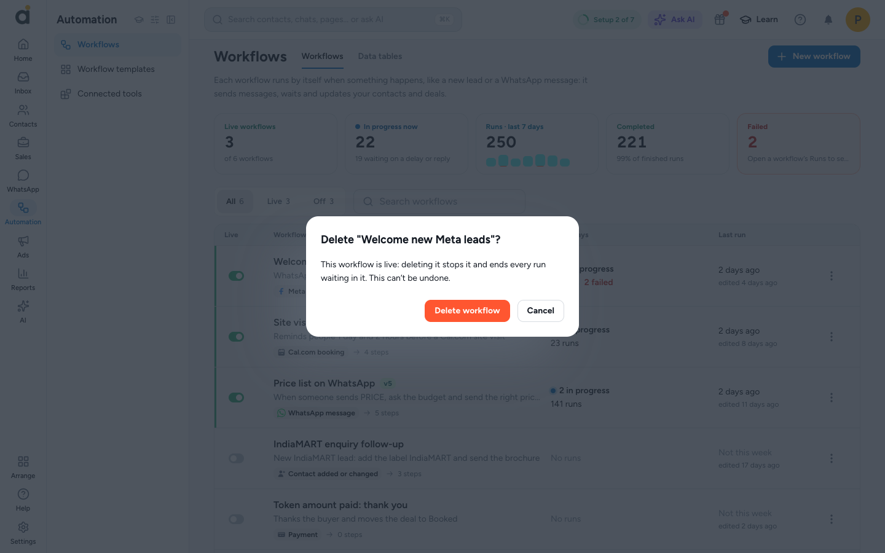

## Ready-made recipes

These are workflows Indian businesses build most. Each takes 5–10 minutes.

<AccordionGroup>
<Accordion title="Welcome every Meta ad lead on WhatsApp, and chase the quiet ones">
Trigger **A Meta ad lead comes in** (your lead form) → **Send a WhatsApp message** (an approved welcome template, with their name from Insert data) → **Wait** for 1 day → **If / else**: did they reply? → **Replied**: **Create a task** “Call {name}” for sales; **Otherwise**: **Send a WhatsApp message** (a reminder template).
</Accordion>
<Accordion title="Remind people before a Cal.com site visit">
Connect [Cal.com](/help/integrations/calcom) first. Trigger **A Cal.com booking** (Booked) → **Wait** until 1 day before the booking's start time → **Send a WhatsApp message** (a reminder template) → **Wait** until 2 hours before → **Send an email** with the directions.
</Accordion>
<Accordion title="Welcome every IndiaMART lead">
Connect [IndiaMART](/help/integrations/indiamart) so enquiries become contacts. Trigger **A contact changes** → tick **A contact is created**, and add a filter for your IndiaMART source field → **Send a WhatsApp message** (your brochure template) → **Add or update a contact** to add the label *IndiaMART*.
</Accordion>
<Accordion title="Thank buyers who pay the token amount">
Trigger **A payment happens** → **Payment received** → **Send a WhatsApp message** (thank-you template) → **Add or update a deal** to move it to your Booked stage.
</Accordion>
<Accordion title="Answer PRICE with the right price list">
Trigger **A WhatsApp message arrives** with the keyword **PRICE** → **Ask a question** (“What is your budget?”) → **Send a message with buttons** (2 BHK / 3 BHK) → under each button, **Send a WhatsApp message** with that price list → **Data table** to log the enquiry.
</Accordion>
</AccordionGroup>

## Who can use workflows

Team members need the **Workflows** permission (Settings → Team members). Data tables also need **Integrations & data tables**. Admins have both.

## FAQ

<AccordionGroup>
<Accordion title="Do changes go live as I make them?">
No. Every change saves into a draft. A new workflow does nothing until you **Publish**. On a live workflow, customers get your changes only after **Publish changes**; people already inside finish on the version they started.
</Accordion>
<Accordion title="Can a workflow message someone who never wrote to me?">
Only with an approved WhatsApp **template**. Meta allows free messages (text, pictures, buttons, questions) only within 24 hours of the customer's last message. Leads from ads and forms haven't written to you, so start with a template. See [the 24-hour rule](/help/inbox/24-hour-window).
</Accordion>
<Accordion title="Does it send email campaigns?">
No. **Send an email** sends one email to one person when the workflow reaches them, from your mailbox, ZeptoMail or an [email account](/help/automation/email-accounts). AdsEra doesn't send email campaigns or newsletters.
</Accordion>
<Accordion title="Can I start from a template?">
Yes: **Automation → Workflow templates** has ten ready-made ones (see [Workflow templates](/help/automation/workflow-templates)). You can also **Duplicate** a workflow you like, or use **Build with AI**.
</Accordion>
<Accordion title="What happens to people inside when I turn a workflow off?">
Their runs end there: they don't get the rest. New people stop starting it. Turning it on again doesn't bring them back.
</Accordion>
</AccordionGroup>

## Related

<CardGroup cols={2}>
<Card title="Every trigger" icon="bolt" href="/help/automation/triggers">What can start a workflow, and each one's settings.</Card>
<Card title="Every step" icon="list-check" href="/help/automation/steps">All 22 steps and their fields.</Card>
<Card title="Test, publish and runs" icon="play" href="/help/automation/test-and-runs">Test on yourself, publish, read runs, fix failures.</Card>
<Card title="Data tables" icon="table" href="/help/automation/data-tables">Your own lists for workflows.</Card>
</CardGroup>
