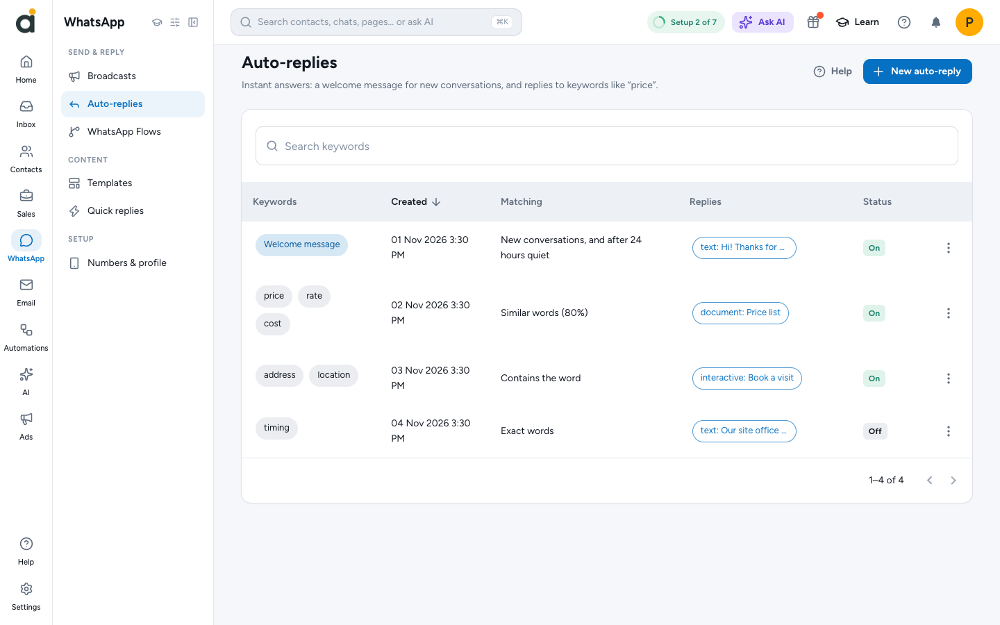
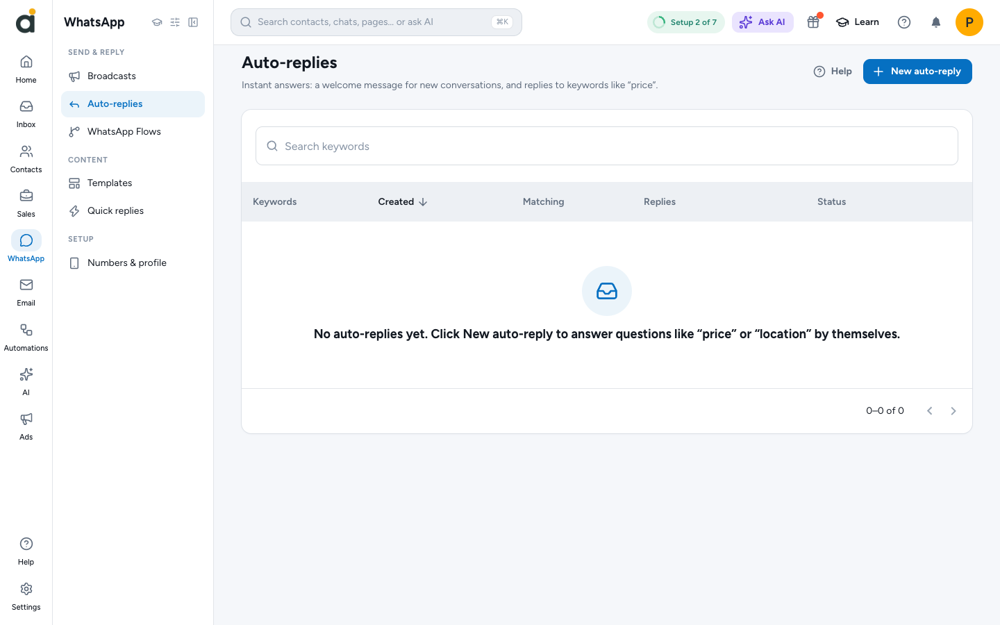
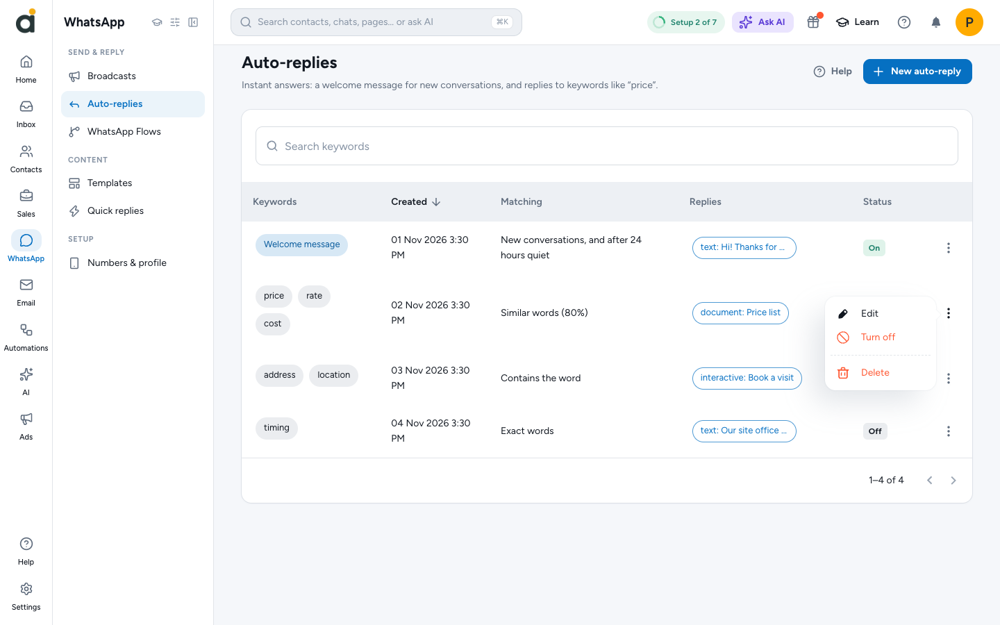
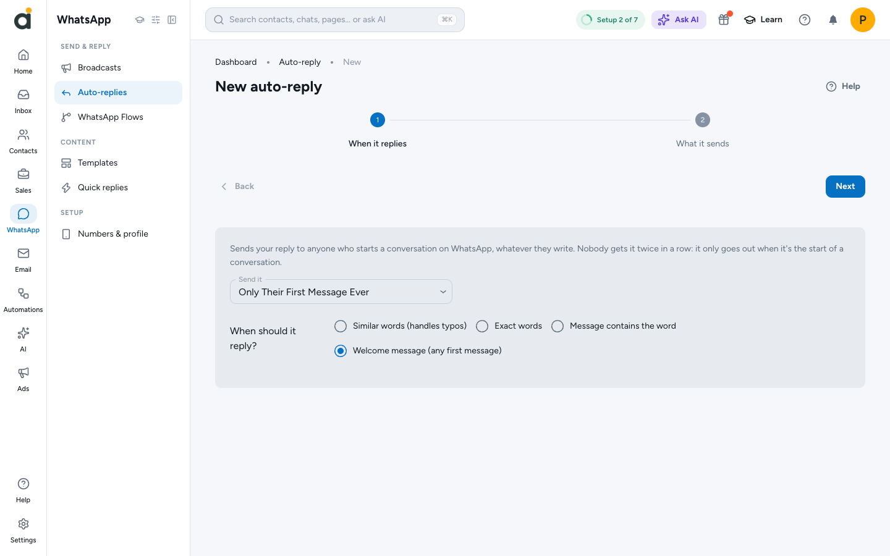
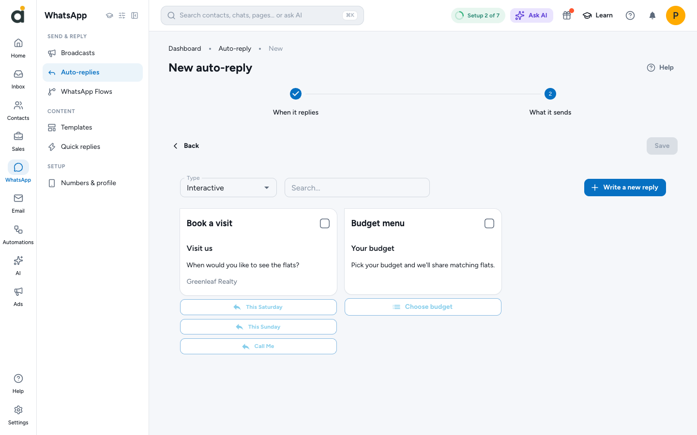
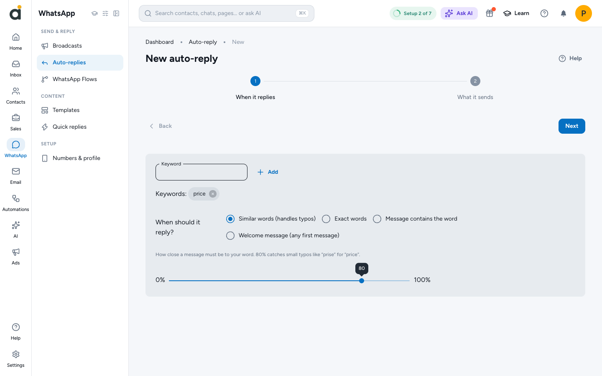

**Auto-replies** answer WhatsApp messages for you:

- a **welcome message** for anyone who starts a conversation, and
- **keyword replies** for words like “price”, “location” or “timing”.

They work on all your WhatsApp numbers, at any hour, and send one or more [quick replies](/help/snippet/list) (text, photos, documents or buttons).

**Where:** **WhatsApp → Auto-replies** (side menu, under **Send & reply**), or **Numbers & profile → Automation → Welcome message → Set up**. [Open it →](https://app.adsera.in/dashboard/autoreply/whatsapp/list)

## The list

| Column | What it shows |
| --- | --- |
| Keywords | The words it answers, or **Welcome message** |
| Created | When it was made |
| Matching | **Similar words (80%)**, **Exact words**, **Contains the word**, or for a welcome: **First message only** / “New conversations, and after 24 hours quiet” |
| Replies | The quick replies it sends. Click one to see it. |
| Status | **On** or **Off** |

Type in **Search keywords** to find one. The **⋮** menu on a row has **Edit**, **Turn off** / **Turn on** and **Delete**.

## Set up a welcome message

<Steps>
<Step title="New auto-reply">Click **New auto-reply**.</Step>
<Step title="Pick Welcome message">Under **When should it reply?** pick **Welcome message (any first message)**. No keywords needed.</Step>
<Step title="Choose when it greets again">
  In **Send it**:

  | Option | Who gets it |
  | --- | --- |
  | **Only their first message ever** | Each person once |
  | **Also when they come back after 24 hours** | And again after a day of quiet (good for most shops) |
  | **… after 3 days / 7 days / 30 days** | And again after that much quiet |

  
</Step>
<Step title="Next">Click **Next**.</Step>
<Step title="Pick what it sends">
  Click the quick replies to send (they show as chips at the top). Use **Type** and **Search…** to find them, or **Write a new reply** to make one now.

  
</Step>
<Step title="Save">Click **Save**. It works straight away.</Step>
</Steps>

## Answer a keyword

<Steps>
<Step title="New auto-reply">Click **New auto-reply**.</Step>
<Step title="Add the words">
  In **Keyword** type a word and click **Add** (or press Enter). Add a few ways people say it: price, rate, cost. Click × on a chip to remove it.

  
</Step>
<Step title="Choose how it matches">See the table below. For **Similar words**, the slider sets how close (80% suits most words).</Step>
<Step title="Pick the reply and save">Click **Next**, pick the quick replies, and click **Save**.</Step>
</Steps>

## How keywords match

| Option | Fires when | Example: keyword “price” |
| --- | --- | --- |
| **Similar words (handles typos)** | The message is close to the word | “prise”, “Price” |
| **Exact words** | The whole message is exactly the word | “price” only |
| **Message contains the word** | The word is anywhere in the message | “what is the price of 2BHK?” |
| **Welcome message (any first message)** | Anyone starts a conversation | Any first message |

When several could fire, AdsEra uses **Message contains the word** first, then **Similar words**, then **Exact words**. A welcome message is sent first, before any keyword reply.

## Turn off, edit or delete

- **Turn off** (⋮ menu): stops it without deleting it. The status shows **Off**. **Turn on** starts it again.
- **Edit**: change the words, the matching or the replies, then **Save**.
- **Delete**: removes it for good. The quick replies it sent stay saved.

## Fields

| Field | What it does | Example | Required? |
| --- | --- | --- | --- |
| Keyword | Words that trigger it | price, rate | Yes, unless Welcome message |
| When should it reply? | How words match, or Welcome message | Message contains the word | Yes |
| Similarity slider | How close Similar words must be | 80% | For Similar words |
| Send it | When a welcome is sent again | After 24 hours | For Welcome message |
| Replies | Quick replies it sends, in order | “Price list” document | Yes |

## Troubleshooting

| Problem | Why | Fix |
| --- | --- | --- |
| No reply arrives | It is **Off**, or the word didn’t match | Turn it on; use **Message contains the word**, or add more keywords |
| Two replies arrive | A welcome and a keyword reply both fired | Expected: on a first message the welcome goes first, then the keyword reply |
| A contact never gets auto-replies | Automatic replies are switched off for that contact | Switch them back on from the contact’s chat |

## Related

<CardGroup cols={2}>
  <Card title="Quick replies" icon="bolt" href="/help/snippet/list">What auto-replies send.</Card>
  <Card title="Opt-in & opt-out keywords" icon="toggle-on" href="/help/channel/whatsapp/opt">STOP and START.</Card>
  <Card title="Addy" icon="robot" href="/help/ai/addy">Your AI agent, for questions keywords can’t cover.</Card>
</CardGroup>
