A **broadcast** sends one approved WhatsApp template to many people at once, like a Diwali offer to all your Pune leads. Each person gets it as a normal WhatsApp message, with their own name and details.

**Where:** **WhatsApp → Broadcasts → New broadcast**. [Open it →](https://app.adsera.in/dashboard/campaign/whatsapp/list)

**Before you start:** a [connected number](/help/channel/whatsapp/connect), an [approved template](/help/template/create), and your [contacts](/help/audiance/audiance).

The form has **2 steps**: **Who gets it** (the name and the people) and **What they get** (the template, the number it comes from, and when). Clicking **Save broadcast** at the end saves it:

<Warning>**Save broadcast does not send.** It saves the broadcast. A broadcast set to **I’ll send it with Send now** waits as a **Draft** until you open its **⋮** menu in Broadcasts and click **Send now**. A broadcast set to **Schedule for later** goes out on its own at the time you picked.</Warning>

## Step 1: Who gets it

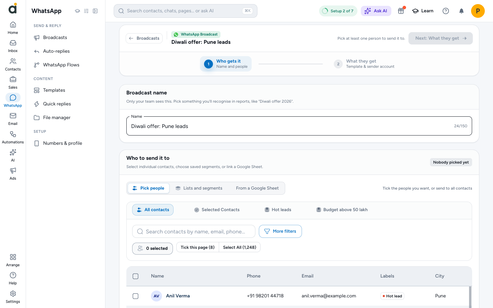

<Steps>
<Step title="Name it">
  In **Broadcast name**, type a name only your team sees, like “Diwali offer: Pune leads” (up to 150 characters).
</Step>
<Step title="Choose who gets it">
  Pick one of the three tabs under **Who to send it to**:

  - **Pick people**: tick people in the list, or click **Select All** to pick everyone who matches (not only the people on this page). **Tick this page** picks just this page. Click a saved segment chip (like **Hot leads**) to see only those people. **More filters** adds conditions like City is Pune. The **Selected Contacts** chip shows who you picked.
  - **Lists and segments**: send to whole lists and segments. A segment updates itself as contacts change.
  - **From a Google Sheet**: send to the rows of a Google Sheet. See [Send to a Google Sheet](/help/campaign/wa/google-sheet).

  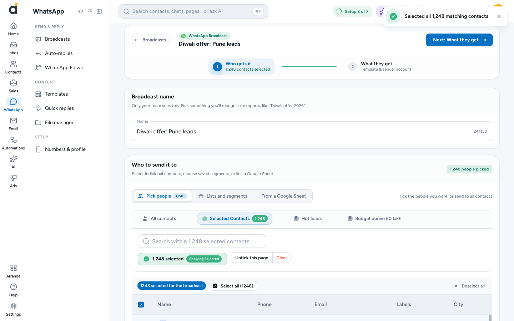

  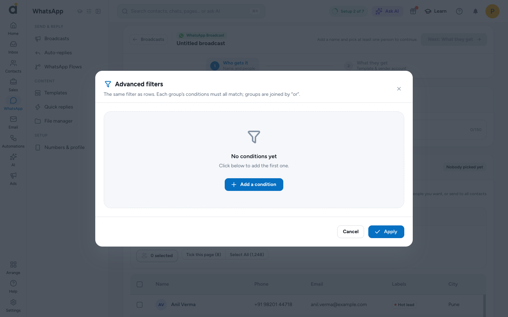

  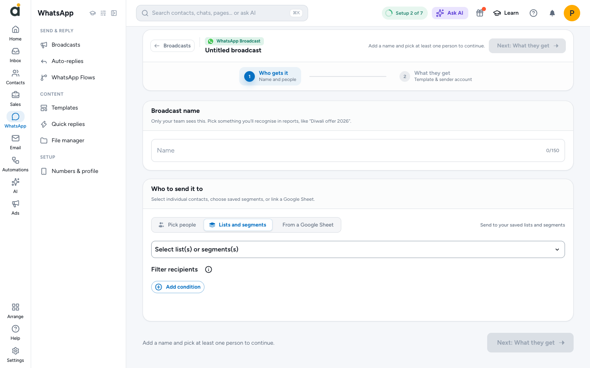
</Step>
<Step title="Next">
  Click **Next: What they get**. Until there is a name and at least one person it stays grey, and the line next to it says what is missing.
</Step>
</Steps>

<Note>Only message people who agreed to hear from you. People who sent **STOP** are skipped automatically ([opt-out](/help/channel/whatsapp/opt)).</Note>

## Step 2: What they get

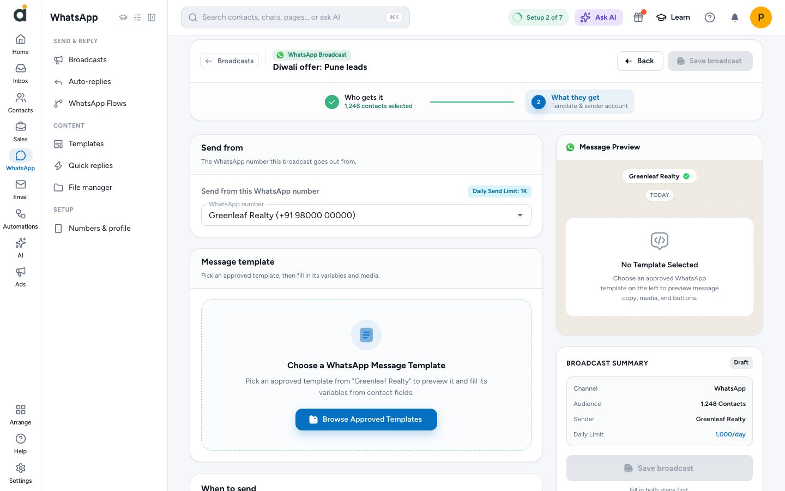

<Steps>
<Step title="Send from">
  Pick the WhatsApp number in **Send from this WhatsApp number**. Its **Daily Send Limit** shows next to it.
</Step>
<Step title="Pick the template">
  Click **Browse Approved Templates** and click **Use Template** on the one you want. Only **Approved** templates can be used. **Change Template** swaps it.

  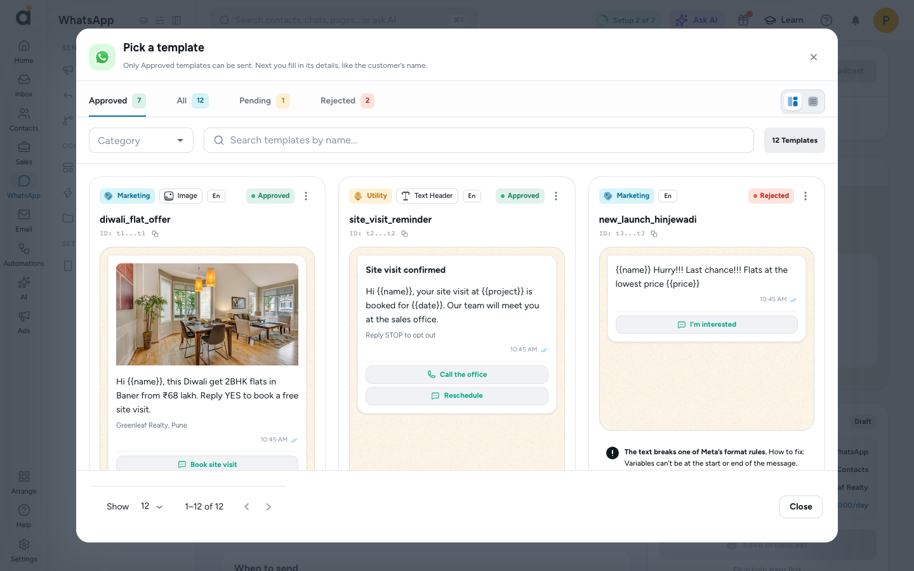

  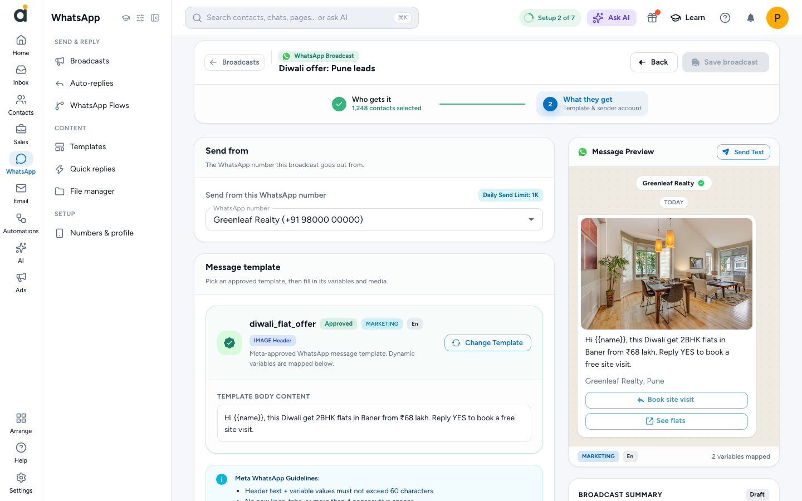
</Step>
<Step title="Fill its variables and media">
  For each variable (like `{{name}}`), pick a **Contact field** (like FIRSTNAME) so everyone gets their own value, **or** type **Same text for everyone**.

  Depending on the template, you also fill:
  - **Image, video or document header**: pick from **Media Library** or paste a **Direct Media URL**. You can use a different file than the sample.
  - **Location header**: **Latitude**, **Longitude**, **Location Name** and **Full Street Address**.
  - **Limited-time offer**: **Offer Expiration** (**Select Expiration Time**), when the offer ends.
  - **Carousel**: each card’s media.

  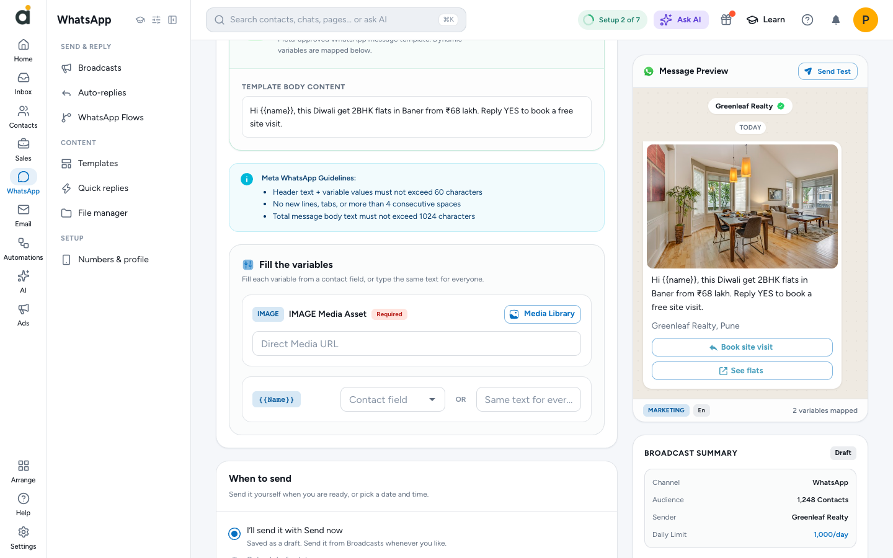
</Step>
<Step title="Choose when to send">
  In **When to send**:
  - **I’ll send it with Send now**: saved as a draft. You send it from Broadcasts whenever you like.
  - **Schedule for later**: pick the **Date and time** (your computer’s time zone). It goes out on its own then. Needs a plan with scheduling; on other plans this option is greyed out with a note pointing to the **Schedule broadcasts** add-on.

  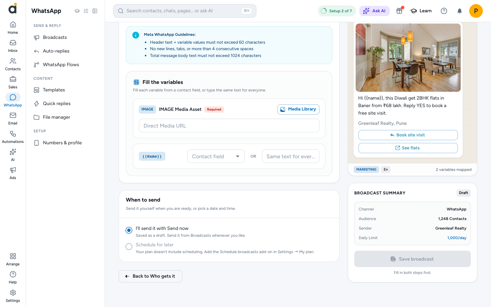

  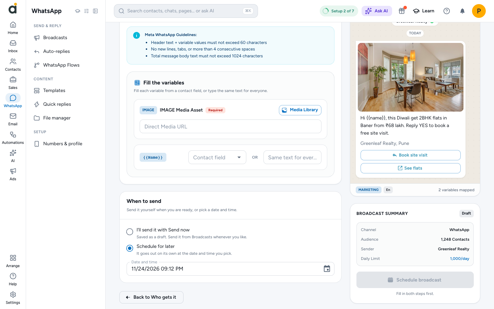
</Step>
<Step title="Send a test (recommended)">
  Click **Send Test** above the preview. In **Preview & test**, search a contact (like yourself) and click **Send Test**. Check it on your phone.

  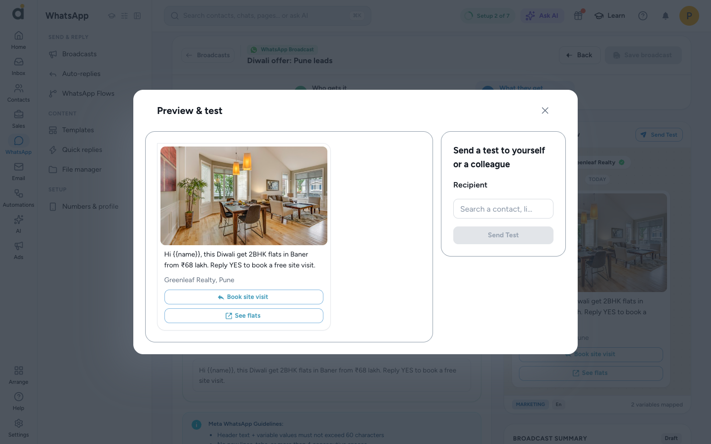
</Step>
<Step title="Check the summary and save">
  **Broadcast summary** shows the channel, how many people, the number and its daily limit. Click **Save broadcast** (or **Schedule broadcast** if you picked a time).

  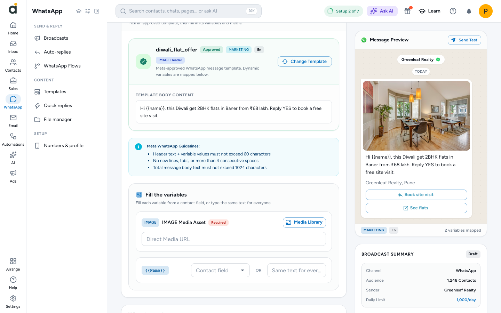
</Step>
</Steps>

## What happens next

| You chose | Status in the list | What to do |
| --- | --- | --- |
| I’ll send it with Send now | **Draft** | Open its **⋮** menu → **Send now** → confirm. It changes to **Processing**, **Sending**, then **Sent**. |
| Schedule for later | **Scheduled** | Nothing. It starts at the time you picked. |

Then open **Report** to see who got it, read it and replied. See [Your broadcasts](/help/campaign/wa/list) and [Broadcast reports](/help/campaign/wa/report).

## Fields

| Field | What it does | Example | Required? |
| --- | --- | --- | --- |
| Broadcast name | Your name for it | Diwali offer: Pune leads | Yes |
| Audience | Contacts, lists/segments or a Google Sheet | Hot leads | Yes |
| Send from this WhatsApp number | The sending number | Greenleaf Realty (+91 98000 00000) | Yes |
| Template | An approved template | diwali_flat_offer | Yes |
| Variables | Contact field or same text for everyone | FIRSTNAME | Yes, per variable |
| Header media / location / offer end | Depends on the template | Flat photo | When the template has it |
| When to send | Send now later, or a date and time | Sat 23 Nov, 11:00 am | Yes |

## Limits and costs

- Each send counts against your number’s **daily limit** of new people.
- Meta charges for each delivered template message (marketing costs most). See [Rules, limits and costs](/help/template/rules-and-limits).
- Meta may hold back marketing messages to people who got many recently (code 131049): they show as failed in the report.

## Troubleshooting

| What you see | Why | What to do |
| --- | --- | --- |
| **Next: What they get** is grey | No name or nobody picked | Type a name and pick people |
| **Save broadcast** is grey | Template, number or a variable is missing | Fill every variable and the media |
| A template is missing in the picker | It isn’t approved, or belongs to another number | Pick the right number; wait for approval |
| Schedule for later is greyed out | Your plan doesn’t include scheduling | Add the **Schedule broadcasts** add-on in Settings → My plan, or send with Send now |
| “Template is not approved!” when scheduling | The template was paused or rejected | Pick an approved template |
| I saved it but nothing was sent | It is a Draft | **⋮ → Send now** in Broadcasts |

## FAQs

<AccordionGroup>
<Accordion title="Can I stop a broadcast after Send now?">
  No. Once it starts it can’t be stopped. Send a test first and check the audience.
</Accordion>
<Accordion title="Can I change or cancel a scheduled broadcast?">
  Not from the list today: only drafts can be edited or deleted. Duplicate it to make a corrected copy, and ask support to cancel the scheduled one.
</Accordion>
<Accordion title="Will people who opted out get it?">
  No. Contacts who sent STOP are skipped.
</Accordion>
</AccordionGroup>

## Related

<CardGroup cols={2}>
  <Card title="Your broadcasts" icon="list" href="/help/campaign/wa/list">Statuses, Send now, edit, duplicate, delete.</Card>
  <Card title="Broadcast reports" icon="chart-line" href="/help/campaign/wa/report">Who read and replied.</Card>
  <Card title="Send to a Google Sheet" icon="table" href="/help/campaign/wa/google-sheet">Rows of a sheet as the audience.</Card>
  <Card title="Variables and samples" icon="brackets-curly" href="/help/template/variables">How variables work.</Card>
</CardGroup>
