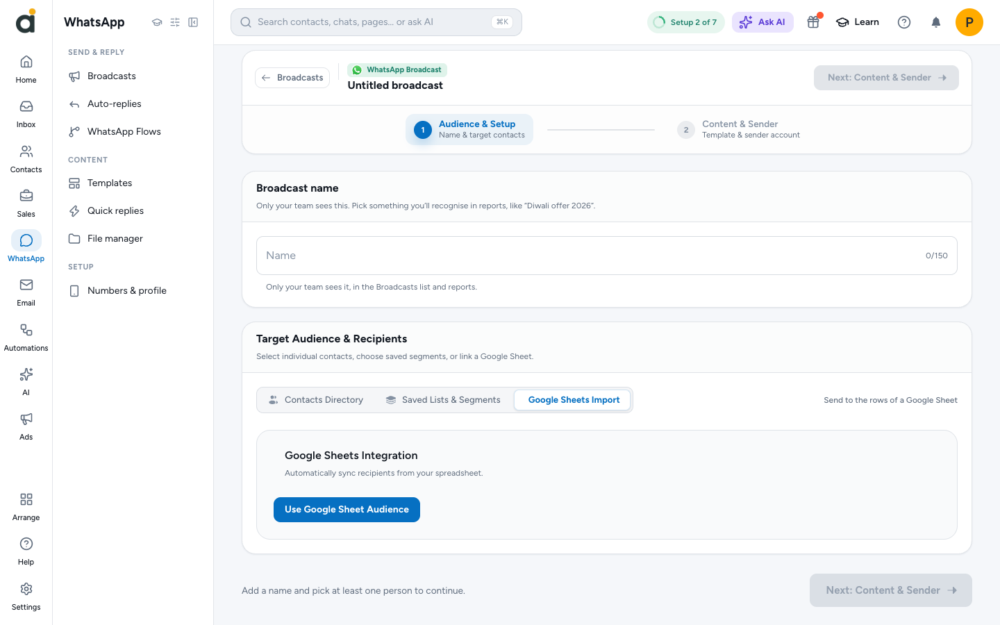
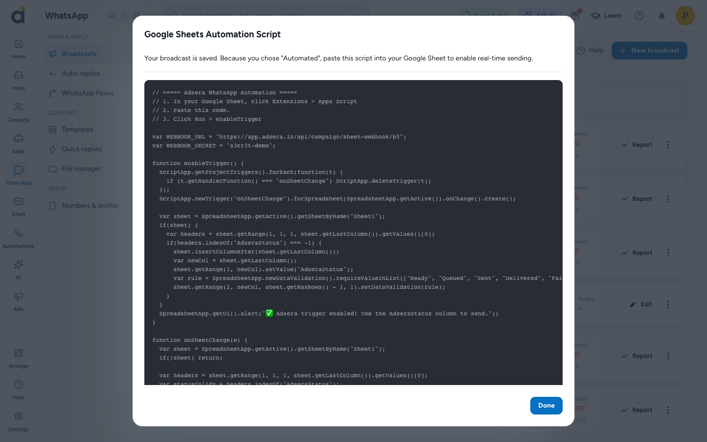

If your leads land in a Google Sheet (from a website form, IndiaMART or a partner), you can send them a WhatsApp template straight from the sheet.

**Where:** **WhatsApp → Broadcasts → New broadcast**, step 1, tab **Google Sheets Import**.

**Before you start:** connect your Google account in **Automations → Connections** and map the sheet’s columns (phone, name) there.

## Set it up

<Steps>
<Step title="Open Google Sheets Import">In step 1, click the **Google Sheets Import** tab, then **Use Google Sheet Audience**.</Step>
<Step title="Pick the sheet">Choose **Select Google Account**, **Select Spreadsheet** and **Select Tab**.</Step>
<Step title="Choose how it runs">
  - **Run on Existing Rows**: sends to the rows in the sheet now, once, when the broadcast starts.
  - **Automated**: also sends to new and changed rows as they arrive. You paste a small script into the sheet (below).
</Step>
<Step title="Filter rows (optional)">Click **Add Filter** to send only to rows where a column **Equals** (or **Not Equals**) a value, like Status equals New.</Step>
<Step title="Finish the broadcast">Click **Next: Content & Sender**, pick the template, fill its variables, and **Save broadcast**. See [Create a broadcast](/help/campaign/wa/create).</Step>
</Steps>

## Automated: paste the script

When you choose **Automated**, AdsEra shows **Google Sheets Automation Script** after you save. You can open it again any time from the broadcast’s **⋮ → View sheet script**.

1. In your Google Sheet, open **Extensions → Apps Script**.
2. Paste the script and save.
3. Allow it when Google asks.

New rows then get the template automatically.

<Warning>Keep the script private: it lets your sheet send messages from your number.</Warning>

## Related

<CardGroup cols={2}>
  <Card title="Create a broadcast" icon="bullhorn" href="/help/campaign/wa/create">The 2-step form.</Card>
  <Card title="Google Sheets" icon="table" href="/help/integrations/google-sheets">Connect Google Sheets.</Card>
</CardGroup>
