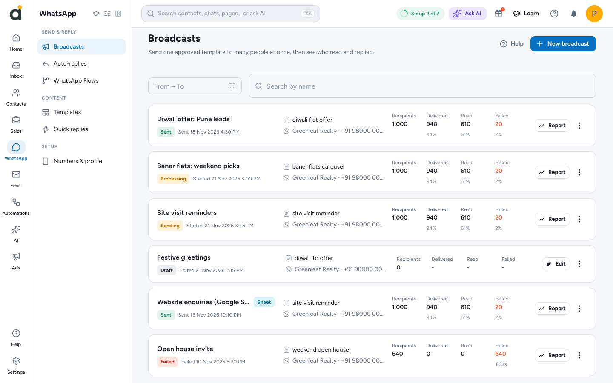
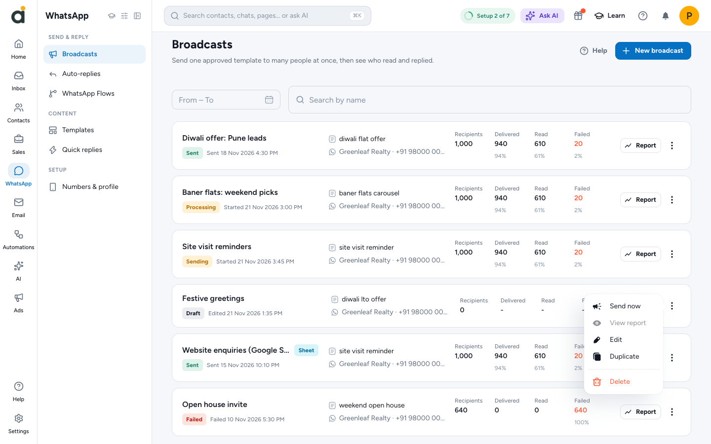
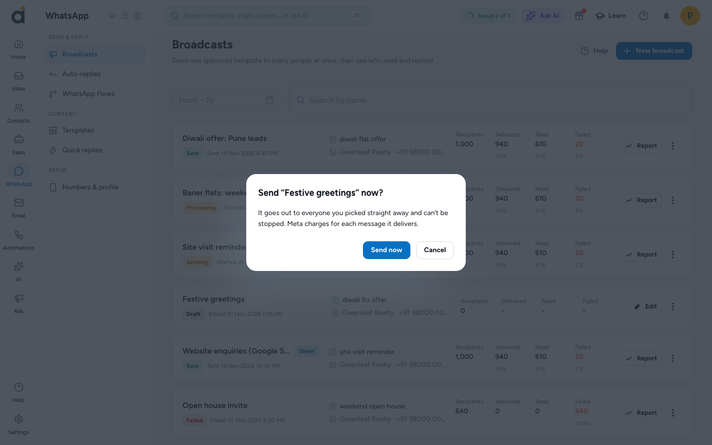
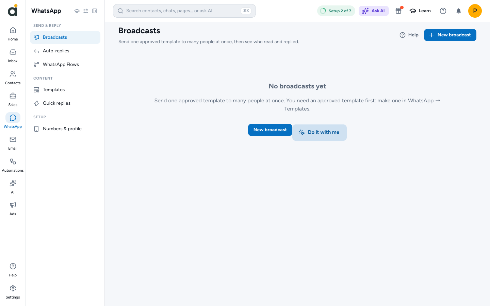

**Broadcasts** lists every broadcast you made, newest first, with its numbers.

**Where:** **WhatsApp → Broadcasts** (side menu, under **Send & reply**). [Open it →](https://app.adsera.in/dashboard/campaign/whatsapp/list)

Each row shows the name, the status and when it changed, the template and the number it went from, and **Recipients**, **Delivered**, **Read** and **Failed** (with the share of recipients). A Google Sheet broadcast has a **Sheet** label. Use the date range and **Search by name** at the top to find one.

## Statuses

| Status | What it means | What you can do |
| --- | --- | --- |
| **Draft** | Saved, not sent. | **Send now**, **Edit**, **Duplicate**, **Delete** |
| **Scheduled** | Waiting for its date and time; then it starts by itself. | **View report** (empty until it starts), **Duplicate** |
| **Processing** | Getting ready to send (checking the audience and limits). | Wait |
| **Sending** | Messages are going out. | **View report** to watch it |
| **Sent** | Finished. | **View report**, **Duplicate** |
| **Failed** | It couldn’t start, for example the template was paused or the plan ran out. | **Duplicate** and send again after fixing the cause |

## The row buttons and ⋮ menu

A draft has an **Edit** button; other broadcasts have **Report**. The **⋮** menu (More actions) has:

| Item | What it does |
| --- | --- |
| **Send now** | Drafts only. Asks you to confirm, then starts sending. It can’t be stopped once it starts. If the broadcast has a future scheduled time, it waits for that time instead. |
| **View report** | Opens the report. See [Broadcast reports](/help/campaign/wa/report). |
| **Edit** | Drafts only. Opens the 2-step form. Follow-up (retargeting) broadcasts can’t be edited. |
| **Duplicate** | Makes a copy with the same audience and template, to change and send again. |
| **View sheet script** | Google Sheet broadcasts set to **Automated** only. Shows the script to paste in your sheet. See [Send to a Google Sheet](/help/campaign/wa/google-sheet). |
| **Delete** | Drafts only. Deletes it for good. |

<Note>Meta charges for each message it delivers. The confirm window says how many people it goes to.</Note>

## No broadcasts yet

Click **New broadcast** to make your first one. See [Create a broadcast](/help/campaign/wa/create).

## FAQs

<AccordionGroup>
<Accordion title="I clicked Create Campaign but nothing was sent">
  It is a draft. Open **⋮ → Send now**.
</Accordion>
<Accordion title="How do I send the same broadcast again?">
  **⋮ → Duplicate**, then **Send now** on the copy.
</Accordion>
<Accordion title="Why is Edit greyed out?">
  Only drafts can be edited. Duplicate a sent or scheduled broadcast to change it.
</Accordion>
</AccordionGroup>

## Related

<CardGroup cols={2}>
  <Card title="Create a broadcast" icon="bullhorn" href="/help/campaign/wa/create">The 2-step form.</Card>
  <Card title="Broadcast reports" icon="chart-line" href="/help/campaign/wa/report">Who read and replied.</Card>
</CardGroup>
