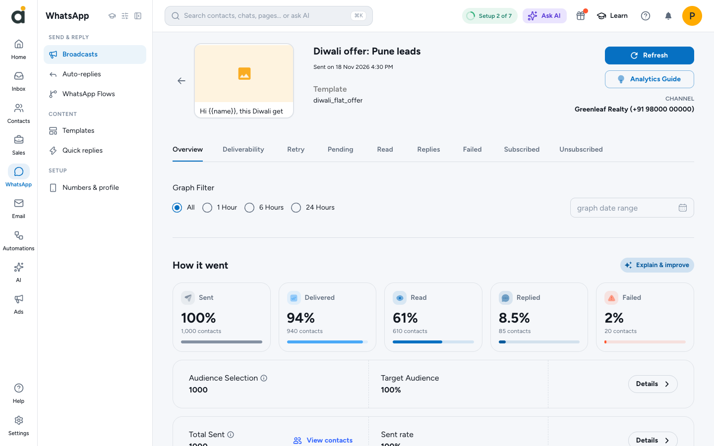
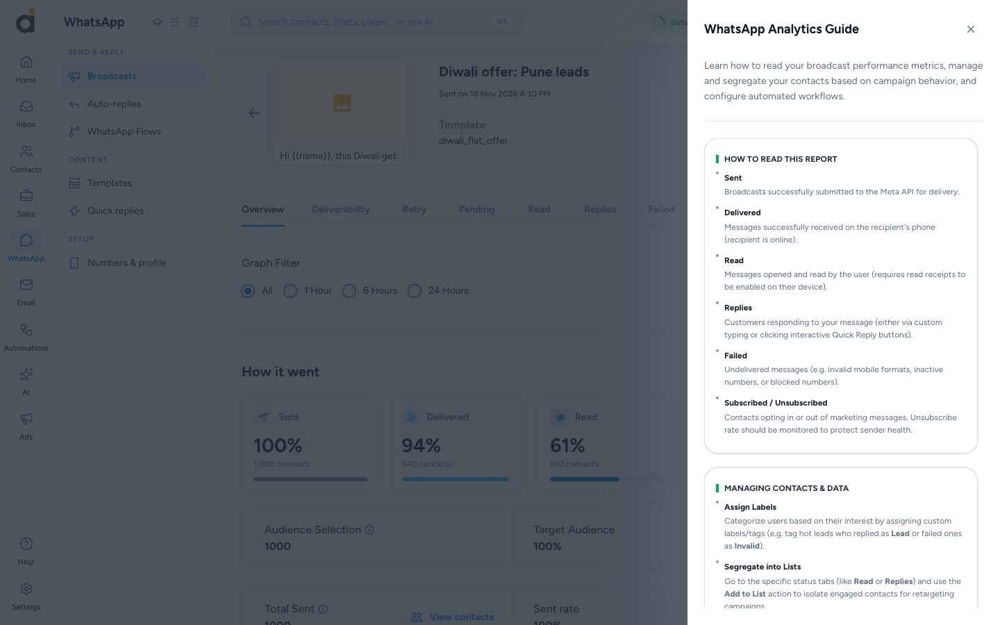
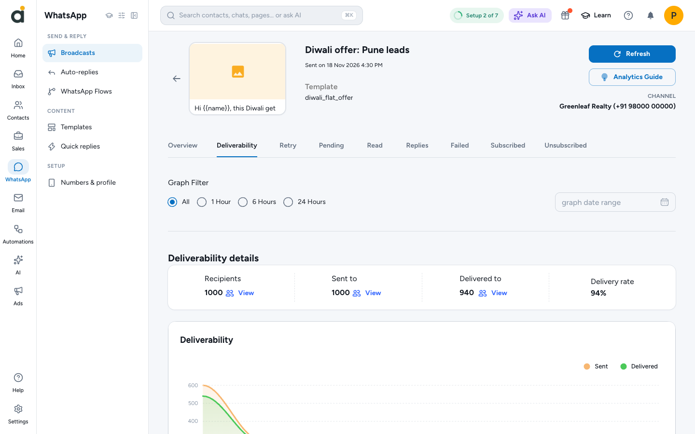
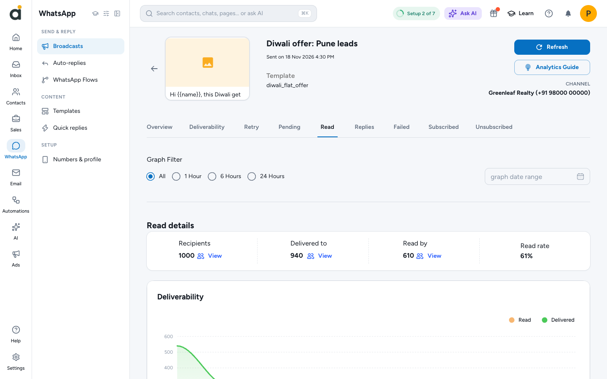
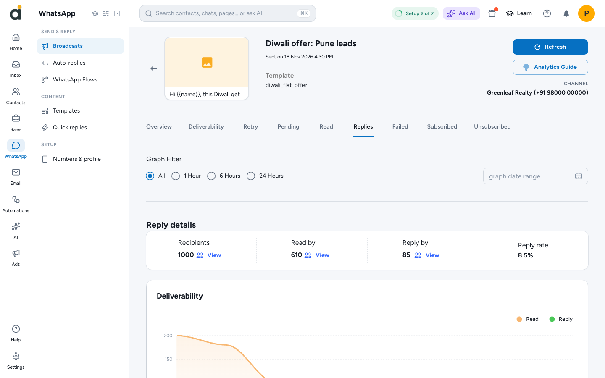
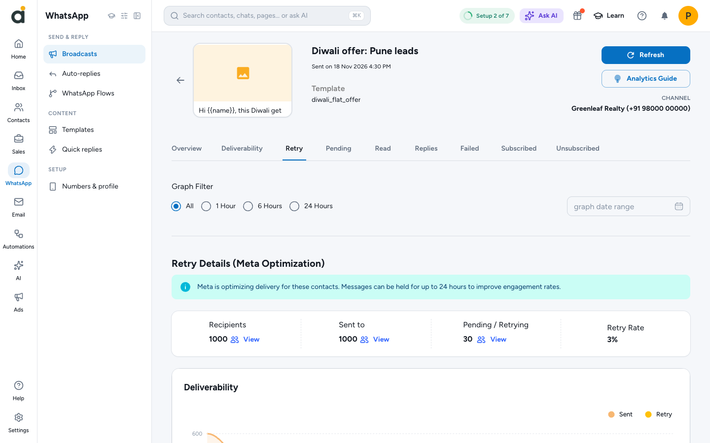
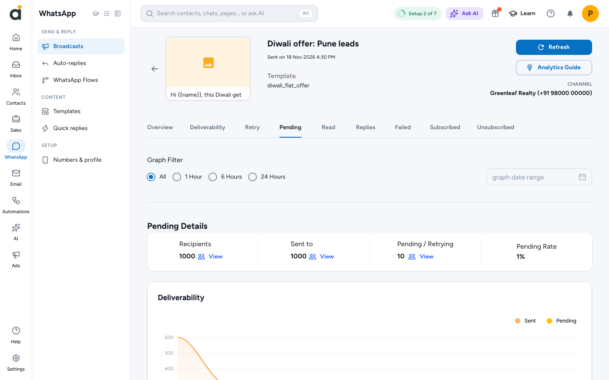
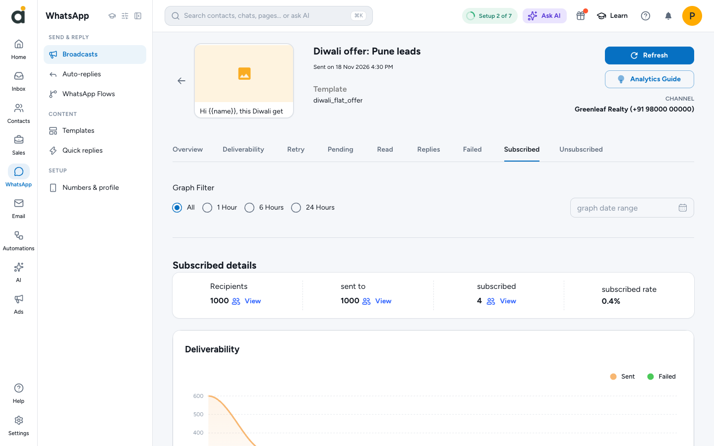
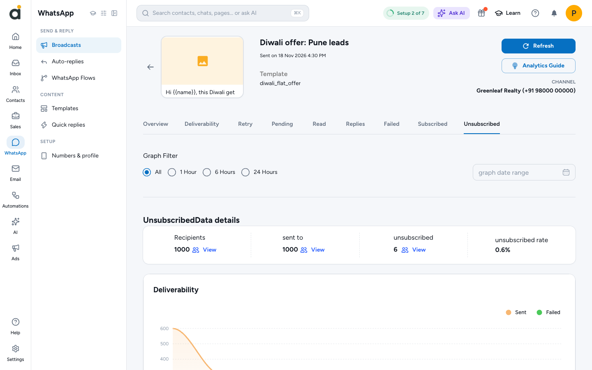
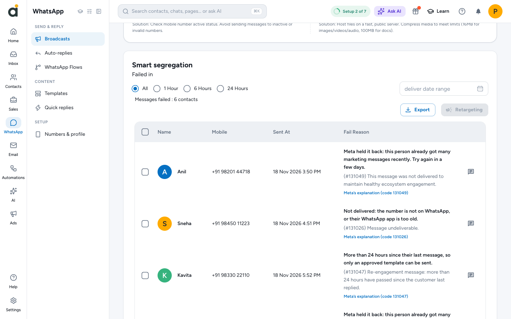

Every broadcast has a report: how it went overall, and person by person.

**Where:** **WhatsApp → Broadcasts** → **Report** on a broadcast (or **⋮ → View report**).

At the top: the broadcast name, its template and the number it went from. **Refresh** gets the latest numbers; **Analytics Guide** explains everything on the page.

## Overview tab

| Number | What it means |
| --- | --- |
| **Sent** | Handed to WhatsApp for delivery |
| **Delivered** | Reached the phone |
| **Read** | Opened. People who turned off read receipts aren’t counted. |
| **Replied** | Wrote back or tapped a quick reply button |
| **Failed** | Couldn’t be delivered (see the Failed tab for why) |

**Explain & improve** asks Ask AI what went well and what to change next time. **View contacts** lists the people behind a number. **Activity over time** shows when messages were delivered and read; filter it by **All**, **1 Hour**, **6 Hours**, **24 Hours** or a date range.

## The tabs

| Tab | Shows |
| --- | --- |
| **Overview** | The numbers above |
| **Deliverability** | Sent vs delivered, and who got it |
| **Retry** | Messages Meta is holding back for up to 24 hours and will try again (“Meta optimization”) |
| **Pending** | Not delivered yet, usually phones that are off |
| **Read** | Who read it |
| **Replies** | Who replied, and what (a typed text or the button they tapped) |
| **Failed** | Who didn’t get it, and why |
| **Subscribed** | People who sent your opt-in word (like START) after it |
| **Unsubscribed** | People who sent your opt-out word (like STOP) after it |

## Why did messages fail?

| Code | Plain words | What to do |
| --- | --- | --- |
| 131049 | Meta held it back: this person got many marketing messages recently | Normal. Try them again in a few days |
| 131026 | The number isn’t on WhatsApp, or their app is too old | Check the number; call or SMS them |
| 131047 | More than 24 hours since their last message | Use an approved template (broadcasts always do; this shows for chat messages) |
| 131050 | They stopped marketing messages from businesses | Don’t retry marketing to them |
| 131048 | Too many people blocked or reported you | Pause, improve your messages, send to people who opted in |
| 131056 | Too many messages to the same person quickly | Space out messages |
| 130429 | Your number hit Meta’s speed limit | It retries; send smaller batches |
| 131042 | A Meta payment problem | Fix your payment method in Meta Business Settings |
| 132001 / 132015 / 132016 | Template missing, paused or disabled | Use an approved template |

Each failed row also links to **Meta’s explanation** for its code.

## Follow up with a group (Retargeting)

<Steps>
<Step title="Open a tab">Open **Read** (or another tab).</Step>
<Step title="Pick the group">Under **Smart segregation**, choose **Has Read**, **Has not Read**, **Has Reply** or **Has not Reply**, or **Choose a Button…** to see who tapped a certain button.</Step>
<Step title="Tick people">Tick the people (or all of them).</Step>
<Step title="Retargeting">Click **Retargeting**. A window opens to pick a template for these people. It is saved as a draft: send it with **Send now** from Broadcasts.</Step>
</Steps>

**Export** downloads the people in the current tab and filter, to call them or use elsewhere.

## Broadcast audience page

**View contacts** opens everyone in the broadcast with their status. Use the time filters and **Customize column** to choose what you see, and click a person to open their contact.

## FAQs

<AccordionGroup>
<Accordion title="Why is Read lower than I expected?">
  People who turned off read receipts never show as read, even when they read it.
</Accordion>
<Accordion title="When are the numbers final?">
  Most deliveries happen in minutes. Retry can take up to 24 hours. Click **Refresh** to update.
</Accordion>
</AccordionGroup>

## Related

<CardGroup cols={2}>
  <Card title="Your broadcasts" icon="list" href="/help/campaign/wa/list">Statuses and actions.</Card>
  <Card title="Number health" icon="mobile" href="/help/channel/whatsapp/troubleshooting">When many messages fail.</Card>
</CardGroup>
