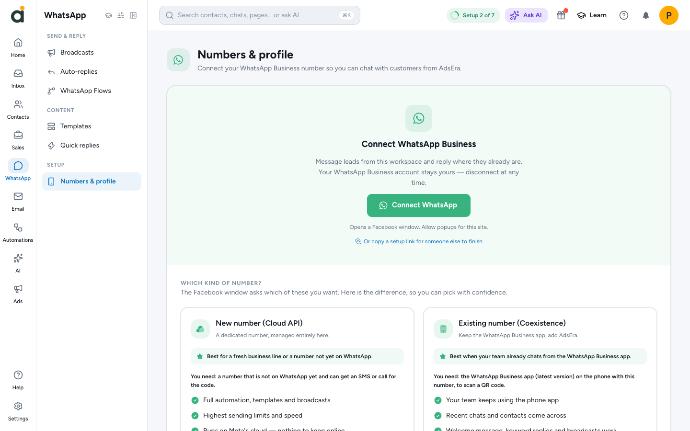
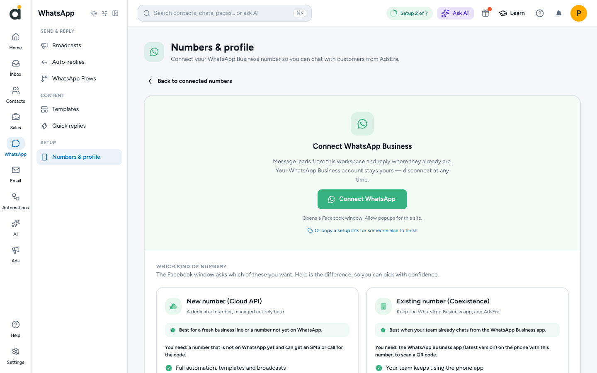
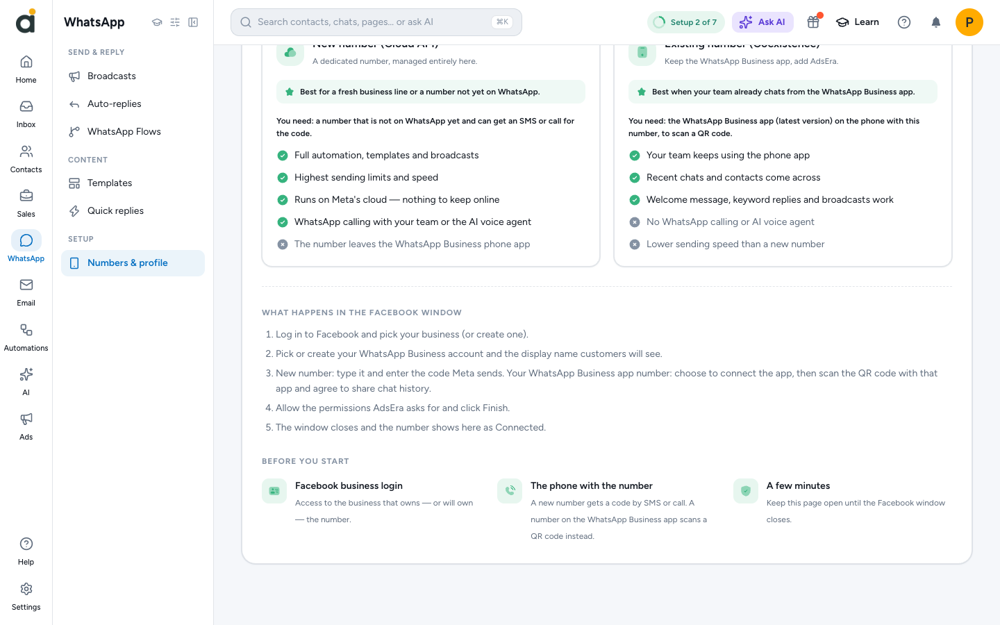
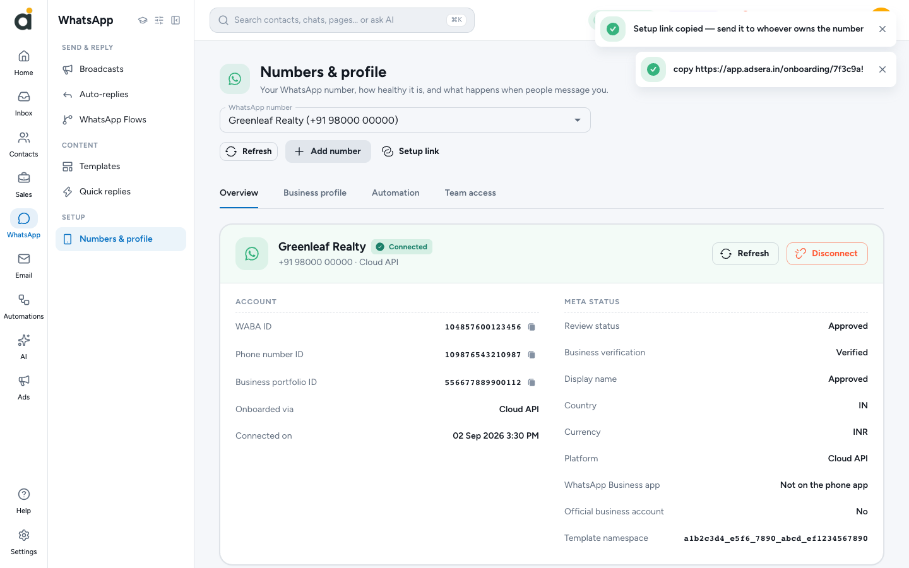
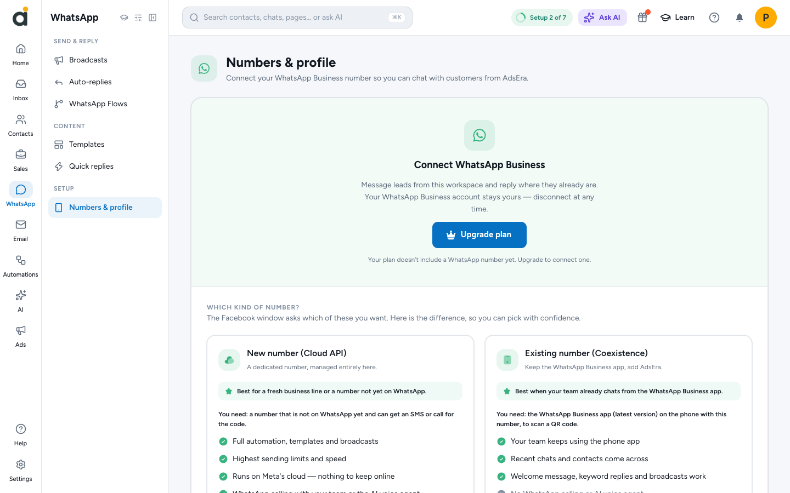

To chat, reply automatically and send broadcasts from AdsEra, connect your WhatsApp number first. It takes about 5 minutes and happens in a Facebook window that AdsEra opens for you.

You can connect two kinds of number:

- **A new number** that is not on WhatsApp yet.
- **The number you already use on the WhatsApp Business app.** You keep using the app on your phone, and AdsEra works alongside it. Meta calls this **Coexistence**.

**Where:** **WhatsApp → Numbers & profile** (in the side menu, under **Setup**). [Open it in AdsEra →](https://app.adsera.in/dashboard/channel/whatsapp)

<Note>Only workspace **admins** can connect a number. Team members see a message asking an admin to do it.</Note>

## Which kind of number should I pick?

| | **New number (Cloud API)** | **Existing number (Coexistence)** |
| --- | --- | --- |
| Pick it when | The number is not on WhatsApp yet, or you are happy to move it off the phone app | Your team already chats on the WhatsApp Business app with this number |
| What you need | The number can get an SMS or a call for a 6-digit code | The WhatsApp Business app (latest version) on the phone with this number, to scan a QR code |
| WhatsApp Business app on the phone | Stops working for this number | Keeps working. Chats show in the app and in AdsEra |
| Old chats and contacts | Start fresh | Recent chats and your app contacts come across |
| Welcome message, keyword replies, broadcasts, templates | ✓ | ✓ |
| Sending speed | Fastest (up to 80 messages a second, more on request) | Slower |
| WhatsApp calling and the AI voice agent | ✓ | ✗ Calls keep ringing in the phone app |
| Edit the business profile from AdsEra | ✓ | ✗ Edit it in the phone app |

<Tip>Most shops and agencies in India already use the WhatsApp Business app. Pick **Existing number (Coexistence)** so nothing changes for your team.</Tip>

## Before you start

- **A Facebook login** that can manage your business on Meta (or create the business during the steps).
- **The phone with the number**, next to you. A new number gets a code; an app number scans a QR code.
- **A few minutes**, and this page kept open until the Facebook window closes.
- **Pop-ups allowed** for app.adsera.in in your browser.

## Connect it

<Steps>
<Step title="Open Numbers & profile">
  Go to **WhatsApp → Numbers & profile**. If a number is already connected, click **Add number** at the top to connect another.

</Step>
<Step title="Click Connect WhatsApp">
  Click the green **Connect WhatsApp** button. A Facebook window opens.

  The card also explains, in **What happens in the Facebook window**, the steps below.

  
</Step>
<Step title="Log in and pick your business">
  Log in to Facebook and choose your business (Meta calls it a business portfolio). No business yet? Create one there: use your real business name.
</Step>
<Step title="Pick or create the WhatsApp Business account">
  Choose an existing WhatsApp Business account or create one, and type the **display name** customers will see, like *Greenleaf Realty*. Meta checks that the name matches your business.
</Step>
<Step title="Add the number">
  - **New number:** type the number, choose SMS or phone call, and type the 6-digit code Meta sends.
  - **Number on the WhatsApp Business app:** choose to connect your WhatsApp Business app. Meta shows a QR code. On your phone, the WhatsApp Business app asks you to scan it: scan it, and agree to share your chat history with AdsEra.
</Step>
<Step title="Allow and finish">
  Allow the permissions AdsEra asks for and click **Finish**. The window closes by itself.
</Step>
<Step title="Check it is Connected">
  Back in AdsEra, the number shows with the status **Connected**. On a number from the WhatsApp Business app, recent chats start coming in; this can take some minutes.
</Step>
</Steps>

## Let someone else connect it (Setup link)

If your agency, partner or the owner of the Facebook business should do the Facebook steps, send them a link instead.

1. On **Numbers & profile**, click **Setup link** (top right), or on the connect card click **Or copy a setup link for someone else to finish**.
2. AdsEra copies the link. Send it to them on WhatsApp or email.
3. They open it, log in with their Facebook and finish the steps above. The number then shows up in your account.

## How many numbers can I connect?

Your plan sets how many numbers you can connect. When all are in use, **Add number** is greyed out and the connect card shows **Upgrade plan** instead of **Connect WhatsApp**.

Click **Upgrade plan** to see plans, or disconnect a number you no longer use.

## What happens next

- Set a **welcome message** and **keyword replies**: [Auto-replies](/help/autoreply/wa).
- Check the number is healthy: [Numbers & profile](/help/channel/whatsapp/whatsapp).
- Get your first template approved: [Create a template](/help/template/create).

## Troubleshooting

| What you see | Why | What to do |
| --- | --- | --- |
| Nothing happens when you click **Connect WhatsApp** | The browser blocked the pop-up | Allow pop-ups for app.adsera.in (icon at the right of the address bar) and click again |
| Meta says the number is already registered on WhatsApp | You chose a new number, but it is on WhatsApp | Choose **connect your WhatsApp Business app** instead. For a personal WhatsApp number, delete that WhatsApp account first |
| The 6-digit code doesn’t arrive | SMS delays or a DND setting | Wait a minute, then choose **phone call** instead of SMS |
| The QR code expired | It is valid for a short time | Go back one step in the window to get a new code, keep the app open, and scan again |
| Meta rejects the display name | It doesn’t match your business | Use your real business or brand name, without words like “official” or extra symbols |
| The window closed but no number shows | The steps weren’t finished | Click **Refresh** at the top, or run **Connect WhatsApp** again |
| **Upgrade plan** instead of **Connect WhatsApp** | Your plan’s numbers are all in use | Upgrade, or disconnect a number you don’t use |

<AccordionGroup>
<Accordion title="Will my chats on the WhatsApp Business app be deleted?">
  No. With **Existing number (Coexistence)** you keep the app and your chats. Recent chats are also copied into AdsEra.
</Accordion>
<Accordion title="Can I move from Coexistence to a new (Cloud API) number later?">
  Yes, but it means taking the number off the phone app. Disconnect it here, delete it from the WhatsApp Business app, then connect it again as a new number.
</Accordion>
<Accordion title="Do I need Meta business verification?">
  Not to start. Without it you can message a limited number of new people a day. Verify your business in Meta Business Settings to raise that limit.
</Accordion>
<Accordion title="Who pays for messages?">
  Meta charges for some messages (for example marketing templates) to the payment method in your Meta account. Add one in Meta Business Settings → Billing.
</Accordion>
</AccordionGroup>

## Related

<CardGroup cols={2}>
  <Card title="Numbers & profile" icon="mobile" href="/help/channel/whatsapp/whatsapp">Status, health, profile, automation and team access.</Card>
  <Card title="My number can’t send" icon="triangle-exclamation" href="/help/channel/whatsapp/troubleshooting">Every warning and its fix.</Card>
  <Card title="Auto-replies" icon="reply" href="/help/autoreply/wa">Welcome message and keyword replies.</Card>
  <Card title="Templates" icon="file-lines" href="/help/template/wa">Get messages approved by Meta.</Card>
</CardGroup>
