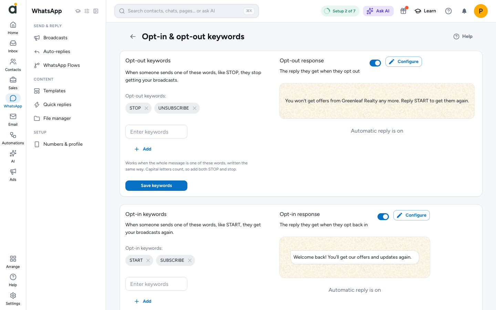
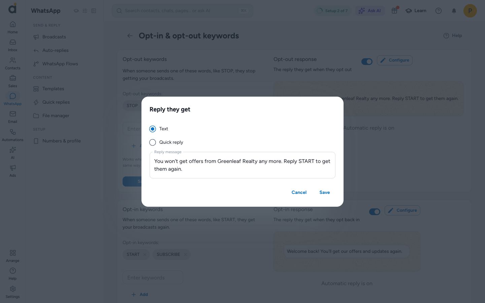
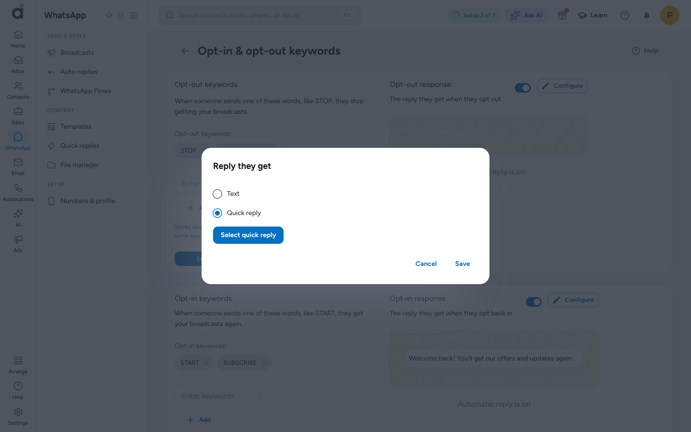

When someone sends **STOP** (or any word you choose), AdsEra marks them as opted out of WhatsApp messages and your broadcasts skip them. When they send **START**, they are back in. Each time, they can get an automatic reply.

Keeping this on protects your number: people who can’t stop your messages tend to block or report you, and that lowers your quality and daily limit.

**Where:** **WhatsApp → Numbers & profile → Automation**, card **Opt-in & opt-out keywords**, button **Manage**. [Open it →](https://app.adsera.in/dashboard/whatsapp/opt-settings)

<Info>These words work on **all** your WhatsApp numbers.</Info>

## Set the opt-out words

<Steps>
<Step title="Add the words">
  In **Enter keywords**, type a word like **STOP** and click **Add** (or press Enter). It shows as a chip. Click × on a chip to remove it.
</Step>
<Step title="Add every way people write it">
  The word must be the whole message, written the same way. Capital letters count, so add **STOP** and **stop**, and the words your customers use, like **UNSUBSCRIBE** or **band karo**.
</Step>
<Step title="Choose the reply">
  The switch next to **Opt-out response** turns the automatic reply on or off. Click **Configure** to write it.

  

  - **Text**: type the reply in **Reply message**, like “You won’t get offers from Greenleaf Realty any more. Reply START to get them again.”
  - **Quick reply**: click **Select quick reply** and pick one you saved.

  

  Click **Save** to close the window.
</Step>
<Step title="Save">
  Click **Save keywords**.
</Step>
</Steps>

## Set the opt-in words

The **Opt-in keywords** card works the same way: add words like **START** and **start**, configure the reply (“Welcome back! You’ll get our offers again.”) and click **Save keywords**.

## What happens after someone opts out

- Their contact is marked as not subscribed to WhatsApp.
- **Broadcasts skip them** from then on.
- You can still reply to them in the inbox when they message you.
- If they opted out by replying to a broadcast, the broadcast’s report counts them under **Unsubscribed**.
- Meta’s own **Stop promotions** button (on some marketing messages) opts them out too.

## Fields

| Field | What it does | Example |
| --- | --- | --- |
| Opt-out keywords | Words that opt someone out | STOP, stop, UNSUBSCRIBE |
| Opt-out response (switch) | Send a reply when someone opts out | On |
| Configure → Text / Quick reply | What the reply says | “You won’t get offers from us any more.” |
| Opt-in keywords | Words that opt someone back in | START, start |
| Opt-in response | Reply when someone opts in | “Welcome back!” |

## FAQs

<AccordionGroup>
<Accordion title="Someone wrote “please stop sending” but was not opted out">
  The whole message must be one of your words. Add common phrases as keywords, or opt them out yourself from their contact.
</Accordion>
<Accordion title="Can I send a Pay Now quick reply as the response?">
  No. A Pay Now message needs an order, so it is skipped here. Use a text reply.
</Accordion>
</AccordionGroup>

## Related

<CardGroup cols={2}>
  <Card title="Numbers & profile" icon="mobile" href="/help/channel/whatsapp/whatsapp">The Automation tab.</Card>
  <Card title="Broadcast reports" icon="chart-line" href="/help/campaign/wa/report">Subscribed and Unsubscribed tabs.</Card>
</CardGroup>
