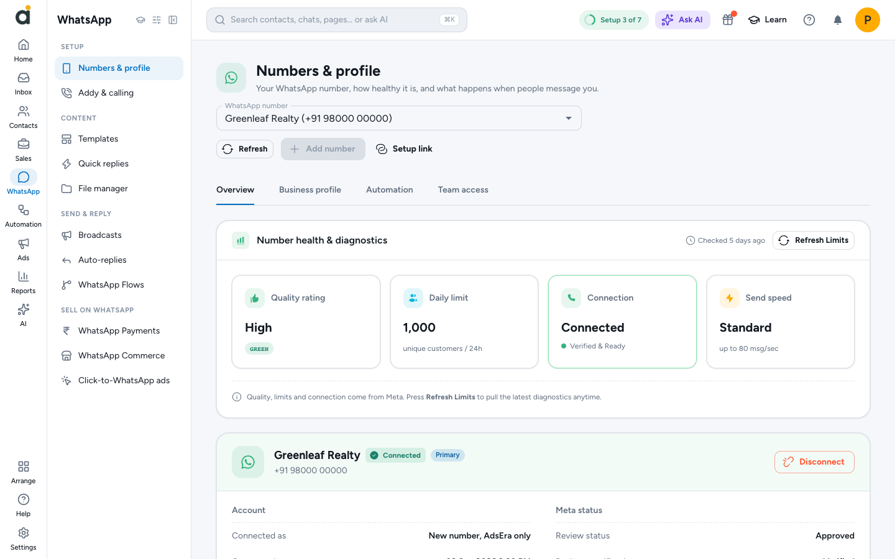
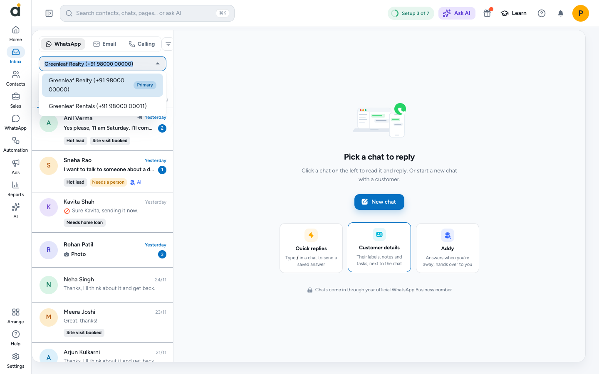

With more than one WhatsApp number, pick one as your **primary number**. It's the number AdsEra starts on wherever you pick a number: the chat inbox, a new broadcast, the templates list, a contact's chat, a workflow's WhatsApp step, workflow templates and Addy. After a refresh it's still selected. Anyone can still switch to another number there.

**Where:** **WhatsApp → Numbers & profile** (admins). [Open it →](https://app.adsera.in/dashboard/channel/whatsapp)

## Make a number primary

<Steps>
<Step title="Open WhatsApp → Numbers & profile">The page opens on your primary number.</Step>
<Step title="Pick the number">In **WhatsApp number** at the top, pick the number you want.</Step>
<Step title="Click Make primary">
Next to **Refresh** and **Disconnect** on the number's card.

</Step>
</Steps>

**What happens next:** you see "This is now your primary number" and a **Primary** chip shows next to it. The number that was primary before isn't any more: there is only one.

## Where you see it

Every number picker lists the primary number with a **Primary** chip and starts on it.

| Place | What it does |
| --- | --- |
| Inbox → WhatsApp chats | Opens on the primary number |
| WhatsApp → Broadcasts → new broadcast | Starts on it |
| WhatsApp → Templates | Opens on its templates |
| A contact's WhatsApp chat | Starts on it |
| A workflow's WhatsApp steps, Workflow templates | Start on it |
| Sales → Setup → Lead handover | Marks it **Primary** |

Picking another number in one of these places only changes that place, that time. The chat inbox remembers your pick in the address, so a refresh keeps the number you were looking at.

## Questions

<AccordionGroup>
<Accordion title="I have one number. Do I need this?">No: one number is used everywhere.</Accordion>
<Accordion title="Can a team member change it?">No, only admins. Team members see the chip and start on it, if the number is one of theirs.</Accordion>
<Accordion title="What if I disconnect the primary number?">It stays marked **Primary** while it is disconnected, so pick another number as primary.</Accordion>
</AccordionGroup>

## Related

<CardGroup cols={2}>
<Card title="Numbers & profile" href="/help/channel/whatsapp/whatsapp">Your numbers and their health.</Card>
<Card title="Connect a number" href="/help/channel/whatsapp/connect">Add another number.</Card>
</CardGroup>
