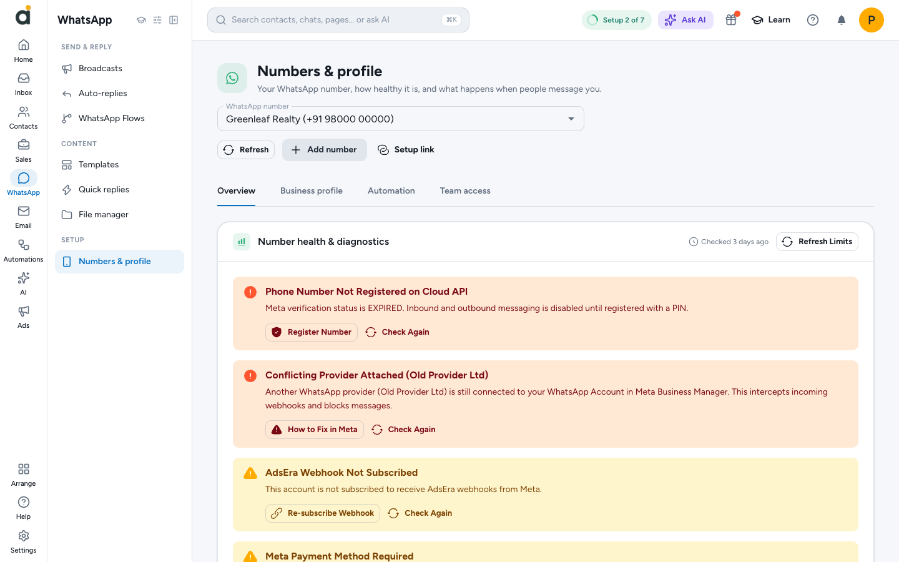
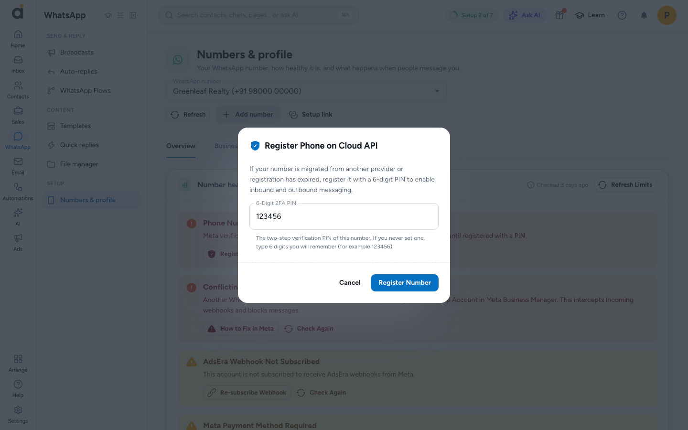
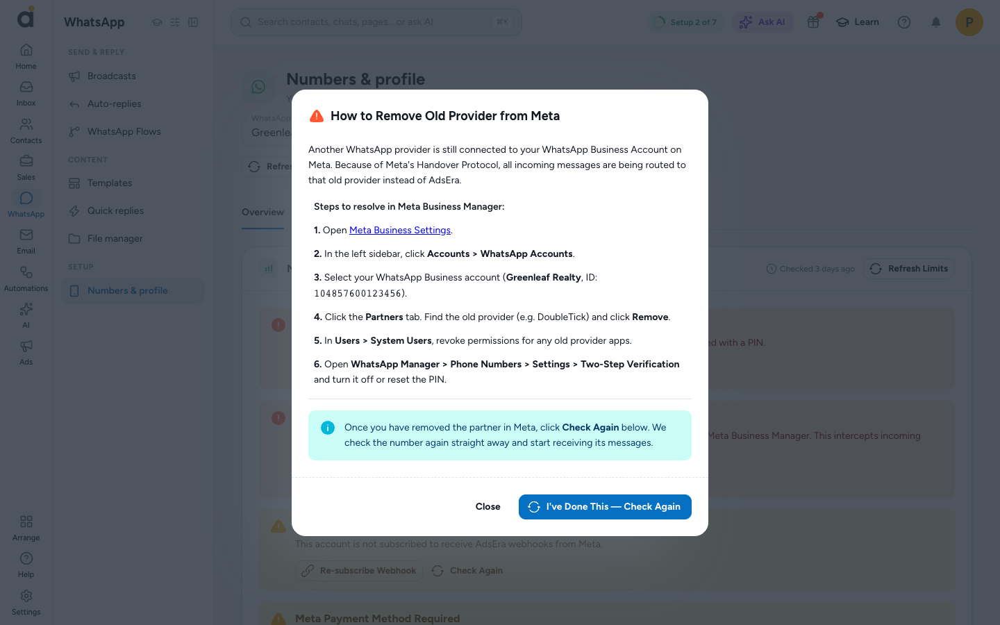

When something stops your WhatsApp number from sending or receiving, AdsEra shows a red or yellow box at the top of **Number health & diagnostics**. Each box says what is wrong and has a button that fixes it, or tells you exactly where to fix it in Meta.

**Where:** **WhatsApp → Numbers & profile → Overview**, card **Number health & diagnostics**. [Open it →](https://app.adsera.in/dashboard/channel/whatsapp)

## The warnings and their fixes

| Warning (as shown) | What it means in plain words | Fix button | What to do |
| --- | --- | --- | --- |
| **Phone Number Not Registered on Cloud API** | The number moved from another provider, or its registration ran out. It can’t send or receive. | **Register Number** | Type the number’s 6-digit two-step PIN and click **Register Number**. Never set a PIN? Type 6 digits you will remember (for example 123456): it becomes the PIN. |
| **Conflicting Provider Attached (name)** | Your old WhatsApp provider is still connected to your account in Meta, so incoming messages go to them, not AdsEra. | **How to Fix in Meta** | Follow the steps in the window (below), then click **I’ve Done This — Check Again**. |
| **AdsEra Webhook Not Subscribed** | Meta is not passing your number’s messages to AdsEra. New chats don’t arrive. | **Re-subscribe Webhook** | Click it. New messages start arriving in a minute. |
| **Meta Payment Method Required** | Meta needs a card on file before it delivers marketing messages. | **Open Meta Billing** | Add a payment method in Meta Business Settings → Billing, then come back. |

Every box also has **Check Again**: it asks Meta for the latest state. The box disappears when Meta agrees the problem is fixed.

<Note>Numbers connected as **Existing number (keep the phone app)** never show the registration warning: the WhatsApp Business app on your phone keeps them registered.</Note>

## Register the number (6-digit PIN)

<Steps>
<Step title="Click Register Number">
  On the **Phone Number Not Registered** box, click **Register Number**.
</Step>
<Step title="Type the PIN">
  Type the number’s two-step verification PIN in **6-Digit 2FA PIN**. If the number never had one, choose 6 digits and write them down.

  
</Step>
<Step title="Register">
  Click **Register Number**. You see “Phone number registered” and the warning goes away.
</Step>
</Steps>

Forgot the PIN? Reset it in Meta: **WhatsApp Manager → Phone numbers → Settings → Two-step verification**, then register again.

## Remove an old provider in Meta

<Steps>
<Step title="Open Meta Business Settings">business.facebook.com/settings (link in the window).</Step>
<Step title="Open your WhatsApp account">**Accounts → WhatsApp Accounts**, then pick your account (its name and ID are shown in the window).</Step>
<Step title="Remove the old partner">Open the **Partners** tab, find the old provider and click **Remove**.</Step>
<Step title="Revoke old apps">In **Users → System users**, remove permissions for the old provider’s apps.</Step>
<Step title="Reset the PIN">In **WhatsApp Manager → Phone numbers → Settings → Two-step verification**, turn it off or reset it.</Step>
<Step title="Check again">Back in AdsEra, click **I’ve Done This — Check Again**.</Step>
</Steps>

## Other problems

| What you see | Why | What to do |
| --- | --- | --- |
| Status **Pending** for a long time | Meta is still setting the number up | Click **Refresh** after 10 minutes. Still pending after a day? Check WhatsApp Manager in Meta for a message. |
| Quality **Low**, status **Flagged** | Many people blocked or reported your messages | Pause broadcasts for a few days, send only to people who opted in, keep STOP on, make messages clearly useful. |
| Daily limit is low (250) | New or unverified business | Verify your business in Meta and keep quality high; Meta raises the limit on its own. |
| Broadcast messages fail with 131049 | Meta held back marketing to people who got many marketing messages recently | Not a problem with your number. Try those people again in a few days. See [Broadcast reports](/help/campaign/wa/report). |
| Chats don’t come in on a Coexistence number | The phone app was logged out or the link expired | Open the WhatsApp Business app on the phone; if it asks, link again. Then **Refresh**. |

## FAQs

<AccordionGroup>
<Accordion title="Does Register Number change anything on my phone?">
  Only for new (Cloud API) numbers, which don’t use the phone app anyway. The PIN you type becomes the number’s two-step PIN at Meta.
</Accordion>
<Accordion title="I clicked Check Again but the box is still there">
  Meta can take a few minutes to update. Wait, then click **Refresh Limits**. If it stays for an hour, contact support with your WhatsApp Business account ID (on the number’s card, open **IDs for Meta support or your developer** and copy it).
</Accordion>
</AccordionGroup>

## Related

<CardGroup cols={2}>
  <Card title="Numbers & profile" icon="mobile" href="/help/channel/whatsapp/whatsapp">Statuses, health tiles and settings.</Card>
  <Card title="Connect your number" icon="link" href="/help/channel/whatsapp/connect">New number or the WhatsApp Business app.</Card>
</CardGroup>
