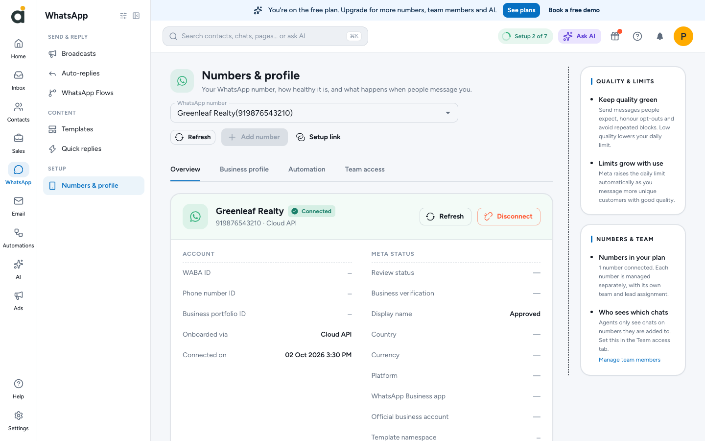
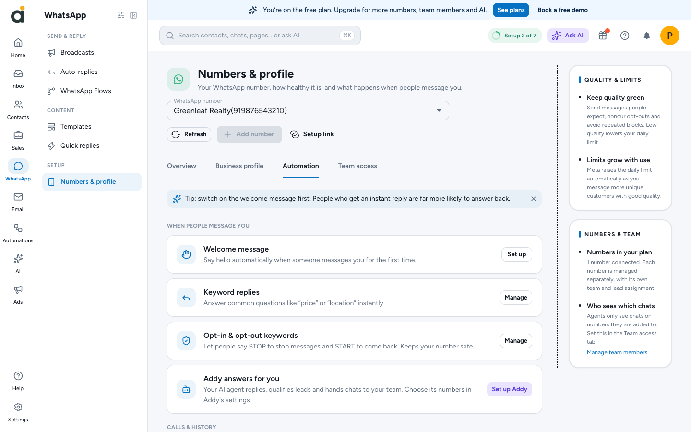

**WhatsApp → Numbers & profile** is where you manage your WhatsApp numbers: how healthy each one is, its public profile, what happens when people message it, and who on your team can see its chats.

**[Open Numbers & profile in AdsEra →](https://app.adsera.in/dashboard/channel/whatsapp)**

At the top, pick the **WhatsApp number** you want to look at. **Refresh** pulls the latest status from Meta, **Add number** connects another one (see [Connecting WhatsApp](/help/channel/whatsapp/connect)), and **Setup link** gives you a link to send to whoever owns the number, so they can connect it for you.

The page has four tabs.

## Overview

The number's connection, its **quality rating** and **daily messaging limit**, and business verification. Keep the quality rating green: send messages people expect and honour opt-outs. Meta raises your daily limit as you message more people with good quality.

## Business profile

What customers see when they open your profile on WhatsApp: picture, about text, address, email and website. Keep it up to date.

## Automation

What happens on this number when people message or call it. Each setting is a card with its button on the right.

| Setting | What it does |
| --- | --- |
| **Welcome message** | Says hello automatically when someone messages you for the first time. See [Auto-replies and welcome messages](/help/autoreply/wa). |
| **Keyword replies** | Instant answers to common questions like "price" or "location". |
| **Opt-in & opt-out keywords** | The words that subscribe or unsubscribe people, and the replies they get. See [Opt-in settings](/help/channel/whatsapp/opt). |
| **Addy answers for you** | Whether [Addy](/help/ai/addy) replies on this number. Choose its numbers in Addy's settings. |
| **Who answers calls** | **Team**, **AI** or **API**. See [WhatsApp calling](/help/channel/whatsapp/calling). Not available on Coexistence numbers. |
| **Sync contacts from the phone app** | Coexistence only: keep contacts saved in the WhatsApp Business app in sync with AdsEra. |
| **Chat history** | Coexistence only: import recent chats from the WhatsApp Business app (one-time). Keep the app open while it syncs. |

## Team access

Admins only. Choose which team members can see and answer chats on this number. Team members only see chats on numbers they are added to.

---

## Pro Tips

<CardGroup>
  <Card title="Monitor Your Quality Rating" icon="shield-halved">
    Regularly check your WhatsApp Rating. A `GREEN` (High Quality) rating ensures the best deliverability. If your rating drops to yellow or red, it's a sign to review your messaging strategy to avoid being blocked by Meta.
  </Card>
  <Card title="Keep Your Profile Current" icon="info-circle">
    Your WhatsApp profile is often a direct point of contact for customers. Ensure your "About" text, website, and contact details are always up-to-date to provide a professional and trustworthy experience.
  </Card>
</CardGroup>