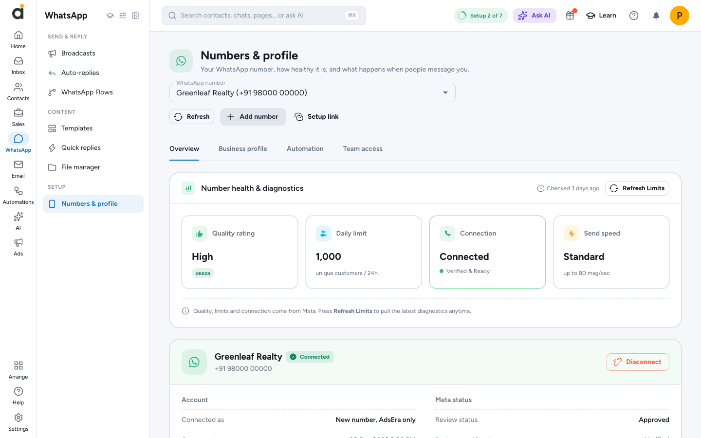
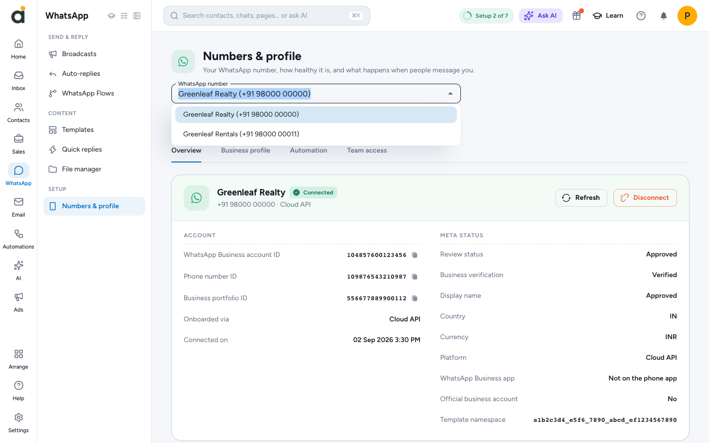
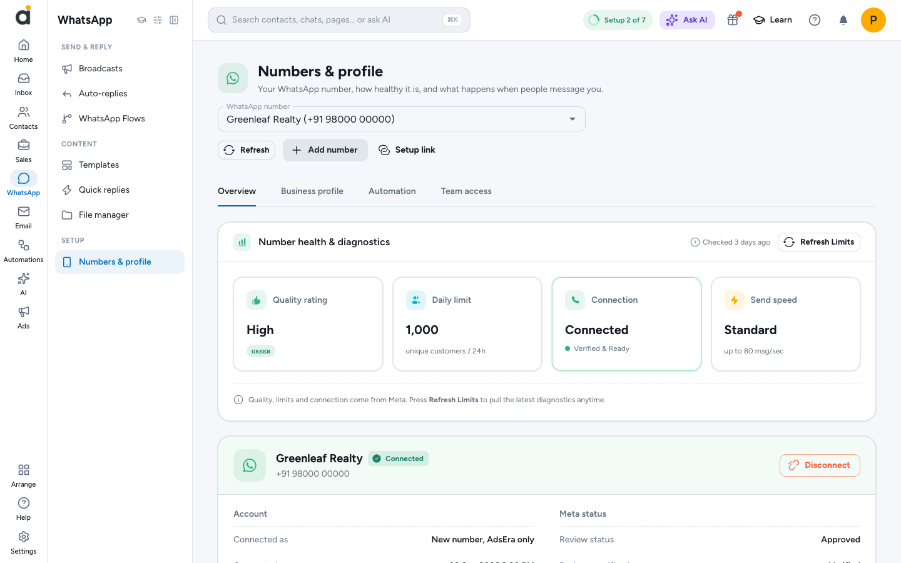
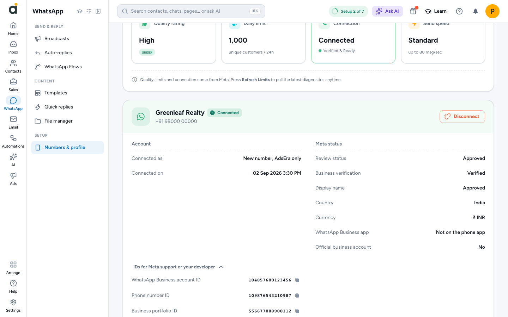
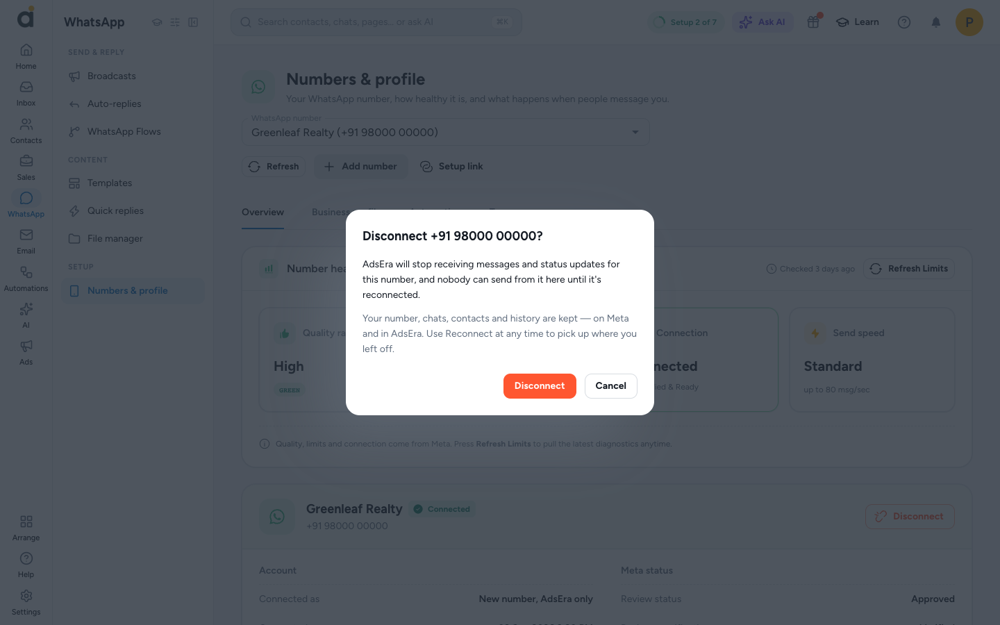
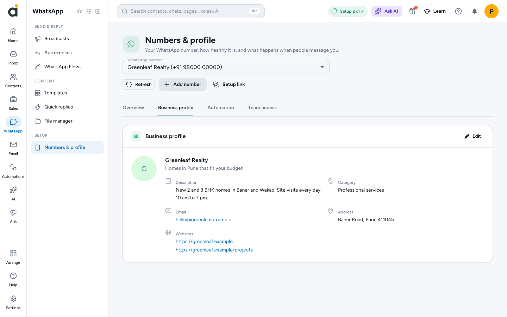
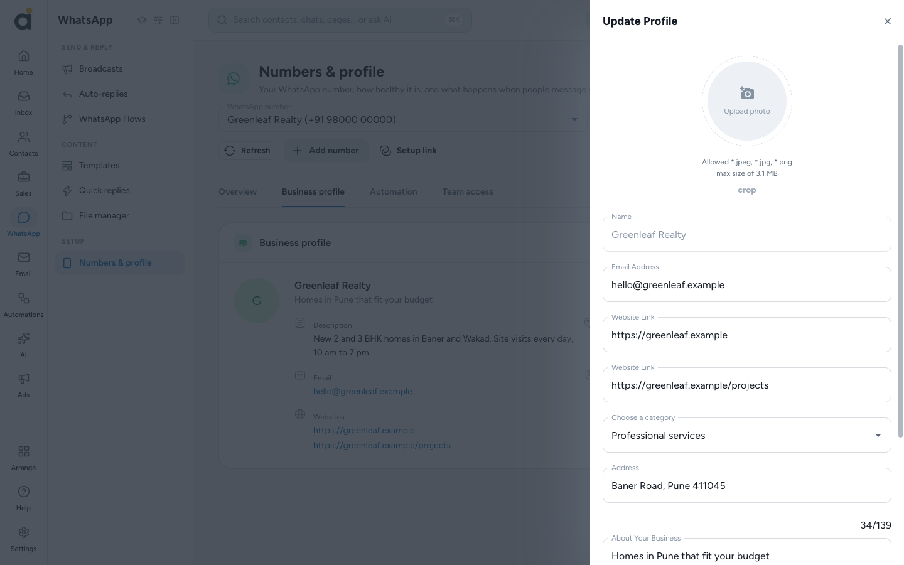
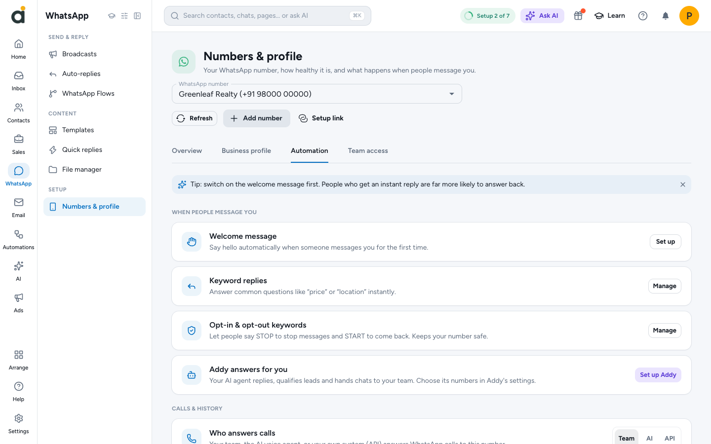
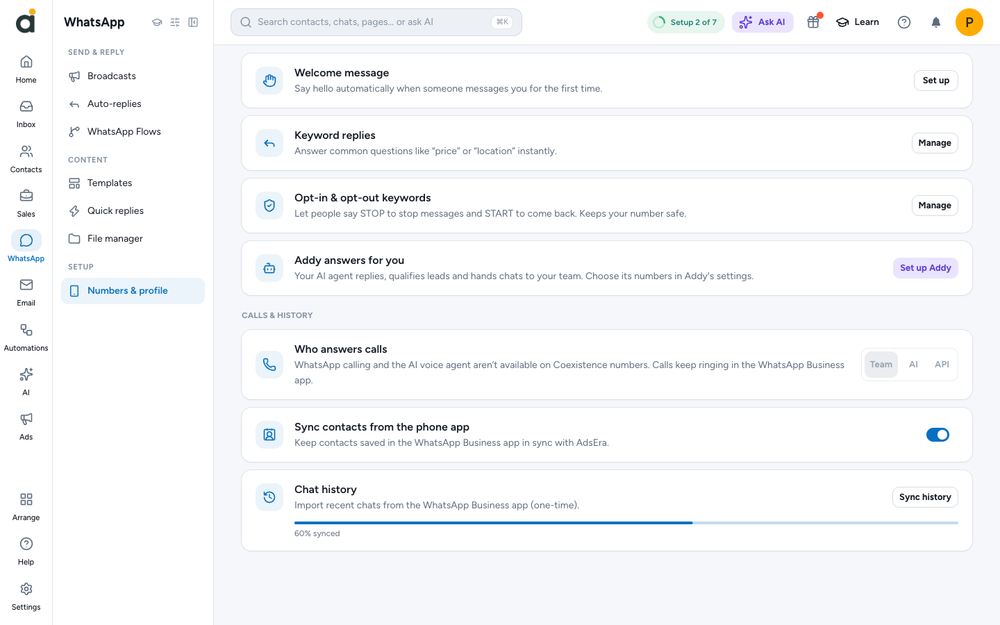
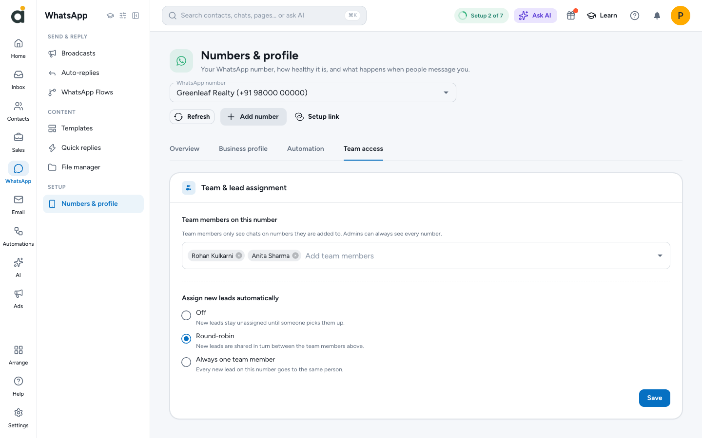

**Numbers & profile** is the home of your WhatsApp numbers. Use it to check a number can send, fix it when it can’t, edit the business profile customers see, set what happens when people message or call, and choose which team members work on it.

**Where:** **WhatsApp → Numbers & profile** (side menu, under **Setup**). [Open it →](https://app.adsera.in/dashboard/channel/whatsapp)

No number yet? See [Connect your WhatsApp number](/help/channel/whatsapp/connect).

## The top of the page

| Control | What it does |
| --- | --- |
| **WhatsApp number** | Picks the number you are looking at. Every tab below shows that number. |
| **Refresh** | Pulls the latest status, quality and daily limit from Meta. |
| **Add number** (admins) | Opens the connect card to connect another number. Greyed out when your plan’s numbers are all in use. |
| **Setup link** (admins) | Copies a link someone else can open to connect a number for you. |

## Overview tab

The Overview starts with what matters most, **Number health & diagnostics** (can it send, how many people a day, how fast), and then the number's card.

### Number health & diagnostics

| Tile | What it means |
| --- | --- |
| **Quality rating** | **High**, **Medium** or **Low**, from how people react to your messages (blocks and reports lower it). |
| **Daily limit** | How many different people you can start conversations with in 24 hours, like 250, 1,000, 2,000, 10,000, 100,000 or Unlimited. Replies to people who wrote to you don’t count. Meta raises it on its own as you send good messages. |
| **Connection** | The status below, and whether the number is verified. |
| **Send speed** | **Standard** (up to 80 messages a second) or **High** (up to 1,000). |

Click **Refresh Limits** to check again after changing something in Meta.

When something blocks messages, a red or yellow box appears here with the fix button. See [My number can’t send: fixes](/help/channel/whatsapp/troubleshooting).

### The number’s card

Shows the display name, the phone number and its status.

| Field | What it means |
| --- | --- |
| Connected as | **New number, AdsEra only** or **Also on the WhatsApp Business app** (you kept the app on your phone). |
| Connected on / Disconnected on | When it was connected or disconnected in AdsEra. |
| Review status, Business verification, Display name | Meta’s checks on your account, business and name. |
| Country, Currency | Set by Meta, like **India** and **₹ INR**. |
| WhatsApp Business app | “Also active on the phone” for numbers that stay on the app. |
| Official business account | Whether Meta gave you the official badge. |

**IDs for Meta support or your developer** (click to open) holds the WhatsApp Business account ID, Phone number ID, Business portfolio ID, Platform and Template namespace. Meta support may ask for the WhatsApp Business account ID: click its copy icon.

### Statuses

| Status | What it means | What to do |
| --- | --- | --- |
| **Connected** | Live: it can send and receive. | Nothing. |
| **Pending** | Meta is still setting it up. | Wait a few minutes and click **Refresh**. |
| **Unverified** | The number still needs verification in Meta. | Finish verification in Meta, or use **Register Number** below. |
| **Flagged** | Quality is low; sending may be limited soon. | Send fewer, more wanted messages; honour STOP. |
| **Rate limited** | Meta is slowing your sends for a while. | Wait and try again later. |
| **Restricted** | Meta stopped this number from starting new conversations for a while. | Check Meta Business Support; reply only to people who message you. |
| **Banned** | Meta banned the number. | Contact Meta support through Meta Business Settings. |
| **Deleted** | The number was deleted in Meta. | Connect it again. |
| **Migrated** | The number moved to another account. | Connect it in the account that now has it. |
| **Disconnected** | You disconnected it in AdsEra. | Click **Reconnect**. |

### Disconnect or reconnect (admins)

**Disconnect** stops AdsEra sending and receiving on this number. Your number, chats, contacts and history are kept, in AdsEra and at Meta. A disconnected number shows **Reconnect**, which opens the Facebook window again.

## Business profile tab

What customers see when they tap your name in WhatsApp: photo, about line, description, category, email, address and websites.

Admins can click **Edit** on a new (Cloud API) number. For a number on the WhatsApp Business app, edit the profile in the app instead (there is no **Edit** button).

| Field | What to put | Limit |
| --- | --- | --- |
| Photo | Your logo, square. Click it to upload and crop. | JPG or PNG |
| Name | Shown, not editable here: change it in Meta’s WhatsApp Manager (Meta checks it again). | — |
| Email Address | Where customers can email you. | — |
| Website Link (×2) | Your website and, say, a projects page. | 2 links |
| Choose a category | The kind of business, like Professional services or Education. | — |
| Address | Your office or shop address. | — |
| About Your Business | One short line under your name. | 139 characters |
| Description of Your Business | What you sell and where. | 512 characters |

Click **Save Changes**. WhatsApp shows the new profile within a few minutes.

## Automation tab

Everything that happens by itself on this number, one card each.

| Card | What it does | Button |
| --- | --- | --- |
| **Welcome message** | Says hello to anyone who messages you for the first time. | **Set up** → [Auto-replies](/help/autoreply/wa) |
| **Keyword replies** | Answers words like “price” or “location”. | **Manage** → Auto-replies |
| **Opt-in & opt-out keywords** | Lets people send STOP to stop messages and START to come back. | **Manage** → [Opt-in & opt-out keywords](/help/channel/whatsapp/opt) |
| **Addy answers for you** | Your AI agent replies, qualifies leads and hands chats to your team. | **Set up Addy** → [Addy](/help/ai/addy) |
| **Who answers calls** | **Team**, **AI** (voice agent) or **API** (your own system). Not on Coexistence numbers. | Toggle. See [WhatsApp calling](/help/channel/whatsapp/calling) |
| **Sync contacts from the phone app** | Coexistence only: keeps the app’s contacts in AdsEra. | Switch |
| **Chat history** | Coexistence only: brings recent chats from the app, once. A bar shows progress. | **Sync history** |

## Team access tab (admins)

Choose who works on this number’s chats, and how new leads are shared.

| Setting | Options |
| --- | --- |
| **Team members on this number** | Pick the team members who answer this number. Others don’t see its chats; admins always do. |
| **Assign new leads automatically** | **Off**: new chats wait for someone to pick them up. **Round-robin**: each new lead goes to the next team member in turn. **Always one team member**: every new lead goes to the person you pick in **Team member who gets every lead**. |

Click **Save**. It applies to new chats from now on.

## FAQs

<AccordionGroup>
<Accordion title="Why is there no Edit button on Business profile?">
  Either you are not an admin, or the number is on the WhatsApp Business app (Coexistence). Edit it in the app on your phone.
</Accordion>
<Accordion title="How do I raise my daily limit?">
  Send messages people want (good quality) to more different people over a few days, and verify your business in Meta. Meta raises the limit on its own.
</Accordion>
<Accordion title="I disconnected by mistake. Is anything lost?">
  No. Click **Reconnect** and log in with Facebook again. Chats and contacts are still there.
</Accordion>
<Accordion title="Can I hide a number from some team members?">
  Yes. In **Team access**, only add the people who should see it.
</Accordion>
</AccordionGroup>

## Related

<CardGroup cols={2}>
  <Card title="Connect your number" icon="link" href="/help/channel/whatsapp/connect">New number or the WhatsApp Business app.</Card>
  <Card title="My number can’t send" icon="triangle-exclamation" href="/help/channel/whatsapp/troubleshooting">Warnings and fixes.</Card>
  <Card title="Opt-in & opt-out keywords" icon="hand" href="/help/channel/whatsapp/opt">STOP and START.</Card>
  <Card title="WhatsApp calling" icon="phone" href="/help/channel/whatsapp/calling">Who answers calls.</Card>
</CardGroup>
