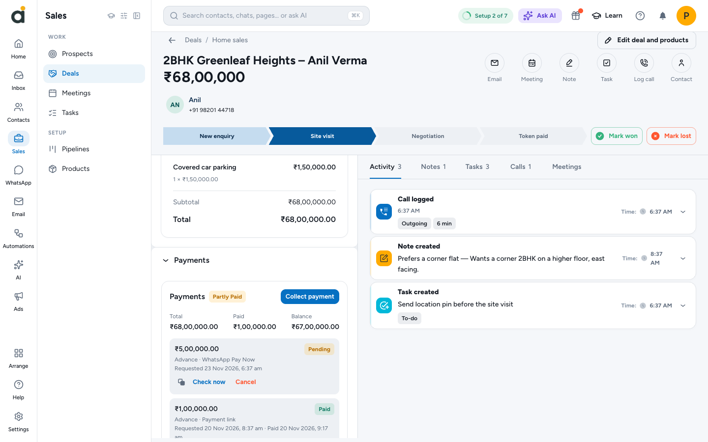
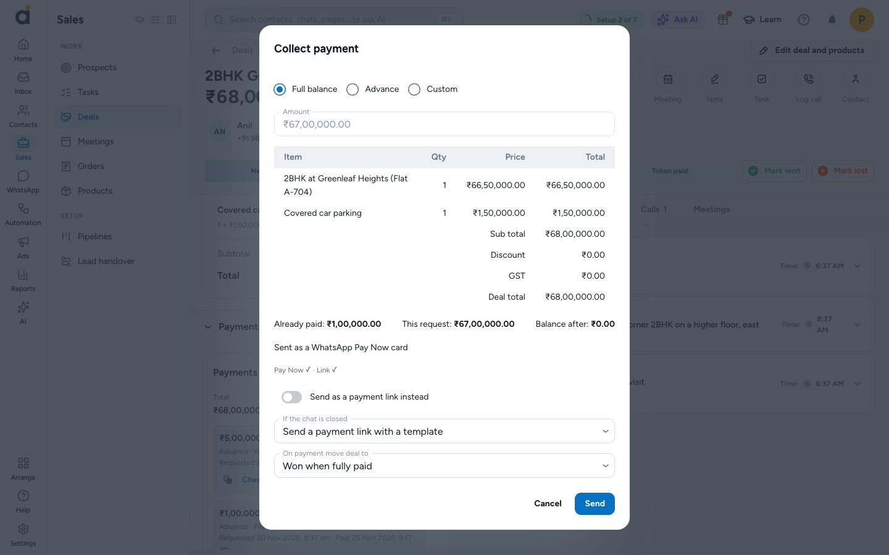
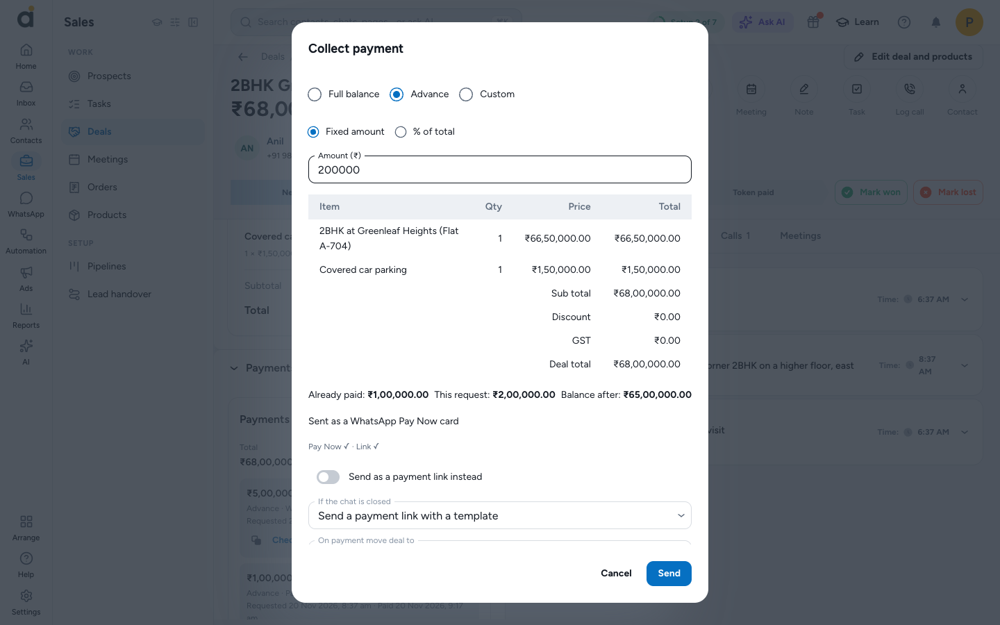

When a buyer is ready to pay a token, an advance or the full amount, ask for it from the deal. AdsEra sends a **WhatsApp Pay Now card** in their chat (they pay without leaving WhatsApp) or a **payment link**, keeps track of what's paid and what's left, and can move the deal to **Won** when it's fully paid.

**Where:** open a deal (Sales → Deals → click a deal → **View deal**). The **Payments** part is on the left. It's also in the deal preview, in the deal's edit panel, and in Prospects as **Pay link** (key **L**).

**Before you start:**
- WhatsApp Pay or Razorpay payment links set up for your account, under **Marketplace**. Without them the **Collect payment** button is greyed out and says why.
- A pipeline with a stage marked **won**, if you want the deal moved to Won when it's paid.
- The contact needs a phone number.

## Ask for a payment

<Steps>
<Step title="Click Collect payment">Under **Payments** on the deal.</Step>
<Step title="Pick how much">

| Choice | What it asks for | Message the buyer sees |
| --- | --- | --- |
| **Full balance** | Everything still unpaid. The **Amount** is filled for you. | "Payment for …" |
| **Advance** | Part of it: a **Fixed amount** (₹) or a **% of total**. | "Advance for …" |
| **Custom** | Any amount you type in **Amount (₹)**. | "Payment for …" |

</Step>
<Step title="Check the numbers">
The items and totals of the deal (**Sub total**, **Discount**, **GST**, **Deal total**), then **Already paid**, **This request** and **Balance after**.

</Step>
<Step title="Check how it will be sent">A line says **Sent as a WhatsApp Pay Now card** or **Sent as a payment link**, and why. Under it: what's set up, like "Pay Now ✓ · Link ✓". If both work, **Send as a payment link instead** switches to a link.</Step>
<Step title="Pick the rest">See the table below.</Step>
<Step title="Click Send">You see "Payment request sent" (or "Request created, not sent" when it can't be sent now). It shows under Payments as **Pending**.</Step>
</Steps>

### Every field

| Field | What it does | Required? |
| --- | --- | --- |
| **Full balance** / **Advance** / **Custom** | How much to ask for. | Yes |
| **Fixed amount** / **% of total** | Only for Advance. | Yes, for Advance |
| **Amount (₹)** / **Percent of total** | The amount, or the percent (it shows the rupee amount under it). | Yes, for Advance and Custom |
| **Send from WhatsApp number** | Only shows when the contact has never chatted with you: pick which number sends it. | Then, yes |
| **Send as a payment link instead** | Sends a link instead of a Pay Now card. | No |
| **If the chat is closed** | WhatsApp only lets you send a free message for 24 hours after their last one. After that: **Don't send**, **Send Pay Now with a template** or **Send a payment link with a template**. Only the choices your setup allows are shown. | Yes |
| **Valid until (optional)** | Only for links: the link stops working after this date and time. | No |
| **On payment move deal to** | **Won when fully paid** (the default), **Don't move**, or any stage. | Yes |

## After you send it

Each request is a box under **Payments**, newest first:

| Part | Meaning |
| --- | --- |
| Amount | What this request asks for. |
| **Pending** / **Paid** / **Failed** / **Expired** / **Cancelled** | Where it stands. |
| **Not sent** | It was made but not sent, with the reason, like the chat being closed. Copy the link and send it yourself, or cancel it. |
| **Test** | Made with test keys: no real money. |
| **Dual verified** | Paid, and confirmed by both WhatsApp and Razorpay. |
| **Awaiting Razorpay** | Paid in WhatsApp; waiting for Razorpay to confirm too (up to 24 hours). |
| **WhatsApp-only paid** (orange) | WhatsApp says paid but Razorpay doesn't confirm it. Check your Razorpay dashboard before you hand anything over. |
| Advance · Payment link | The kind and how it was sent. |
| Requested … · Paid … | When it was asked for and paid. |
| **Needs review** | Something looks wrong, with the reason. |
| Red lines like **Deal stage not moved** | The payment came in, but a follow-up step failed: Deal stage not moved, Stock not updated, Receipt not sent or Workflow not started. Click **Check now** to try again. |

At the top: **Unpaid**, **Partly paid**, **Paid** or **Overpaid**, with **Total**, **Paid** and **Balance**.

On a **Pending** request:
- the copy icon copies the payment link,
- **Check now** asks the payment company again (use it if the buyer says they paid and it's still Pending),
- **Cancel** stops the request.

When it's paid in full and **On payment move deal to** was Won, the deal moves to your Won stage by itself.

## Why Collect payment is greyed out

Point at the button to see the reason:

| Message | What to do |
| --- | --- |
| This number has no active WhatsApp Pay configuration | Set up WhatsApp Pay for the number. |
| Add order details to the WhatsApp payment configuration | Finish the WhatsApp Pay setup. |
| Payment links aren't set up for this account: use WhatsApp Pay | Connect Razorpay to send links, or use Pay Now. |
| No payment method is available: set up WhatsApp Pay or Razorpay in Marketplace | Set up at least one. |
| Razorpay rejected the saved keys: reconnect | Connect Razorpay again with fresh keys. |
| This contact has no phone number | Add their number on the contact. |

## FAQs

<AccordionGroup>
<Accordion title="Pay Now card or payment link: which is better?">
A Pay Now card lets them pay inside WhatsApp with UPI or a card, without leaving the chat. A link opens a payment page and works anywhere, also outside WhatsApp. AdsEra picks Pay Now when the chat is open and Pay Now is set up.
</Accordion>
<Accordion title="Can I take a token now and the rest later?">
Yes. Send an **Advance** now. Later, **Full balance** asks for exactly what's left.
</Accordion>
<Accordion title="They paid by bank transfer. How do I record it?">
Payments here are only those made through Pay Now or a link. Write a note on the deal and move it to the right stage.
</Accordion>
</AccordionGroup>

## Related

<CardGroup cols={2}>
<Card title="Deals" icon="handshake" href="/help/crm/deal">Everything about a deal.</Card>
<Card title="Collect payment in a chat" icon="comments" href="/help/inbox/payments">Send a Pay Now card from the inbox.</Card>
</CardGroup>
