A **deal** is one chance to sell: one person, what they want to buy, how much it's worth, and how far along it is. Deals move through the stages of a [pipeline](/help/crm/pipeline), like *New enquiry → Site visit → Negotiation → Token paid → Won*. The Deals page shows them all, with the money at each stage, so you can see what's close and what's stuck.

**Where:** **Sales → Deals** in the menu on the left. [Open it →](https://app.adsera.in/dashboard/crm/deal)

**Before you start:** you need a pipeline. If you have none, Deals says **Set up your stages first** with a **Make a pipeline** button. See [Pipelines](/help/crm/pipeline).

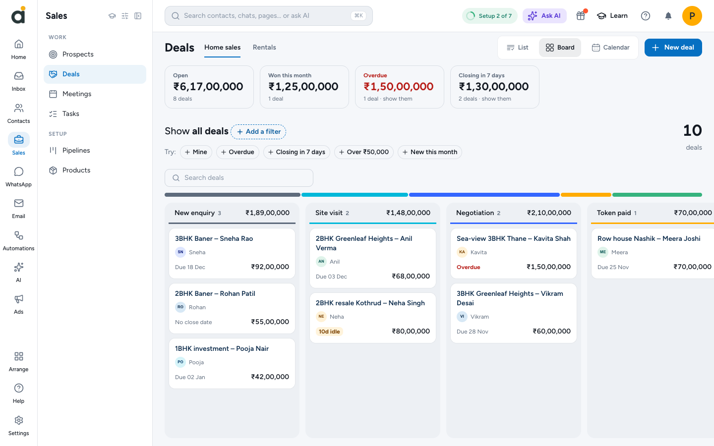

## The top of the page

| Part | What it does |
| --- | --- |
| Pipeline tabs (**Home sales**, **Rentals**…) | One tab per pipeline. Click to switch. |
| **List** / **Board** / **Calendar** | Three ways to see the same deals (below). |
| **New deal** | Adds a deal. |
| **Open** | The money in all open deals, and how many. |
| **Won this month** | Deals won since the 1st of this month. |
| **Overdue** | Open deals past their close date. Click to show only those. |
| **Closing in 7 days** | Open deals due today or in the next 7 days. Click to show only those. |
| **Show all deals** + **Add a filter** | A filter you build as a sentence. Starters: **Mine**, **Overdue**, **Closing in 7 days**, **Over ₹50,000**, **New this month**. |
| **Search deals** | Finds deals by name. |

Filter on **Stage**, **Owner**, **Amount**, **Close date** (overdue, in the next 7 or 30 days, in the last 30 days, or a date), **Created** or **Last changed**.

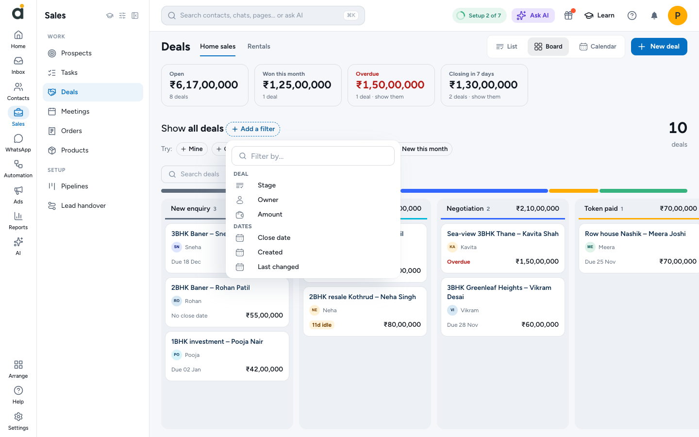

## Three views

<Tabs>
<Tab title="Board">
A column per stage, left to right, with how many deals and their total. The thin bar on top shows where the money sits (point at a part for the stage and amount). Each card shows the deal name, the contact, the money and:

- **Due 02 Dec**: its close date,
- **Overdue** in red when the close date has passed,
- **9d idle** when nothing changed for a week or more (red after two weeks),
- **No close date** when none is set.

Drag a card to another column to move the deal. It saves at once; if saving fails it goes back.

</Tab>
<Tab title="List">
Deals grouped by when they should close: **Overdue**, **This week**, **Next week**, **Later**, **No close date**, and **Won and lost** at the bottom. Columns: **Amount**, **Stage**, **Owner**, **Close date**, **Last change**.

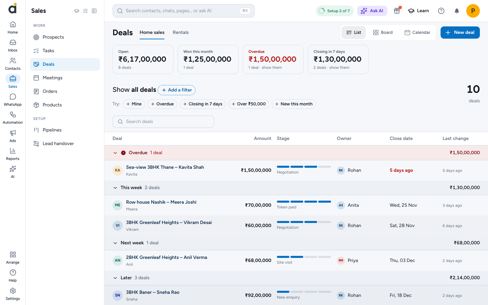
</Tab>
<Tab title="Calendar">
A month with each open deal on its close date. Drag a deal to another day to change its close date. **No close date** on the right lists the deals without one: drag them onto a day. The arrows show the previous or next month.

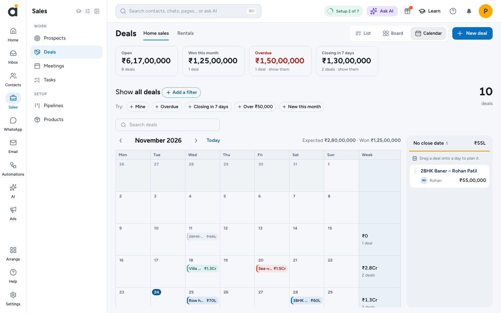
</Tab>
</Tabs>

## Add a deal

<Steps>
<Step title="Click New deal">The **New deal** panel opens on the right.</Step>
<Step title="Title and Description">
**Title**: like "3BHK Baner – Ravi Kumar", so it's clear on the board. **Description**: one line on what they want, budget or timing. Both are required.

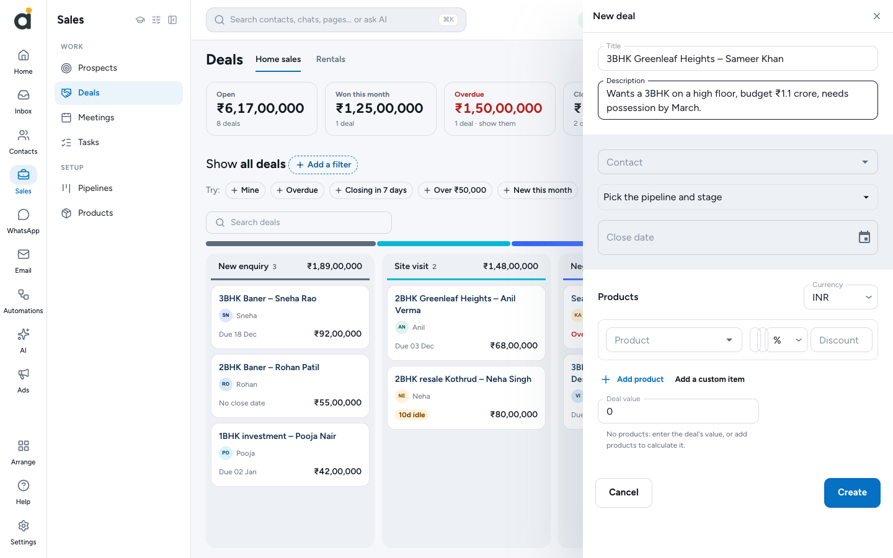
</Step>
<Step title="Contact">Type a name or number and pick the person. Their chats, calls and notes show on the deal.</Step>
<Step title="Pick the pipeline and stage">
Click the box, pick the pipeline, then the stage the deal is at now.

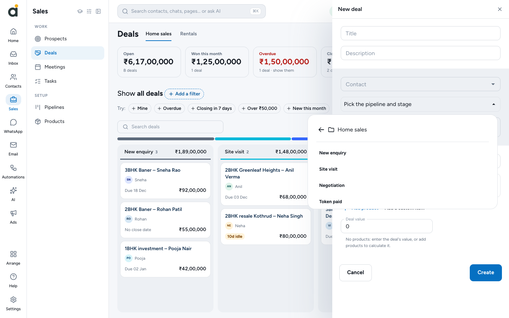
</Step>
<Step title="Close date">When you expect to close. Past it, the deal shows as Overdue.</Step>
<Step title="Products">Pick what they're buying (see the table below). The total adds up by itself. No products? Type the **Deal value**.</Step>
<Step title="Click Create">The deal shows on the board in its stage.</Step>
</Steps>

### Products on a deal

| Field | What it does | Example |
| --- | --- | --- |
| **Currency** | The deal's currency. | INR |
| **Product** | Search your [products](/help/crm/product) by name or SKU. Shows each one's price. | 2BHK at Greenleaf Heights |
| **Item name** | For **Add a custom item**: something that's not in Products. | Covered car parking |
| **Billing option** | Only for products with several prices, like a subscription's monthly and yearly plans. | Yearly · ₹27,000 |
| **Qty** | How many. | 1 |
| **Unit price** | Filled from the product (it says "from catalog", or the offer's name). Type a different price to change it for this deal. | 66,50,000 |
| **%** or **₹** + **Discount** | A discount as a percent or an amount. | 2 % |
| Line total | The line's total, with "incl. GST" when the product charges tax. | ₹65,17,000 |
| **Subtotal**, **Discount**, **GST**, **Total** | The deal's totals, worked out for you. | |

**Add product** adds a line from Products. **Add a custom item** adds a typed line. The bin removes a line.

<Note>GST comes from each product's **Charge tax?** setting (see [Product types](/help/crm/product-types)). A deal has no GST field of its own.</Note>

## Open a deal: the preview

Click a card (or a row) and the deal opens on the right, so you keep your place.

| Part | What it does |
| --- | --- |
| Arrows at the top | Previous / next deal. |
| **⋮** (More actions) | **Edit deal and products**, **Open in a new tab**. |
| Name, money, contact | Click the contact to open their page. |
| **Stage: …** | Click to pick another stage. The bar under it shows how far along it is. |
| **Mark won** / **Mark lost** | Moves the deal to your pipeline's won or lost stage. |
| **Email**, **Meeting**, **Note**, **Task**, **Log call**, **Contact** | Quick actions. **Meeting** offers **Schedule a meeting** and **Log a meeting**. |
| **About this deal** | **Owner** and **Close date** (click to change), **Pipeline**, **Created**, **Description**, then **Subtotal**, **Discount**, GST and **Total**. |
| **Products**, **Payments** | The lines, and payment requests with **Collect payment**. |
| **Recent activity**, **Notes**, **Tasks**, **Calls**, **Meetings** | Everything about the deal. **Add** / **Log** adds one. |
| **View deal** | Opens the deal's own page. |

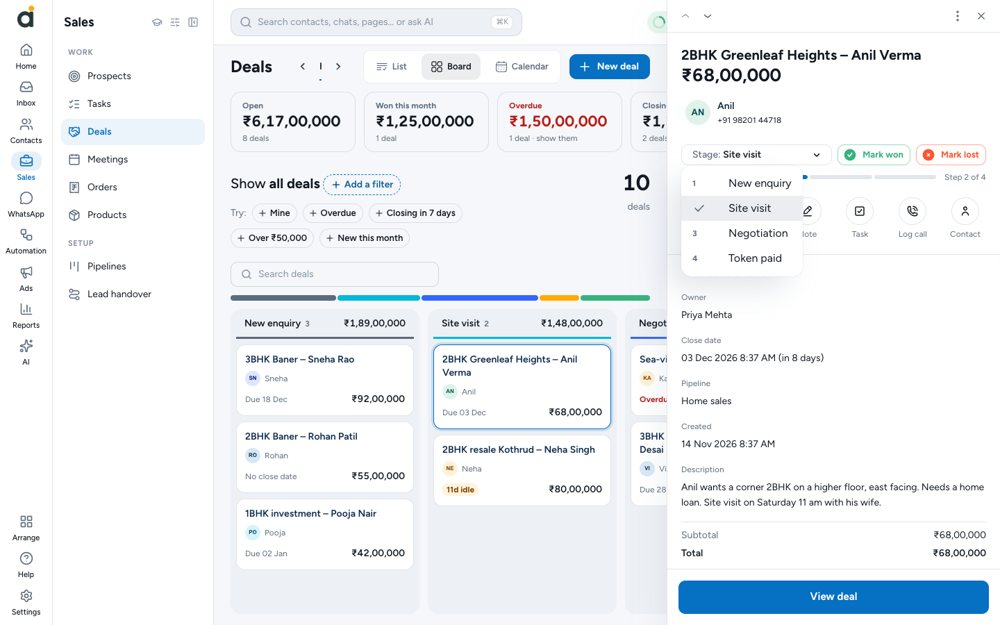

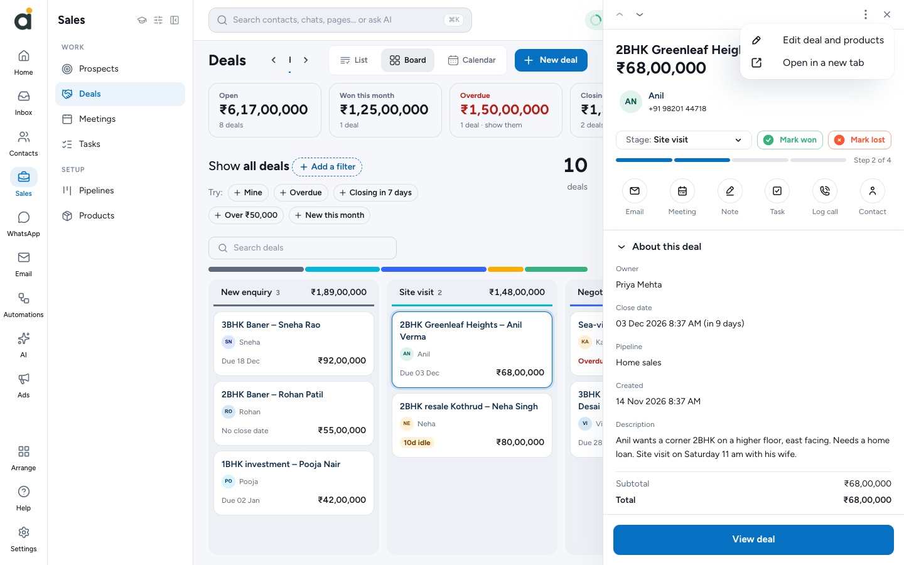

## Move a deal, win or lose it

- **Drag** the card to another column on the board.
- Or open it and click **Stage: …**, or click a stage in the arrow bar on its page.
- **Mark won** when they've bought: it counts in **Won this month**. **Mark lost** when they won't. Changed your mind? Pick another stage.

Mark won and Mark lost use the stages in your pipeline marked **won** and **lost**. If they're missing, add them in [Pipelines](/help/crm/pipeline). A [workflow](/help/automation/workflows) can react when a deal reaches a stage.

## Edit a deal

Open it → **⋮** → **Edit deal and products**. Change the title, description, stage, close date and products, then click **Update**. The **contact** and the **pipeline** can't be changed after a deal is made: make a new deal instead. The edit panel also shows the deal's **Payments**.

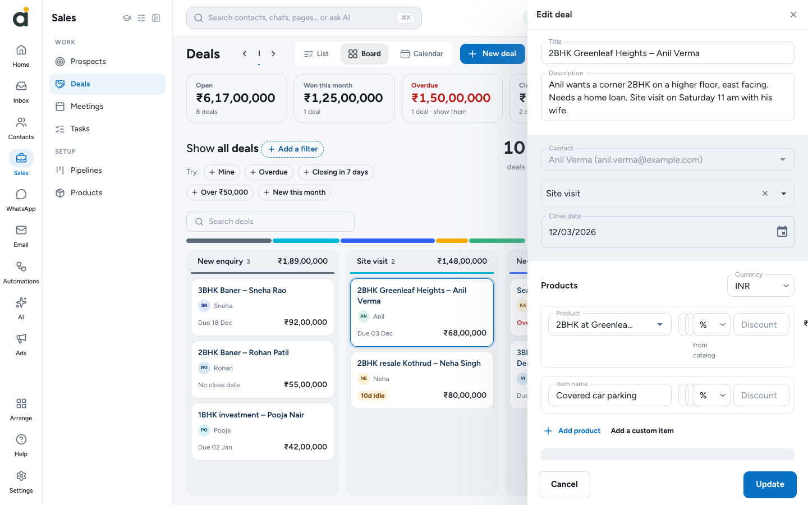

## A deal's own page

Click **View deal** (or **Open in a new tab**).

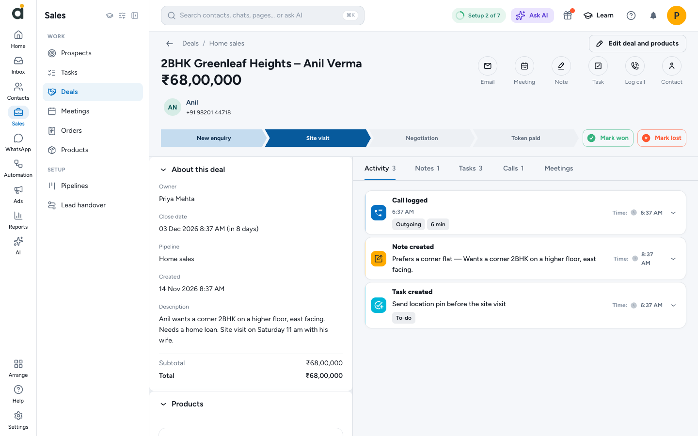

| Part | What it does |
| --- | --- |
| Back arrow, **Deals / Home sales** | Back to Deals. |
| **Edit deal and products** | Opens the edit panel. |
| Round buttons | **Email**, **Meeting**, **Note**, **Task**, **Log call**, **Contact**. |
| Arrow bar | Every open stage; click one to move the deal. **Mark won** / **Mark lost** on the right. |
| Left side | **About this deal**, **Products**, **Payments**. |
| Tabs | **Activity**, **Notes**, **Tasks**, **Calls**, **Meetings**, each with its count and an Add or Log button. |

To take a payment, see [Collect a payment](/help/crm/deal-payments).

## When there are no deals

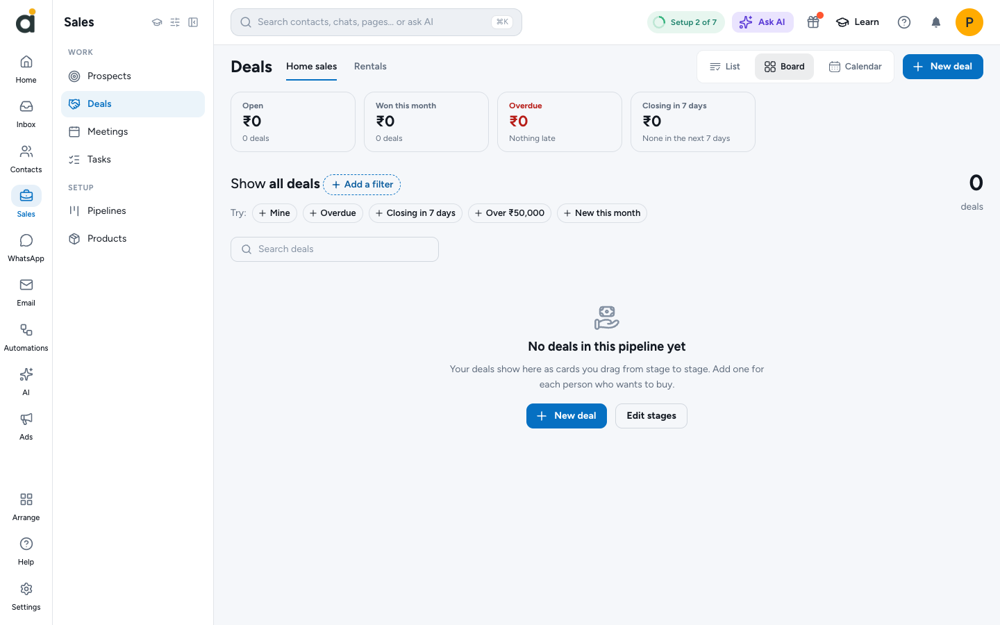

The page says **No deals in this pipeline yet** with **New deal** and **Edit stages**. If you have no pipeline at all it says **Set up your stages first** with **Make a pipeline**.

## Limits

- A pipeline shows up to 500 deals at once. With more, a note says "Showing the newest 500. Narrow the sentence to see the rest."
- Deals can't be deleted from the app today. Mark them lost instead.

## Troubleshooting

| What you see | What to do |
| --- | --- |
| "Give the deal a name" / "Add a line about the deal" / "Pick the pipeline and stage" | Title, Description and the stage are required. |
| "Couldn't move that deal" | The card went back: check your connection and drag again. |
| "Deal saved, but its products weren't…" | Open the deal → Edit deal and products, and add the products again. |
| No **Mark won** / **Mark lost** buttons | Your pipeline has no stage marked won or lost. Add them in Pipelines. |
| A deal disappeared from the board | Its stage was renamed or removed in the pipeline. Search for it in **List** and pick a stage. |

## FAQs

<AccordionGroup>
<Accordion title="How is a deal different from a contact?">
A contact is a person. A deal is one sale to that person. One contact can have several deals, like a flat now and a shop later.
</Accordion>
<Accordion title="Can I make a deal from a chat or from Prospects?">
New deals are made here, with **New deal**. A payment you collect from an inbox chat is saved on a deal. In Prospects, the outcomes **Meeting set** and **Won** move the lead's open deal for you, and **Pay link** asks for a payment on it.
</Accordion>
<Accordion title="Who sees a deal?">
Admins see all deals. Team members see the deals their Data visibility allows (see [Give each salesperson their own leads](/help/sales/own-leads)).
</Accordion>
</AccordionGroup>

## Related

<CardGroup cols={2}>
<Card title="Collect a payment" icon="indian-rupee-sign" href="/help/crm/deal-payments">Pay Now cards and payment links.</Card>
<Card title="Pipelines" icon="sliders" href="/help/crm/pipeline">The stages your deals move through.</Card>
<Card title="Products" icon="box" href="/help/crm/product">What you sell, with prices.</Card>
<Card title="From lead to payment" icon="route" href="/help/sales/lead-to-payment">The whole journey.</Card>
</CardGroup>
