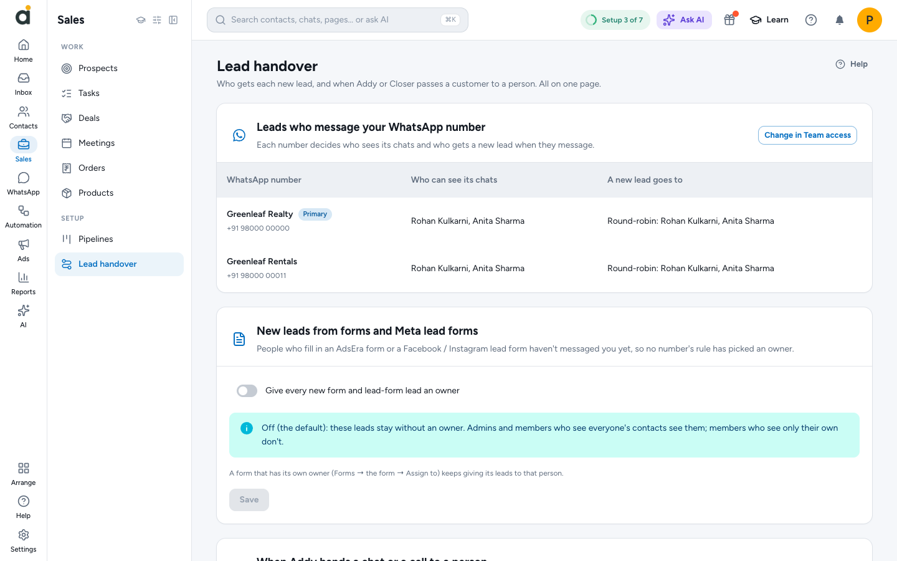
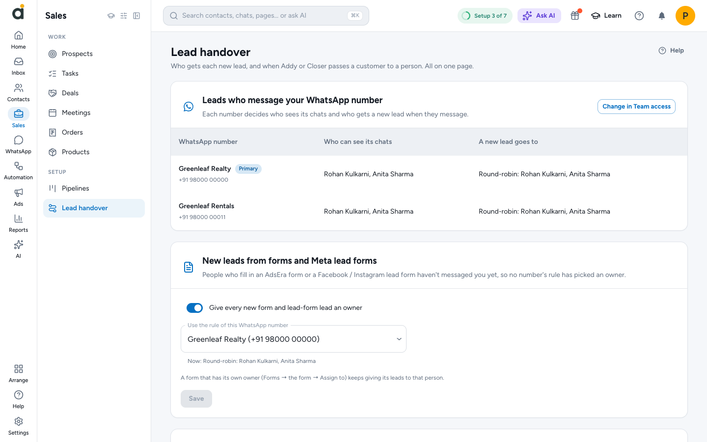

**Lead handover** shows, on one page, every rule that hands a lead to a person on your team:

- who gets a new lead when someone **messages your WhatsApp number** (round-robin, one person, or nobody),
- who gets a new lead from an **AdsEra form** or a **Meta lead form** (people who haven't messaged you yet),
- when **Addy** hands a chat or a call to a person,
- when **Closer** hands a lead to a person.

Each rule still lives on its own page: this page shows them together and links to each one. The only setting you change here is the one for form and lead-form leads.

**Where:** **Sales → Setup → Lead handover** (admins only). [Open it →](https://app.adsera.in/dashboard/crm/lead-handover)

## Leads who message your WhatsApp number

A table with one row per WhatsApp number:

| Column | What it shows | Example |
| --- | --- | --- |
| **WhatsApp number** | The number, with **Primary** on your [primary number](/help/channel/whatsapp/primary-number) | Greenleaf Realty |
| **Who can see its chats** | The team members on this number (admins always can) | Rohan Kulkarni, Anita Sharma |
| **A new lead goes to** | **Round-robin: …** (in turn), **Always …** (one person) or **Nobody (stays unassigned)** | Round-robin: Rohan Kulkarni, Anita Sharma |

To change it, click **Change in Team access**: it opens **WhatsApp → Numbers & profile → Team access** (pick the number at the top). See [Team access](/help/inbox/team).

## New leads from forms and Meta lead forms

People who fill in an AdsEra form, or a Facebook / Instagram lead form, haven't messaged you yet, so no number's rule has given them an owner. **Off by default:** they stay without an owner. Admins and members who see everyone's contacts see them; members who see only their own leads don't.

<Steps>
<Step title="Switch it on">Switch on **Give every new form and lead-form lead an owner**.</Step>
<Step title="Pick a number's rule">
In **Use the rule of this WhatsApp number**, pick the number whose rule they should follow. Under it you see that rule, like "Now: Round-robin: Rohan Kulkarni, Anita Sharma".

</Step>
<Step title="Click Save">You see "Saved: new form and lead-form leads follow this rule from now on".</Step>
</Steps>

**What happens next:** each new lead from an AdsEra form or a Meta lead form gets an owner the moment it arrives, picked by that number's rule (round-robin goes to the next person in turn; one person always gets it). The owner is told in AdsEra, and the contact's timeline says "Auto (round-robin)" or "Auto (fixed agent)". Leads that arrived before you switched it on keep no owner.

| Setting | What it does | Required? |
| --- | --- | --- |
| **Give every new form and lead-form lead an owner** | On: new form and lead-form leads get an owner. Off: they stay without one | — |
| **Use the rule of this WhatsApp number** | Whose round-robin or one person they follow | Yes, when on |

<Warning>If the chosen number's rule is **Nobody** (off), the page warns you: pick round-robin or one person for it in Team access first, or nothing is assigned.</Warning>

- A form that has its own owner (**Forms → the form → Assign to**) keeps giving its leads to that person.
- A lead who already has an owner keeps them.

## When Addy hands a chat or a call to a person

Shows whether Addy is on, whether it **Hands over when asked** (or **Never hands over**), and the extra cases you listed ("Also hands over when: …"). Addy hands a chat to the contact's owner (or the number's team). On a WhatsApp call it rings whoever is online, the owner first; when nobody is free it books a call-back task. You can also take over a live call in [Calling](/help/inbox/calling).

**Change in Addy** opens Addy's **Selling** tab. See [Addy](/help/ai/addy).

## When Closer hands a lead to a person

One line per Closer goal: whether it **tells the owner when a lead turns hot**, after how many follow-ups with no reply it hands over, and who gets leads with no owner.

**Change in Closer** opens Closer's **Goals**. See [Closer goals](/help/ai/closer-goals).

## Questions

<AccordionGroup>
<Accordion title="Why can't my team members open this page?">It shows settings only admins can change.</Accordion>
<Accordion title="Does it assign leads that already came in?">No, only new ones from the moment you save. Give older leads an owner from All contacts (select them, then assign).</Accordion>
<Accordion title="What about IndiaMART or Google Sheet leads?">They use their own setting: IndiaMART's default owner (Marketplace → IndiaMART) and the sheet's mapping.</Accordion>
</AccordionGroup>

## Related

<CardGroup cols={2}>
<Card title="Team access" href="/help/inbox/team">Round-robin or one person per number.</Card>
<Card title="Only their own leads" href="/help/sales/own-leads">What members see.</Card>
<Card title="Lead sources" href="/help/audiance/lead-sources">Where leads come from.</Card>
<Card title="Calling" href="/help/inbox/calling">Take over a call Addy is on.</Card>
</CardGroup>
