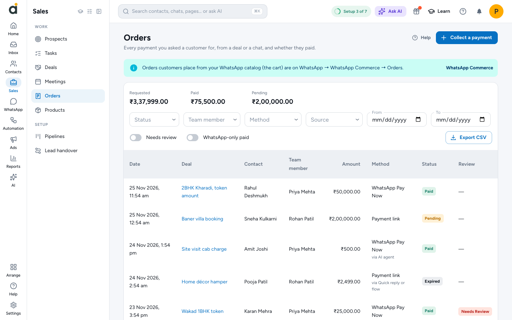

**Orders** lists every payment you asked a customer for, from a deal or from a chat: as a **WhatsApp Pay Now** card or a **payment link**. It shows the totals requested, paid and pending, and each request's status.

Use it at the end of the day to see what came in, chase what's pending, and export the list for your accountant.

**Where:** **Sales → Orders**. [Open it →](https://app.adsera.in/dashboard/crm/orders) It's the same list as **WhatsApp → WhatsApp Payments → Requests**.

<Note>Orders customers place from your WhatsApp catalog (the cart in the chat) are in **WhatsApp → WhatsApp Commerce → Orders**. The blue bar at the top of the page links there.</Note>

## Read the list

| Part | What it shows |
| --- | --- |
| **Requested** / **Paid** / **Pending** | Totals for what the filters show |
| **Status**, **Team member**, **Method**, **Source**, **From**, **To** | Filters |
| **Needs review** | Requests AdsEra flagged because something didn't match (for example the amount paid): check them before you deliver |
| **WhatsApp-only paid** | Paid with Pay Now on WhatsApp, but Razorpay doesn't confirm the payment: check your Razorpay account before you deliver |
| **Export CSV** | Downloads the rows you see (up to 5,000) |
| Each row | Date, the deal (click to open it), contact, team member, amount, method, status and review |

### Statuses

| Status | Meaning |
| --- | --- |
| **Pending** | Sent, not paid yet |
| **Paid** | Paid in full |
| **Expired** | The link or card expired before they paid |
| **Cancelled** | You cancelled the request |
| **Failed** | The payment failed: they can try again |

## Ask for a new payment

<Steps>
<Step title="Click Collect a payment">It opens **Sales → Deals**.</Step>
<Step title="Open the deal">Click the deal, then **Collect payment** under **Payments**.</Step>
<Step title="Send it">Pick the amount and send. See [Collect a payment for a deal](/help/crm/deal-payments).</Step>
</Steps>

In a chat you can also click **Collect payment** in the chat's tools: it makes a deal and sends Pay Now in one step.

## Remind people who haven't paid

**Automation → Workflow templates → Payment reminder** sends a reminder template 24 hours after a request if it's still unpaid. See [Workflow templates](/help/automation/workflow-templates).

## Who sees what

Team members see the requests for deals they may see (their role's deal access).

## Questions

<AccordionGroup>
<Accordion title="Why is Collect a payment greyed out on a deal?">WhatsApp Pay or Razorpay isn't set up yet: WhatsApp → WhatsApp Payments, or Marketplace → Razorpay.</Accordion>
<Accordion title="Where do I set up WhatsApp Pay?">**WhatsApp → WhatsApp Payments → Setup**. See [WhatsApp Pay](/help/integrations/whatsapp-pay).</Accordion>
</AccordionGroup>

## Related

<CardGroup cols={2}>
<Card title="Collect a payment" href="/help/crm/deal-payments">Ask for a payment from a deal.</Card>
<Card title="WhatsApp Pay" href="/help/integrations/whatsapp-pay">Payments inside WhatsApp.</Card>
<Card title="WhatsApp Commerce" href="/help/integrations/whatsapp-commerce">Your catalog and its orders.</Card>
<Card title="Payments in chat" href="/help/inbox/payments">Collect from a chat.</Card>
</CardGroup>
