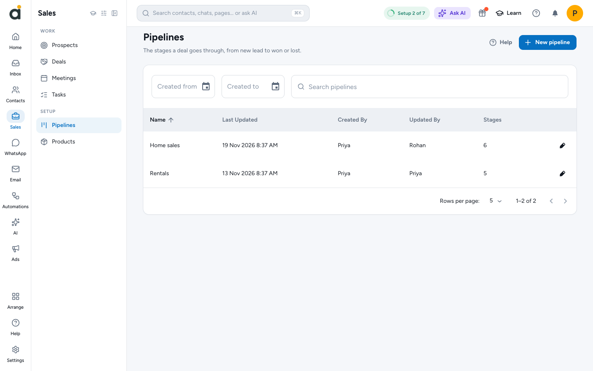
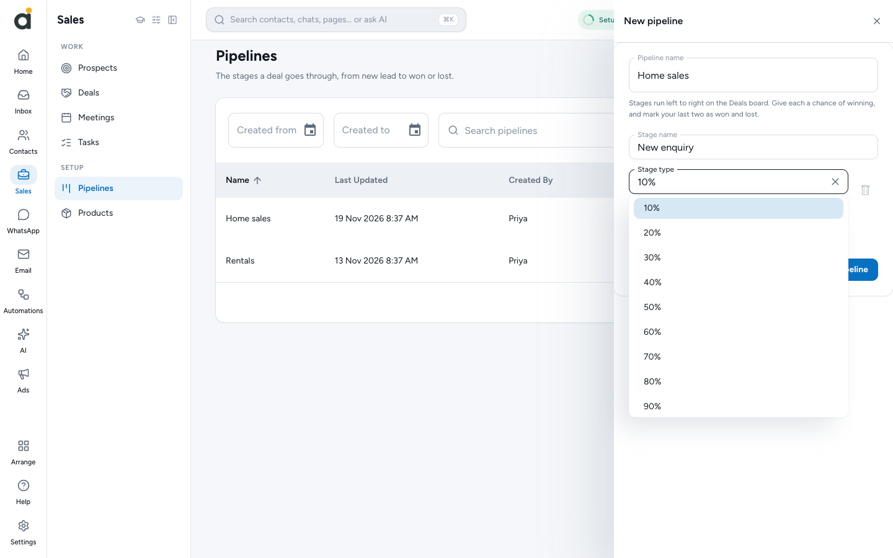
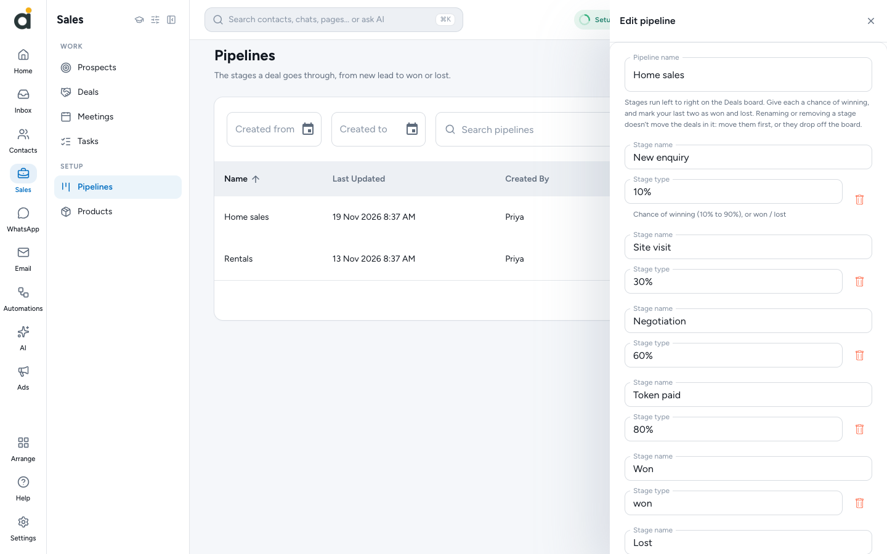

A **pipeline** is the list of steps your sales go through, like *New enquiry → Site visit → Negotiation → Token paid → Won / Lost*. Each step is a **stage**, and each stage is a column on the [Deals](/help/crm/deal) board. Most businesses need one pipeline; make a second only for a different kind of sale, like **Rentals**.

**Where:** **Sales → Pipelines** in the menu on the left. [Open it →](https://app.adsera.in/dashboard/crm/pipeline)

## The list

| Column | Meaning |
| --- | --- |
| **Name** | The pipeline's name. |
| **Last updated** | When it last changed. |
| **Created by**, **Updated by** | Who made it and who changed it last. |
| **Stages** | How many stages it has. |
| Pencil | Opens it to change it. |

**Search pipelines** finds one by name. **Created from** / **Created to** show the ones made between two dates. **Clear** shows them all again.

## Make a pipeline

<Steps>
<Step title="Click New pipeline">The **New pipeline** panel opens on the right.</Step>
<Step title="Name it">**Pipeline name**, like "Home sales".</Step>
<Step title="Add the stages, left to right">
For each stage, a **Stage name** and a **Stage type**. Click **Add stage** for the next one.

</Step>
<Step title="Click Create pipeline">You see "Pipeline created". You can now add deals to it.</Step>
</Steps>

### Stage type

| Stage type | Meaning | Example |
| --- | --- | --- |
| **10%** to **90%** | How likely a deal at this stage is to close. You can type your own number, like 35. | New enquiry 10%, Site visit 30%, Negotiation 60%, Token paid 80% |
| **won** | The deal is won. **Mark won** moves deals here, and paid deals move here when you collect a payment with "Won when fully paid". | Won |
| **lost** | The deal is lost. **Mark lost** moves deals here. | Lost |

<Tip>Give every pipeline exactly one **won** and one **lost** stage, at the end. Without them there are no Mark won / Mark lost buttons, and payments can't move the deal to Won.</Tip>

### A real-estate example

| Stage name | Stage type |
| --- | --- |
| New enquiry | 10% |
| Site visit | 30% |
| Negotiation | 60% |
| Token paid | 80% |
| Won | won |
| Lost | lost |

## Change a pipeline

<Steps>
<Step title="Click the pencil on its row">
The **Edit pipeline** panel opens.

</Step>
<Step title="Change what you need">Rename a stage, change its type, **Add stage** for a new one at the end, or the bin to remove one (a pipeline needs at least one stage).</Step>
<Step title="Click Save changes">You see "Changes saved".</Step>
</Steps>

<Warning>Deals remember their stage by its name. If you **rename** or **remove** a stage, the deals in it no longer show on the board. Move them to another stage first (drag them on the board), then change the stage.</Warning>

## What you can't do (yet)

- **Delete a pipeline.** There's no delete. Stop using a pipeline by not adding deals to it.
- **Reorder stages by dragging.** Stages stay in the order you added them. To put one in the middle, rename the stages in the order you want.
- **Move a deal to another pipeline.** Make a new deal in the other pipeline instead.

## Troubleshooting

| What you see | What to do |
| --- | --- |
| "Give the pipeline a name" / "Give the stage a name" | Fill in every name. |
| "Pick the chance of winning, or won / lost" | Every stage needs a Stage type. |
| Deals vanished after I edited the pipeline | A stage was renamed or removed. Change the name back, move the deals, then rename. |

## FAQs

<AccordionGroup>
<Accordion title="What does the percentage do?">
It says how likely deals at that stage are to close, so the pipeline reads at a glance. The Deals page totals show the full value of each stage.
</Accordion>
<Accordion title="How many stages should I have?">
Four to six plus Won and Lost. More than that and deals sit in stages nobody updates.
</Accordion>
</AccordionGroup>

## Related

<CardGroup cols={2}>
<Card title="Deals" icon="handshake" href="/help/crm/deal">Move deals through the stages.</Card>
<Card title="Collect a payment" icon="indian-rupee-sign" href="/help/crm/deal-payments">Paid deals move to Won.</Card>
</CardGroup>
