When you click **New product**, AdsEra asks **What are you adding?**. Each type has its own form that asks only what fits it. Pick the one closest to how you sell.

**Where:** **Sales → Products → New product**. [Open it →](https://app.adsera.in/dashboard/crm/product)

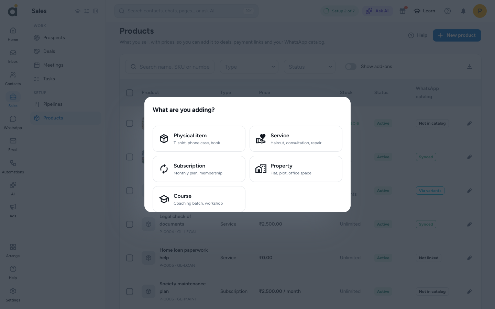

| Type | Use it for | Examples |
| --- | --- | --- |
| **Physical item** | Things you hand over or ship. Has stock, variants and shipping. | Brochure kit, smart door lock, T-shirt, phone case |
| **Service** | Work you do, priced one time or per hour, session, month… | Legal check of documents, consultation, repair |
| **Subscription** | Plans people pay for again and again, with trials and features. | Society maintenance plan, gym membership |
| **Property** | A flat, plot or office for sale, rent or short stays. | 2BHK at Greenleaf Heights, office space on rent |
| **Course** | A batch, workshop or programme with modules, seats and installments. | First-home buyer course, coaching batch |

Every form works the same way: the parts are listed on the left (click one to jump to it), each part is a card on the right, and **Cancel** / **Create product** stay at the bottom. Only the name is required to start; parts marked **Optional** can wait. If something is wrong, a red box at the top says **Please fix the following** with the list. You can change everything later with **Edit**.

<Note>Only **physical items** and **services** can show in your WhatsApp catalog. Subscriptions, properties and courses sell through [deals](/help/crm/deal) and [payment links](/help/crm/deal-payments).</Note>

## Physical item

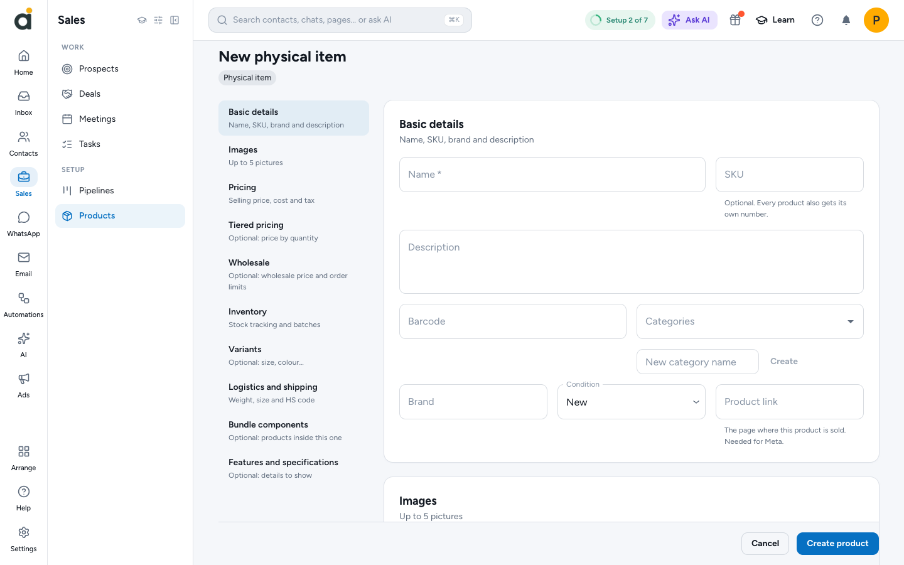

| Part | Fields | Notes |
| --- | --- | --- |
| **Basic details** | **Name** (required), **SKU**, **Description**, **Barcode**, **Categories** (pick, or type a **New category name** and **Create**), **Brand**, **Condition** (New, Refurbished, Used), **Product link** | SKU is your own code; every product also gets a number like P-0002. The product link (starting with https://) is needed for the WhatsApp catalog. |
| **Images** | **Add pictures**: up to 5 | The first picture shows in lists and the catalog. |
| **Pricing** | **Selling price**, **Cost price**, **Charge tax?** → **Tax rate (%)** and **Tax code** (HSN / SAC) | Cost price is only for you, to see your margin. |
| **Tiered pricing** (optional) | **Add tier**: a lower price from a minimum quantity | Like ₹450 each from 10 kits. |
| **Wholesale** (optional) | **Wholesale price**, **Minimum order quantity**, **Maximum order quantity** | Leave the maximum as "No limit" if there's none. |
| **Inventory** | **Track stock**, **Opening stock**, **Low-stock alert at**, **Allow backorders (sell when out of stock)**, a first batch (**Initial batch number**, **Manufacturing date**, **Expiry date**) | Without Track stock it's "Unlimited". |
| **Variants** (optional) | **This product comes in variants (size, colour…)**: 1 to 3 options with their values; each combination becomes a variant with its own SKU, price and stock | Barcode moves to the variants. |
| **Logistics and shipping** | **Requires shipping**, **Weight**, **Unit**, **Length**, **Width**, **Height**, **HS code** | HS code is the export code: leave it empty if you don't export. |
| **Bundle components** (optional) | **Add a product**: the products inside this one | Like a kit made of a brochure and a tote bag. |
| **Features and specifications** (optional) | **Add a feature**: a name and a value | Shown on the product page. |

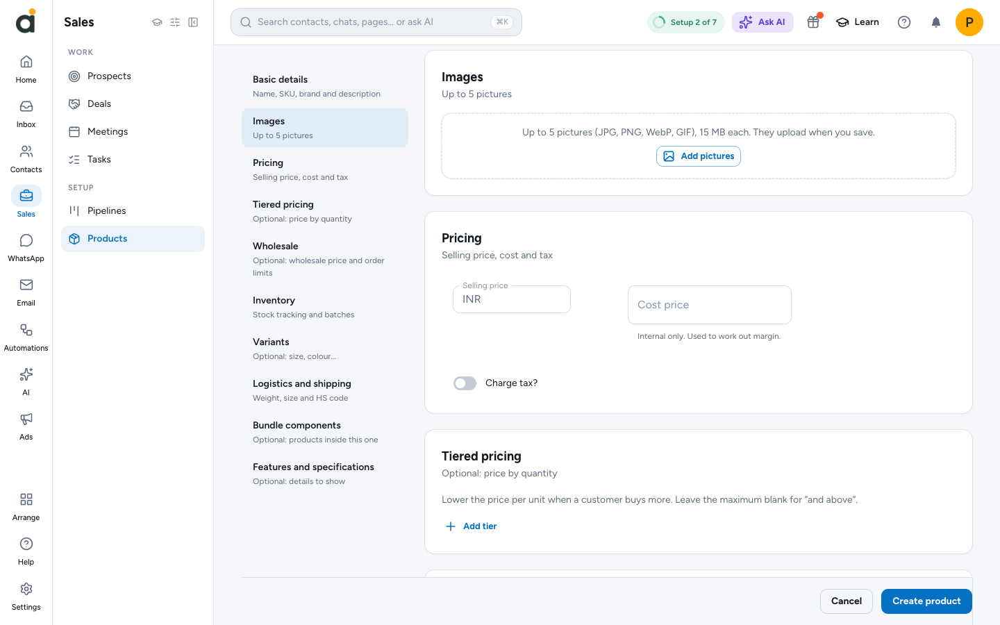

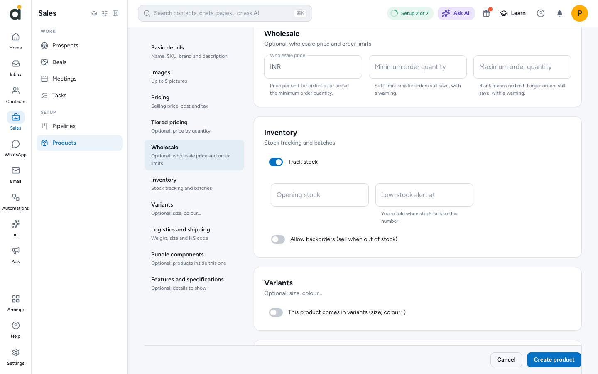

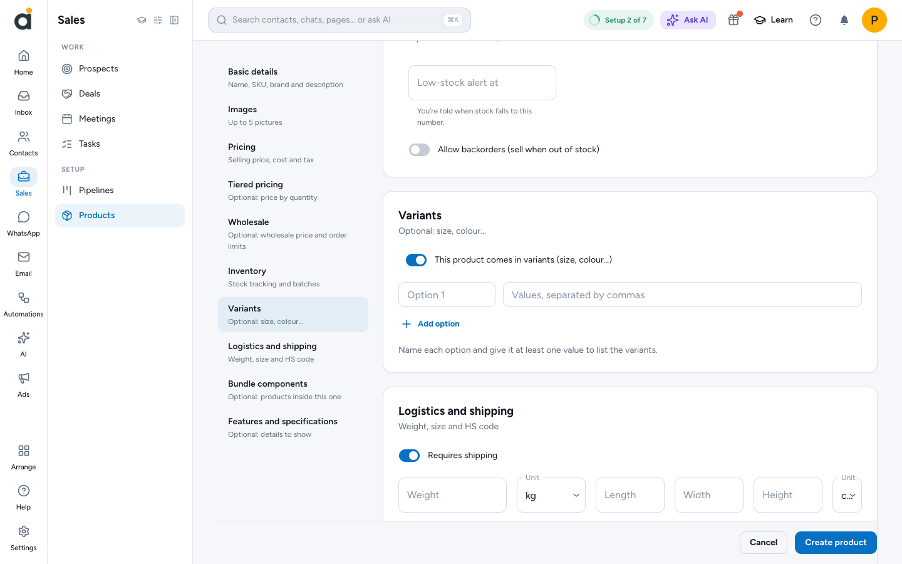

## Service

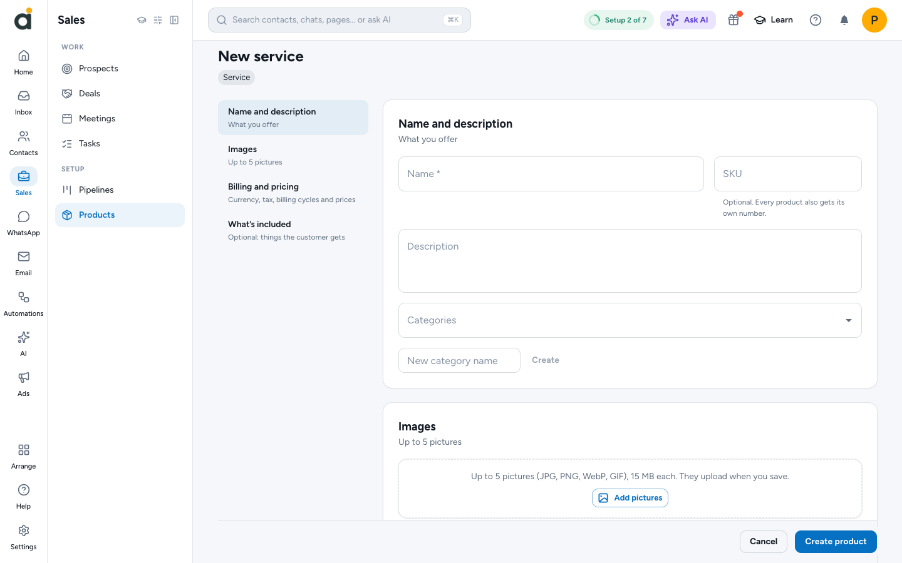

| Part | Fields | Notes |
| --- | --- | --- |
| **Name and description** | **Name** (required), **SKU**, **Description**, **Categories** | |
| **Images** | Up to 5 pictures | |
| **Billing and pricing** | **Currency**, **Charge tax?**, **Price per** (one time, or each hour, session, day…), then a **Price** for each billing cycle you tick: **One time**, **Monthly**, **Quarterly**, **Yearly** | Tick more than one to offer a choice; deals then show a **Billing option**. |
| **What's included** (optional) | **Add an included item** | Like "Title search for 30 years". |

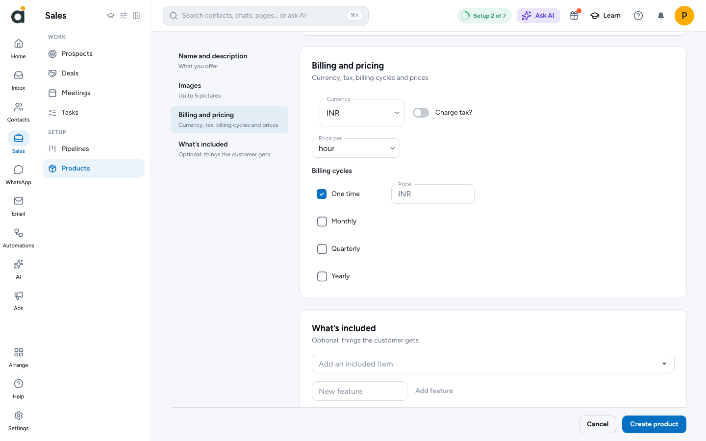

## Subscription

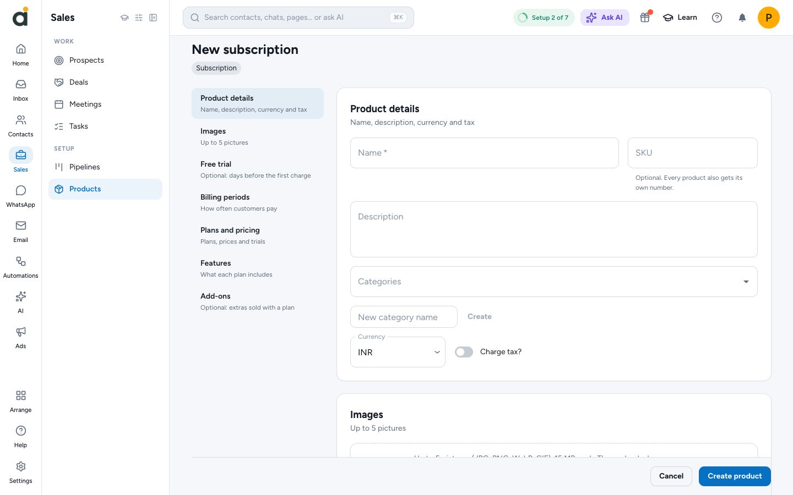

| Part | Fields | Notes |
| --- | --- | --- |
| **Product details** | **Name** (required), **SKU**, **Description**, **Categories**, **Currency**, **Charge tax?** | |
| **Images** | Up to 5 pictures | |
| **Free trial** (optional) | **Offer a trial?** → **Trial days** | For every plan, unless a plan sets its own. |
| **Billing periods** | **Every** (a number) and **Period** (month, year…); **Add billing period**; one is the **Default** | Like every 1 month and every 1 year. |
| **Plans and pricing** | For each plan: **Plan name** (required), **One-line pitch**, a price for each billing period, **Trial days**, **Most popular**; **Add plan** | Like Basic and Premium. |
| **Features** | **Add a feature**, then tick or fill it for each plan | Builds a plan comparison. |
| **Add-ons** (optional) | **Add add-on**: extras sold with a plan | Like "Extra parking slot". |

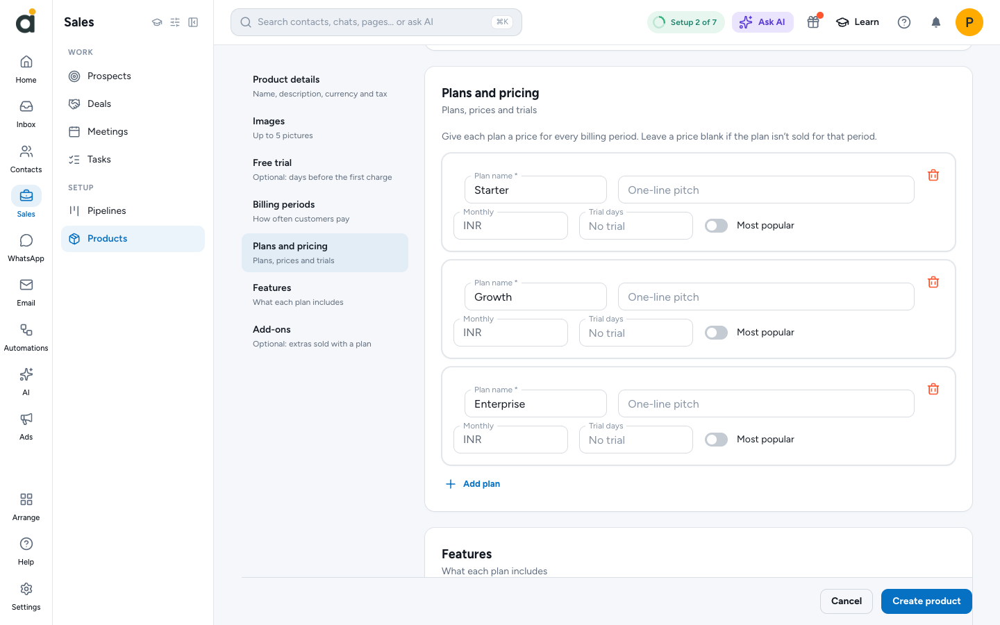

## Property

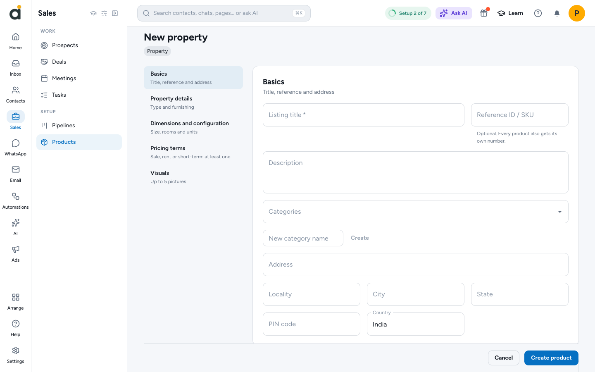

| Part | Fields | Notes |
| --- | --- | --- |
| **Basics** | **Listing title** (required), **Reference ID / SKU**, **Description**, **Categories**, **Address** (building, street), **Locality**, **City**, **State**, **PIN code**, **Country** | |
| **Property details** | **Property type**: Apartment, Villa, Independent House, Builder Floor, Studio, Commercial Office, Retail Shop, Warehouse, Co-working Space, Agricultural Land, Industrial Land. **Furnishing**: Unfurnished, Semi-furnished, Fully furnished | |
| **Dimensions and configuration** | **Size** and **Unit** (Sq.Ft, Sq.Yd, Sq.M, Acres, Hectares), **Bedrooms**, **Bathrooms**, **Year built**, **Multi-unit project** → **Total units available** | Multi-unit: identical units counted together, like 40 flats of the same plan. A single flat is "one of a kind". |
| **Pricing terms** | At least one of: **For sale** (**Listing price**), **For rent (long-term)** (**Rent**, **Billed** monthly or yearly), **Short-term stay** (**Rate**, billed daily or weekly); **Charge tax?** | |
| **Visuals** | Up to 5 pictures | |

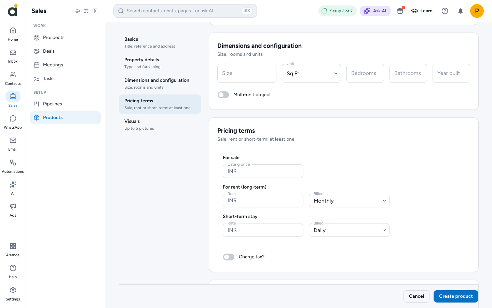

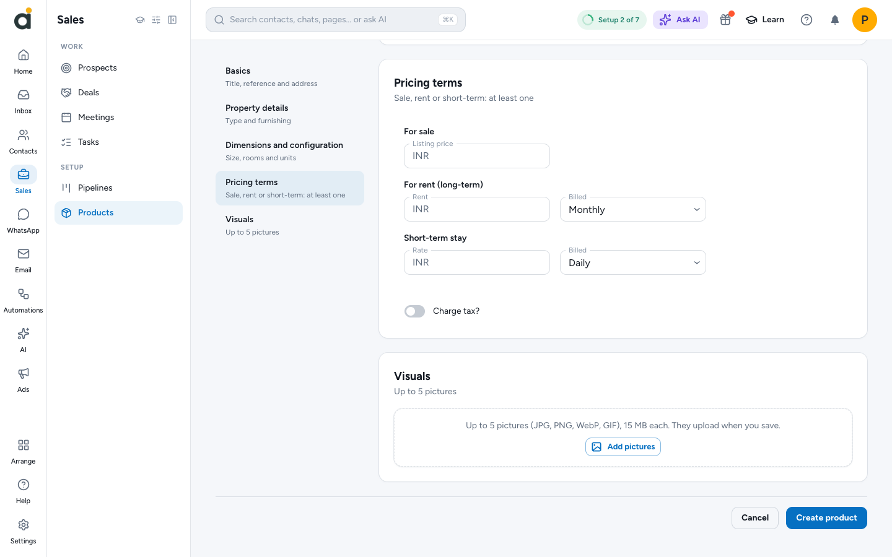

## Course

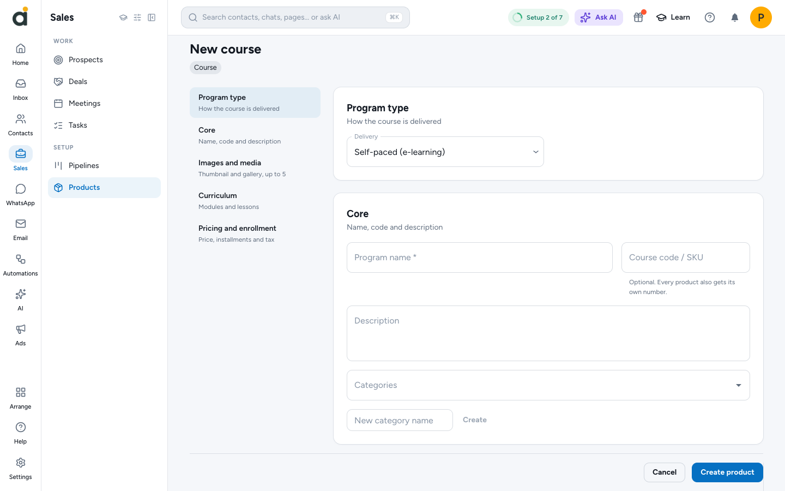

| Part | Fields | Notes |
| --- | --- | --- |
| **Program type** | **Delivery**: Self-paced (e-learning), Live classes or coaching, Academic program or degree | The rest of the form changes with it. |
| **Core** | **Program name** (required), **Course code / SKU**, **Description**, **Categories** | |
| **Images and media** | Thumbnail and gallery, up to 5 | Not for academic programmes. |
| **Curriculum** | **Add module**, with lessons in each | Optional for live classes. |
| **Live schedule and batches** | For live classes: **Batch name**, **Seats**, **Class timings**, **Starts**, **Ends** | Like "Weekend batch, 30 seats, Sat–Sun 10am–12pm". |
| **Pricing and enrollment** | **Pricing model**: One time (**Amount**), Installments (**Total amount**, **Number of installments**), Recurring (**Amount**, **Billed** monthly, quarterly or yearly); **Allow scholarships and coupons**; **Charge tax?** | |

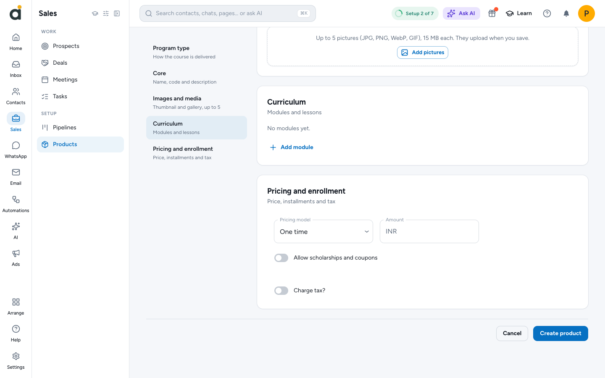

## After you save

The product opens on its own page, with **Active** status. It's ready to add to [deals](/help/crm/deal) and payment requests. See [Products](/help/crm/product) for the product page, stock, add-ons and the WhatsApp catalog.

## Troubleshooting

| Message | What to do |
| --- | --- |
| "Enter a full web address starting with http:// or https://." | The product link must be a full address. |
| "A tier's maximum quantity can't be lower than its minimum." | Fix the tier's quantities. |
| "The maximum order quantity can't be lower than the minimum." | Fix the wholesale limits. |
| "Use 1 to 3 options (e.g. Size, Colour)." / "Give every option a different name and at least one value, or turn variants off." | Fix the variant options. |
| "The expiry date must be after the manufacturing date." | Fix the batch dates. |

## FAQs

<AccordionGroup>
<Accordion title="I picked the wrong type.">
Open the product. On the **Overview** tab, change **Type** and click **Save changes**. Then click **Edit** to fill in what the new type asks for.
</Accordion>
<Accordion title="Should each flat be its own product?">
Yes, when each one is different (floor, view, price). For many identical flats of one plan, make one property and switch on **Multi-unit project** with the number of units.
</Accordion>
</AccordionGroup>

## Related

<CardGroup cols={2}>
<Card title="Products" icon="box" href="/help/crm/product">The list, the product page and the catalog.</Card>
<Card title="Deals" icon="handshake" href="/help/crm/deal">Add products to a deal.</Card>
</CardGroup>
