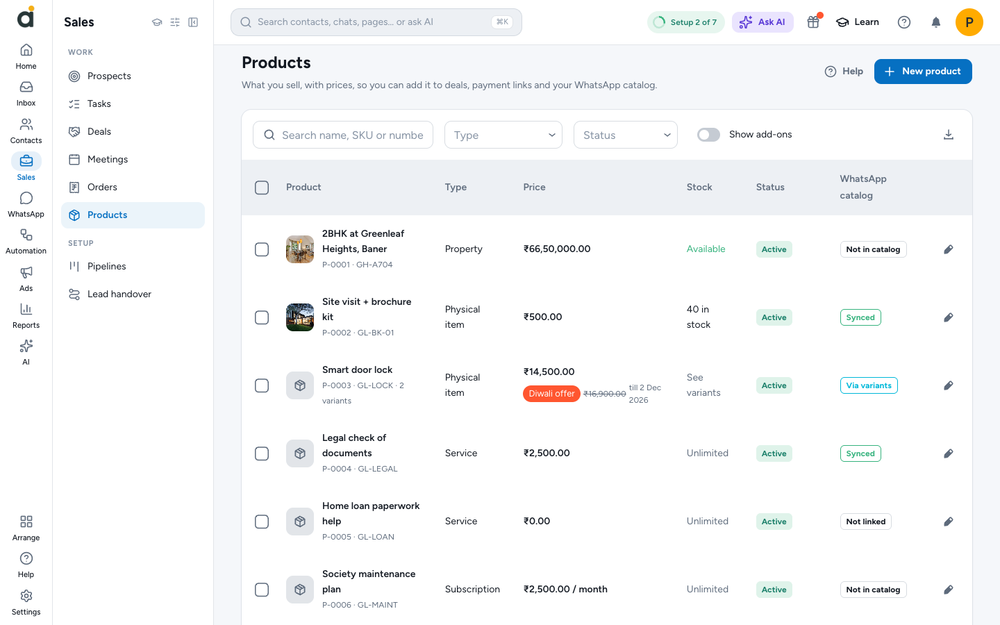
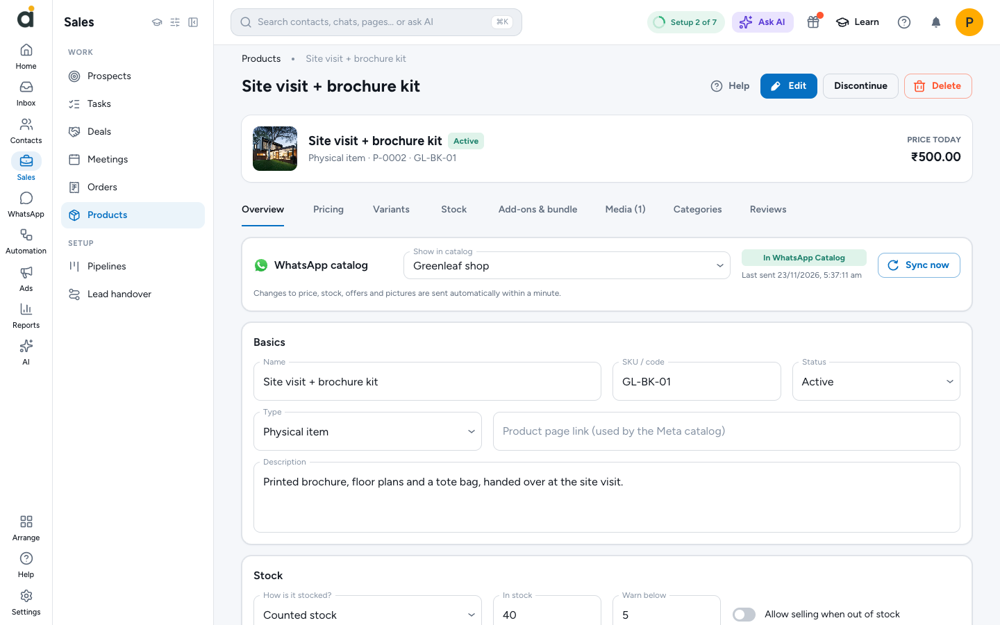
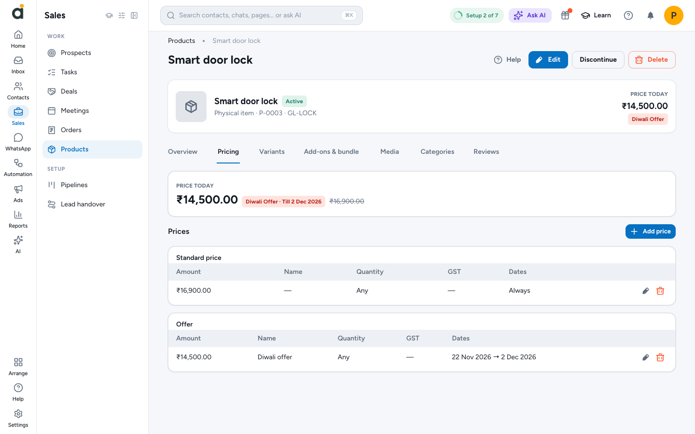
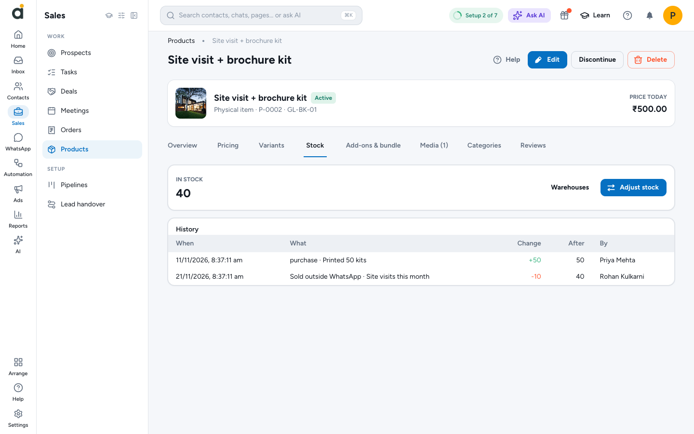
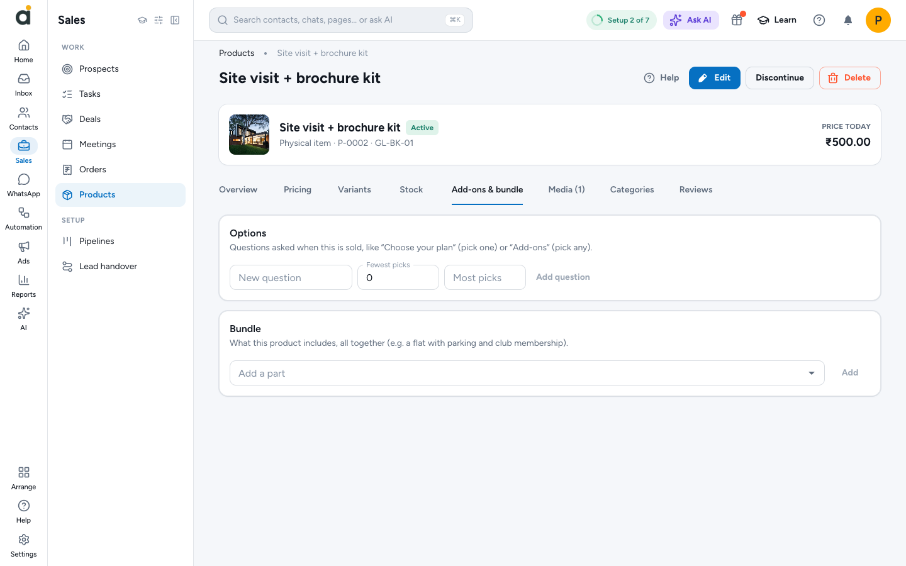
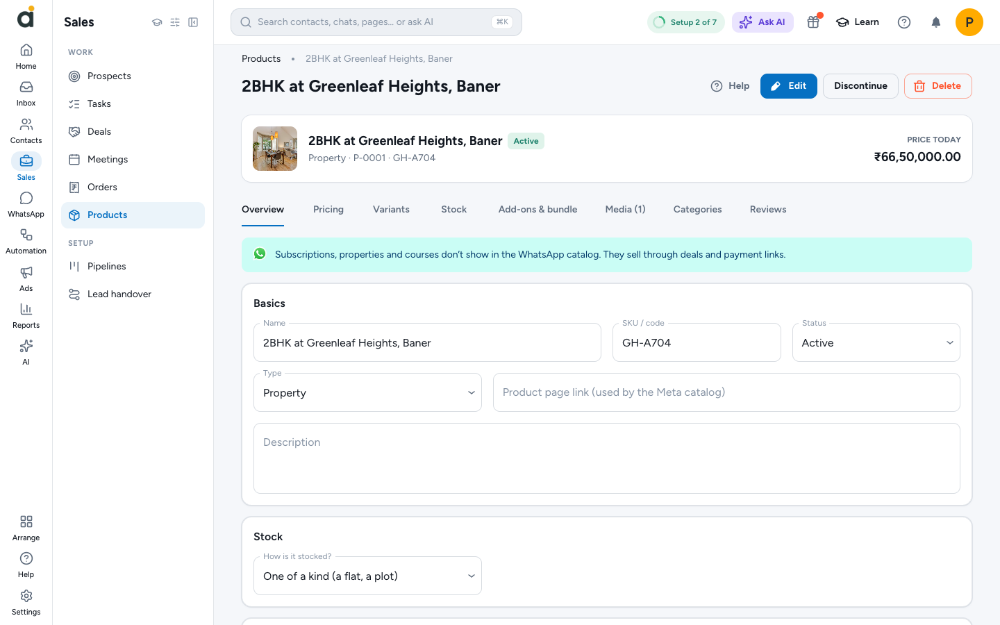
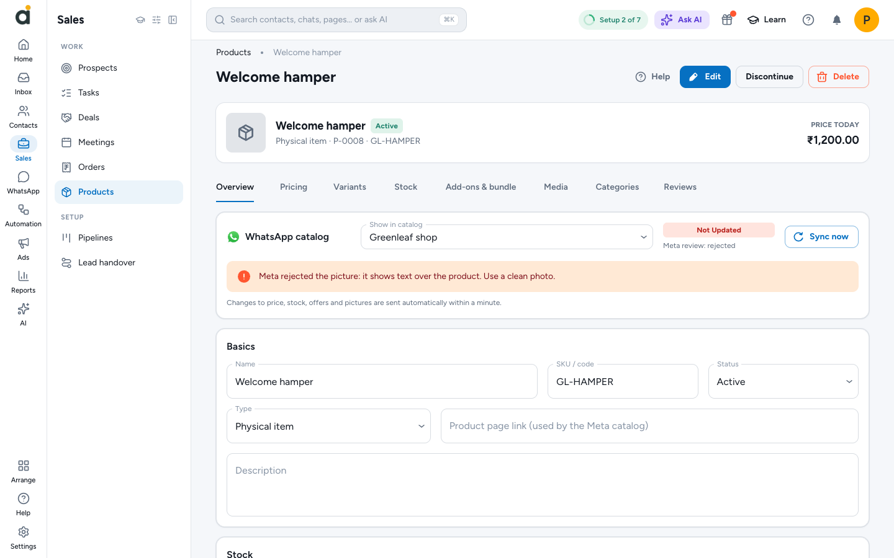
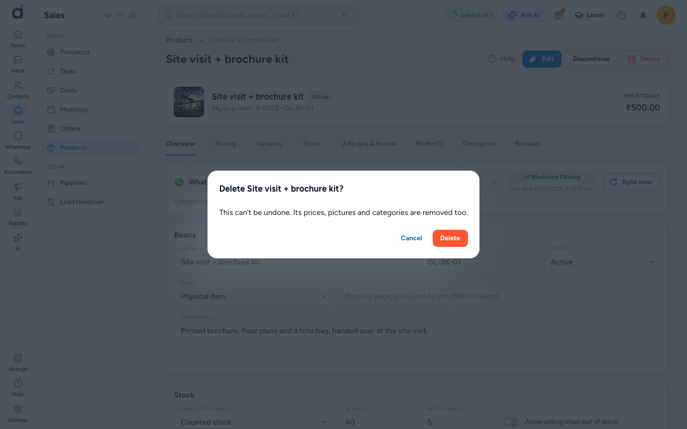

**Products** is your price list: flats, services, plans, courses, kits. Add them once and use them in [deals](/help/crm/deal), in [payment requests](/help/crm/deal-payments), in Pay Now cards from the inbox, and in your WhatsApp catalog.

**Where:** **Sales → Products** in the menu on the left. [Open it →](https://app.adsera.in/dashboard/crm/product)

To add one, click **New product** and pick its type. See [Product types and their fields](/help/crm/product-types).

## The list

| Column | Meaning |
| --- | --- |
| **Product** | Picture, name, product number (like P-0002), SKU and, for products with variants, how many. |
| **Type** | Physical item, Service, Subscription, Property or Course. |
| **Price** | The price now. An offer shows in red with the old price crossed out and its end date. Plans show "/ month". |
| **Stock** | "40 in stock" (red when below the low-stock alert), **Available** for a one-of-a-kind property, **Unlimited** when stock isn't tracked, **See variants** for products with variants. |
| **Status** | **Active** (on sale), **Draft** (not ready yet) or **Discontinued** (no longer sold, history kept). |
| **WhatsApp catalog** | See below. Point at it for what it means. |
| Pencil | Opens the edit form. |

| Control | What it does |
| --- | --- |
| **Search name, SKU or number** | Finds products. |
| **Type** | Only one type. |
| **Status** | Only Active, Draft or Discontinued. |
| **Show add-ons** | Also lists the extras sold with other products (like "Extra covered parking"). |
| Tick boxes | Tick products, then **Activate** or **Discontinue** them all at once. |
| Download icon | Saves the products on this page as a CSV file (Number, Name, Type, SKU, Price, Price type, Stock, Status). |

### WhatsApp catalog states

| State | Meaning | What to do |
| --- | --- | --- |
| **Synced** | Shown in your WhatsApp catalog. | Nothing. |
| **Pending** | Being sent to WhatsApp. | Wait a few minutes. |
| **Rejected** | Meta turned it down. | Open it: the reason is on its page. Fix the name, picture or product link and save. |
| **Not linked** | Not shown in WhatsApp. | Open it and pick a catalog under **Show in catalog**. |
| **Via variants** | Each variant is sent on its own. | Open it to see each variant. |
| **Not in catalog** | Subscriptions, properties and courses can't go in the catalog. | Sell them with a deal or a payment link. |

## A product's page

Click a product.

| Part | What it does |
| --- | --- |
| **Edit** | Opens the full form. |
| **Discontinue** / **Activate** | Stops or restarts selling it. |
| **Delete** | Removes it (see below). |
| **Price today** | What it costs now, offers included. |
| **Overview** | The **WhatsApp catalog** card, then the details you can change in place (Basics, Stock, Cost and order limits, Item details…). **Save changes** saves them. |
| **Pricing** | Every price: **Standard price**, **Offer** (with dates) and **Lowest allowed price** (only managers who can approve discounts can add it). **Add price**. |
| **Variants** | The sizes, colours… **Add an option**, **Create variants**. |
| **Stock** | How many are in stock, **Adjust stock**, **Warehouses** and the **History** of every change. Only for products that track stock. |
| **Add-ons & bundle** | **Options**: a question with choices sold with this product (**New question**, **Fewest picks**, **Most picks**, **Add question**). **Bundle**: the products inside this one (**Add a part**). |
| **Features** | For subscriptions: what each plan includes. |
| **Course** | For courses: modules and batches. |
| **Media** | Pictures, brochures and videos: **Choose files** or **Add link**. |
| **Categories** | Pick categories, or **Create** one, then **Save**. |
| **Reviews** | Customer reviews. |

## Show a product in your WhatsApp catalog

Only physical items and services. You need a WhatsApp catalog connected under **WhatsApp → WhatsApp Commerce**.

<Steps>
<Step title="Open the product">From the list.</Step>
<Step title="Pick the catalog under Show in catalog">In the **WhatsApp catalog** card on Overview. You see "Catalog set. It syncs in a few seconds."</Step>
<Step title="Optional: click Sync now">Sends it straight away ("Sent to WhatsApp catalog"). After that, price, stock, offers and pictures are sent by themselves within a minute of a change.</Step>
</Steps>

The card shows **In WhatsApp catalog**, **Not updated** (with Meta's reason in red) or **Removed from catalog**, when it was last sent, and Meta's review result.

## Discontinue or delete

- **Discontinue** stops new sales but keeps the product and its history in old deals. **Activate** brings it back.
- **Delete** asks "Delete …? This can't be undone. Its prices, pictures and categories are removed too." A product already used in a deal, or one with variants, can't be deleted: you see why, with **Discontinue instead**.

## When there are no products

The list says **No products yet** with a **New product** button.

## FAQs

<AccordionGroup>
<Accordion title="What's the difference between SKU and the product number?">
The SKU is your own code, if you use one. The product number (P-0001…) is given by AdsEra to every product.
</Accordion>
<Accordion title="Can a deal use a different price than the product?">
Yes. On the deal, type another **Unit price** or a discount for that deal. The product's price doesn't change.
</Accordion>
<Accordion title="Does stock go down when someone pays?">
Yes, for products that track stock, when a payment request on a deal is paid. If it fails, the deal's Payments shows "Stock not updated" with **Check now**.
</Accordion>
</AccordionGroup>

## Related

<CardGroup cols={2}>
<Card title="Product types and their fields" icon="boxes-stacked" href="/help/crm/product-types">Every form, field by field.</Card>
<Card title="Deals" icon="handshake" href="/help/crm/deal">Add products to a deal.</Card>
<Card title="Collect a payment" icon="indian-rupee-sign" href="/help/crm/deal-payments">Ask for the money.</Card>
</CardGroup>
