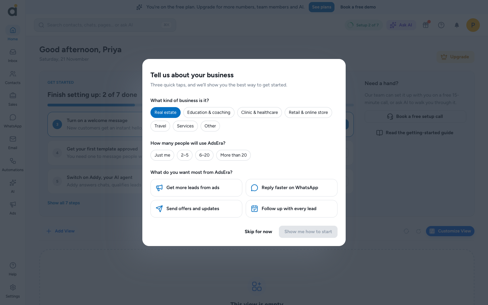
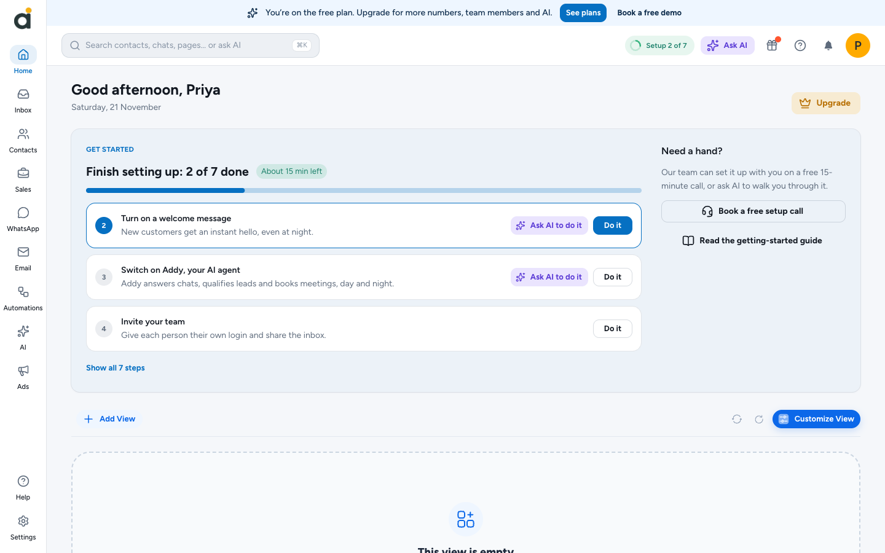

Welcome to your AdsEra Dashboard! This is the first page you see after logging in. It serves as your mission control, providing either an onboarding guide to get you started or a high-level overview of your recent activity and performance.

**Want to See Dashboard? [Go to the AdsEra Dashboard Page &rarr;](https://app.adsera.in/dashboard/app)**

The content on your dashboard will evolve as you use the platform.

---

<Tabs>
<Tab title="New User Dashboard">

When you first sign up, Home shows a **Get started** checklist. Each step takes a few minutes, and AdsEra ticks it off by itself once it is done.

The first time you open Home, AdsEra asks three quick questions: what kind of business you run, how many people will use AdsEra, and what you want most from it (more leads from ads, faster replies, sending offers, or following up with every lead). Your answer puts the most useful steps first.

You can skip it, and change your business type and main goal later under **Settings → Company → Edit details**.

### The "Get started" checklist

1.  **Connect your WhatsApp number.** See [Connecting WhatsApp](/help/channel/whatsapp/connect).
2.  **Add your contacts.** Import a file or Google Sheet. People who message you are added on their own.
3.  **Turn on a welcome message**, so new customers get an instant hello. See [Auto-replies and welcome messages](/help/autoreply/wa).
4.  **Get your first template approved.** You need one to message people who have not written to you in the last 24 hours. See [WhatsApp templates](/help/template/wa).
5.  **Switch on Addy, your AI agent.** See [Addy](/help/ai/addy).
6.  **Invite your team**, so everyone has their own login.
7.  **Send your first broadcast.** See [Create a broadcast](/help/campaign/wa/create).

Each step has a **Do it** button that takes you to the right page. Many also have **Ask AI to do it**: Ask AI walks you through the step and sets it up with you.

While steps are left, the top bar shows your progress, for example **Setup 4 of 7**. Click it to come back to the checklist.

<Tip>
Stuck? Click **Book a free setup call** next to the checklist and our team will set it up with you.
</Tip>

The checklist is shown to people who can connect WhatsApp numbers (usually the account owner and admins).

</Tab>

<Tab title="Active Dashboard">
Once you're up and running, the dashboard becomes a set of **views**, each a grid of cards you can arrange yourself.

### Views

Switch views with the tabs at the top, for example **Campaigns**, **WhatsApp**, **Detailed**, **Analytics** and **Automations**. From the view menu you can:

- create a new view (give it a **View Name**, and clone the layout from a template or an existing view),
- **Reorder views**,
- set the **Default landing view**,
- **Reset all views back to factory defaults**.

### Cards

Click **Add a card** and pick a module (contacts, campaigns, deals, tasks, chats and more). Then set:

- **How it shows the data:** Table / List, Graph & Chart (bar, line, area, donut or pie), Metric Summary or Detail Summary.
- **Card Title**, columns, chart metric and **filters** (combine rules with AND).
- **Date range:** last 7, 14, 30 or 90 days, last 12 months, or all time.
- **Width:** one third, half, two thirds or full width.
- **Linked filters:** *When a row is picked in…* another card, filter this card.

Drag cards to rearrange them, use **Columns, chart & filters** to edit a card, and **Remove card** to delete it. Turn on auto-refresh (every 1, 5, 15 or 30 minutes) to keep a wall screen up to date.

Cards only show data you're allowed to see. A card you don't have access to shows **No access**.
</Tab>
</Tabs>