**Home** is the first page you see after you sign in. In one look it tells you what is waiting for you today, how business is going, what is left to set up and what to do next. Further down, **Your cards** holds views you arrange yourself, from any area of AdsEra.

**Where to find it:** click **Home** at the top of the icon rail on the left, or open [app.adsera.in/dashboard/app](https://app.adsera.in/dashboard/app).

<Tip>
Want AdsEra to show you each part on the real page? Open **Learn → Getting started → Your Home page** and click **Do it with me** on any lesson. See [Learn with the Education hub](/help/introduction/education-hub).
</Tip>

---

## The parts of Home

| Part | What it shows | Where it takes you |
| --- | --- | --- |
| **Greeting** | Good morning / afternoon / evening, today’s date and how many things need you today. | |
| **Needs you today** | Everything waiting for you, most urgent first. The first row’s blue button is the next best thing to do. | The page where you deal with it. |
| **How business is going** | New leads, messages from customers, deals won and their value, compared with the time before. | Contacts, WhatsApp chats, Deals. |
| **Finish setting up** | Your 7 setup steps until they are all done, with **Do it with me** and **Ask AI to do it**. | The page for each step. |
| **Need a hand?** | Book a free setup call, the Education hub, the getting-started guide. | |
| **Your cards** | Views (tabs) of cards you choose yourself: tables, charts and numbers from any area. | |

---

## Needs you today

Each row says in one line what is waiting, with names where it helps, and has one button that opens the right page. Red rows stopped working, amber rows need a look soon, the rest is today’s work. Rows are listed most urgent first, and the first row’s button is blue: that is the thing to do next.

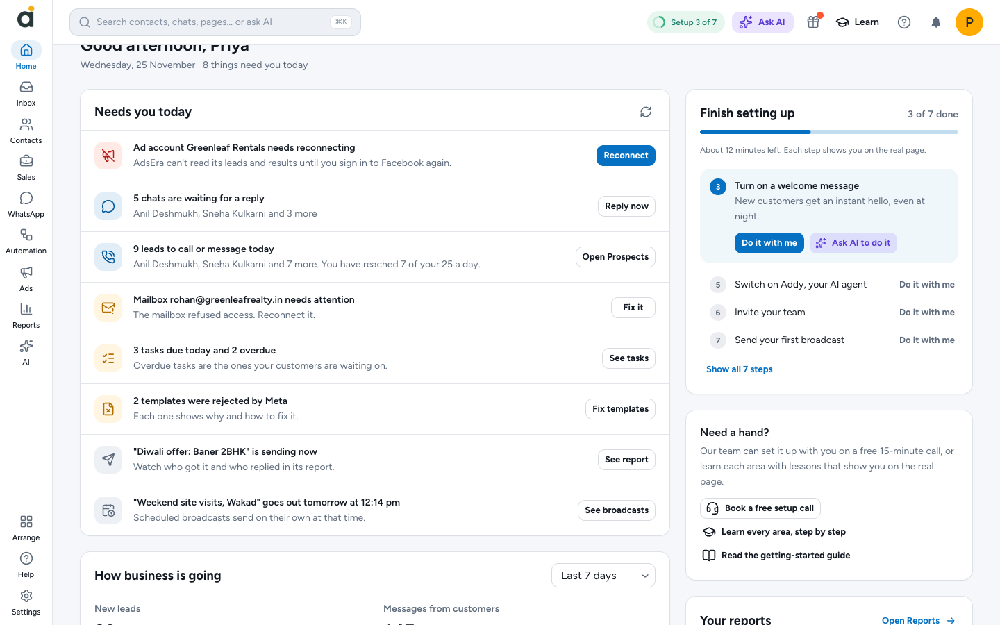

| Row | When it shows | What to do | Button |
| --- | --- | --- | --- |
| **Your WhatsApp number … is disconnected** | A connected number lost its connection. Customers can’t reach you on it. | Reconnect it on WhatsApp → Numbers & profile. | **Reconnect** |
| **Ad account … needs reconnecting** | Facebook signed AdsEra out of an ad account, so leads and results stop coming in. | Sign in to Facebook again on Ads → Meta Ads. | **Reconnect** |
| **Mailbox … needs attention** | A mailbox you own or manage stopped syncing. The reason shows under it. | Reconnect it on Email → Mailboxes. | **Fix it** |
| **N chats are waiting for a reply** | Customers wrote and nobody has replied yet. Shows the first names. | Reply in your WhatsApp chats. | **Reply now** |
| **N leads to call or message today** | Your list in Prospects for today, and how many you have reached against your daily goal. | Work the list in Sales → Prospects. | **Open Prospects** |
| **N tasks due today and N overdue** | Open tasks due today, or past their due date. | Tick them off in Sales → Tasks. | **See tasks** |
| **N templates were rejected by Meta** | A WhatsApp template was rejected. Each one says why and how to fix it. | Fix and resubmit on WhatsApp → Templates. | **Fix templates** |
| **Meta rates … as low quality** | Too many people blocked or reported a number. | Send fewer marketing messages for a few days. | **See number** |
| **"…" is sending now** | A broadcast is going out right now. | Watch who got it and who replied. | **See report** |
| **"…" goes out tomorrow at 10:00 am** | Your next scheduled broadcast. | Nothing: it sends on its own. | **See broadcasts** |

A row disappears by itself once it is dealt with. Home checks again every time you open it; the round arrow at the top right of the card (**Check again**) checks right now.

<Note>
Team members only see rows for the parts of AdsEra their role lets them open. For example, someone who can’t open Sales won’t see tasks or leads to call.
</Note>

When nothing is waiting, the card says **Nothing needs you right now**:

---

## How business is going

Four numbers that tell you whether business is moving. Pick the time in the box at the top right of the card: **Today**, **Last 7 days**, **Last 30 days** or **Last 90 days**. AdsEra remembers your choice on this computer.

| Number | What it counts | Opens |
| --- | --- | --- |
| **New leads** | People added as contacts in that time: from ads, forms, chats and imports. | Contacts |
| **Messages from customers** | WhatsApp messages you received in that time. | WhatsApp chats |
| **Deals won** | Deals moved into a won stage, counted by each deal’s **close date**. | Deals |
| **Value of deals won** | The total value of those deals, in rupees. | Deals |

Under each number a line compares it with the same length of time just before, for example *4 more than the 7 days before* or *₹56,00,000 more than the 30 days before*. **Today** compares with yesterday up to the same time of day. A green arrow means up, a red arrow means down. When there is nothing yet, the card says *These fill in as leads come in, customers message you and you win deals.*

<Tip>
Set a deal’s **Close date** when you mark it won, so it is counted in the right week. See [Deals](/help/crm/deal).
</Tip>

---

## Finish setting up

Until all 7 steps are done, the right side of Home shows your setup progress. The highlighted step is your next one.

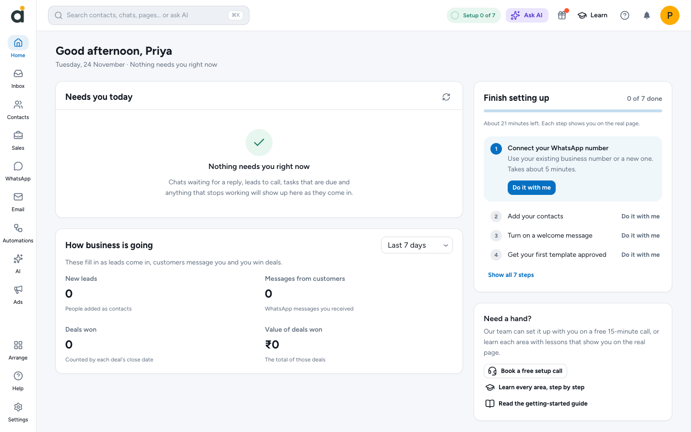

- **Do it with me** opens the right page and points at each thing to click.
- **Ask AI to do it** (purple) asks [Ask AI](/help/ai/ask-ai) to set it up for you. It asks before it changes anything. Steps that need you yourself (like your Facebook login) don’t have it.
- The steps after it are listed below, each with its own **Do it with me**.
- **Show all 7 steps** also shows the finished ones, with **Do it again** (another template, another teammate).

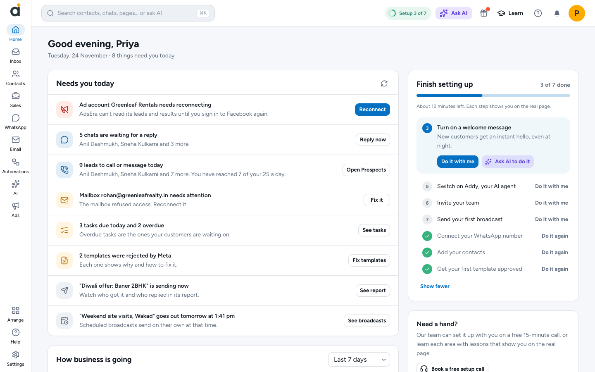

The 7 steps, in the order that suits the goal you picked when you signed up:

1. **Connect your WhatsApp number.** See [Connecting WhatsApp](/help/channel/whatsapp/connect).
2. **Add your contacts.** Import a file or Google Sheet. People who message you are added on their own.
3. **Turn on a welcome message**, so new customers get an instant hello. See [Auto-replies](/help/autoreply/wa).
4. **Get your first template approved.** You need one to message people who have not written to you in 24 hours. See [WhatsApp templates](/help/template/wa).
5. **Switch on Addy, your AI agent.** See [Addy](/help/ai/addy).
6. **Invite your team**, so everyone has their own login. See [Team members](/help/account/team).
7. **Send your first broadcast.** See [Create a broadcast](/help/campaign/wa/create).

A step is ticked only when the job is really done in your account (for example, a template approved by Meta), never just by clicking through. While steps are left, the top bar shows **Setup 3 of 7**: click it from any page to come back here. When all 7 are done the card goes away. Team members who can’t connect a WhatsApp number don’t see it.

### The first time you open Home

A window, **Tell us about your business**, asks three quick questions: **What kind of business is it?**, **How many people will use AdsEra?** and **What do you want most from AdsEra?** (**Get more leads from ads**, **Reply faster on WhatsApp**, **Send offers and updates** or **Follow up with every lead**). Your answer puts the most useful setup steps first. **Skip for now** closes it; you can set your business type later under **Settings → Company**. Only admins see it.

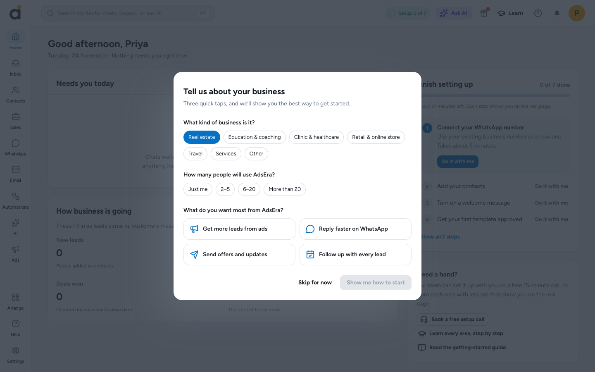

---

## Need a hand?

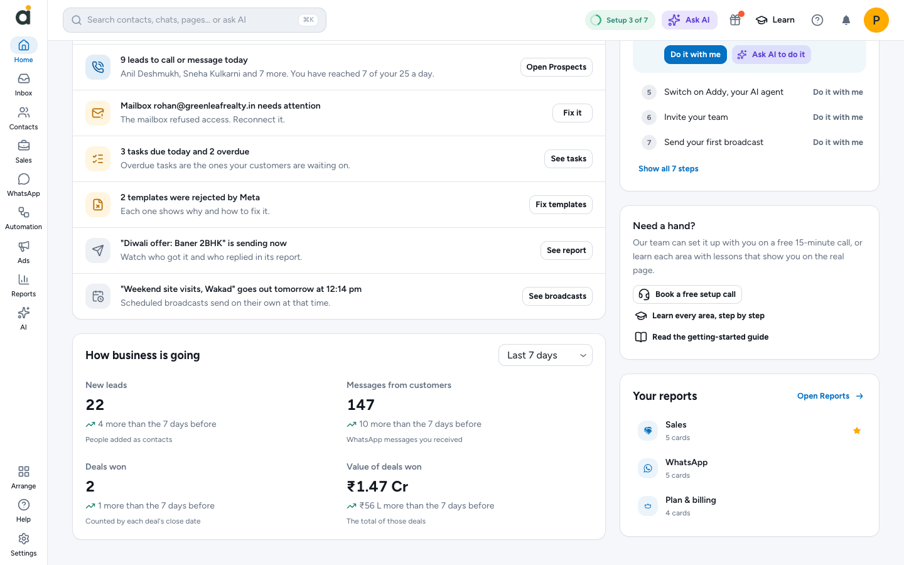

- **Book a free setup call**: pick a 15-minute slot with the AdsEra team.
- **Learn every area, step by step**: the [Education hub](/help/introduction/education-hub).
- **Read the getting-started guide**: [Introduction](/help/introduction/adsera), in a new tab.

---

## Your cards

Below the numbers, **Your cards** holds your own views of any area. A **view** is a tab with cards on it; a **card** shows one thing as a table, a chart or a few numbers, for example *My daily tasks* or *Deal value by stage*. Each person has their own views.

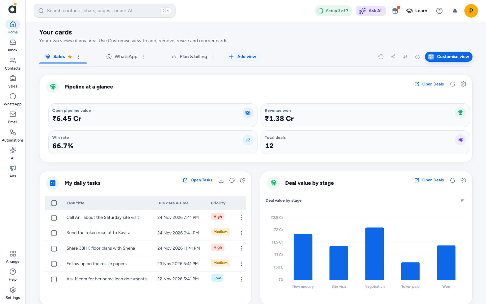

### Pick your first cards

The first time, **Your cards** offers two ways to start:

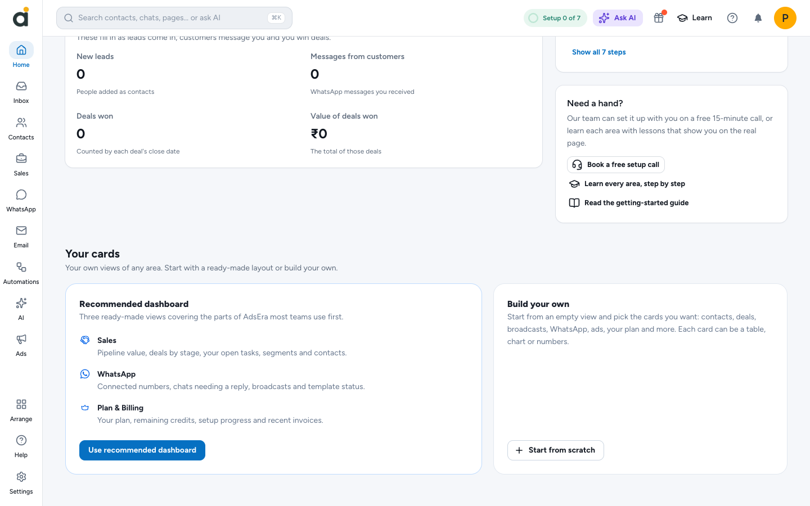

<Steps>
  <Step title="Recommended dashboard">
    Click **Use recommended dashboard** to add three ready-made views: **Sales** (pipeline value, your open tasks, deal value by stage, segments, contacts), **WhatsApp** (your numbers, chats needing a reply, recent broadcasts, templates) and **Plan & Billing** (your plan, setup progress, invoices).
  </Step>
  <Step title="Or build your own">
    Click **Start from scratch** to get one empty view called *My Dashboard*. **Add a card** opens so you can pick each card yourself.
  </Step>
</Steps>

Either way you can change everything later.

### Views

- Click a tab to open that view. The address in your browser remembers it, so you can bookmark a view.
- The **star** marks your **default view**: Home opens on it, and it always stays first.

**Add a view:** click **Add view** next to the tabs and type the **View name**. Under **Start from**, keep **An empty view** or pick **A copy of** one of your views. Click **Create view**, then fill it with **Customise view**.

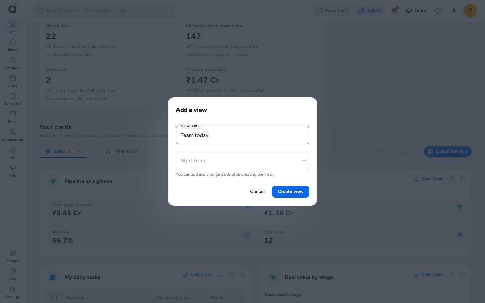

**Change a view:** click the **⋮** next to its name.

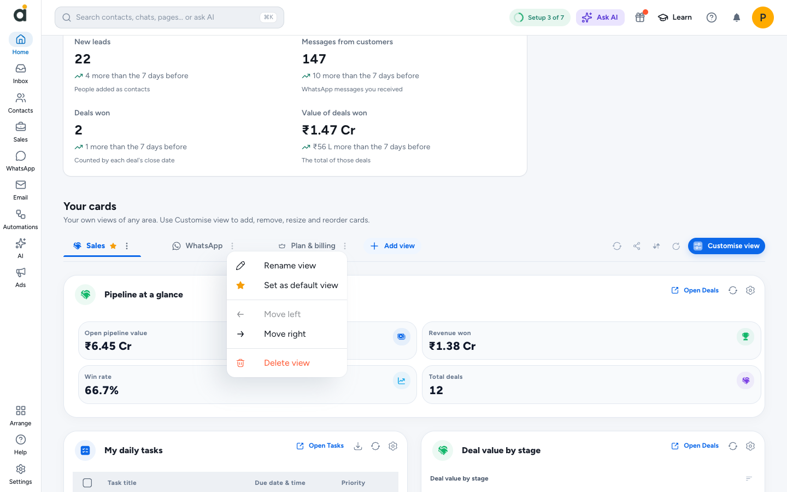

| Choice | What it does |
| --- | --- |
| **Rename view** | Change its name. |
| **Set as default view** | Home opens on it. The default view always stays first. |
| **Move left** / **Move right** | Change the order of the tabs. The default view can’t move. |
| **Delete view** | Removes the view and its cards. You must keep at least one view. |

### Customise view: resize, reorder and remove cards

Click **Customise view** (blue, on the right above your cards). A panel opens on the right with three tabs.

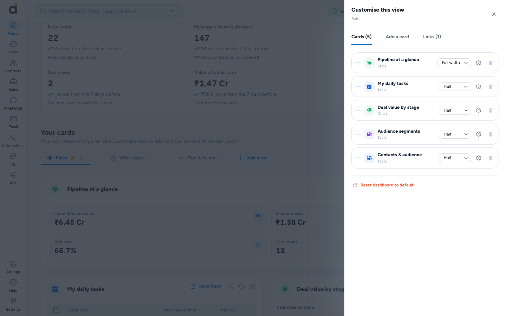

**Cards** lists every card on this view, in order.

- Drag a card by its handle to move it.
- The box next to a card sets its **width**: **One third**, **Half**, **Two thirds** or **Full width** of the row. Cards sit side by side when they fit.
- The **gear** opens the card’s settings (below). The **bin** (**Remove card**) takes it off this view.
- **Reset dashboard to default** puts every view back to the starting layout.

Changes save as you make them.

### Add a card

In **Customise view**, open **Add a card**.

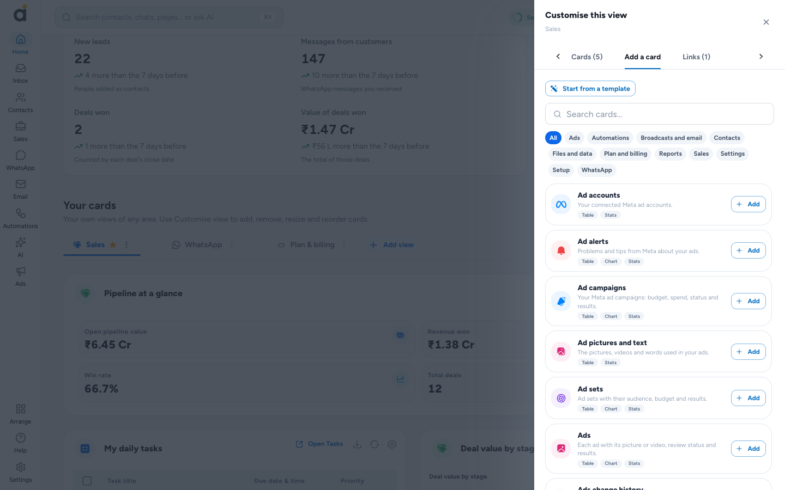

1. Type in **Search cards…**, or tap an area: **Contacts**, **Sales**, **WhatsApp**, **Broadcasts and email**, **Automations**, **Ads**, **Plan and billing**, **Settings**, **Files and data**, **Setup**, **Reports**.
2. Each card says what it shows and how it can look: **Table**, **Chart** or **Numbers**.
3. Click **Add**. The card goes to the end of the view. The number next to **Add** tells you how many of that card the view already has.

You only see cards for the areas your role lets you open. Ads cards appear once an ad account is connected.

**A whole view at once:** click **Start from a template** and pick **Sales Pipeline**, **WhatsApp Operations**, **Meta Ads Performance** or **Audience Growth**. It is added as a new view with its cards filled in.

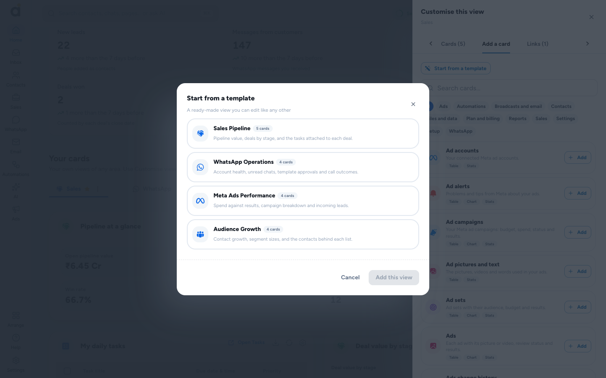

### Change a card

Click the **gear** at the top of a card (or in **Customise view**). The settings have three steps: **Look and size**, **What it shows** and **Filters**. **Save changes** saves at any step; **Next** goes on.

<Steps>
  <Step title="Look and size">
    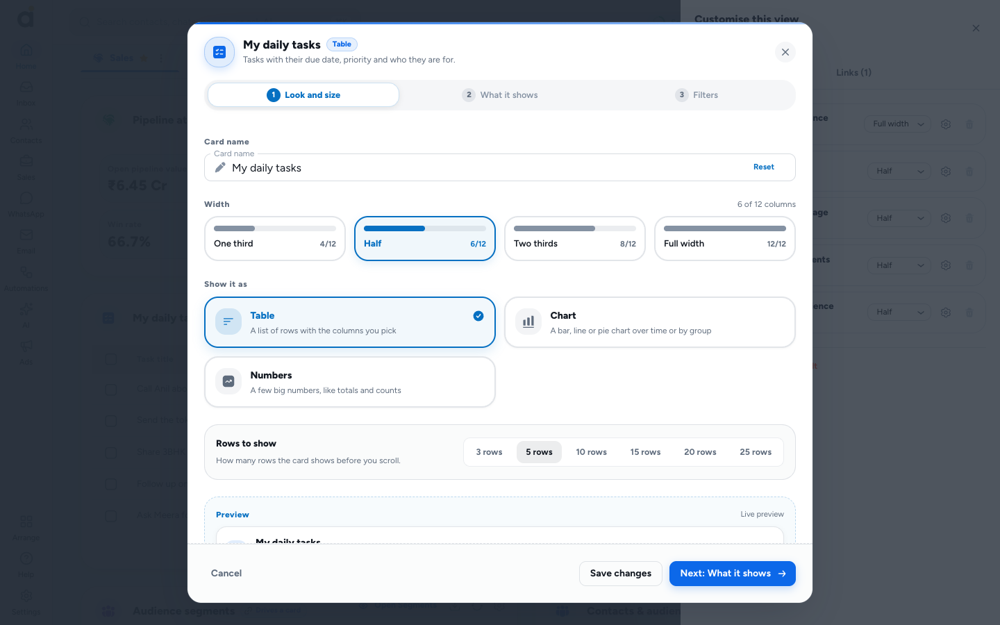

    | Setting | What it does |
    | --- | --- |
    | **Card name** | The name on the card. **Reset** goes back to the standard name. |
    | **Width** | **One third**, **Half**, **Two thirds** or **Full width**. |
    | **Show it as** | **Table** (rows with the columns you pick), **Chart** (bar, line, area, donut or pie), **Numbers** (a few big totals) or **Summary** (name and value lines, for your plan). Only the ways that card supports are offered. |
    | **Rows to show** | For a table: 3, 5, 10, 15, 20 or 25 rows before you scroll. |
  </Step>
  <Step title="What it shows">
    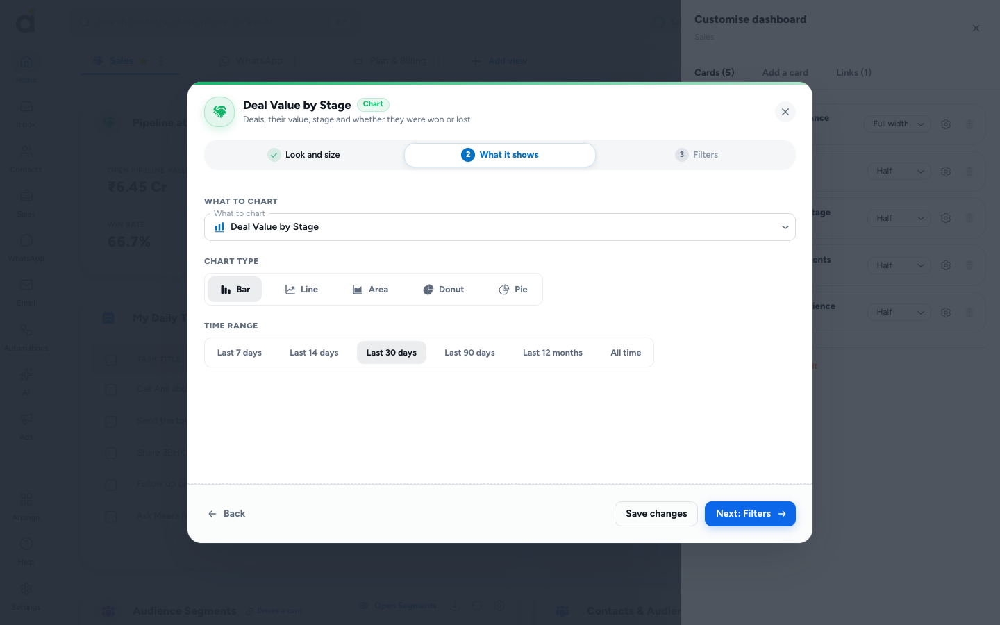

    - **Table:** tick the **Columns shown**, drag them into order, and add **More fields**.
    - **Chart:** pick **What to chart** (for example *Deal value by stage*) and the **Chart type**: **Bar**, **Line**, **Area**, **Donut** or **Pie**.
    - **Numbers:** tick the **Numbers to show**.
    - **Time range:** **Last 7 days**, **Last 14 days**, **Last 30 days**, **Last 90 days**, **Last 12 months** or **All time** (some cards also take your own dates).
  </Step>
  <Step title="Filters">
    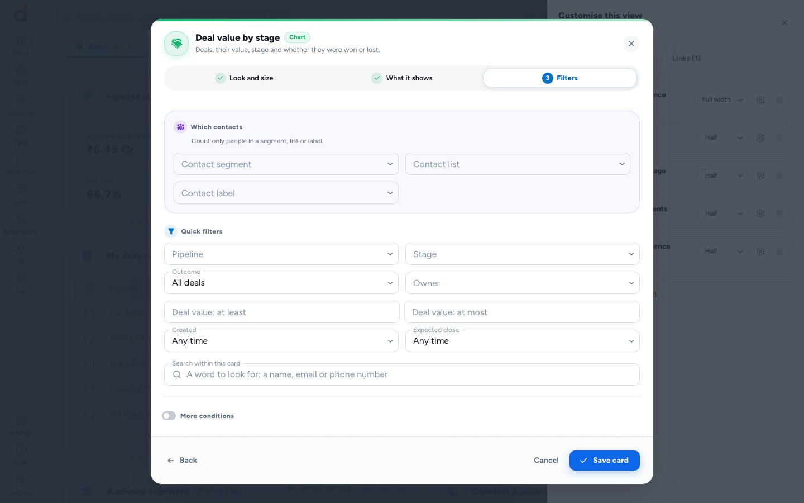

    - **Which contacts:** only people in one segment, list or label.
    - **Quick filters:** the choices this kind of card has, for example **Pipeline**, **Stage**, **Outcome**, **Owner**, a value range or a **Created** date.
    - **Add a condition** for anything else, and **Search within this card** to match a word.

    Click **Save card**.
  </Step>
</Steps>

### Use a card

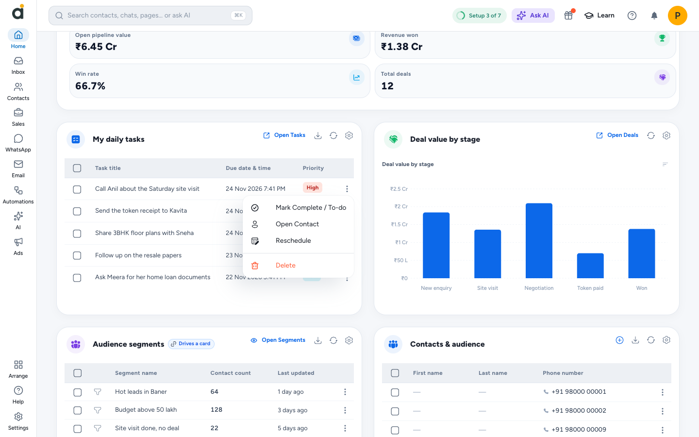

- **Open …** at the top (for example **Open Tasks**) opens the page behind the card.
- The **round arrow** refreshes the card; the **download arrow** saves its rows as a **CSV** or **Excel** file; the **gear** opens its settings.
- On a table, the **⋮** at the end of a row has actions for that record, like **Mark Complete / To-do**, **Open Contact** or **Reschedule** on a task. Actions that change something ask first, and only show if your role allows them.

### Link two cards

Make one card filter another: pick a segment in one card and the contacts card shows only that segment’s people. In **Customise view**, open **Links**, choose the card you’ll pick from under **When a row is picked in…**, then the card it should filter, and click **Connect**. The first card then shows **Drives a card**; click a row in it to filter, click it again to clear.

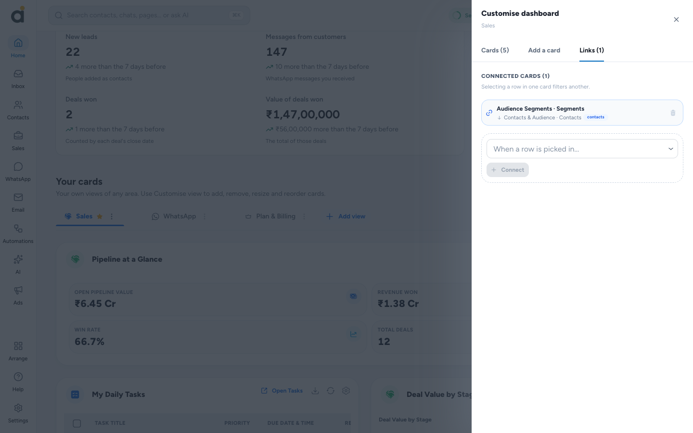

### Share, auto-refresh, reorder and reset

The small buttons next to **Customise view** (under **More dashboard options**, the **…**, on a smaller screen):

| Button | What it does |
| --- | --- |
| **Share this view with your team** | Your team can see it and copy it to their own Home. Click again to make it private. A badge shows views your team shared with you. |
| **Auto-refresh** | Reload the cards **Off**, **Every minute**, **Every 5 minutes**, **Every 15 minutes** or **Every 30 minutes**. Remembered on this computer: handy on a screen in the office. |
| **Reorder views** | Drag the tabs into order (shows when you have more than one view). |
| **Reset all views to the starting layout** | Removes every view, card and change and puts back the starting layout. It asks first and can’t be undone. |

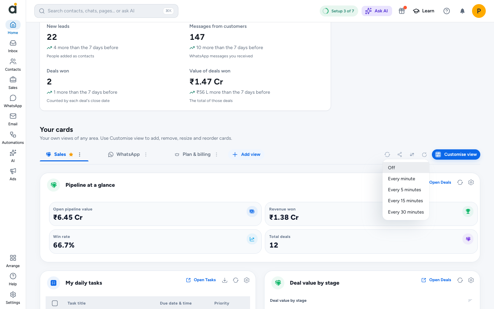

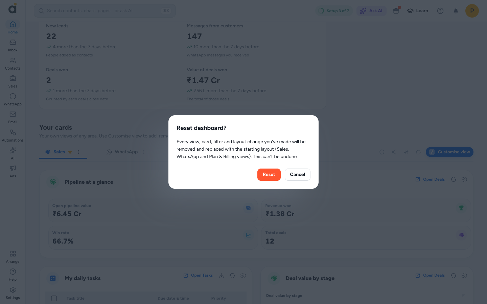

---

## Other states

<Tabs>
  <Tab title="Brand new account">
    Nothing set up yet: the checklist starts at step 1, the numbers are empty and **Your cards** asks how to start.

    
  </Tab>
  <Tab title="Setup finished">
    The setup card is gone; **Need a hand?** stays.

    
  </Tab>
  <Tab title="Loading">
    Grey placeholders show while Home checks what needs you.

    
  </Tab>
  <Tab title="Couldn't load">
    If the connection drops: *We couldn’t check what needs you* with **Try again**. Nothing is lost.

    
  </Tab>
  <Tab title="On a phone">
    Everything stacks in one column: Needs you today first.

    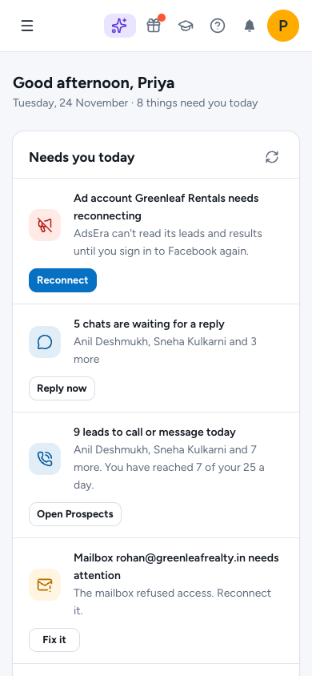
  </Tab>
</Tabs>

---

## Troubleshooting

| What you see | Why | What to do |
| --- | --- | --- |
| A card says **You don’t have access to this** | Your role can’t open that area. | Ask an admin for access, or remove the card. |
| **Nothing to show here yet** on a view | Every card on it is for an area you can’t open. | Ask an admin, or add a card for something you can see. |
| **Deals won** shows 0 though you won deals | Deals are counted by their close date. | Set the **Close date** on the won deals. |
| A card added for Ads isn’t offered | Ads cards appear only after an ad account is connected. | Connect one under **Ads → Meta Ads**. |
| A card disappeared after an update | AdsEra removed a card for a feature that no longer exists, and showed a message. | Add a different card. |
| **We couldn’t load these numbers just now** | A connection hiccup. | Click **Try again**. |

---

## FAQs

<AccordionGroup>
  <Accordion title="Do my changes to Your cards affect my team?">
    No. Each person has their own views. A view you **share** can be seen and copied by your team, but their copy is theirs.
  </Accordion>
  <Accordion title="Where does Home get Needs you today from?">
    From your chats, Prospects, tasks, broadcasts, templates, WhatsApp numbers, ad accounts and mailboxes, every time you open Home. It never changes anything by itself.
  </Accordion>
  <Accordion title="Why is the setup checklist missing?">
    All 7 steps are done, or your role can’t connect a WhatsApp number. The Education hub still has every lesson.
  </Accordion>
  <Accordion title="Can I move or hide Needs you today?">
    Not yet: the top of Home is the same for everyone. Your own layout lives under **Your cards**.
  </Accordion>
  <Accordion title="Is money collected through WhatsApp Pay shown here?">
    Not on Home. **Value of deals won** is the value of your won deals. Payments are on each deal and under **Ads → WhatsApp Pay**.
  </Accordion>
</AccordionGroup>

---

## Related

<CardGroup cols={2}>
  <Card title="Find your way around" icon="compass" href="/help/introduction/getting-around">
    The icon rail, Arrange, side menus and the top bar.
  </Card>
  <Card title="Learn with the Education hub" icon="graduation-cap" href="/help/introduction/education-hub">
    Courses, Do it with me, learning mode and Help on every page.
  </Card>
  <Card title="Prospects" icon="phone" href="/help/sales/prospects">
    Your daily list of leads to call.
  </Card>
  <Card title="Deals" icon="handshake" href="/help/crm/deal">
    Pipelines, stages and close dates.
  </Card>
</CardGroup>
