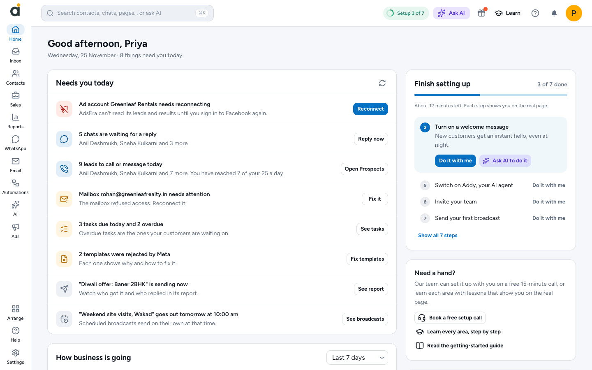
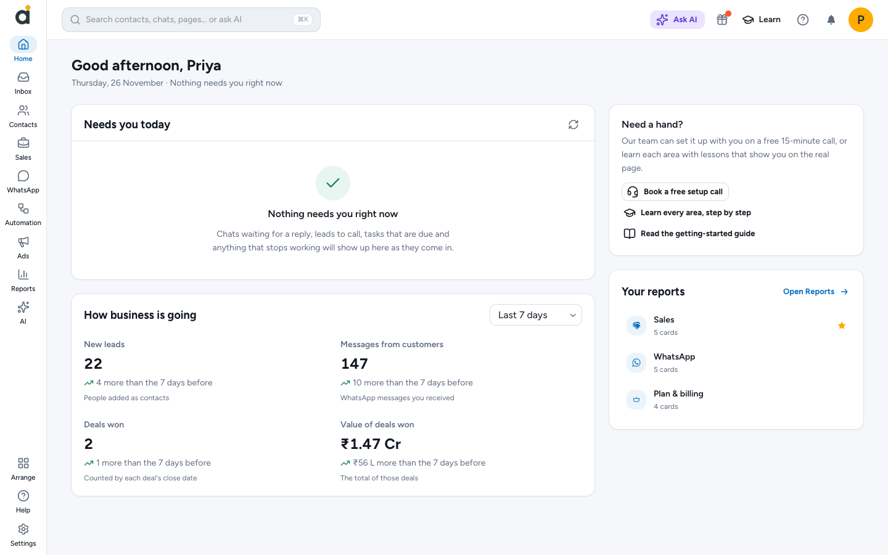
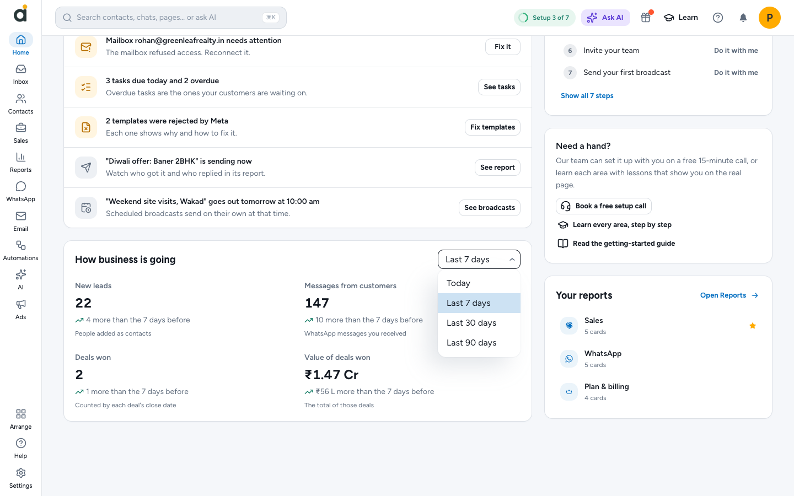
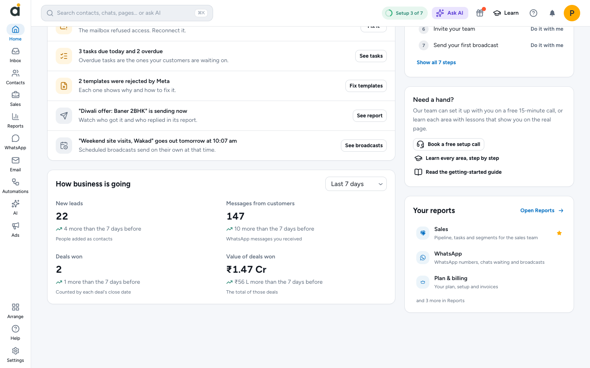
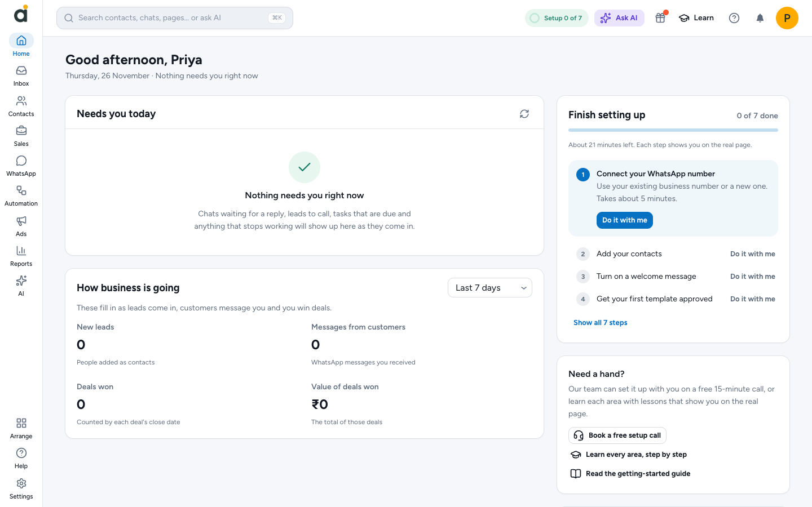
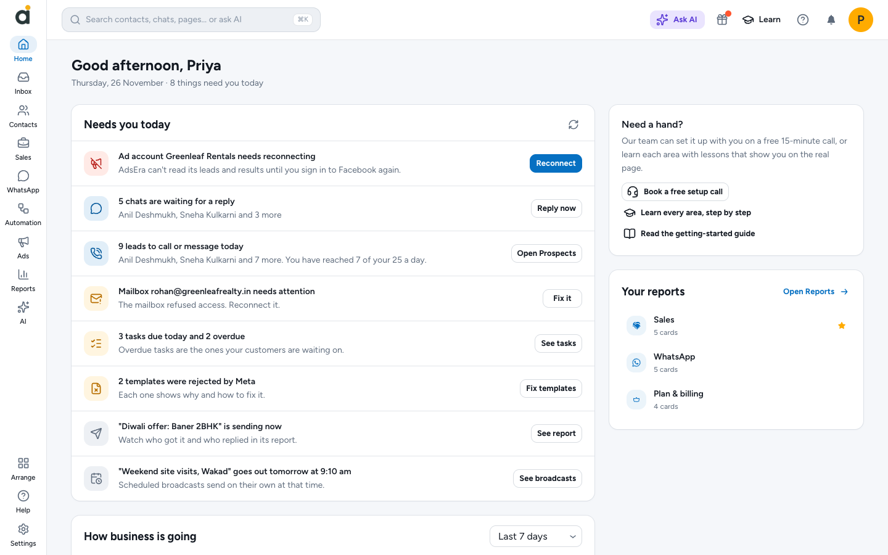
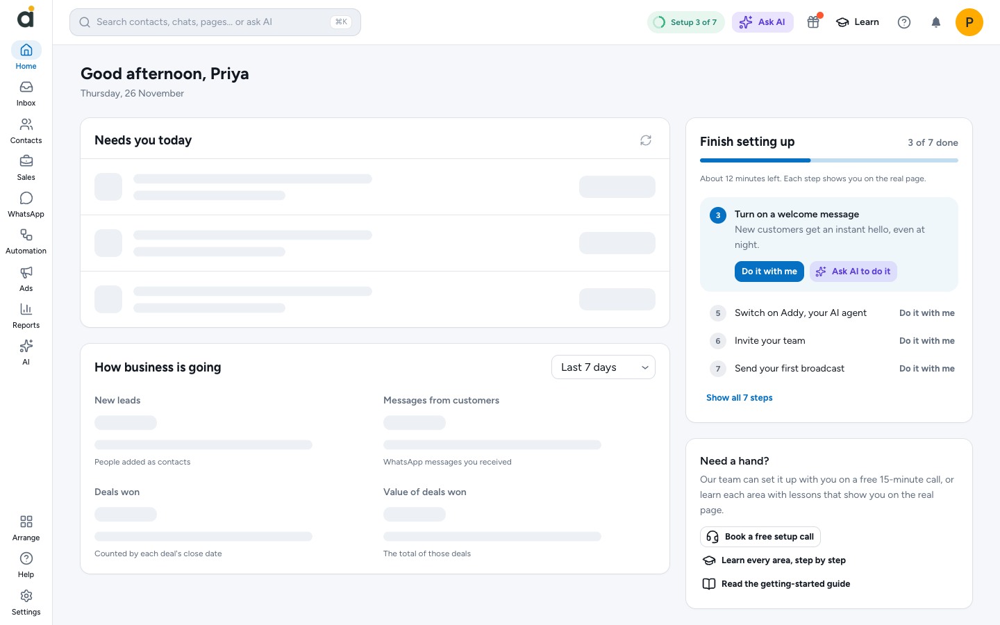
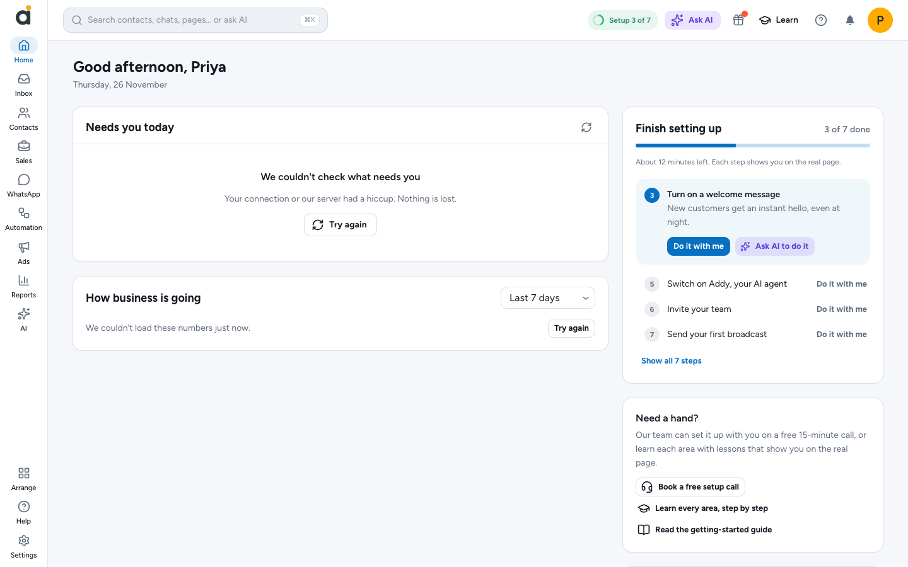

**Home** is the first page you see after you sign in. In one look it tells you what is waiting for you today, how business is going, what is left to set up and what to do next. On the right, **Your reports** opens the pages of cards you build yourself in [Reports](/help/reports).

**Where to find it:** click **Home** at the top of the icon rail on the left, or open [app.adsera.in/dashboard/app](https://app.adsera.in/dashboard/app).

<Tip>
Want AdsEra to show you each part on the real page? Open **Learn → Getting started → Your Home page** and click **Do it with me** on any lesson. See [Learn with the Education hub](/help/introduction/education-hub).
</Tip>

---

## The parts of Home

| Part | What it shows | Where it takes you |
| --- | --- | --- |
| **Greeting** | Good morning / afternoon / evening, today’s date and how many things need you today. | |
| **Needs you today** | Everything waiting for you, most urgent first. The first row’s blue button is the next best thing to do. | The page where you deal with it. |
| **How business is going** | New leads, messages from customers, deals won and their value, compared with the time before. | Contacts, WhatsApp chats, Deals. |
| **Finish setting up** | Your 7 setup steps until they are all done, with **Do it with me** and **Ask AI to do it**. | The page for each step. |
| **Need a hand?** | Book a free setup call, the Education hub, the getting-started guide. | |
| **Your reports** | Your first three reports (default first). | The report, or **Open Reports** for all of them. |

---

## Needs you today

Each row says in one line what is waiting, with names where it helps, and has one button that opens the right page. Red rows stopped working, amber rows need a look soon, the rest is today’s work. Rows are listed most urgent first, and the first row’s button is blue: that is the thing to do next.

| Row | When it shows | What to do | Button |
| --- | --- | --- | --- |
| **Your WhatsApp number … is disconnected** | A connected number lost its connection. Customers can’t reach you on it. | Reconnect it on WhatsApp → Numbers & profile. | **Reconnect** |
| **Ad account … needs reconnecting** | Facebook signed AdsEra out of an ad account, so leads and results stop coming in. | Sign in to Facebook again on Ads → Meta Ads. | **Reconnect** |
| **Mailbox … needs attention** | A mailbox you own or manage stopped syncing. The reason shows under it. | Reconnect it on Email → Mailboxes. | **Fix it** |
| **N chats are waiting for a reply** | Customers wrote and nobody has replied yet. Shows the first names. | Reply in your WhatsApp chats. | **Reply now** |
| **N leads to call or message today** | Your list in Prospects for today, and how many you have reached against your daily goal. | Work the list in Sales → Prospects. | **Open Prospects** |
| **N tasks due today and N overdue** | Open tasks due today, or past their due date. | Tick them off in Sales → Tasks. | **See tasks** |
| **N templates were rejected by Meta** | A WhatsApp template was rejected. Each one says why and how to fix it. | Fix and resubmit on WhatsApp → Templates. | **Fix templates** |
| **Meta rates … as low quality** | Too many people blocked or reported a number. | Send fewer marketing messages for a few days. | **See number** |
| **"…" is sending now** | A broadcast is going out right now. | Watch who got it and who replied. | **See report** |
| **"…" goes out tomorrow at 10:00 am** | Your next scheduled broadcast. | Nothing: it sends on its own. | **See broadcasts** |

A row disappears by itself once it is dealt with. Home checks again every time you open it; the round arrow at the top right of the card (**Check again**) checks right now.

<Note>
Team members only see rows for the parts of AdsEra their role lets them open. For example, someone who can’t open Sales won’t see tasks or leads to call.
</Note>

When nothing is waiting, the card says **Nothing needs you right now**:

---

## How business is going

Four numbers that tell you whether business is moving. Pick the time in the box at the top right of the card: **Today**, **Last 7 days**, **Last 30 days** or **Last 90 days**. AdsEra remembers your choice on this computer.

| Number | What it counts | Opens |
| --- | --- | --- |
| **New leads** | People added as contacts in that time: from ads, forms, chats and imports. | Contacts |
| **Messages from customers** | WhatsApp messages you received in that time. | WhatsApp chats |
| **Deals won** | Deals moved into a won stage, counted by each deal’s **close date**. | Deals |
| **Value of deals won** | The total value of those deals, in rupees. | Deals |

Under each number a line compares it with the same length of time just before, for example *4 more than the 7 days before* or *₹56,00,000 more than the 30 days before*. **Today** compares with yesterday up to the same time of day. A green arrow means up, a red arrow means down. When there is nothing yet, the card says *These fill in as leads come in, customers message you and you win deals.*

<Tip>
Set a deal’s **Close date** when you mark it won, so it is counted in the right week. See [Deals](/help/crm/deal).
</Tip>

---

## Finish setting up

Until all 7 steps are done, the right side of Home shows your setup progress. The highlighted step is your next one.

- **Do it with me** opens the right page and points at each thing to click.
- **Ask AI to do it** (purple) asks [Ask AI](/help/ai/ask-ai) to set it up for you. It asks before it changes anything. Steps that need you yourself (like your Facebook login) don’t have it.
- The steps after it are listed below, each with its own **Do it with me**.
- **Show all 7 steps** also shows the finished ones, with **Do it again** (another template, another teammate).

The 7 steps, in the order that suits the goal you picked when you signed up:

1. **Connect your WhatsApp number.** See [Connecting WhatsApp](/help/channel/whatsapp/connect).
2. **Add your contacts.** Import a file or Google Sheet. People who message you are added on their own.
3. **Turn on a welcome message**, so new customers get an instant hello. See [Auto-replies](/help/autoreply/wa).
4. **Get your first template approved.** You need one to message people who have not written to you in 24 hours. See [WhatsApp templates](/help/template/wa).
5. **Switch on Addy, your AI agent.** See [Addy](/help/ai/addy).
6. **Invite your team**, so everyone has their own login. See [Team members](/help/account/team).
7. **Send your first broadcast.** See [Create a broadcast](/help/campaign/wa/create).

A step is ticked only when the job is really done in your account (for example, a template approved by Meta), never just by clicking through. While steps are left, the top bar shows **Setup 3 of 7**: click it from any page to come back here. When all 7 are done the card goes away. Team members who can’t connect a WhatsApp number don’t see it.

### The first time you open Home

A window, **Tell us about your business**, asks three quick questions: **What kind of business is it?**, **How many people will use AdsEra?** and **What do you want most from AdsEra?** (**Get more leads from ads**, **Reply faster on WhatsApp**, **Send offers and updates** or **Follow up with every lead**). Your answer puts the most useful setup steps first. **Skip for now** closes it; you can set your business type later under **Settings → Company**. Only admins see it.

---

## Need a hand?

- **Book a free setup call**: pick a 15-minute slot with the AdsEra team.
- **Learn every area, step by step**: the [Education hub](/help/introduction/education-hub).
- **Read the getting-started guide**: [Introduction](/help/introduction/adsera), in a new tab.

---

## Your reports

**Your reports** lists your first three reports, your default report first (with a star). Click one to open it, or **Open Reports** for all of them. With no reports yet it offers **New report**.

Reports are pages of cards you build yourself from any area: tables, charts and numbers. They used to be **Your cards** at the bottom of Home and now have their own place on the icon rail, with a side menu listing each report. Everything about them is in [Reports](/help/reports): [making a report](/help/reports/create), [cards](/help/reports/cards), [tables](/help/reports/tables), [filters and dates](/help/reports/filters) and [sharing](/help/reports/sharing).

<Note>
Bookmarks to an old Home view (an address ending in `?viewId=…`) open the matching report.
</Note>

---

## Other states

<Tabs>
  <Tab title="Brand new account">
    Nothing set up yet: the checklist starts at step 1, the numbers are empty and **Your reports** offers **New report**.

    
  </Tab>
  <Tab title="Setup finished">
    The setup card is gone; **Need a hand?** stays.

    
  </Tab>
  <Tab title="Loading">
    Grey placeholders show while Home checks what needs you.

    
  </Tab>
  <Tab title="Couldn't load">
    If the connection drops: *We couldn’t check what needs you* with **Try again**. Nothing is lost.

    
  </Tab>
  <Tab title="On a phone">
    Everything stacks in one column: Needs you today first.

    
  </Tab>
</Tabs>

---

## Troubleshooting

| What you see | Why | What to do |
| --- | --- | --- |
| **Deals won** shows 0 though you won deals | Deals are counted by their close date. | Set the **Close date** on the won deals. |
| **We couldn’t load these numbers just now** | A connection hiccup. | Click **Try again**. |

---

## FAQs

<AccordionGroup>
  <Accordion title="Where did Your cards go?">
    To **Reports** on the icon rail, with the same cards. See [Reports](/help/reports).
  </Accordion>
  <Accordion title="Where does Home get Needs you today from?">
    From your chats, Prospects, tasks, broadcasts, templates, WhatsApp numbers, ad accounts and mailboxes, every time you open Home. It never changes anything by itself.
  </Accordion>
  <Accordion title="Why is the setup checklist missing?">
    All 7 steps are done, or your role can’t connect a WhatsApp number. The Education hub still has every lesson.
  </Accordion>
  <Accordion title="Can I move or hide Needs you today?">
    Not yet: Home is the same for everyone. Your own layouts live in [Reports](/help/reports).
  </Accordion>
  <Accordion title="Is money collected through WhatsApp Pay shown here?">
    Not on Home. **Value of deals won** is the value of your won deals. Payments are on each deal and under **Ads → WhatsApp Pay**.
  </Accordion>
</AccordionGroup>

---

## Related

<CardGroup cols={2}>
  <Card title="Reports" icon="chart-column" href="/help/reports">
    Your own pages of cards, made with New report.
  </Card>
  <Card title="Find your way around" icon="compass" href="/help/introduction/getting-around">
    The icon rail, Arrange, side menus and the top bar.
  </Card>
  <Card title="Learn with the Education hub" icon="graduation-cap" href="/help/introduction/education-hub">
    Courses, Do it with me, learning mode and Help on every page.
  </Card>
  <Card title="Prospects" icon="phone" href="/help/sales/prospects">
    Your daily list of leads to call.
  </Card>
  <Card title="Deals" icon="handshake" href="/help/crm/deal">
    Pipelines, stages and close dates.
  </Card>
</CardGroup>
