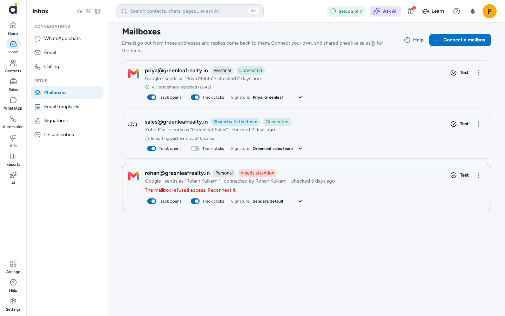

AdsEra lets you and your team email customers **one to one** from your own address, next to your WhatsApp chats. Every email with a contact lands on their timeline, with **Opened** and **Clicked**, so anyone on your team can see the whole conversation.

<Note>AdsEra doesn't send email campaigns or newsletters. To reach many customers at once, use a [WhatsApp broadcast](/help/campaign/wa/create).</Note>

## Where the email pages are

| Page (in the Inbox menu) | What it's for | Guide |
| --- | --- | --- |
| **Email** | Read and answer email | [Email inbox](/help/email/inbox) |
| **Setup → Mailboxes** | Connect Gmail, Google Workspace or Zoho Mail; who uses each; tracking | [Mailboxes](/help/email/mailboxes) |
| **Setup → Email templates** | Emails you send often, saved once | [Email templates](/help/email/templates), [The template builder](/help/email/template-builder) |
| **Setup → Signatures** | The sign-off under your emails | [Signatures](/help/email/signatures) |
| **Setup → Unsubscribes** | Addresses AdsEra never emails | [Unsubscribes](/help/email/unsubscribes) |

Click **Inbox** on the icon rail: **Email** is next to WhatsApp and Calling. The setup pages are under **Setup** in the Inbox menu (on a chat screen, open the menu with the panel icon at the top left). The inbox's **Email settings** button opens them too.

## Set it up in four steps

<Steps>
<Step title="Connect your mailbox">**Inbox → Setup → Mailboxes → Connect a mailbox**: **Just me** or **My team**, then **Gmail / Google Workspace** or **Zoho Mail**, and sign in. [How →](/help/email/mailboxes#connect-a-mailbox)</Step>
<Step title="Make your signature">**Inbox → Setup → Signatures → New signature**. [How →](/help/email/signatures#make-your-signature)</Step>
<Step title="Save a template or two">**Inbox → Setup → Email templates → New template**: start with **Simple text**, or a ready-made design for your industry. [How →](/help/email/templates)</Step>
<Step title="Write to a customer">**Inbox → Email → Compose**, pick a template with **Templates**, and **Send**. [How →](/help/email/inbox)</Step>
</Steps>

Each team member connects their own mailbox. A shared address like sales@ is connected once, as **My team**.

## Where else you can email from

- A contact's page: the round **Email** button.
- **Prospects**: the email button on a lead (or key **E**). See [Prospects](/help/sales/prospects).
- A deal's page.

All of them use your connected mailboxes, templates and signature.

## What it costs

Email from your own mailbox costs nothing extra in AdsEra: no AI credits and no per-email price, on every plan. Limits that keep your address safe: 50 people per email, 15 MB of attachments, 30 emails a minute per mailbox, plus Google's or Zoho's own daily limits. See [Mailboxes → What sending costs](/help/email/mailboxes#what-sending-costs-and-limits).

## Related

<CardGroup cols={2}>
<Card title="Mailboxes" icon="inbox" href="/help/email/mailboxes">Connect Gmail or Zoho.</Card>
<Card title="Email inbox" icon="envelope-open" href="/help/email/inbox">Read and reply.</Card>
<Card title="Email templates" icon="file-lines" href="/help/email/templates">Save emails you send often.</Card>
<Card title="Signatures" icon="signature" href="/help/email/signatures">Your sign-off.</Card>
</CardGroup>
