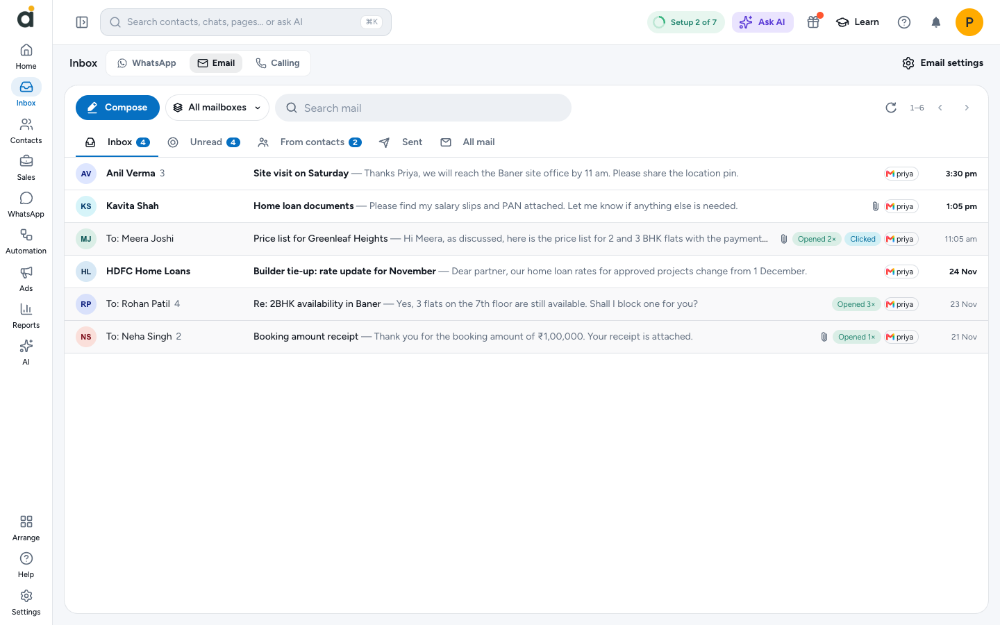
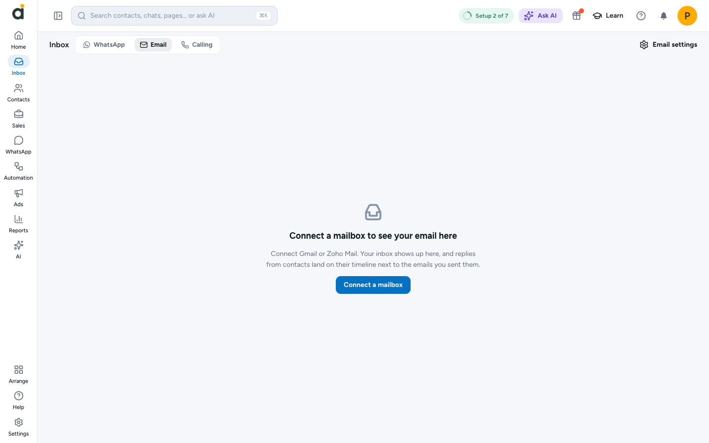
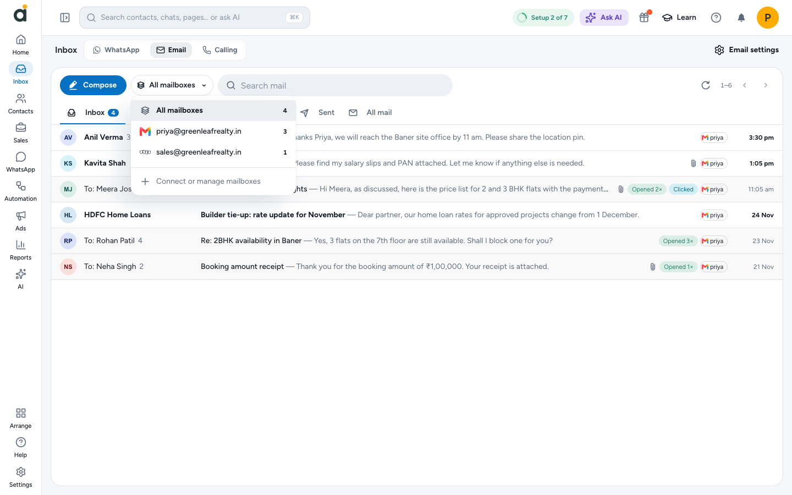
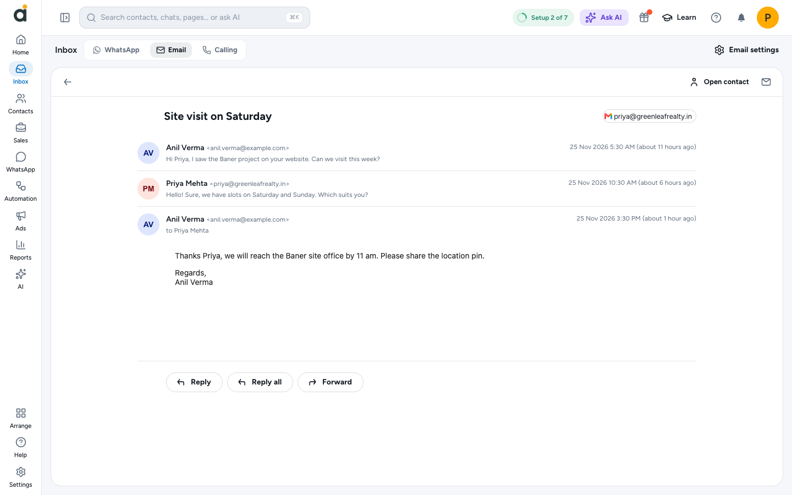
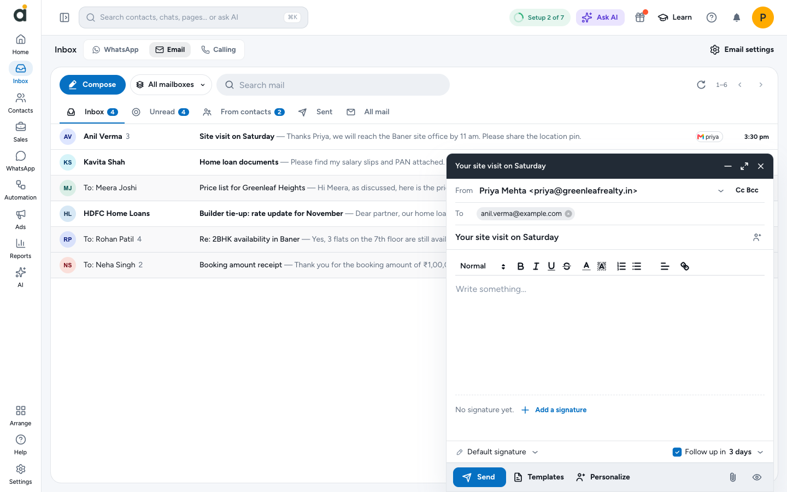
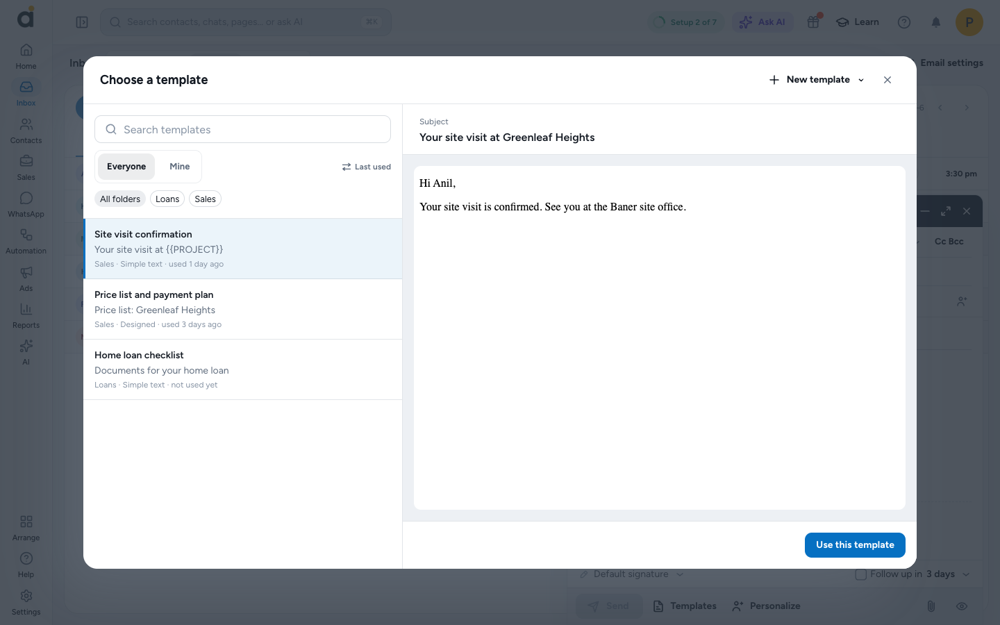

The **Email inbox** shows the email of the mailboxes you connected, next to your WhatsApp chats. You read and reply from AdsEra; replies go out from your own mailbox, and every email with a contact lands on their timeline.

This is **one-to-one email** (you writing to a customer). AdsEra doesn't send email campaigns.

**Where:** **Inbox** on the icon rail, then **Email** at the top (or **Inbox → Email** in the Inbox menu). [Open it →](https://app.adsera.in/dashboard/email/inbox)

## Connect your mailbox first

Until a mailbox is connected, the inbox says **Connect a mailbox to see your email here**.

<Steps>
<Step title="Click Connect a mailbox">On the inbox, or in **Inbox → Setup → Mailboxes**.</Step>
<Step title="Who uses it">**Just me**, or **My team (like sales@)** for a shared address.</Step>
<Step title="Sign in">Click **Gmail / Google Workspace** or **Zoho Mail** and sign in. AdsEra never sees your password.</Step>
<Step title="Wait a few minutes">Your recent email comes in. The mailbox menu says *Importing past emails…* while it loads.</Step>
</Steps>

More about mailboxes: [Mailboxes](/help/email/mailboxes). Templates, signatures and unsubscribes: [Email templates](/help/email/templates), [Signatures](/help/email/signatures), [Unsubscribes](/help/email/unsubscribes).

## The inbox

| Item | What it does |
| --- | --- |
| **Compose** | Write a new email (see below) |
| Mailbox menu | **All mailboxes**, or one at a time, with unread counts. A mailbox with a problem says *Needs attention*. **Connect or manage mailboxes** is at the bottom |
| **Search mail** | Search names, addresses and subjects |
| Round arrow | **Check for new email** right now. Otherwise new email comes in by itself every couple of minutes |
| ‹ › and *1–50* | **Newer** and **Older** pages, 50 emails each |
| **Email settings** (top right) | Mailboxes, templates, signatures and unsubscribes |

### Folders

| Folder | Shows |
| --- | --- |
| **Inbox** | Email you received. The number is unread |
| **Unread** | Only unread email |
| **From contacts** | Only email from people in your Contacts |
| **Sent** | Email you sent from AdsEra or your mailbox |
| **All mail** | Everything |

### Each row

| On the row | Meaning |
| --- | --- |
| Bold | Unread |
| **To: name** | The last email in the conversation was sent by you |
| A small number after the name | How many emails are in the conversation |
| Paper clip | It has attachments |
| **Opened 2×** | The customer opened your email twice |
| **Clicked** | They clicked a link in it |
| Mailbox chip | Which mailbox it's in (when you see all mailboxes) |

<Note>
  Opens are an estimate: some email apps open images by themselves, and some block them. Turn tracking on or off per mailbox in **Inbox → Setup → Mailboxes**.
</Note>

## Read a conversation

Click a row. The whole conversation opens, newest email open at the bottom; click an older one to open it.

| Item | What it does |
| --- | --- |
| ← | **Back to the list** |
| **Open contact** | Opens the sender's contact page (when they're a contact) |
| Envelope | **Mark as unread** and go back to the list |
| **Opened 3×** / **Clicked 1×** on your emails | When they opened it (point at it for first and last time) |
| **Not sent** | That email failed to send |
| Attachment chips | The files, with their size |

## Reply, reply all, forward

Under the conversation:

- **Reply** answers the sender.
- **Reply all** also includes everyone in To and Cc (not your own address).
- **Forward** sends it to someone new, with the original below.

The writing window opens with **To** and **Subject** filled in. Write, then click **Send**.

## Write a new email

Click **Compose**. The writing window opens at the bottom right. The top bar can **Minimise** it, make it **Bigger**, or **Close** it; drag it to move it.

| Field | What it does | Example | Required? |
| --- | --- | --- | --- |
| **From** | The mailbox it's sent from (only shows with more than one) | priya@greenleafrealty.in | Yes |
| **To** | Type an address and press Enter. Add more the same way | anil.verma@example.com | Yes |
| **Cc Bcc** | Copy more people | | No |
| **Subject** | The subject. The person icon adds the contact's name or another field | Your site visit on Saturday | Yes |
| Message | What you write | | Yes |
| **Templates** | Start from a saved email template | Site visit confirmation | No |
| **Personalize** | Put the contact's name or a field in the text | Hi {{FIRSTNAME}} | No |
| Signature | **Default signature**, another of yours, or **No signature** | | No |
| **Follow up in** | Tick it and pick **1, 2, 3, 5, 7 or 14 days**: you get a task to follow up on that day at 10 am | 3 days | No |
| Paper clip | **Attach files** | Brochure.pdf | No |
| Eye | **Preview**: see it as the contact will | | No |

<Steps>
<Step title="Fill in To and Subject">Type the address and press Enter, then the subject.</Step>
<Step title="Write, or pick a template">Click **Templates** to start from one (see below), or write your own.</Step>
<Step title="Check the signature and follow-up">Pick a signature. Tick **Follow up in** if you want a reminder.</Step>
<Step title="Preview and send">Click the eye to check it, then **Send**. You see *Email sent* (or *Email sent · follow-up task added*).</Step>
</Steps>

### Start from a template

**Templates** opens **Choose a template**:

- Search, pick a folder (**All folders** or one), and show **Everyone**'s or **Mine**.
- Point at a template to preview it with this contact's details. Click **Use this template**.
- **Simple text** templates stay editable when you send. **Designed** ones (images, buttons, layout) are sent as designed; the composer shows the template with **Remove template**.
- **Edit template** opens it to change. **New template** makes one: **Simple text** or **Designed**.

Manage templates in **Inbox → Setup → Email templates**.

## FAQ

<AccordionGroup>
  <Accordion title="Which email providers work?">
    Gmail, Google Workspace and Zoho Mail, by signing in. Outlook and other providers can't be connected yet.
  </Accordion>
  <Accordion title="Where do my sent emails go?">
    Into your mailbox's Sent folder (so you see them in Gmail or Zoho too), into **Sent** here, and onto the contact's timeline.
  </Accordion>
  <Accordion title="I don't see a new email.">
    Click the round arrow to check now. If a mailbox shows *Needs attention*, reconnect it in **Inbox → Setup → Mailboxes**.
  </Accordion>
  <Accordion title="Can my team read my email?">
    Not a mailbox you connected as **Just me**. A mailbox connected for **My team** (like sales@) is shared.
  </Accordion>
</AccordionGroup>

## Related

<CardGroup cols={2}>
  <Card title="Email setup: mailboxes, templates, signatures" icon="inbox" href="/help/email/inbox-and-mailboxes" />
  <Card title="WhatsApp chats" icon="comments" href="/help/inbox/chat" />
</CardGroup>
