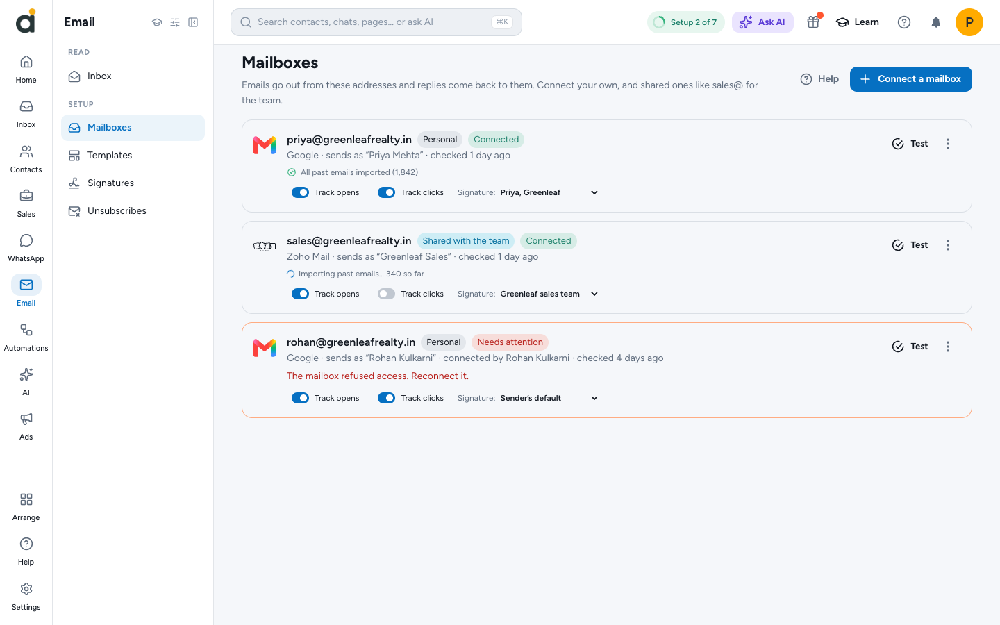
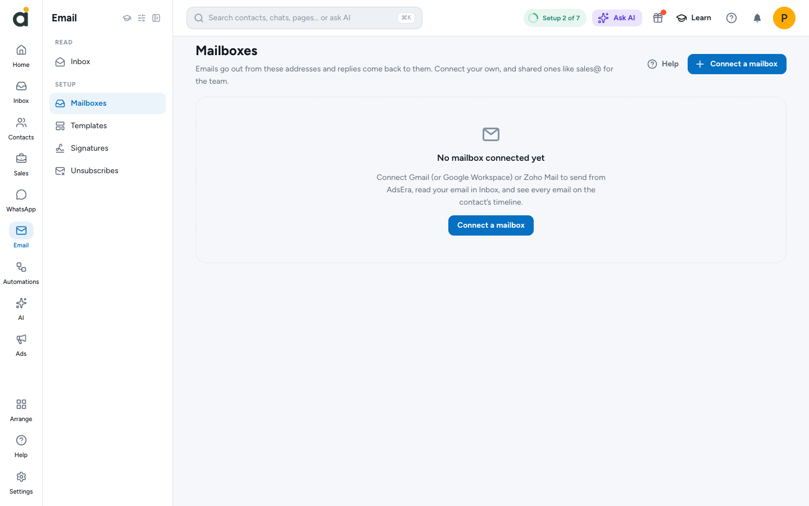
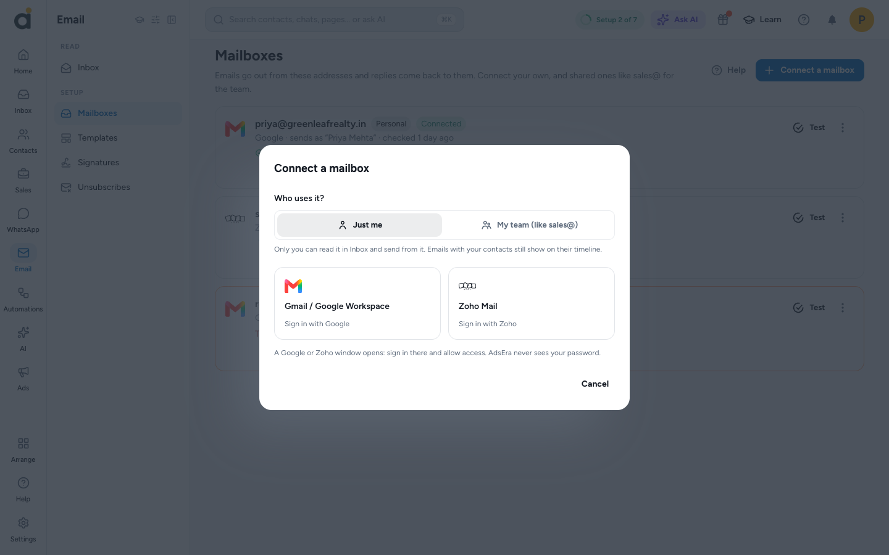
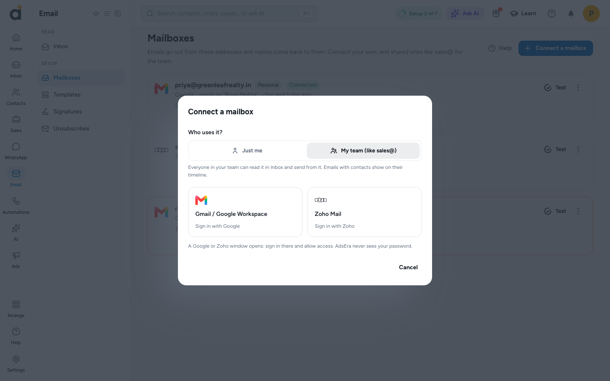
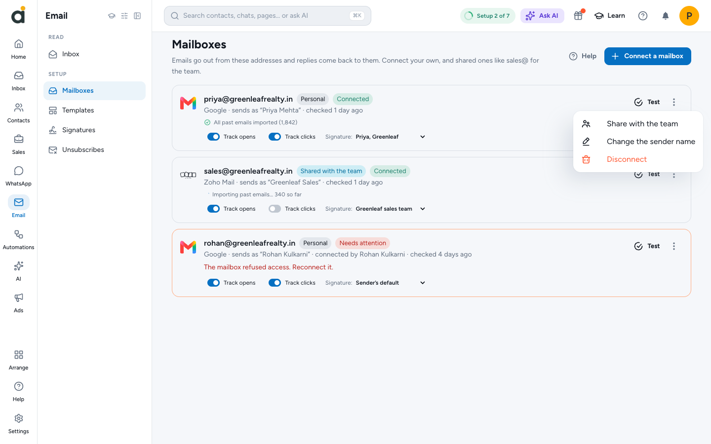
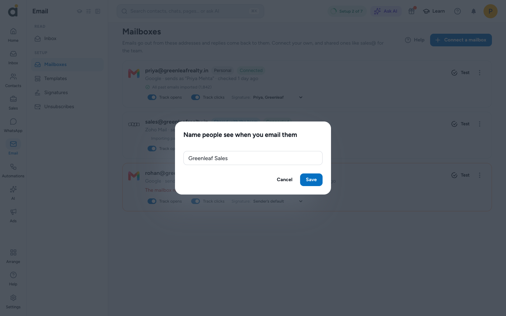
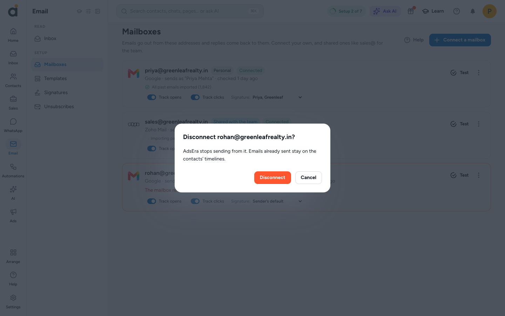
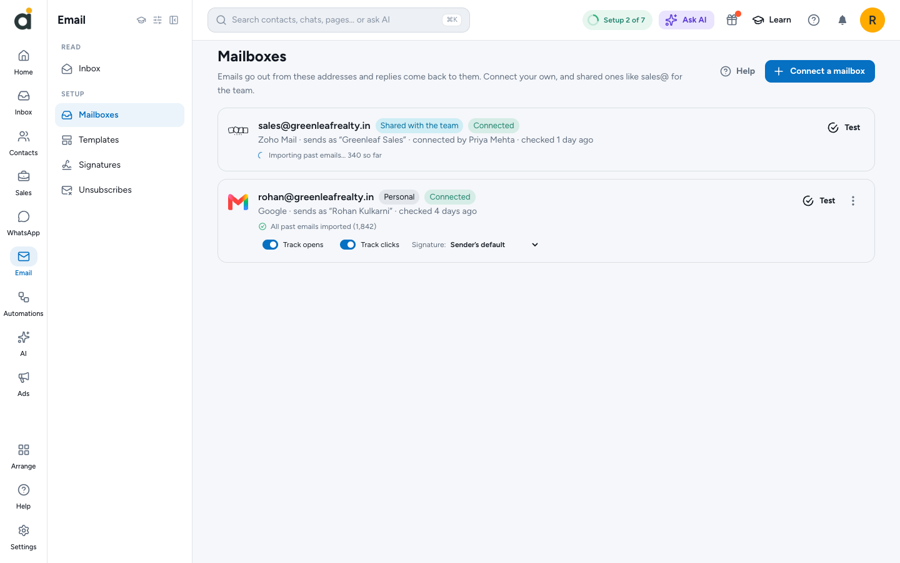

A **mailbox** is an email address you connect to AdsEra, like `priya@greenleafrealty.in` or a shared `sales@greenleafrealty.in`. Once it's connected you can:

- read and answer its email in **Inbox → Email** ([Email inbox](/help/email/inbox)),
- email a contact from their page, from Prospects or from a deal,
- see every email with a contact on their timeline, with **Opened** and **Clicked**.

Emails go out from your own mailbox, so they also show in the **Sent** folder of your Gmail or Zoho, and replies come back to it as usual.

<Note>AdsEra is for **one-to-one email**: you writing to a customer. It doesn't send email campaigns or newsletters.</Note>

**Where:** **Email → Mailboxes** in the left menu. [Open it →](https://app.adsera.in/dashboard/email-settings/mailboxes)

## Which email can I connect?

| Your email is on | Can you connect it? |
| --- | --- |
| **Gmail** (@gmail.com) | Yes: **Gmail / Google Workspace** |
| **Google Workspace** (your own domain on Google, like you@yourbusiness.com) | Yes: **Gmail / Google Workspace** |
| **Zoho Mail** (any Zoho data centre: zoho.in, zoho.com, zoho.eu…) | Yes: **Zoho Mail** |
| Outlook, Microsoft 365, GoDaddy, Hostinger, Yahoo, your own server | Not yet |

Not sure where your business email is? Open your webmail: if it looks like Gmail, it is Google; if the address bar says zoho, it is Zoho.

## Connect a mailbox

Before you start, decide who will use the address:

| Choice | Pick it for | Who can read it in Inbox and send from it |
| --- | --- | --- |
| **Just me** | Your own address, like priya@ | Only you |
| **My team (like sales@)** | A shared address several people answer, like sales@ or info@ | Everyone in your team |

You can change this later (see [Share or make personal](#share-a-mailbox-or-make-it-personal)).

<Steps>
<Step title="Click Connect a mailbox">
On **Email → Mailboxes**, top right. Before you have any mailbox, the page shows **No mailbox connected yet** with the same button.

</Step>
<Step title="Choose Who uses it?">
**Just me** or **My team (like sales@)**. The line under the choice says who will be able to read it.

</Step>
<Step title="Click your provider">
**Gmail / Google Workspace** (*Sign in with Google*) or **Zoho Mail** (*Sign in with Zoho*). A small Google or Zoho window opens and AdsEra shows *Finish signing in in the window that opened…*.
</Step>
<Step title="Sign in and click Allow">
In that window, pick or type your email address, sign in, and click **Allow**. You sign in on Google's or Zoho's own page: AdsEra never sees your password. AdsEra asks to read, send and organise email for that address only.
</Step>
<Step title="It's connected">
The window closes by itself, you see *… connected*, and the mailbox shows **Connected**. Your past emails start coming in: *Importing past emails… 340 so far*, then *All past emails imported (1,842)*. A big mailbox can take a few hours; you can use it meanwhile.
</Step>
</Steps>

<Tip>Every team member connects their own address the same way. Connect a shared address (sales@) once, as **My team**: nobody else needs to connect it.</Tip>

## What each mailbox shows

| On the mailbox | What it means |
| --- | --- |
| Logo | Gmail or Zoho |
| **Personal** / **Shared with the team** | Who can read and send from it |
| **Connected** | It works |
| **Needs attention** (red border) | It stopped working. AdsEra can't send from it or bring in new email until you fix it (see [below](#fix-a-mailbox-that-says-needs-attention)) |
| *Google · sends as "Priya Mehta"* | The provider, and the name customers see in their inbox |
| *connected by Rohan Kulkarni* | Shown to admins on a teammate's mailbox |
| *checked about 2 hours ago* | When AdsEra last checked it works |
| *Importing past emails… 340 so far* / *All past emails imported (1,842)* | Your old email coming into Inbox → Email |
| **Track opens** / **Track clicks** | Tracking switches (see [below](#track-opens-and-clicks)) |
| **Signature** | The signature this mailbox adds (see [below](#a-signature-for-each-mailbox)) |
| **Test** | Checks it works right now: *… works*, or the reason it doesn't |
| **⋮** | **Share with the team** / **Make personal**, **Change the sender name**, **Disconnect** |

The switches, the signature list and the **⋮** menu show only to the person who connected the mailbox and to admins.

## Track opens and clicks

| Switch | When it's on | Good to know |
| --- | --- | --- |
| **Track opens** | A tiny invisible picture is added to each email. When it loads, the email shows **Opened** (with how many times) in Inbox and on the contact's timeline. | A good guess, not proof: some email apps (like Apple Mail) load pictures by themselves, and some people block pictures. |
| **Track clicks** | Links in your email pass through AdsEra first, then open the real page. The email shows **Clicked**. | Customers see an AdsEra link when they point at it. Turn it off for receipts or links people must trust. |

Both are on for a new mailbox. A template can override them for itself: see [The template builder](/help/email/template-builder#opens-and-clicks-for-this-template).

## A signature for each mailbox

The **Signature** list on a mailbox picks the signature for emails sent from it:

- **Sender's default**: the default signature of whoever sends (each person's own). Best for a personal mailbox.
- A named signature: always that one. Handy for a shared sales@ that should sign as the team.

The list shows once you have a signature. When you write an email you can still pick another one, or **No signature**, for that email. More in [Signatures](/help/email/signatures).

## Share a mailbox, or make it personal

<Steps>
<Step title="Click ⋮ on the mailbox">

</Step>
<Step title="Click Share with the team (or Make personal)">
**Share with the team**: everyone in your team can read it in Inbox and send from it. **Make personal**: only the person who connected it again. You see *Shared with the team* or *Now personal*.
</Step>
</Steps>

## Change the name people see

The sender name is what customers see as **From**, like *Priya Mehta* or *Greenleaf Sales*. It starts as the name on your Google or Zoho account.

<Steps>
<Step title="Click ⋮ → Change the sender name"></Step>
<Step title="Type the name and click Save">

New emails go out with this name. Emails already sent don't change.
</Step>
</Steps>

## Fix a mailbox that says Needs attention

A mailbox turns **Needs attention** when Google or Zoho stops letting AdsEra in. The red line under it says why, for example *The mailbox refused access. Reconnect it.* This usually happens after you change your email password, or remove AdsEra's access in your Google or Zoho account.

<Steps>
<Step title="Click Test">If it works again, it turns **Connected**.</Step>
<Step title="Still failing? Connect it again">Click **Connect a mailbox** and sign in to the **same address**. It keeps its settings and turns **Connected**.</Step>
</Steps>

Until it's fixed, sending from it shows *This mailbox needs attention: … .*

## Disconnect a mailbox

<Steps>
<Step title="Click ⋮ → Disconnect"></Step>
<Step title="Confirm">

Click **Disconnect**.
</Step>
</Steps>

What happens: AdsEra stops sending from it and stops reading it, and its emails leave **Inbox → Email**. Emails already on contacts' timelines stay there. Your Gmail or Zoho mailbox itself is not changed. To also remove AdsEra's access on Google's side, open your Google Account → **Security** → **Your connections to third-party apps** and remove AdsEra (Zoho: **My Account → Security → Connected apps**).

## Admins and team members

| | The person who connected it | An admin | Another team member |
| --- | --- | --- | --- |
| Sees it on Mailboxes | Yes | Yes, every mailbox | Only if it's shared |
| Reads it in Inbox, sends from it | Yes | Only if it's shared (or theirs) | Only if it's shared |
| Tracking, signature, ⋮ menu | Yes | Yes | No |

A team member sees their own mailboxes and the shared ones, without the switches on mailboxes they didn't connect:

## What sending costs, and limits

Sending from your own mailbox **costs nothing extra in AdsEra**: it uses no AI credits and has no per-email price, on every plan. These limits keep your address safe:

| Limit | What happens |
| --- | --- |
| **50 people per email** (To, Cc and Bcc together) | *At most 50 recipients per email.* |
| **15 MB of attachments** per email | *Attachments are over 15 MB in total.* |
| **30 emails a minute** from one mailbox | *This mailbox has sent a lot in the last minute. Try again shortly.* Wait a minute and send again |
| Google's daily limit | About **500 emails a day** from a free @gmail.com address and **2,000** from Google Workspace (Google's own rules). Over it, Google stops your sending for up to a day |
| Zoho's daily limit | Depends on your Zoho Mail plan |
| People on **Unsubscribes** | Can't be emailed: *… asked not to get email from you (unsubscribed). Remove them to send.* |

## Troubleshooting

| You see | Do this |
| --- | --- |
| Nothing happens when you click Gmail or Zoho | Your browser blocked the pop-up window. Allow pop-ups for app.adsera.in and click again. |
| *Finish signing in in the window that opened…* and nothing else | The Google or Zoho window is behind this one, or you closed it. Click **Cancel** and try again. |
| *Couldn't connect the mailbox: Access wasn't granted.* | You clicked **Cancel** or **Deny** in the Google or Zoho window. Try again and click **Allow**. |
| *Someone in your team has already connected this mailbox.* | A teammate connected it as their personal mailbox. Ask them to click **⋮ → Share with the team**. |
| A tile says *Not available yet. Ask AdsEra support.* | That provider isn't switched on for your account yet. Write to contact@adsera.in. |
| **Needs attention** | See [Fix a mailbox that says Needs attention](#fix-a-mailbox-that-says-needs-attention). |
| *The provider is limiting how fast this mailbox sends. Try again in a minute.* | Google or Zoho is slowing you down. Wait a minute. |
| *You can't send from this mailbox.* | It's someone else's personal mailbox. Ask them to share it, or send from yours. |
| The past-email line shows a warning | AdsEra hit a problem bringing in old email and tries again in a few minutes by itself. |

## FAQs

<AccordionGroup>
<Accordion title="Does AdsEra see my password?">
No. You sign in on Google's or Zoho's own page and allow access there. AdsEra keeps only the access Google or Zoho gives it, stored encrypted.
</Accordion>
<Accordion title="Can I connect more than one mailbox?">
Yes. Each person can connect several, and your team can share any number of addresses. When you write an email you pick which one it goes from.
</Accordion>
<Accordion title="Will emails I send from Gmail itself show in AdsEra?">
Yes. Email you send from Gmail or Zoho shows in **Sent** in Inbox → Email, and emails with your contacts land on their timeline.
</Accordion>
<Accordion title="Can I connect Outlook or my GoDaddy email?">
Not yet. Today you can connect Gmail, Google Workspace and Zoho Mail.
</Accordion>
<Accordion title="Can my admin read my personal email?">
No. Admins see that your mailbox is connected and can change its settings or disconnect it, but only you read a personal mailbox in Inbox. Emails with contacts do show on those contacts' timelines, which your team can see.
</Accordion>
<Accordion title="Can I send a newsletter to all my contacts?">
No. AdsEra is for one-to-one email. To reach many customers at once, use a [WhatsApp broadcast](/help/campaign/wa/create).
</Accordion>
</AccordionGroup>

## Related

<CardGroup cols={2}>
<Card title="Email inbox" icon="envelope-open" href="/help/email/inbox">Read, reply, forward and write email.</Card>
<Card title="Email templates" icon="file-lines" href="/help/email/templates">Emails you send often, saved once.</Card>
<Card title="Signatures" icon="signature" href="/help/email/signatures">Your sign-off, and one for each mailbox.</Card>
<Card title="Unsubscribes" icon="ban" href="/help/email/unsubscribes">Addresses AdsEra never emails.</Card>
</CardGroup>
