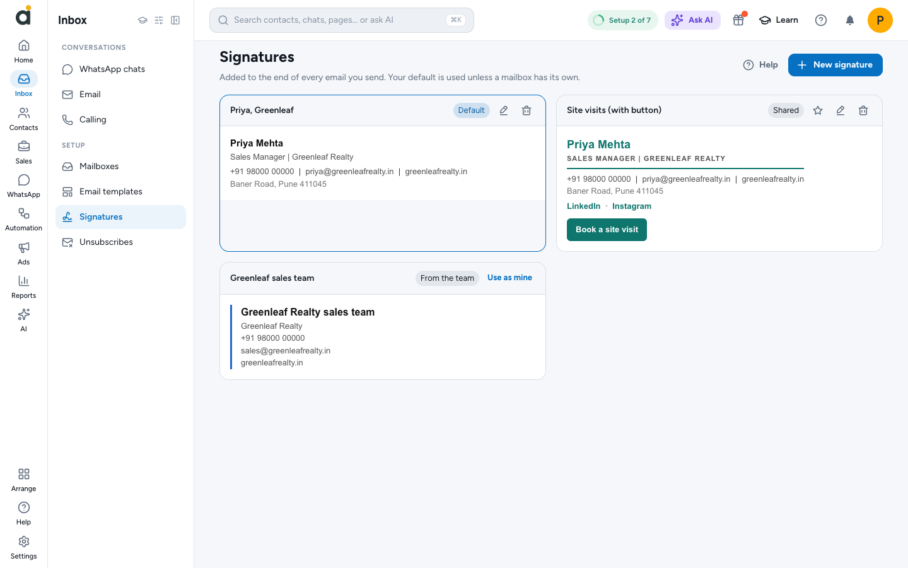
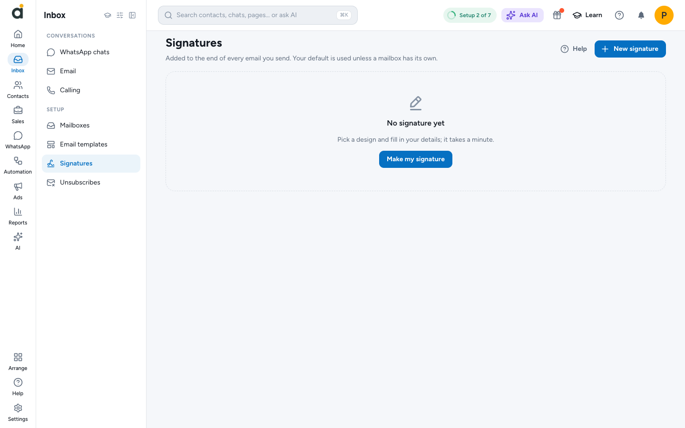
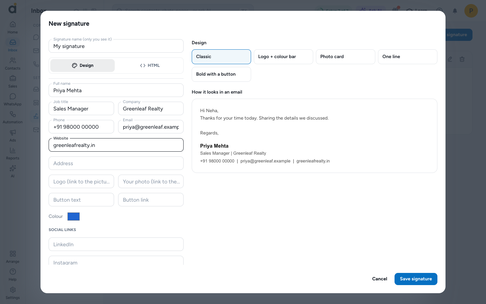
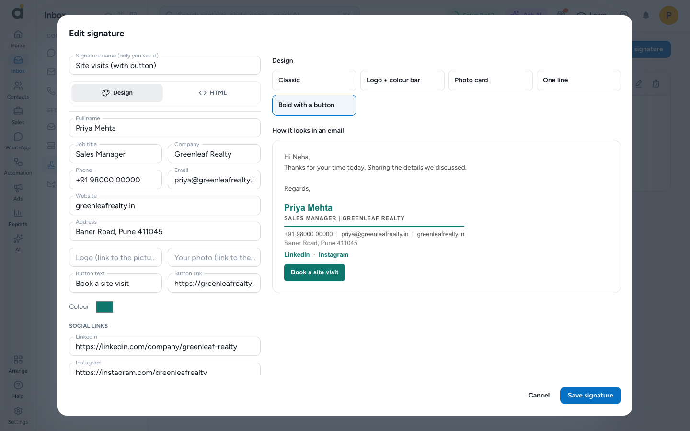
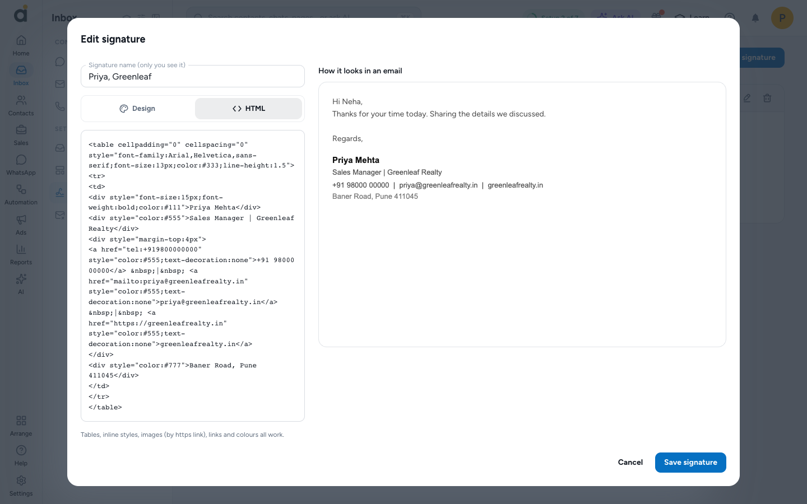
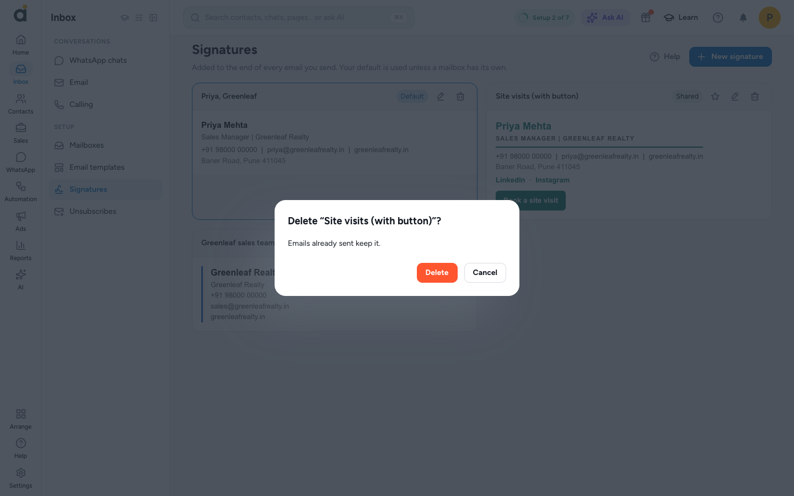
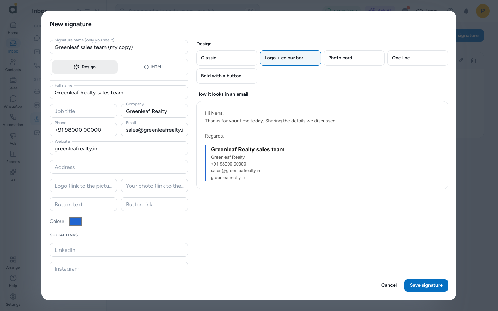

A **signature** is the sign-off added to the end of every email you send from AdsEra: your name, job, phone, website, logo, a button like *Book a site visit*, and links to your pages.

**Where:** **Inbox → Setup → Signatures** in the left menu. [Open it →](https://app.adsera.in/dashboard/email-settings/signatures)

Before you have one, the page says **No signature yet** with **Make my signature**:

## Make your signature

<Steps>
<Step title="Click New signature">
The **New signature** window opens with your name and email already filled in.

</Step>
<Step title="Name it">
**Signature name (only you see it)**, like *Priya, Greenleaf*.
</Step>
<Step title="Fill in your details">
Only **Full name** is needed. Leave out anything you don't want shown.
</Step>
<Step title="Pick a design and a colour">
Click a design on the right and pick your brand **Colour**. **How it looks in an email** shows the result as you type.

</Step>
<Step title="Click Save signature">
Your first signature becomes your **Default**.
</Step>
</Steps>

### Every field

| Field | What it's for | Example |
| --- | --- | --- |
| **Signature name (only you see it)** | To tell your signatures apart. Needed | Priya, Greenleaf |
| **Full name** | Your name. Needed | Priya Mehta |
| **Job title**, **Company** | Under your name | Sales Manager, Greenleaf Realty |
| **Phone**, **Email**, **Website** | Shown as links people can tap | +91 98000 00000 |
| **Address** | Your office | Baner Road, Pune 411045 |
| **Logo (link to the picture)** | Your logo. Paste the link to the picture (it starts with https://). On your website, right-click the logo → **Copy image address** | https://greenleafrealty.in/logo.png |
| **Your photo (link to the picture)** | Used by the **Photo card** design | https://…/photo.jpg |
| **Button text**, **Button link** | A button, like *Book a site visit*, and the page it opens | Book a site visit |
| **Colour** | Your brand colour for names, lines and the button | Teal |
| **LinkedIn**, **Instagram**, **Facebook**, **YouTube**, **X** | Links to your pages | https://instagram.com/greenleafrealty |
| **Small print (optional)** | A line at the bottom, like a disclaimer | RERA No. P52100012345 |
| **Let my team use it as a starting point** | Teammates can copy it (see [below](#share-a-signature-with-your-team)) | On |

### The designs

| Design | Looks like |
| --- | --- |
| **Classic** | Name, job, then your details in lines |
| **Logo + colour bar** | Your logo on the left with a coloured bar |
| **Photo card** | Your photo next to your details |
| **One line** | Everything on one short line |
| **Bold with a button** | Big name, details and a coloured button |

## Use a signature you already have

Already have a signature from Gmail, Outlook or a signature maker? Paste it in.

<Steps>
<Step title="Click New signature, then HTML">
The box shows the HTML of the design you had, so you can also start from that.

</Step>
<Step title="Paste your signature's HTML over it">
Most signature makers have a **Copy HTML** button. Tables, colours, links and pictures (as https:// links) all work. Scripts, forms and style blocks are removed when you save, because email apps ignore them anyway.
</Step>
<Step title="Check the preview and click Save signature">
**Start again from the "…" design** brings back the design's HTML.
</Step>
</Steps>

## Default, edit or delete

Each of your signatures has, at its top:

| Item | What it does |
| --- | --- |
| **Default** | This one is added to your emails |
| Star (**Make default**) | Makes this one your default |
| Pencil (**Edit**) | Opens it to change |
| Bin (**Delete**) | Asks *Delete "…"?* (*Emails already sent keep it.*) then removes it. If it was your default, your newest other signature becomes the default |

## Which signature goes on an email

1. The one you pick in the email window (**Default signature**, another one, or **No signature**) wins.
2. Otherwise, the mailbox's own signature, if it has one (see [Mailboxes](/help/email/mailboxes#a-signature-for-each-mailbox)).
3. Otherwise, your **Default**.

So a shared sales@ mailbox can always sign as the team, while your own mailbox signs as you. Test emails from the template builder have no signature.

## Share a signature with your team

Keep everyone's signature looking the same:

<Steps>
<Step title="Share yours">
In your signature, turn on **Let my team use it as a starting point** and save. It shows **Shared**.
</Step>
<Step title="A teammate copies it">
They see it marked **From the team** and click **Use as mine**. The window opens with a copy named *… (my copy)*.

</Step>
<Step title="They change it to them and save">
Their name, phone and email; the design stays. It's their own signature now.
</Step>
</Steps>

Teammates can't change or delete your signature, only copy it.

## Troubleshooting

| You see | Do this |
| --- | --- |
| **Save signature** is grey | Fill in **Full name** (or, on **HTML**, paste something), and a signature name. |
| The logo doesn't show | The logo field needs a link to the picture itself (ending in .png or .jpg), not to your website's page. |
| No signature on an email | You picked **No signature** in the email window, or it was a test email. |
| The wrong signature on a sales@ email | That mailbox has its own signature: change it under **Mailboxes**, or pick another one in the email window. |
| *A signature needs a name and its content.* | Give it a name and fill in your details. |

## FAQs

<AccordionGroup>
<Accordion title="Can I have more than one signature?">
Yes. Make as many as you like (say, one in English and one in Hindi) and pick one in the email window.
</Accordion>
<Accordion title="Does my signature show in emails I send from Gmail itself?">
No. This signature is added to emails you send from AdsEra. Gmail and Zoho have their own signature settings.
</Accordion>
<Accordion title="Can I upload my logo here?">
Not as a file: paste a link to the picture. Put the picture on your website and copy its link.
</Accordion>
</AccordionGroup>

## Related

<CardGroup cols={2}>
<Card title="Mailboxes" icon="inbox" href="/help/email/mailboxes">A signature for each mailbox.</Card>
<Card title="Email inbox" icon="envelope-open" href="/help/email/inbox">Pick a signature when you write.</Card>
</CardGroup>
