The **template builder** is where you design an email with blocks: drag in a heading, text, a picture, a button or your logo, click any of them to change it, and save. You get here from **Email → Templates → New template** (**Blank canvas** or a ready-made design), or by opening a designed template.

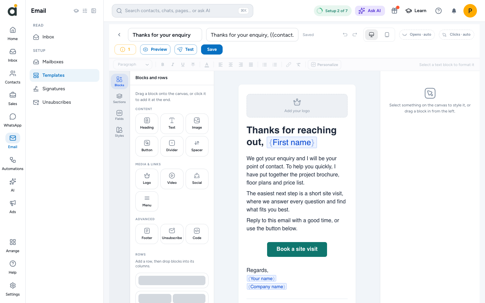

The screen has four parts:

| Part | What's there |
| --- | --- |
| **Top bar** | Back, the template's name and subject, *Saved* / *Unsaved*, undo and redo, computer / phone view, **Opens** and **Clicks**, the checks, **Preview**, **Test**, **Save** |
| **Text bar** (under it) | Formatting for the text you're typing in: style, bold, colour, alignment, lists, link, **Personalize** |
| **Left** | **Blocks**, **Sections**, **Fields**, **Styles** |
| **Middle** | Your email. Click anything in it to change it |
| **Right** | The settings of what you clicked |

## The top bar

| Item | What it does |
| --- | --- |
| ‹ (back) | Back to Templates. With unsaved changes your browser asks first |
| **Untitled template** | The template's name, for your team |
| **Subject line** | What customers see in their inbox. Personal details work here too, like `{{contact.firstName}}` |
| *Saved* / *Unsaved* / *Saving…* | Whether your changes are kept |
| ↶ ↷ | Undo and redo (also Ctrl+Z / Ctrl+Shift+Z) |
| Computer / phone | Shows the email as it looks on a computer or a phone |
| **Opens · auto**, **Clicks · auto** | Tracking for this template (see [below](#opens-and-clicks-for-this-template)) |
| A number in orange or red | The checks: what to fix before sending (see [below](#check-preview-and-send-a-test)) |
| **Preview** | The whole email, as a customer sees it |
| **Test** | Sends it to you. Works once the template is saved |
| **Save** | Saves it. A new template then shows on Templates |

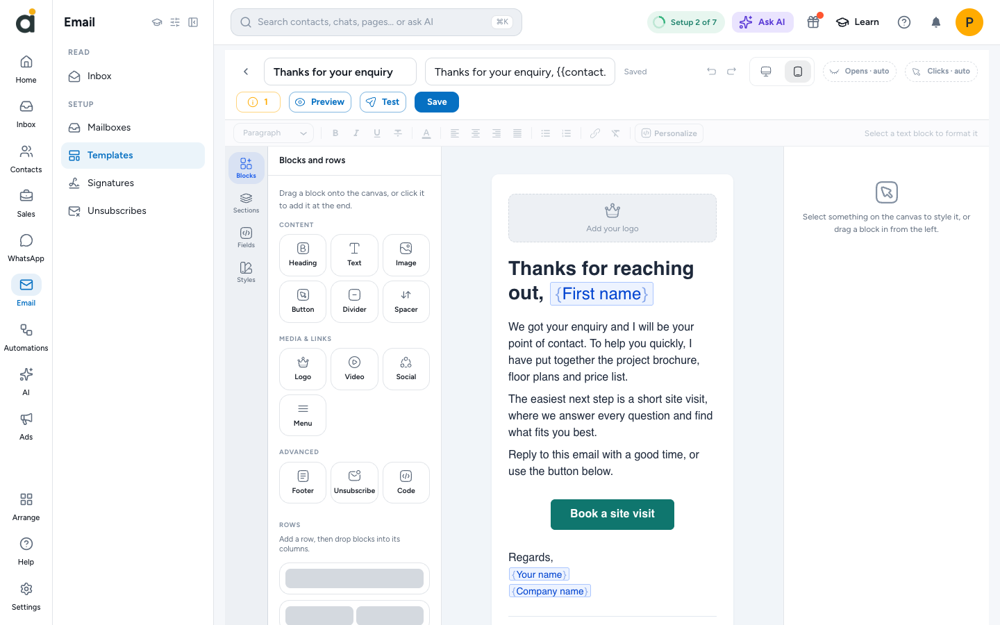

## Add blocks and rows

Open **Blocks** on the left. Drag a block onto your email where you want it, or click it to add it at the end. Drag blocks up and down to move them.

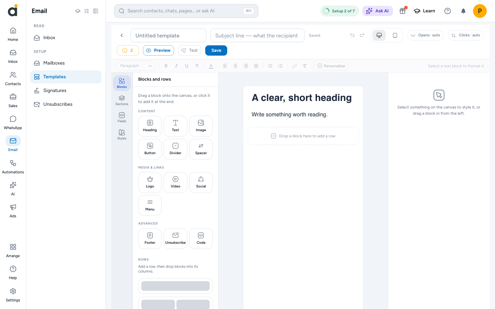

| Block | What it is | What you set |
| --- | --- | --- |
| **Heading** | A title | Level (Heading 1–4); type the words in the email |
| **Text** | Paragraphs | Type in the email; format with the text bar |
| **Image** | A picture | **Upload** (up to 8 MB: JPG, PNG, GIF or WebP) or a **Picture link**, a **Description (alt text)**, and a **Link** it opens |
| **Button** | A button | **Label** and **Link**, colour, shape (square, rounded, pill) and size |
| **Divider** | A line | Style, colour, thickness |
| **Spacer** | Empty space | Height |
| **Logo** | Your logo | Like Image |
| **Video** | A cover picture with a play sign that opens your video (videos can't play inside an email) | **Cover picture link**, **Video link** |
| **Social** | Icons for your pages | Each network and its link; icon size and gap |
| **Menu** | A row of links | Each link's words and address |
| **Footer** | Small print at the bottom | The words, and an **Unsubscribe link** switch |
| **Unsubscribe** | Just the unsubscribe link | Its words |
| **Code** | Your own HTML piece | The HTML |

**Rows** (at the bottom of Blocks) put things side by side: **1 column**, **2 columns**, **3 columns**, **4 columns**, **Wide + narrow**, **Narrow + wide**. Click a row to add it, then drop blocks into its columns. On a phone, columns stack one under the other.

## Change a block

Click a block in the email. It gets a blue outline and its settings open on the right.

- **Text and headings:** type straight into the email. The text bar formats it: **Paragraph**/heading style, bold, italic, underline, strike, colour, alignment, lists, link and **Personalize**.

  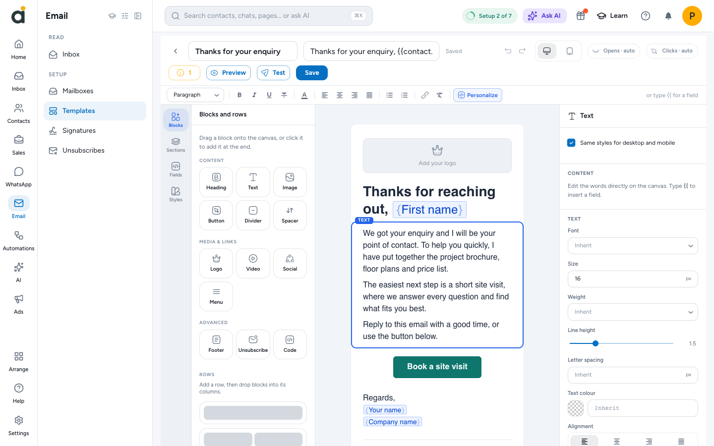

- **Button:** write the **Label** and the **Link** (starting with https://, mailto: or tel:). Below: colour, **Button shape**, **Button size**, and the text's font, size, weight and colour.

  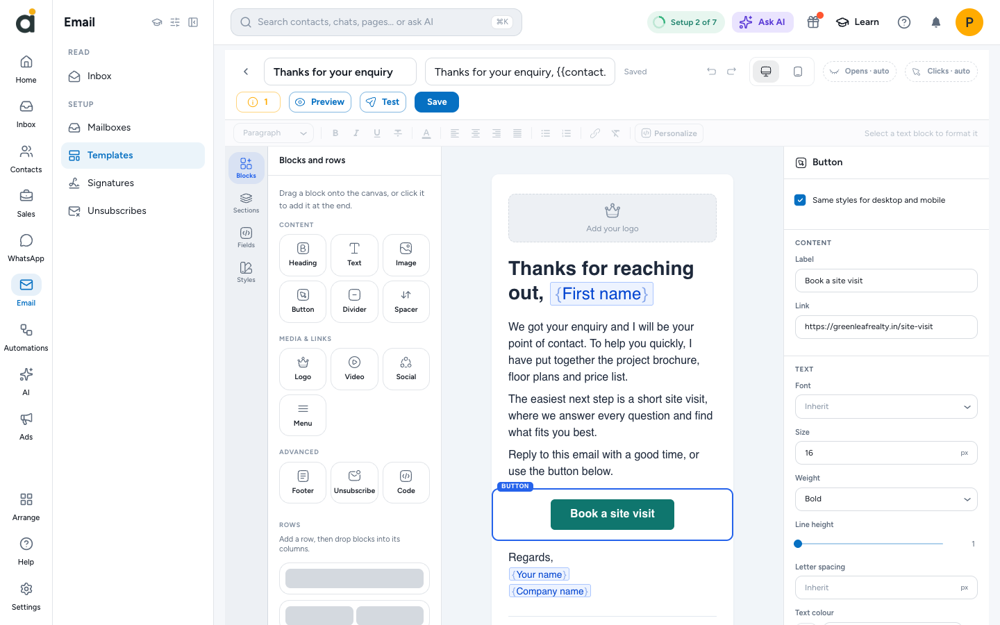

- **Every block** has **Box** settings at the bottom (background, padding, border, rounded corners) and **On mobile** (hide it on phones, or give phones their own size). **Same styles for desktop and mobile** ties the two together.

Next to the selected block or row is a small toolbar: drag to **Move**, **Duplicate**, **Save as a reusable section** (rows) and **Delete**. Click a row's edge to change the row itself: its columns, background and padding.

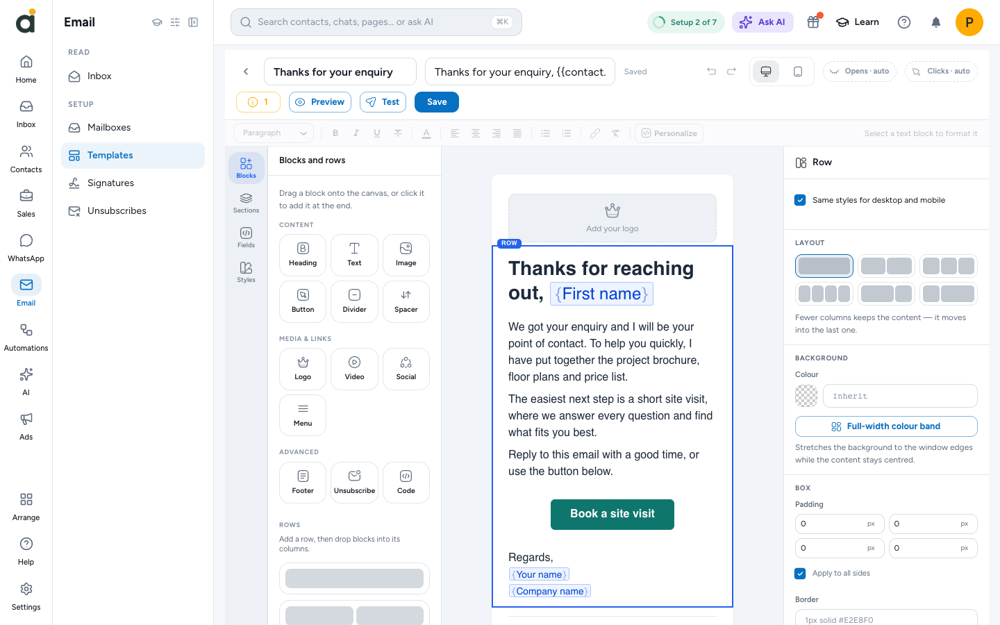

## Add the contact's name and other details

Personal details are filled in for each person when the email is sent.

<Steps>
<Step title="Click into some text">Put your cursor where the detail should go.</Step>
<Step title="Click Personalize">
In the text bar (or type `{{` in the text). Pick a detail. It shows as a blue chip, like **First name**.
</Step>
<Step title="Give it a fallback">
Click the chip. Under **If this is empty, write**, type a word to use when a contact has no value, like *there*, and click **Save**.

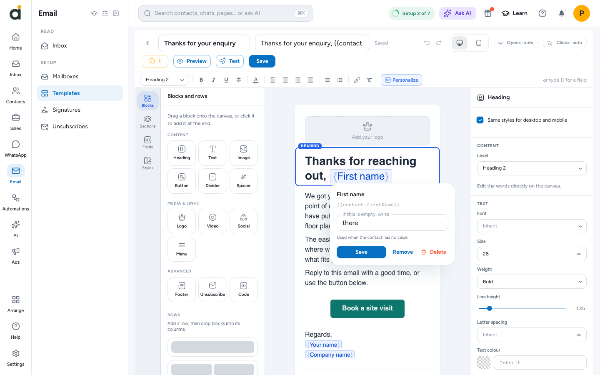
</Step>
</Steps>

**Fields** on the left lists every detail: the contact's (first name, last name, email, phone, and every contact field you made, like City or Budget), yours (name, first name, email, phone) and your company name. A dot on **Fields** and a note at its top tell you when a detail has no fallback. Without one it's left blank for a contact without that detail (*Hi ,*). It never stops the email from sending.

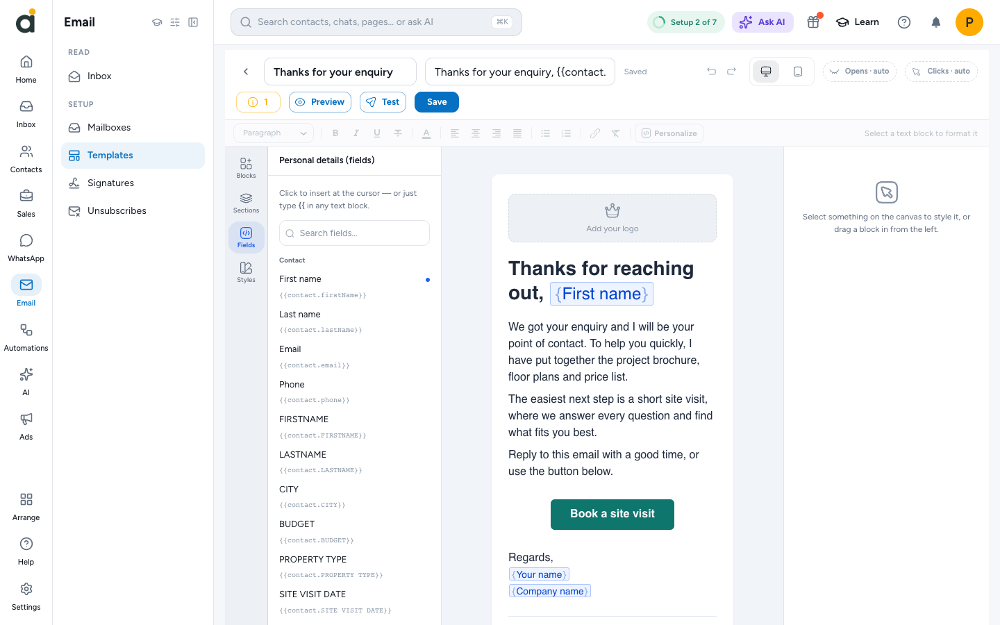

## Set the colours, font and preview text

Open **Styles** on the left. These apply to the whole email:

| Setting | What it does |
| --- | --- |
| **Content width** | How wide the email is. 600 is right for most emails |
| **Page background**, **Content background** | The colour around the email, and behind its content |
| **Base font** | The font. Only fonts every email app has, so it looks the same for everyone |
| **Text**, **Links** | Text and link colours |
| **Buttons**: Background, Label, Corner radius | Every button you haven't changed one by one |
| **Preview text** | The grey line after the subject in the inbox list. Left empty, email apps show the first words of the email |

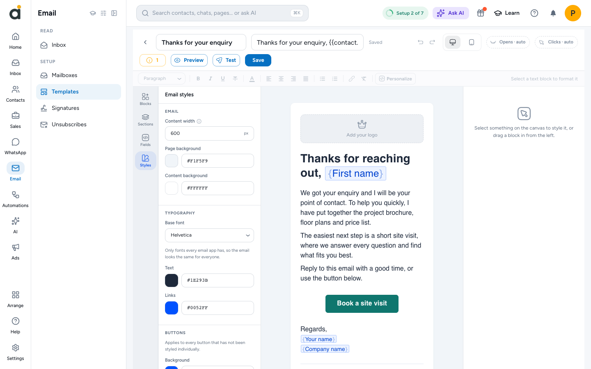

## Save a part to reuse it (sections)

A **section** is a row you saved, like your header with the logo or your office address, to drop into other templates.

- **Save one:** click a row in your email, then **Save as a reusable section** in its toolbar, and name it.
- **Use one:** open **Sections** on the left. **Saved** has your team's sections; **Pre-built** has ready ones. Search by name and click one to add it.

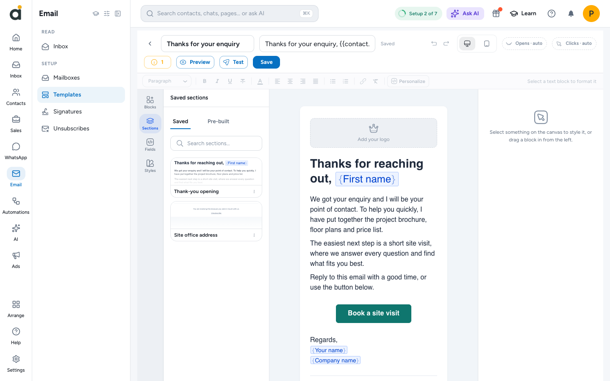

## Opens and clicks for this template

**Opens** and **Clicks** in the top bar override the mailbox's tracking for this template. Click to go round the three choices:

| Shows | Means |
| --- | --- |
| **Opens · auto** | Follow the mailbox's **Track opens** switch (the usual choice) |
| **Opens** (green) | Always track opens for this template |
| **Opens · off** | Never track opens for this template |

**Clicks** works the same way. Turn clicks off for receipts and important links, so customers see the real address.

## Check, preview and send a test

**The checks.** The button before **Preview** shows how many things to look at, in orange (advice) or red (fix this). Click it: **Before you send** lists them; click one to jump to the block. Nothing here stops you saving or sending.

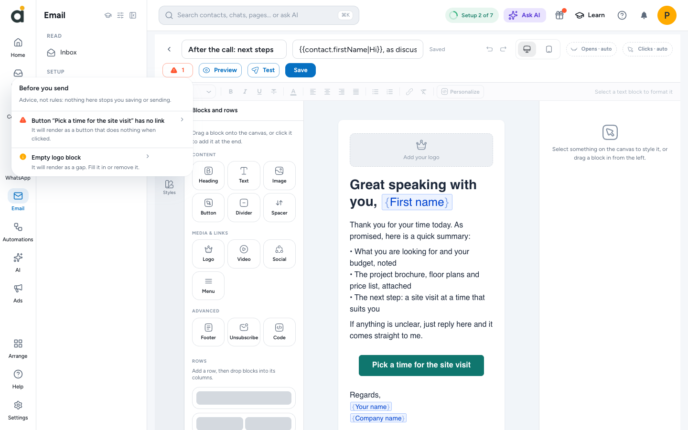

| Check | Why |
| --- | --- |
| *Button "…" has no link* | It would do nothing when clicked |
| *… menu link has no URL* | It shows as plain text |
| *Image has no alt text* | Some email apps hide pictures; the description shows instead |
| *No preview text* | The inbox shows the first words instead |
| *Almost no text* | An email that is all pictures looks like spam and is blank when pictures are hidden |
| *No unsubscribe link* | Advice for emails many people get (Gmail and Outlook may show their own Unsubscribe link anyway) |
| `{{…}} has no fallback` | Left blank for contacts without that detail |
| *Text is only …px* / *Low contrast* | Hard to read on a phone |
| *Empty … block* | A block with nothing in it |
| *Message is …KB* | Very big emails get cut off by Gmail |

When all is well it says **Nothing to flag**.

**Preview** opens the whole email; switch between computer and phone at the top.

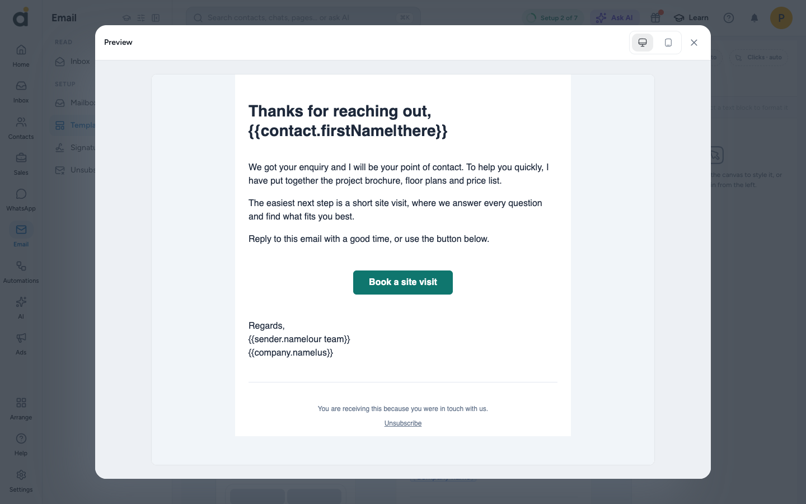

**Test** (after saving): pick the mailbox it comes **From**, type where to **Send to**, and click **Send test**. It arrives marked *[TEST]*, without a signature. There is no contact, so contact details show their fallback (or are left blank). Open it on your phone and your computer.

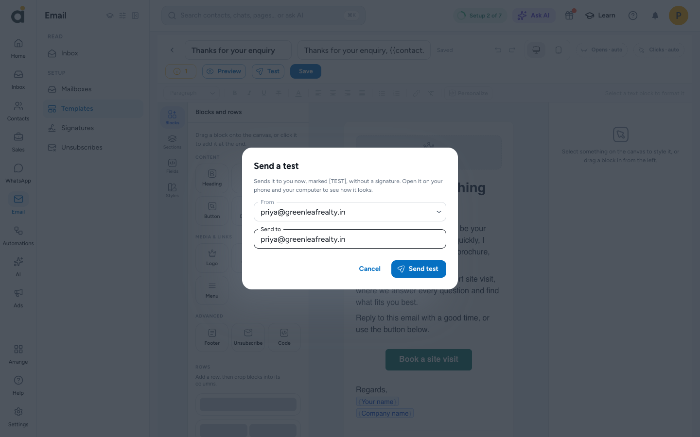

## Troubleshooting

| You see | Do this |
| --- | --- |
| *Give the template a name before saving.* | Type a name in **Untitled template**. |
| **Test** is grey | Save first (*Save the template first*). After a change, save again. |
| *Connect a mailbox first.* (in Send a test) | Connect a mailbox: [Mailboxes](/help/email/mailboxes). |
| *Start it with https://, mailto: or tel: …* | Links must start with https:// (a web page), mailto: (an email address) or tel: (a phone number). |
| *Choose a picture (JPG, PNG, GIF or WebP).* | Only those picture types can be uploaded, up to 8 MB. |
| *Only whoever made this template (or an admin) can change it. Make a copy instead.* | Go back and **Duplicate** it from its ⋮ menu. |

## FAQs

<AccordionGroup>
<Accordion title="Will it look right on a phone?">
Yes: columns stack on phones and text keeps its size. Use the phone view and **Preview** to check, and send yourself a **Test**.
</Accordion>
<Accordion title="Can I use my own fonts?">
No: only fonts every email app has, so your email looks the same everywhere.
</Accordion>
<Accordion title="Can I put a video in the email?">
Email apps can't play videos. The **Video** block shows a cover picture with a play sign that opens your video (YouTube, for example).
</Accordion>
<Accordion title="Can I open an HTML template here?">
No. A template made with **Paste your own HTML** opens in the HTML editor. See [Email templates](/help/email/templates#paste-your-own-html).
</Accordion>
</AccordionGroup>

## Related

<CardGroup cols={2}>
<Card title="Email templates" icon="file-lines" href="/help/email/templates">Make, find and use templates.</Card>
<Card title="Mailboxes" icon="inbox" href="/help/email/mailboxes">Tracking switches for each mailbox.</Card>
</CardGroup>
