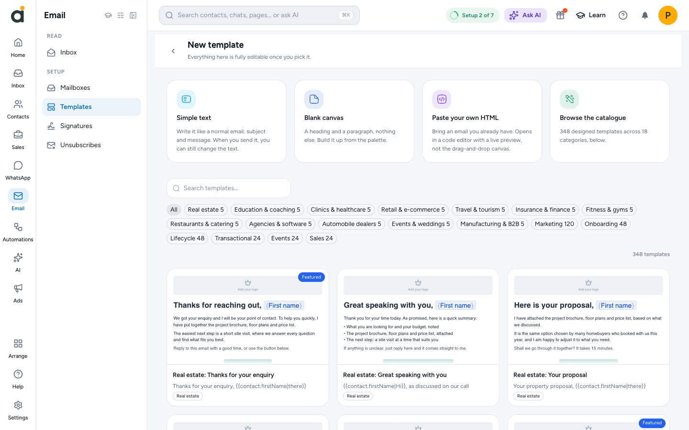
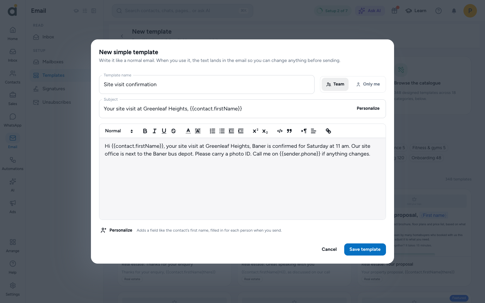
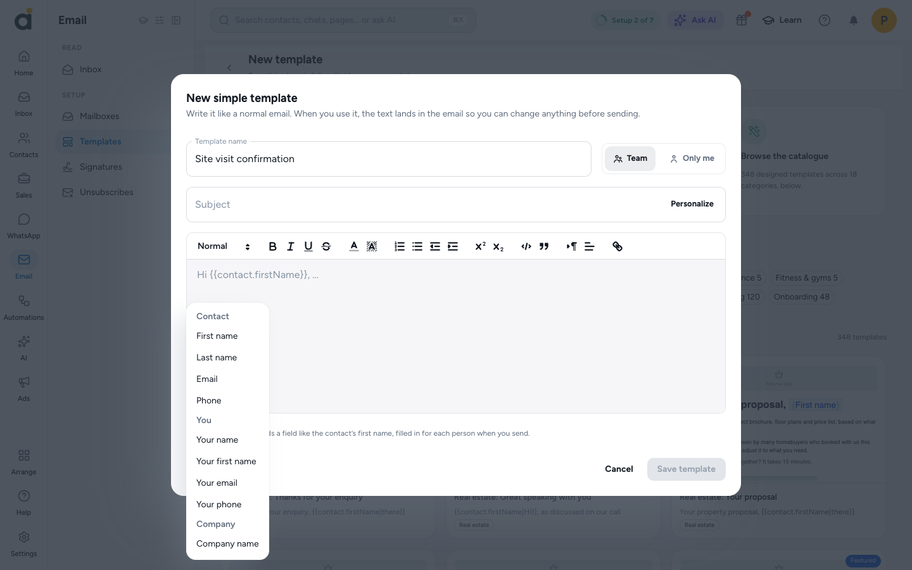
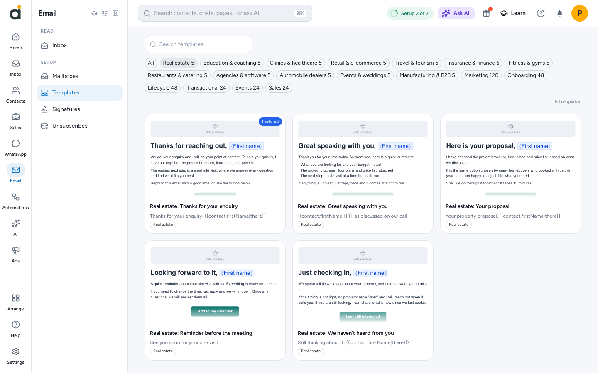
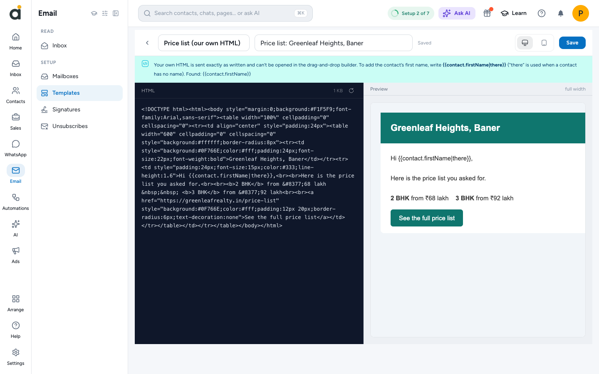
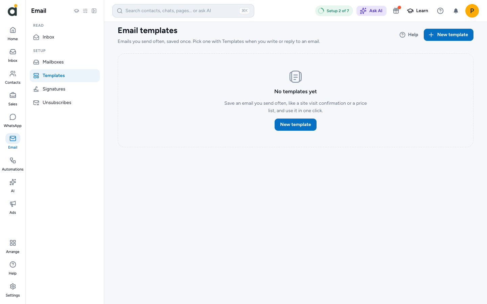
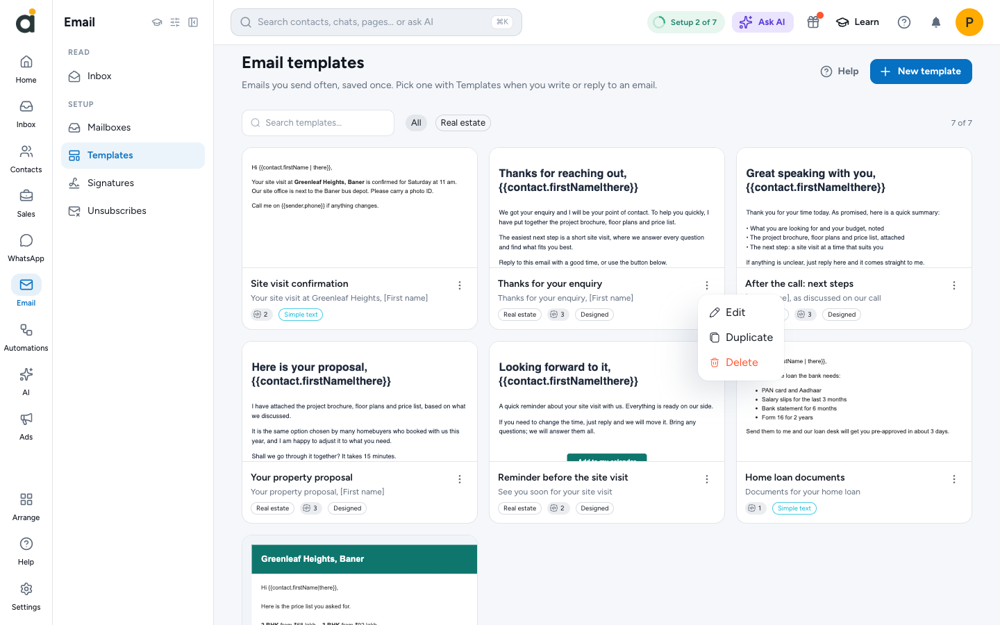
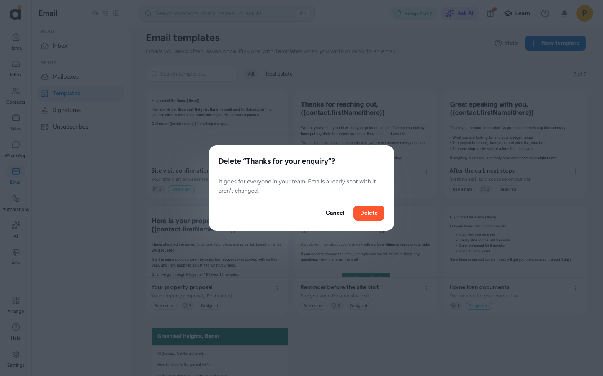
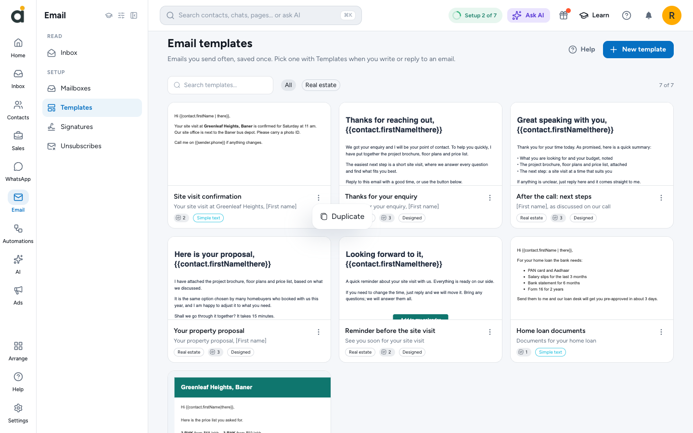
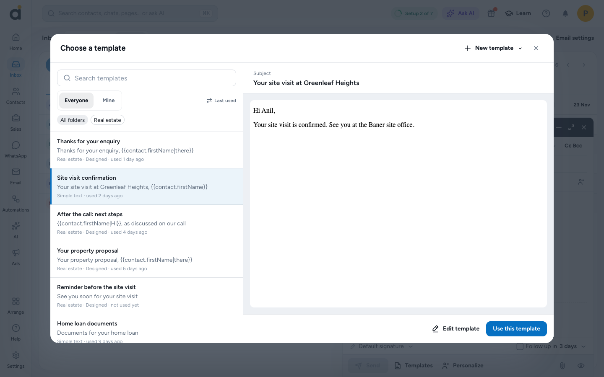

An **email template** is an email you write once and reuse: the subject and the message, with personal details like the contact's first name filled in for each person. Your whole team picks them when they write or reply to an email.

**Where:** **Email → Templates** in the left menu. [Open it →](https://app.adsera.in/dashboard/email-settings/templates)

## Four ways to start

Click **New template**. The page shows four ways to start, with ready-made designs below.

| Start with | What you get | Best for |
| --- | --- | --- |
| **Simple text** | A normal email: subject and message, with bold, lists and links. When you use it, the words land in the email so you can change anything before sending. | Most replies: confirmations, follow-ups, document lists. |
| **Blank canvas** | A designed email built from blocks: your logo, pictures, buttons, columns. Sent exactly as designed (you can still click its text to change it). | Proposals, price lists, anything that should look branded. |
| **Paste your own HTML** | An email someone already designed for you, pasted in as code. | You have an HTML email from a designer or another tool. |
| **Browse the catalogue** (a ready-made design) | A designed email for your industry, opened in the builder to change. | Getting a good-looking email fast. |

## Make a simple text template

<Steps>
<Step title="Click New template, then Simple text">
The **New simple template** window opens.

</Step>
<Step title="Name it">
**Template name** is only for your team, like *Site visit confirmation*.
</Step>
<Step title="Choose Team or Only me">
**Team**: everyone can use it. **Only me**: only you see it.
</Step>
<Step title="Write the Subject">
What customers see in their inbox. **Personalize** at the end of the box adds a detail, like their first name.
</Step>
<Step title="Write the message">
Write it like a normal email. To add a personal detail where your cursor is, click **Personalize** under the message and pick one.

</Step>
<Step title="Click Save template">
It shows on **Templates**, marked **Simple text**.
</Step>
</Steps>

### Personal details you can add

| Group | Details | Written as |
| --- | --- | --- |
| **Contact** | First name, Last name, Email, Phone | `{{contact.firstName}}` … |
| **You** | Your name, Your first name, Your email, Your phone | `{{sender.name}}` … |
| **Company** | Company name (your business) | `{{company.name}}` |

Designed templates can also add **any contact field you made**, like City or Budget (see [The template builder](/help/email/template-builder#add-the-contacts-name-and-other-details)).

When a contact has no value for a detail, it's left blank. To use a word instead, add it after a `|`: `Hi {{contact.firstName | there}}` reads *Hi Anil* for Anil, and *Hi there* for a contact with no first name. A missing detail never stops the email from sending.

## Start from a ready-made design

Below the four start cards is the **catalogue**: 348 designed emails. Every industry has five, written for one-to-one sales email:

| Design | When to send it |
| --- | --- |
| **Thanks for your enquiry** | Right after a new lead asks about you |
| **Great speaking with you** | After a call, with the next step |
| **Your proposal** | Sending a quote or proposal |
| **Reminder before the meeting** | The day before a visit or meeting |
| **We haven't heard from you** | When a lead goes quiet |

Industries: Real estate, Education & coaching, Clinics & healthcare, Retail & e-commerce, Travel & tourism, Insurance & finance, Fitness & gyms, Restaurants & catering, Agencies & software, Automobile dealers, Events & weddings, Manufacturing & B2B. More general designs (welcome, thank-you, event, survey and more) follow.

<Steps>
<Step title="Find a design">
Type in **Search templates…** (like *site visit*), or click your industry, like **Real estate 5** (the number is how many designs it has). **Featured** marks good ones to start with. Nothing found? **Clear filters**.

</Step>
<Step title="Click a design">
It opens in the builder as your own new template, filed under its industry. The design in the catalogue stays as it is.
</Step>
<Step title="Make it yours and save">
Name it, check the subject, change the words, then **Save**. See [The template builder](/help/email/template-builder).
</Step>
</Steps>

## Paste your own HTML

<Steps>
<Step title="Click New template, then Paste your own HTML">
The HTML editor opens with a sample email on the left and its preview on the right.

</Step>
<Step title="Name it and write the subject">At the top: **Untitled template** and **Subject line**.</Step>
<Step title="Paste your HTML over the sample">
The preview updates as you type; the phone button at the top shows it on a small screen. The round arrow above the code (*Start again from the sample email*) brings the sample back. To add the contact's first name, write `{{contact.firstName|there}}`.
</Step>
<Step title="Click Save">It shows on Templates, marked **Your HTML**.</Step>
</Steps>

An HTML template is sent exactly as written and can't be opened in the drag-and-drop builder.

## The Templates page

| On the page | What it does |
| --- | --- |
| **New template** | Start a new one |
| **Search templates…** | Finds templates by name or subject (shows once you have more than 3) |
| **All**, **Real estate**… | Templates started from a ready-made design are filed under its industry. Click one to see only those |
| *7 of 7* | How many are shown |
| A card | The email, its name and subject. Click it to open it |
| **Simple text** / **Designed** / **Your HTML** | How it was made |
| A small number with a code icon | How many personal details it fills in; point at it to see them |
| **⋮** | **Edit**, **Duplicate**, **Delete** |

Templates used most recently come first.

Before you make any, the page says **No templates yet** with **New template**:

## Edit, copy or delete a template

Click **⋮** on a template:

| Choice | What it does |
| --- | --- |
| **Edit** | Opens it: a simple template in its window, a designed one in the builder, an HTML one in the HTML editor. (Clicking the card does the same.) |
| **Duplicate** | Makes a copy named *… (copy)* that you own, to try a new version without touching the original |
| **Delete** | Asks first, then removes it for everyone. Emails already sent with it don't change |

### Who can change a template

| | Make templates | Use them | Duplicate | Edit or delete |
| --- | --- | --- | --- | --- |
| Admin | Yes | Yes | Yes | Every template |
| Team member | Yes | Yes (the team's, and their own) | Yes | Only the ones they made |

A team member's **⋮** on someone else's template shows only **Duplicate**:

Opening someone else's template and saving it says *Only whoever made this template (or an admin) can change it. Make a copy instead.*

## Use a template in an email

<Steps>
<Step title="Write or reply">
In **Inbox → Email** click **Compose**, or **Reply** on an email. (Also from a contact's page, Prospects or a deal.)
</Step>
<Step title="Click Templates">
At the bottom of the email window. **Choose a template** opens.

</Step>
<Step title="Find it">
Search, switch **Everyone** / **Mine**, sort by **Last used** or **Name**, or click a folder. Point at a template: the right side shows it filled in for this contact.
</Step>
<Step title="Click it (or Use this template)">
The subject and message are filled in. A **simple** template becomes normal text you can change. A **designed** one keeps its look: click any text in it to change it; **Remove template** clears it.
</Step>
<Step title="Send">Change anything you like, then click **Send**.</Step>
</Steps>

In **Choose a template** you can also click **New template** → **Simple text** to make one without leaving the email, or **Edit template** on a simple one.

## Troubleshooting

| You see | Why, and what to do |
| --- | --- |
| No **Edit** or **Delete** in the ⋮ menu | A teammate made it. Click **Duplicate** and change your copy. |
| *Only whoever made this template (or an admin) can change it. Make a copy instead.* | Same: duplicate it. |
| *Give the template a name.* / *Give the template a name before saving.* | Type a name at the top. |
| **Save template** is grey | Give it a name and write the message. |
| A customer got *Hi ,* | The contact had no first name and the detail had no fallback. Add one: see [Personal details](#personal-details-you-can-add). |
| *Nothing matches "…"* | No template has those words. Check the spelling or click **All** (in the catalogue: **Clear filters**). |
| A template doesn't show in **Choose a template** | It's someone else's **Only me** template. Ask them to switch it to **Team**. |

## FAQs

<AccordionGroup>
<Accordion title="How many templates can I make?">
As many as you like. Templates aren't limited by your plan.
</Accordion>
<Accordion title="Simple text or designed: which should I pick?">
Simple text for most replies: it reads like a personal email, lands in inboxes well and can be changed each time. Designed for proposals, price lists and anything that should look branded.
</Accordion>
<Accordion title="Can I put templates in my own folders?">
Not yet. Templates started from a ready-made design are filed under its industry; others show under **All**.
</Accordion>
<Accordion title="Do templates send emails by themselves?">
No. A template only fills in an email that you (or a teammate) send. AdsEra doesn't send email campaigns.
</Accordion>
<Accordion title="Are these the same as WhatsApp templates?">
No. WhatsApp templates are approved by Meta and sent on WhatsApp ([WhatsApp templates](/help/template/wa)). Email templates are yours and need no approval.
</Accordion>
</AccordionGroup>

## Related

<CardGroup cols={2}>
<Card title="The template builder" icon="pen-ruler" href="/help/email/template-builder">Blocks, styles, details, checks and test emails.</Card>
<Card title="Email inbox" icon="envelope-open" href="/help/email/inbox">Write and reply with your templates.</Card>
<Card title="Signatures" icon="signature" href="/help/email/signatures">The sign-off added under every email.</Card>
<Card title="Mailboxes" icon="inbox" href="/help/email/mailboxes">Connect Gmail or Zoho first.</Card>
</CardGroup>
