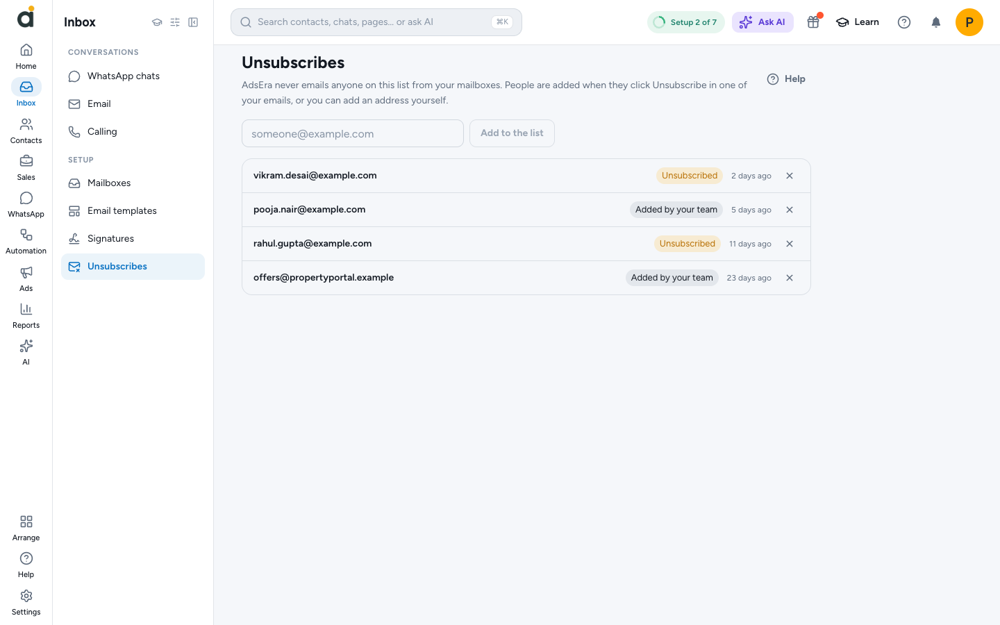
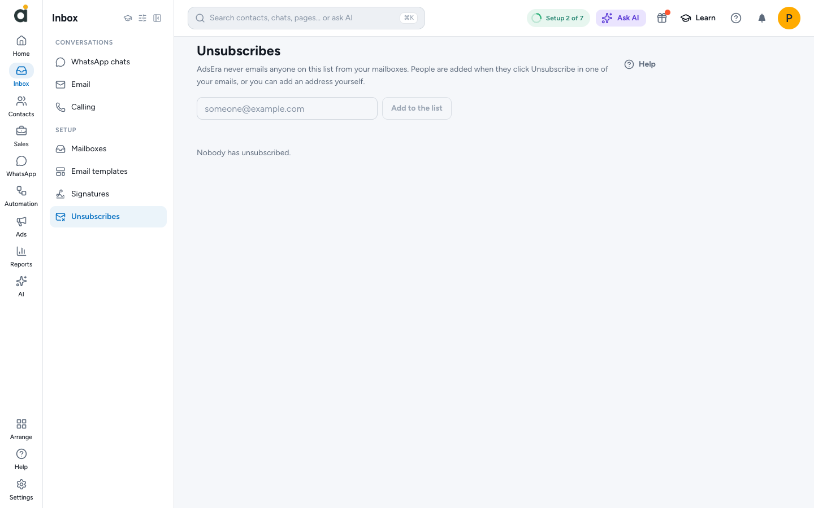
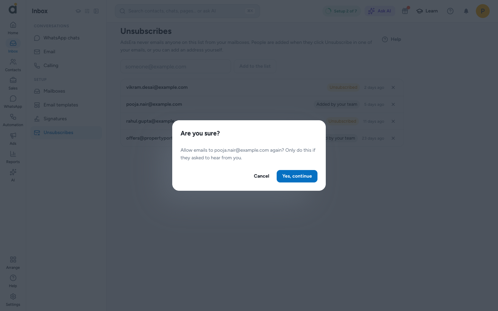

**Unsubscribes** is the list of email addresses AdsEra will never email from your mailboxes. People get on it in two ways:

- they click the unsubscribe link in one of your emails and confirm, or
- someone in your team adds the address here (say, a customer asked on the phone).

**Where:** **Inbox → Setup → Unsubscribes** in the left menu. [Open it →](https://app.adsera.in/dashboard/email-settings/unsubscribes)

## How someone unsubscribes

Every email sent from AdsEra carries an unsubscribe link in its hidden header, so Gmail and Outlook may show an **Unsubscribe** button next to your name. A designed template can also have an **Unsubscribe** or **Footer** block with the link in the email itself.

<Steps>
<Step title="They click Unsubscribe">A page opens: *Stop getting emails from this sender?* with **Yes, unsubscribe me**. (Just opening the link does nothing: email security scanners open links by themselves.)</Step>
<Step title="They confirm">The page says *You're unsubscribed*. Every address the email was sent **To** is added to your list as **Unsubscribed**.</Step>
</Steps>

The **Unsubscribe** button in Gmail or Outlook adds them straight away, without that page.

## What the list shows

| On a row | Meaning |
| --- | --- |
| The address | Who won't be emailed |
| **Unsubscribed** | They clicked unsubscribe in one of your emails |
| **Added by your team** | Someone in your team added it here |
| *about 2 hours ago* | When it was added. Point at it for the exact date and time |
| × | Allow emails to them again |

When the list is empty it says *Nobody has unsubscribed.*

## What it stops

Anyone on the list can't be emailed from any mailbox in AdsEra (Inbox, a contact's page, Prospects, deals). If you try, the email isn't sent and you see *priya.k@example.com asked not to get email from you (unsubscribed). Remove them to send.* Take them out of To, Cc or Bcc and send again.

It covers email only. It doesn't change WhatsApp: WhatsApp opt-out has its own setting ([Opt-in and opt-out](/help/channel/whatsapp/opt)).

## Add an address yourself

<Steps>
<Step title="Type the address">In the box (*someone@example.com*).</Step>
<Step title="Click Add to the list">It shows straight away as **Added by your team**, and sending to it is stopped.</Step>
</Steps>

## Allow emails to someone again

Only do this if they asked to hear from you again.

<Steps>
<Step title="Click the × on the address"></Step>
<Step title="Confirm">
*Allow emails to … again? Only do this if they asked to hear from you.* Click **Yes, continue**. You can email them straight away.

</Step>
</Steps>

## Troubleshooting

| You see | Do this |
| --- | --- |
| *Enter an email address.* | Type a full address, like name@example.com. |
| *… asked not to get email from you (unsubscribed). Remove them to send.* | Remove that address from the email. If they asked to hear from you again, allow them here first. |
| Someone asked by phone or WhatsApp to stop emails | Add their address yourself with **Add to the list**. |

## FAQs

<AccordionGroup>
<Accordion title="Do I need an unsubscribe link in one-to-one email?">
AdsEra adds one to every email's header for you. For an email many people get, also add an **Unsubscribe** or **Footer** block to your template.
</Accordion>
<Accordion title="Is the list shared with my team?">
Yes. It's one list for your whole business: nobody in your team can email an address on it.
</Accordion>
<Accordion title="Does it remove the contact?">
No. The contact stays in Contacts, with all their chats and history.
</Accordion>
</AccordionGroup>

## Related

<CardGroup cols={2}>
<Card title="Mailboxes" icon="inbox" href="/help/email/mailboxes">Limits on sending.</Card>
<Card title="The template builder" icon="pen-ruler" href="/help/email/template-builder">Add an Unsubscribe block.</Card>
</CardGroup>
