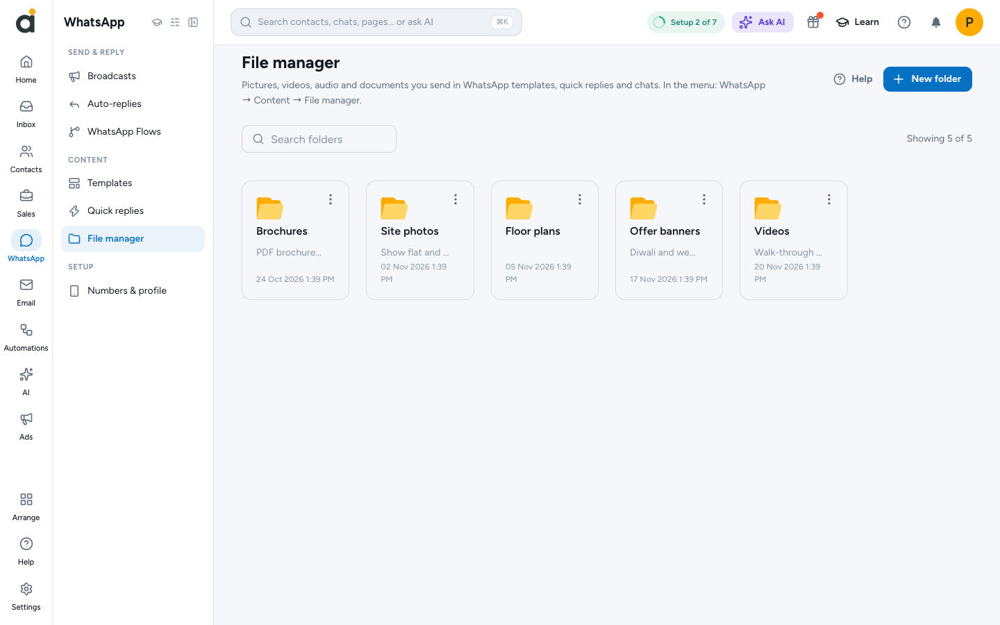
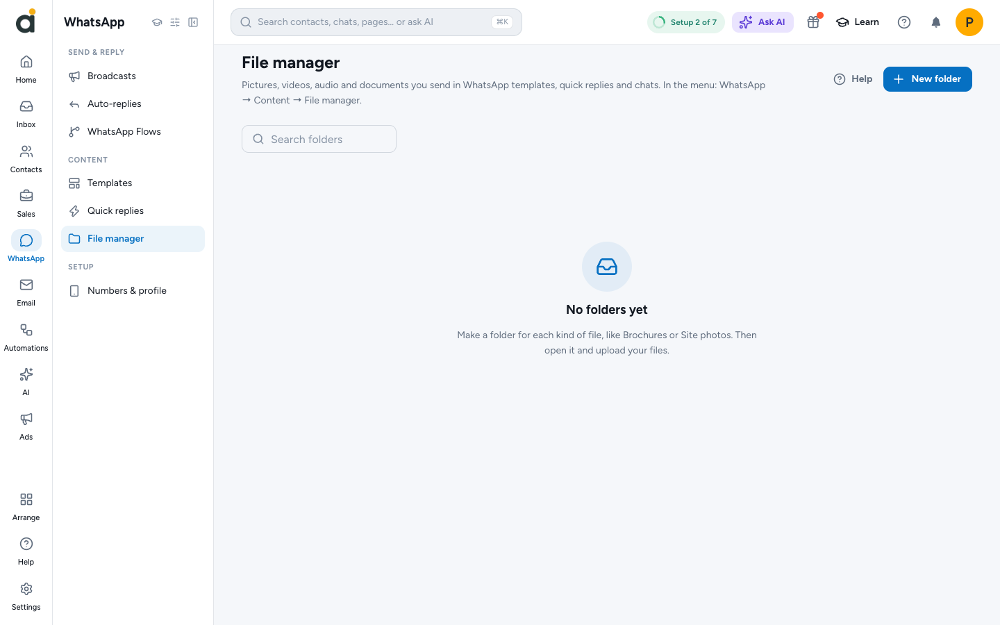
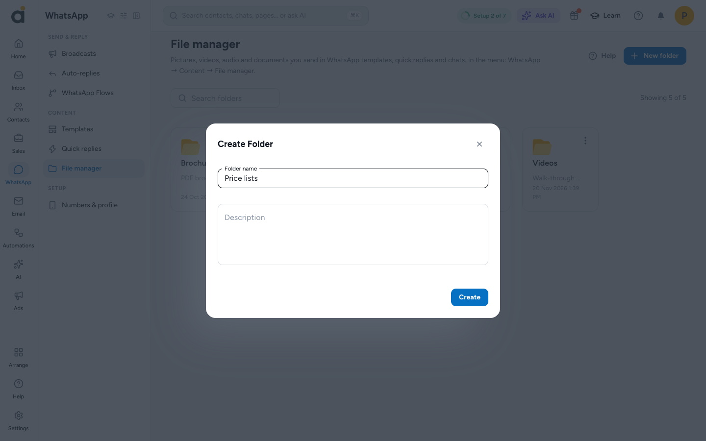
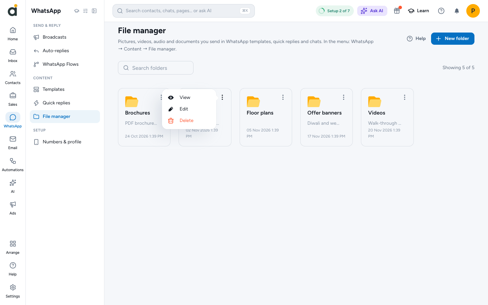
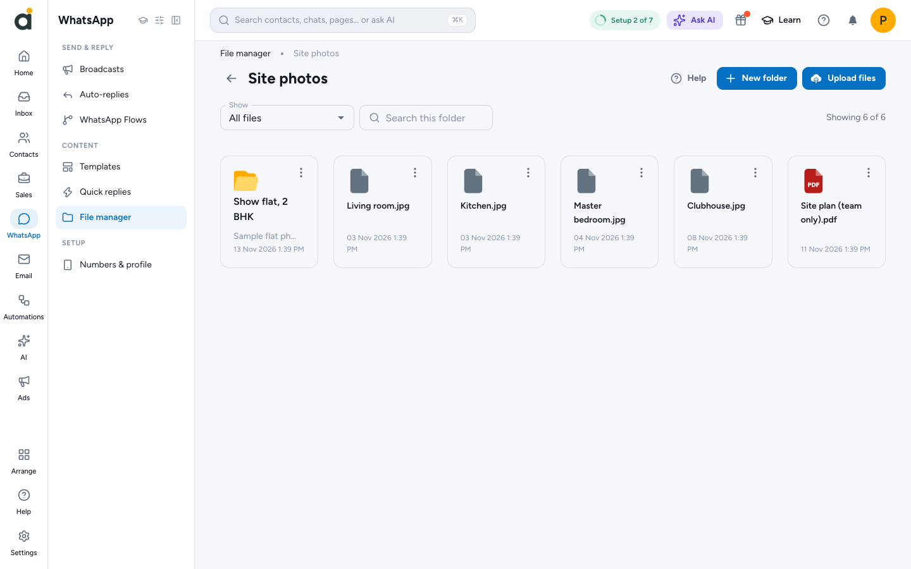
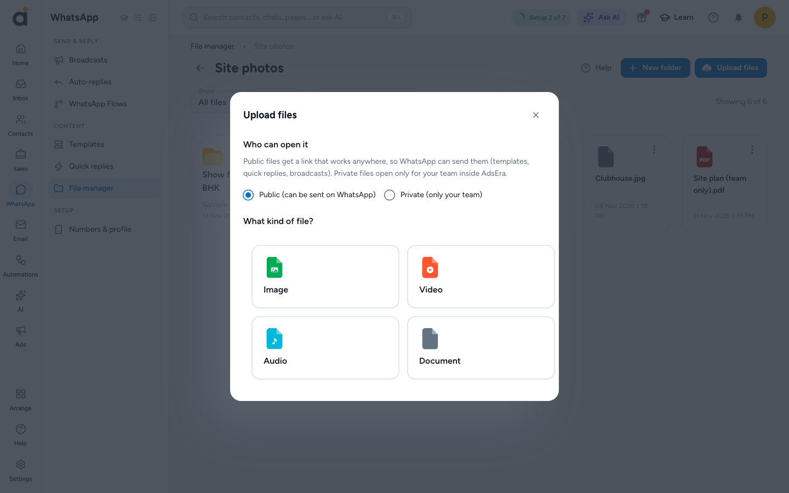
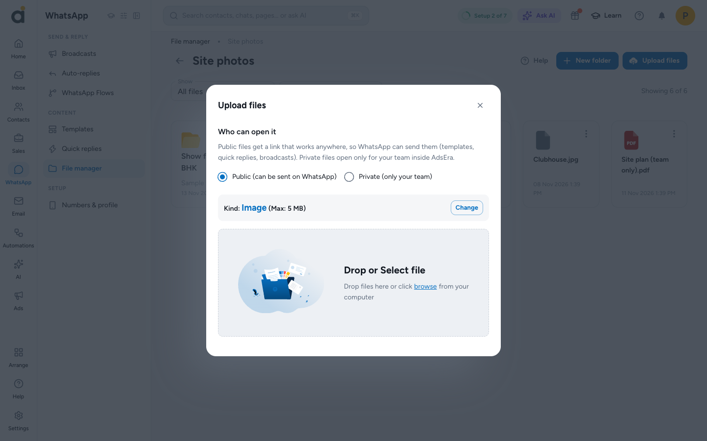

The **File manager** is your library for the pictures, videos, audio and documents you send to customers: brochures, floor plans, site photos, walk-through videos. Upload a file once and pick it whenever a WhatsApp template, broadcast, quick reply, chat or email template needs it.

**Where:** **WhatsApp → File manager** in the left menu (under **Content**, next to Templates and Quick replies). [Open it →](https://app.adsera.in/dashboard/folder/list)

Files live in **folders**. The first page shows your folders; click one to see its files (and any folders inside it).

Before you have any, it says **No folders yet**:

## Make a folder

<Steps>
<Step title="Click New folder">

</Step>
<Step title="Name it">
**Folder name** (needed), like *Brochures* or *Site photos*, and an optional **Description**.
</Step>
<Step title="Save">
The folder shows on the page. Inside a folder, **New folder** makes a folder inside it.
</Step>
</Steps>

A folder's **⋮** menu: **View** (open it), **Edit** (rename it or change its description) and **Delete**. Only an **empty** folder can be deleted: delete its files (and folders) first, or AdsEra says what's still in it.

## Upload files

<Steps>
<Step title="Open a folder and click Upload files">

</Step>
<Step title="Choose who can open it">
- **Public (can be sent on WhatsApp)**: the file gets a link that works anywhere. WhatsApp needs this to send it, so use Public for anything in templates, broadcasts and quick replies.
- **Private (only your team)**: only people signed in to your AdsEra can open it, for invoices, agreements and other private papers.

</Step>
<Step title="Pick what kind of file">
| Kind | File types | Biggest file |
| --- | --- | --- |
| **Image** | JPG, PNG | 5 MB |
| **Video** | MP4, 3GP | 16 MB |
| **Audio** | AAC, M4A, MP3, AMR, OGG | 16 MB |
| **Document** | PDF, Word, Excel, PowerPoint, TXT | 100 MB |

These match WhatsApp's own limits for each kind. **Change** picks another kind.
</Step>
<Step title="Drop the files in and upload">
Drag files onto the box or click it to choose them (several at once is fine), then upload.

</Step>
</Steps>

## Find, open and delete files

| To… | Do this |
| --- | --- |
| Show only public or private files | **Show**: **All files**, **Public files**, **Private files** |
| Find a file | **Search this folder** (by name). **Clear** resets both |
| Open a file | Its **⋮** → **View** |
| Delete a file | Its **⋮** → **Delete** (asks first) |

<Warning>
Deleting a file can't be undone. Templates, quick replies and saved messages that still use its link stop showing it.
</Warning>

## Use a file

When a template, quick reply, chat or email template asks for a picture or document, choose **from your files** and pick it from its folder. Or paste the file's link.

## Related

<CardGroup cols={2}>
<Card title="WhatsApp templates" icon="message" href="/help/template/wa">Pictures and documents in a template's header.</Card>
<Card title="Quick replies" icon="bolt" href="/help/snippet/list">Saved messages with a file.</Card>
</CardGroup>
