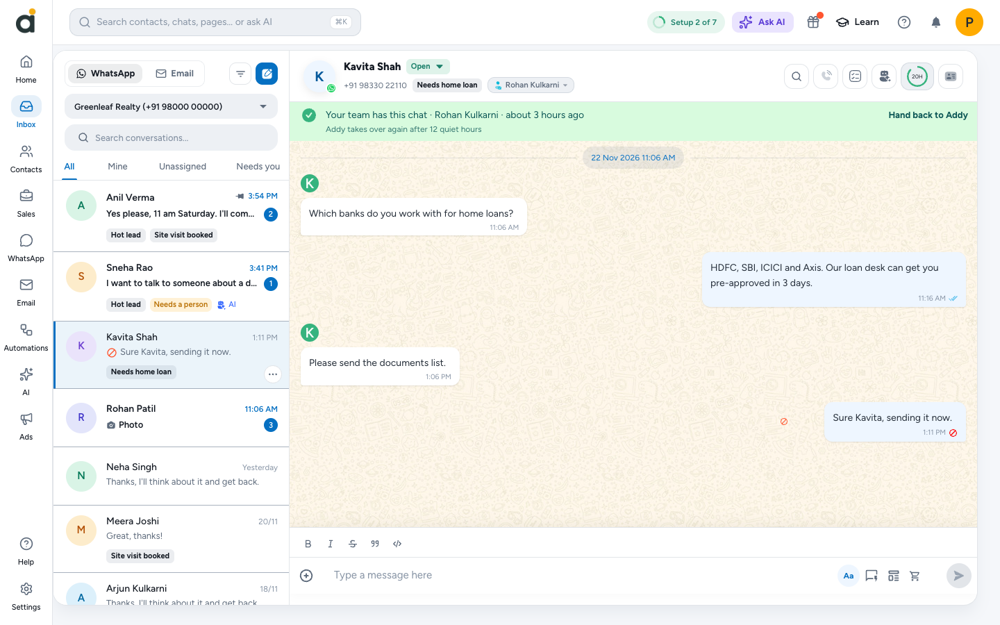
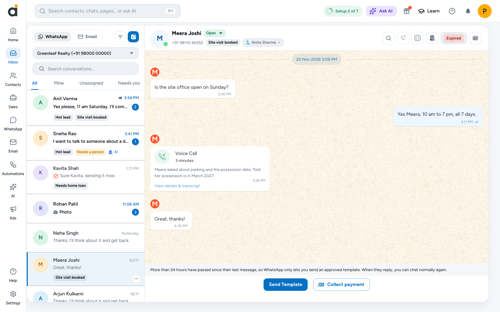
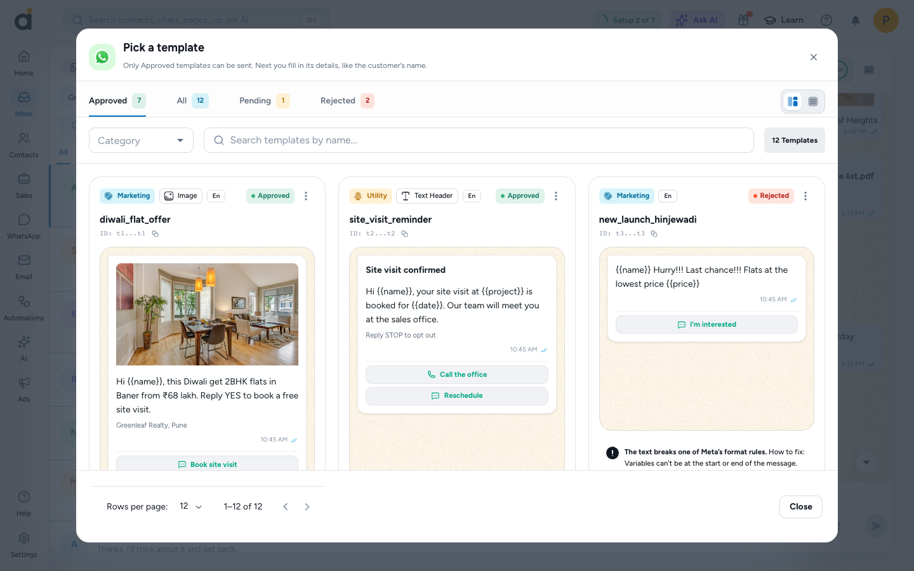
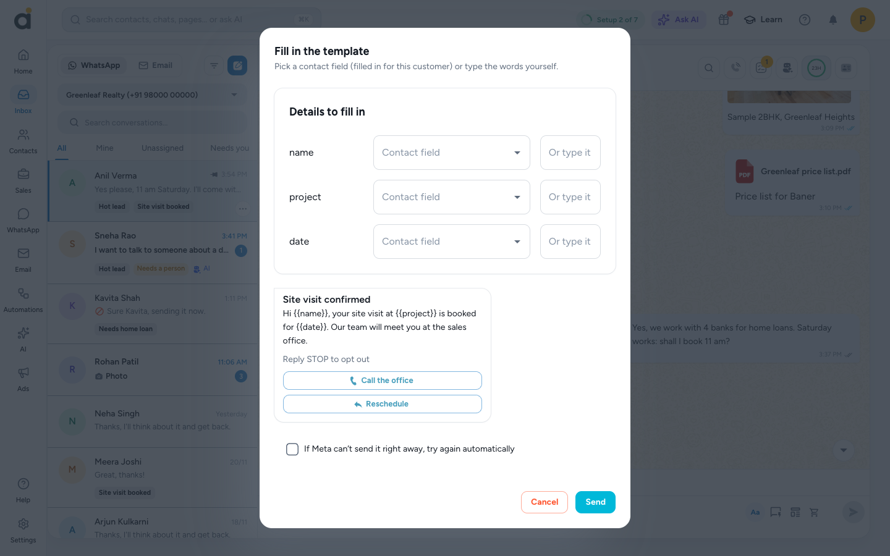

WhatsApp has one rule every business must follow:

- **Within 24 hours of the customer's last message**, you can send anything: text, photos, documents, quick replies.
- **After 24 hours** (or if they never wrote to you), you can only send an **approved template**. When they reply, the 24 hours start again.

This protects customers from spam. It's Meta's rule, not an AdsEra setting, and nobody can switch it off.

## How it looks in the chat

The clock in the chat header shows how much time is left. It goes round once in 24 hours and starts again each time the customer writes.

After 24 hours the clock says **Expired** and the reply box is replaced by:

> More than 24 hours have passed since their last message, so WhatsApp only lets you send an approved template. When they reply, you can chat normally again.

with two buttons, **Send Template** and **Collect payment**.

A chat you started yourself (with **Start a new chat**) says *They haven't messaged you yet…* instead.

## Send a template in a chat

<Steps>
<Step title="Open the template list">Click **Send Template** (after 24 hours), or the template button in the reply box (inside 24 hours you can send one too).</Step>
<Step title="Pick an approved template">
  The **Pick a template** window opens on **Approved**. Only approved templates can be sent: ones waiting for Meta or rejected are greyed out. Search by name or filter by **Category**. Click **Use Template**.

  
</Step>
<Step title="Fill in the details">
  The **Fill in the template** window lists each detail the template needs, like `{{name}}` or `{{date}}`. For each one, pick a **Contact field** (filled in for this customer, like FIRSTNAME) or type the words under **Or type it**. Templates with a photo, video or document header also ask for the file.

  
</Step>
<Step title="Send">Tick **If Meta can't send it right away, try again automatically** if you want AdsEra to retry when Meta is busy. Click **Send**.</Step>
</Steps>

The template shows in the chat. When the customer replies (or taps a button), the reply box comes back.

| Field | What it does | Example | Required? |
| --- | --- | --- | --- |
| **Contact field** | Fills the detail from this customer's contact | FIRSTNAME → "Anil" | One of the two |
| **Or type it** | The same words for this send | "Saturday 11 am" | One of the two |
| Media (photo/video/document header) | The file shown on top | Brochure PDF | If the template has one |
| Retry automatically | Tries again if Meta is busy | | No |

## What counts as "their last message"

- Any message, button tap or reaction **from the customer** starts the 24 hours.
- Your own messages, broadcasts and automatic replies **don't** reset it.

## Which template to use

- To restart a conversation: a **Utility** template (like a follow-up about their enquiry) or a **Marketing** template (an offer). Make them in **WhatsApp → Templates** ([how](/help/template/create)).
- Meta charges per template conversation; free-form replies inside 24 hours are free. See [templates](/help/template/wa).

## FAQ

<AccordionGroup>
  <Accordion title="Why does it say Expired when the customer wrote yesterday evening?">
    24 hours means exactly 24 hours from their last message, not "today". If they wrote at 7 pm yesterday, the window closed at 7 pm today.
  </Accordion>
  <Accordion title="My template doesn't show in the list.">
    Only **Approved** templates of this WhatsApp number can be sent. Check its status in **WhatsApp → Templates** and press **Sync** there if you just got it approved.
  </Accordion>
  <Accordion title="The template failed with 'Meta held back this marketing message'.">
    Meta limits how many marketing messages one person gets. Try again after a day or two, or use a utility template. See [failed messages](/help/inbox/errors).
  </Accordion>
  <Accordion title="Can Addy or auto-replies answer after 24 hours?">
    No one can, by WhatsApp's rule. They only answer when the customer writes, which opens the window again.
  </Accordion>
</AccordionGroup>

## Related

<CardGroup cols={2}>
  <Card title="WhatsApp chats" icon="comments" href="/help/inbox/chat" />
  <Card title="Create a template" icon="file-lines" href="/help/template/create" />
  <Card title="Why a message failed" icon="triangle-exclamation" href="/help/inbox/errors" />
  <Card title="Template statuses" icon="circle-check" href="/help/template/status" />
</CardGroup>
