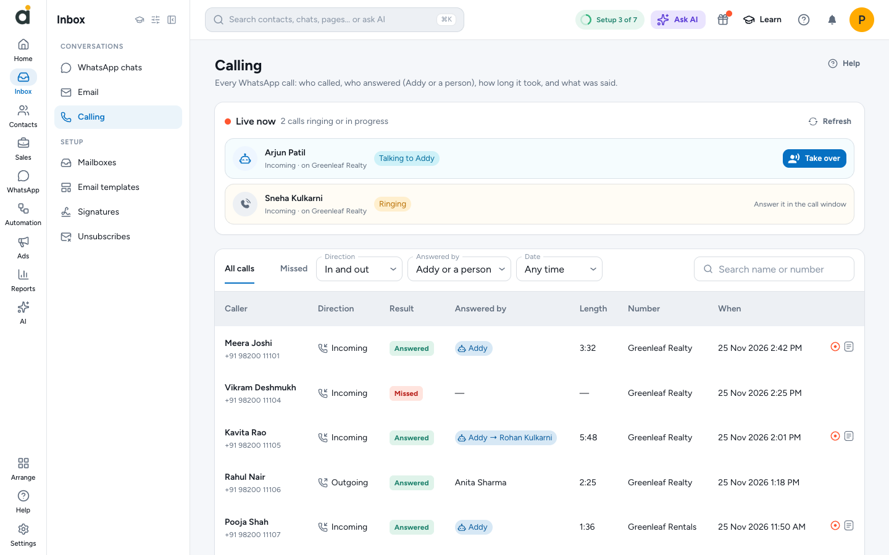
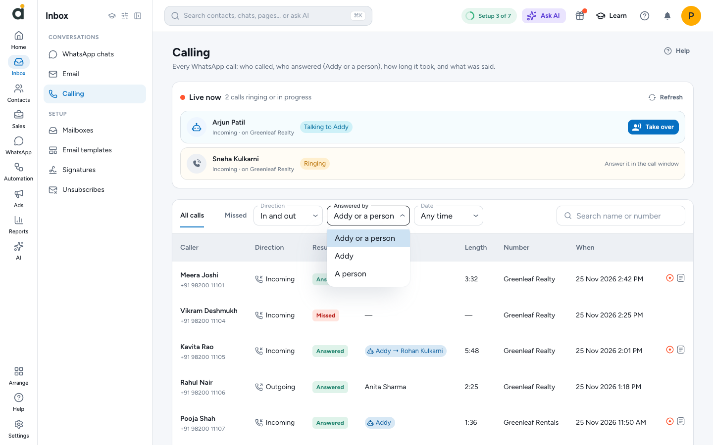
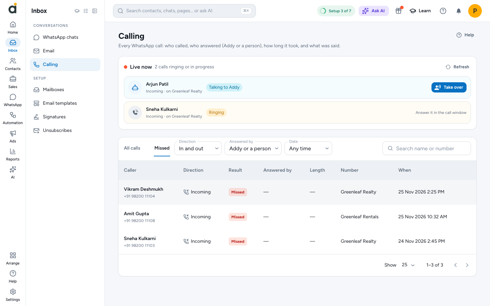
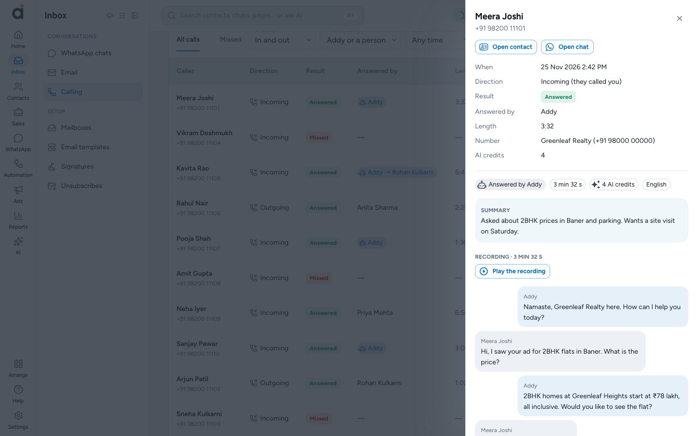
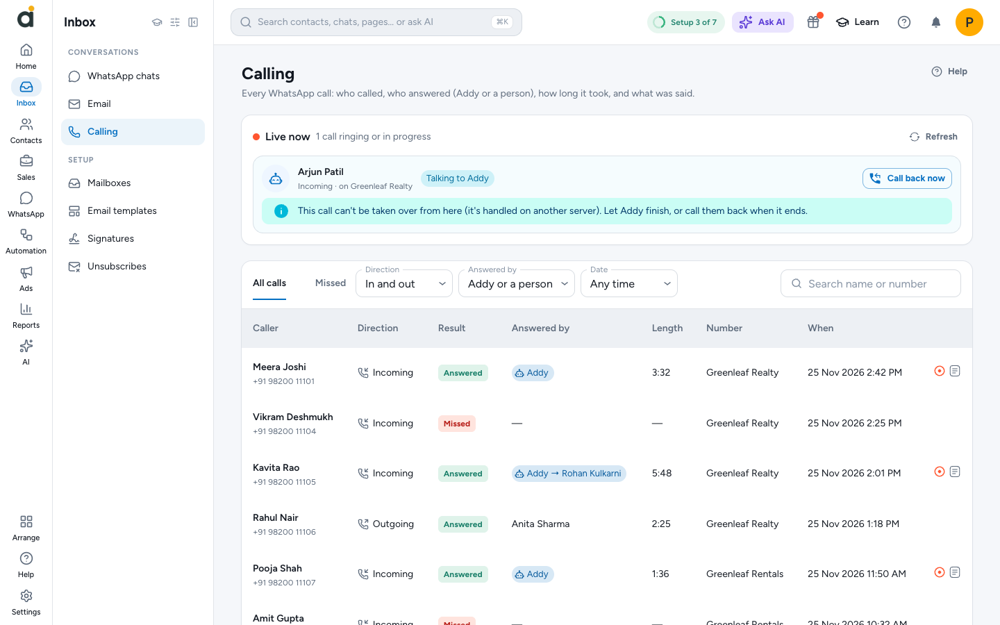
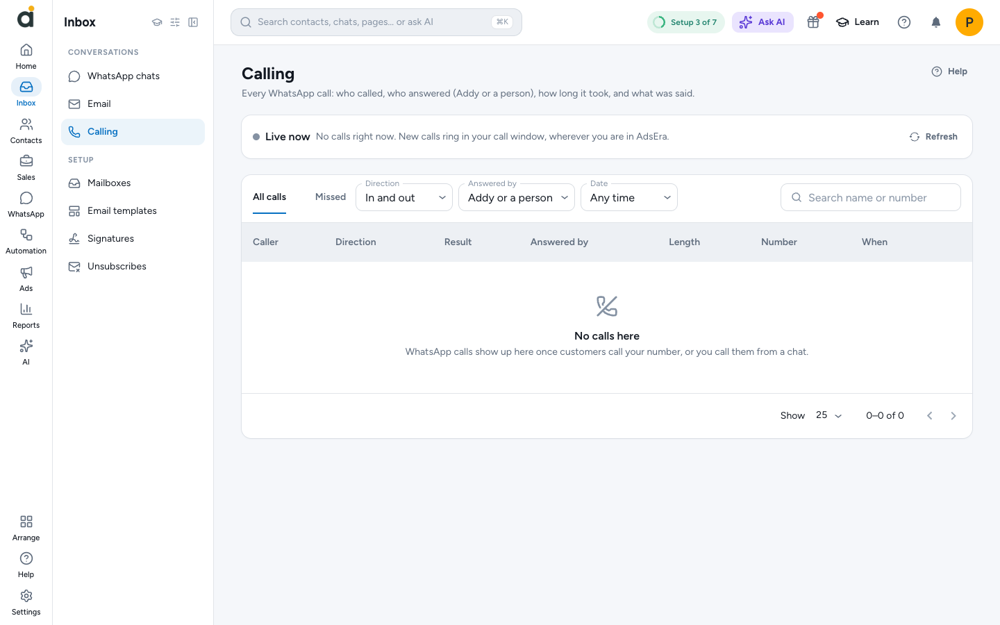
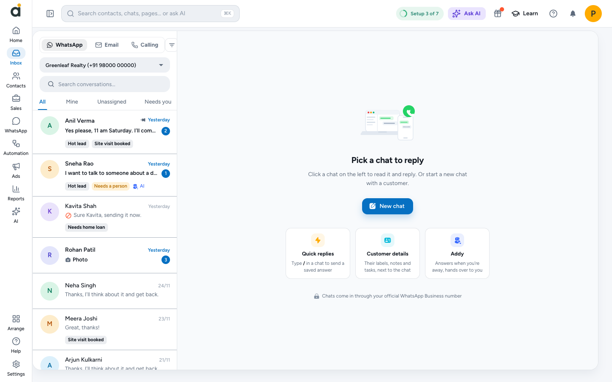

**Calling** lists every WhatsApp call on your numbers: who called, who answered (Addy or a person on your team), how long it took and what was said. At the top, **Live now** shows the calls ringing or in progress, and lets you **take over** a call Addy is on.

Use it to call back the people you missed, to check what Addy promised a customer, or to jump into a call when a customer needs a person.

**Where:** **Inbox → Calling**. On a chat screen, **Calling** is also next to **WhatsApp** and **Email** at the top. [Open it →](https://app.adsera.in/dashboard/calls)

**Before you start:** a WhatsApp number on the Cloud API with calling switched on (see [WhatsApp calling](/help/channel/whatsapp/calling)). Calls on a Coexistence number (also on the WhatsApp Business app) stay in the phone app and are not listed.

## Find a call

<Steps>
<Step title="Open Inbox → Calling">The newest call is at the top.</Step>
<Step title="Pick a tab">**All calls**, or **Missed** for the calls nobody answered.</Step>
<Step title="Narrow it down">

| Filter | Choices | Use it to |
| --- | --- | --- |
| **Direction** | **In and out**, **Incoming** (they called you), **Outgoing** (you called them) | See only the calls customers made |
| **Answered by** | **Addy or a person**, **Addy**, **A person** | Check Addy's calls |
| **Date** | **Any time**, **Today**, **Last 7 days**, **Last 30 days** | Today's calls |
| **Search name or number** | Part of a name or phone number | Find one caller |

</Step>
<Step title="Read the row">See the columns below. Click the caller's name to open their contact page.</Step>
</Steps>

### The columns

| Column | What it shows |
| --- | --- |
| **Caller** | Their name and number |
| **Direction** | **Incoming** or **Outgoing** |
| **Result** | **Answered**, **Missed**, **On a call** (in progress) or **Ringing** |
| **Answered by** | **Addy**, **Addy → Rohan Kulkarni** (Addy put the caller through to Rohan), a teammate's name, or **—** for a missed call |
| **Length** | Minutes and seconds |
| **Number** | Your WhatsApp number they called (or you called from) |
| **When** | Date and time |
| Last column | A red dot: the call was recorded. A page icon: it has a summary |

### What each result means

| Result | Meaning |
| --- | --- |
| **Answered** | Someone (Addy or a person) took the call and it has ended |
| **Missed** | Nobody answered, or the call was declined |
| **On a call** | Happening right now |
| **Ringing** | Ringing right now (it also shows in **Live now**) |

## Open a call: summary, recording and transcript

Click a row (anywhere except the name). A panel opens on the right.

| Part | What it shows |
| --- | --- |
| **Open contact** / **Open chat** | Their contact page, or their WhatsApp chat on the number they called (call them back with the phone icon there) |
| **When**, **Direction**, **Result**, **Answered by**, **Length**, **Number** | The facts |
| **AI credits** | What Addy's part of the call used (Addy's calls only) |
| Chips | **Answered by Addy** or the teammate, the length, **Put through to …**, the AI credits and the language |
| **Summary** | One line on what the call was about |
| **Recording** → **Play the recording** | Plays it in the panel. Only recorded calls have it |
| Transcript | Every line: the caller on the left, Addy or your teammate on the right. If Addy's transcript language is set, switch between it and **Original** |
| Call-back note | When nobody was free to take a call Addy passed on, the call-back task Addy booked |

<Note>Only calls Addy answers are transcribed. A call your team answered shows its facts and recording (if recorded).</Note>

## Take over a call Addy is on

**Live now** shows every call ringing or in progress, Addy's and your team's. It refreshes every few seconds, and straight away when your call window rings.

<Steps>
<Step title="Find the call">A call with Addy says **Talking to Addy**.</Step>
<Step title="Click Take over">Your call window rings, the same way it does when Addy hands a call to you: "Addy is putting this caller through (you asked to take over)".</Step>
<Step title="Click Accept in the call window">The caller is put through to you and Addy leaves the call. In the list it shows **Addy → your name**.</Step>
</Steps>

### When it can't be taken over

AdsEra can only take over a call from the server that is running it. If it can't, the card says **This call can't be taken over from here** and shows **Call back now**, which opens the chat so you can call them back when Addy is done.

| Message | Why | What to do |
| --- | --- | --- |
| This call can't be taken over from here | The call ended, or another server runs it | Let Addy finish, then **Call back now** |
| Your browser isn't connected for calls right now | AdsEra lost its live connection in your browser | Reload AdsEra and click **Take over** again |
| A teammate already has this call | Someone took it first (or Addy already put them through) | Nothing: it's handled |

A ringing call that isn't Addy's says **Answer it in the call window**: incoming calls ring in your call window wherever you are in AdsEra.

## Who sees which calls

Admins see every call. A team member sees the calls on the WhatsApp numbers they can use, for the contacts they may see (their own, or theirs and unassigned ones, as their role says). The page needs the **WhatsApp chats** permission.

## When there are no calls

Calls show up once customers call your WhatsApp number, or you call them from a chat. Check that calling is on for your number in [WhatsApp calling](/help/channel/whatsapp/calling).

## On a chat screen

The chat screens keep the full width: the Inbox menu is folded away. **Calling** is at the top, next to **WhatsApp** and **Email**; the panel icon at the top left opens the Inbox menu.

## Troubleshooting

| What you see | Fix |
| --- | --- |
| A call shows **Ringing** but nobody is calling | Its end never reached AdsEra. It drops off **Live now** after 2 minutes. |
| **Play the recording** says it couldn't load | Try again. Recording is switched off in Addy → Calls for calls after that change. |
| No transcript | Only calls Addy answers have one. |
| A teammate can't see a call | The number isn't one of theirs, or the contact isn't theirs (Team access and their role). |

## Questions

<AccordionGroup>
<Accordion title="Does taking over end Addy's part straight away?">Yes, once you click **Accept** in the call window. Until then Addy holds the caller with music.</Accordion>
<Accordion title="Can I call someone from here?">Click the call, then **Open chat**, and use the phone icon at the top of the chat.</Accordion>
<Accordion title="Are calls in Reports?">Not yet: use this page. Addy's own call list and settings are in WhatsApp → Addy & calling (AI → Addy → Calls).</Accordion>
<Accordion title="Can a workflow react to a missed call?">Yes: Automation → Workflow templates → **Missed call: WhatsApp them and make a task**.</Accordion>
</AccordionGroup>

## Related

<CardGroup cols={2}>
<Card title="WhatsApp calling" href="/help/channel/whatsapp/calling">Switch calling on for a number.</Card>
<Card title="Addy" href="/help/ai/addy">Let Addy answer calls and chats.</Card>
<Card title="Lead handover" href="/help/crm/lead-handover">Who gets a lead, and when Addy hands over.</Card>
<Card title="Workflow templates" href="/help/automation/workflow-templates">Missed call → WhatsApp + task.</Card>
</CardGroup>
