The **WhatsApp chats** inbox shows every message customers send to your WhatsApp number. You and your team reply from here, send templates, photos and payment requests, and see the customer's details next to the chat.

**Where:** **Inbox** in the left menu, then **WhatsApp** at the top of the list. [Open it →](https://app.adsera.in/dashboard/whatsapp/chat)

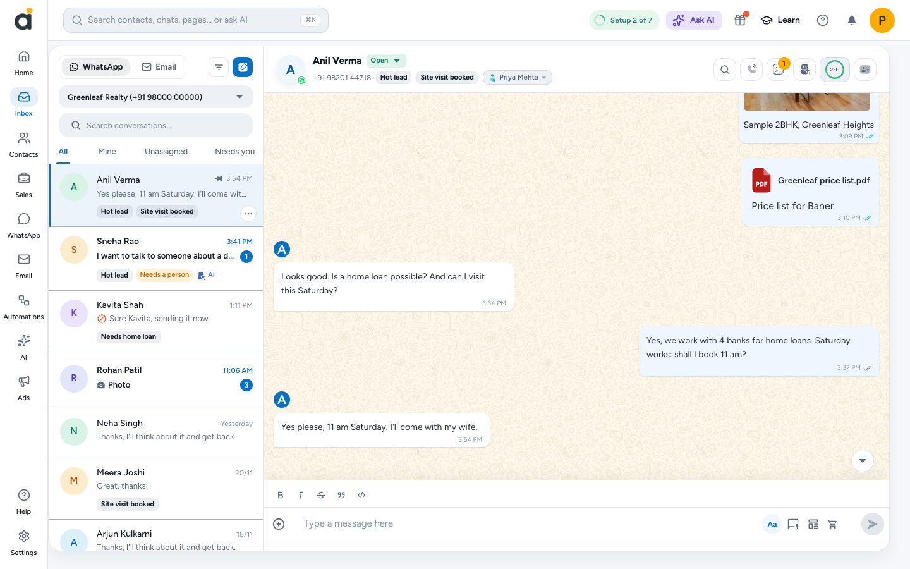

The screen has three parts:

| Part | What it shows |
| --- | --- |
| **Chat list** (left) | Your number, search, the four tabs, and every chat, newest first |
| **Open chat** (middle) | The customer's name and status at the top, the messages, and the reply box at the bottom |
| **Customer details** (right, when you open it) | Their fields, labels, notes, tasks, calls and an AI summary |

<Tip>
  New here? In the app, open **Learn → Inbox** and click **Do it with me** on any lesson: the guide points at each button on the real page.
</Tip>

## No number connected yet

If no WhatsApp number is connected, the inbox asks you to connect one. Click **Connect WhatsApp** and follow [Connect your WhatsApp number](/help/channel/whatsapp/connect). Chats show up here on their own once it's connected.

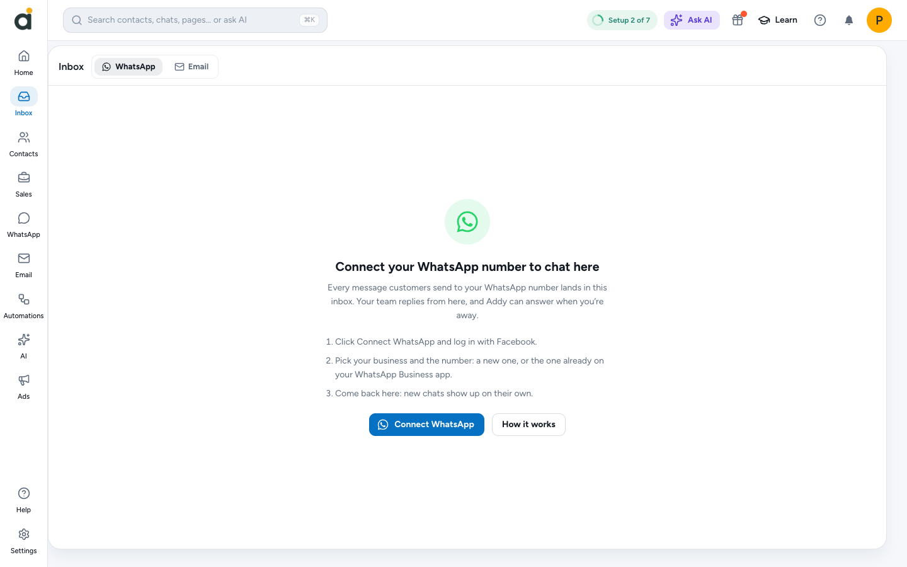

A **team member** sees "You're not added to a WhatsApp number yet" instead. An admin adds them in **WhatsApp → Numbers & profile → Team access** ([how](/help/channel/whatsapp/whatsapp)).

## The chat list

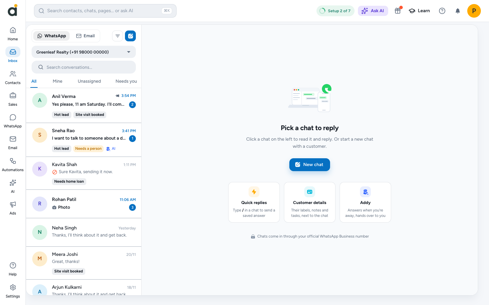

| Item | What it does |
| --- | --- |
| **WhatsApp / Email** | Switch between WhatsApp chats and your [email inbox](/help/email/inbox) |
| Filter button | Opens **Filter chats** ([filters](/help/inbox/filters)). A dot means some filters are on |
| Pencil button | **Start a new chat** (see below) |
| Number picker | Which WhatsApp number's chats you see, like *Greenleaf Realty (+91 98000 00000)* |
| **Search conversations…** | Find a chat by name or phone number |
| **All / Mine / Unassigned / Needs you** | Who should answer (see [Work as a team](/help/inbox/team)) |
| Load more chats | The round arrow at the bottom loads older chats (they also load as you scroll) |

Each chat row shows:

| On the row | Meaning |
| --- | --- |
| Name or number, time | The customer and when the last message came |
| Last message | A preview. ✓ grey = sent, ✓✓ grey = delivered, ✓✓ blue = read, red ⊘ = failed |
| Blue number | Unread messages |
| Labels | Up to two of the customer's labels (like *Hot lead*), then **+1** |
| **Needs a person** | Addy or the AI agent asked for someone from your team |
| **Closed** | You closed this chat |
| **AI** | Addy or the AI agent is answering this chat |
| Pin | You pinned it (pins are yours only) |

## Open a chat and reply

Click a chat. The messages show in the middle and the reply box at the bottom.

<Steps>
<Step title="Type your reply">Click **Type a message here** and write. **Enter** starts a new line; **Shift + Enter** sends. A message can be up to 4,096 characters.</Step>
<Step title="Format it (optional)">Select words and click **B** (bold), **I** (italic), **S** (strikethrough), quote or code. **Aa** shows or hides these buttons.</Step>
<Step title="Send">Click the send arrow. The ticks show when it's delivered and read.</Step>
</Steps>

### The buttons in the chat header

| Button | What it does |
| --- | --- |
| **Open / Closed** (next to the name) | The chat's status. Click to change it (see below) |
| Name under the customer (or **Unassigned**) | Who answers this chat. Click to [assign it](/help/inbox/team) |
| Magnifier | **Search this chat** for a word |
| Phone | **Call on WhatsApp**. Grey until the customer allows calls ([calling](/help/channel/whatsapp/calling)) |
| Checklist | **Add a task** for this customer. The number is their open tasks |
| Robot | **Automatic replies** on or off for this customer ([take over](/help/inbox/team#take-over-from-addy-or-automatic-replies)) |
| Clock | Time left in the [24-hour window](/help/inbox/24-hour-window). **Expired** after 24 hours |
| Person | **Contact details** ([the panel](/help/inbox/contact-panel)) |

### On each message

Point at a message to see its buttons:

| Button | What it does |
| --- | --- |
| Arrow | **Reply** to this message: your answer quotes it |
| Smiley | **React** with an emoji. Click your reaction again to remove it |
| (i) on your messages | **Message info**: when it was sent, delivered and read ([details](/help/inbox/errors#message-info)) |
| Red ⊘ | It failed. Click to see [why and how to fix it](/help/inbox/errors) |

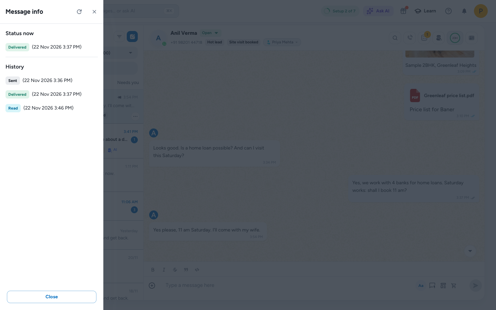

When a chat started from a **Facebook or Instagram ad**, the customer's first message shows the ad they clicked (**View ad** opens it). When the customer came from an **Instant form** ad, the top of the chat says *Lead from an Instant form ad* with their form answers.

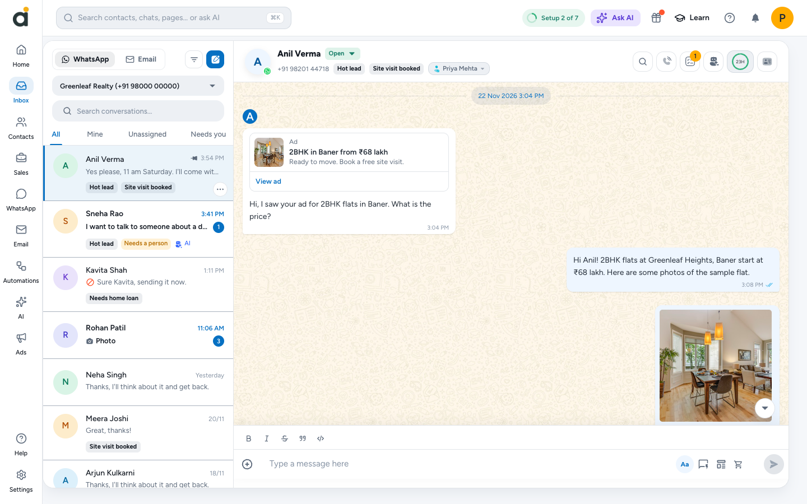

### Attach a file, quick reply, template or payment

Click **+** in the reply box:

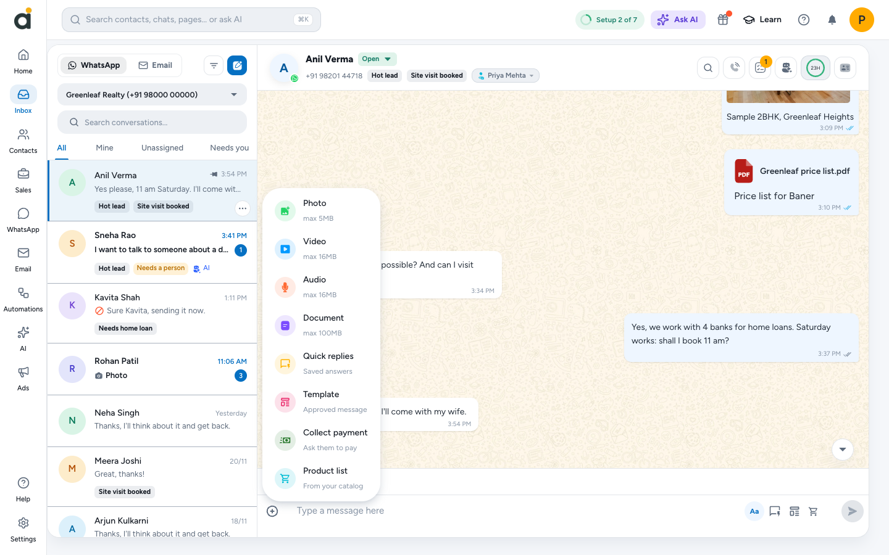

| Item | What it sends | Limit |
| --- | --- | --- |
| **Photo** | A picture with a caption | 5 MB (JPG, PNG) |
| **Video** | A video with a caption | 16 MB (MP4) |
| **Audio** | A voice note or audio file | 16 MB |
| **Document** | PDF, Excel, Word… | 100 MB |
| **Quick replies** | A saved answer ([quick replies](/help/snippet/list)) | |
| **Template** | An approved template ([24-hour rule](/help/inbox/24-hour-window)) | |
| **Collect payment** | A Pay Now request ([payments](/help/inbox/payments)) | |
| **Product list** | Products from your catalog | Up to 30 |

The buttons on the right of the reply box are shortcuts: **Aa** (formatting), quick replies, template and product list.

### Quick replies: type /

Type **/** at the very start of the reply box. Your quick replies show above it: click one to send it. Keep typing after the / to search by name. Or click the quick replies button to pick from all of them, by type.

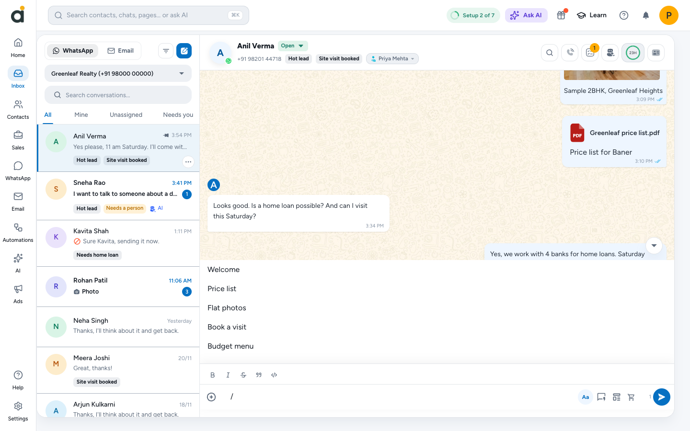

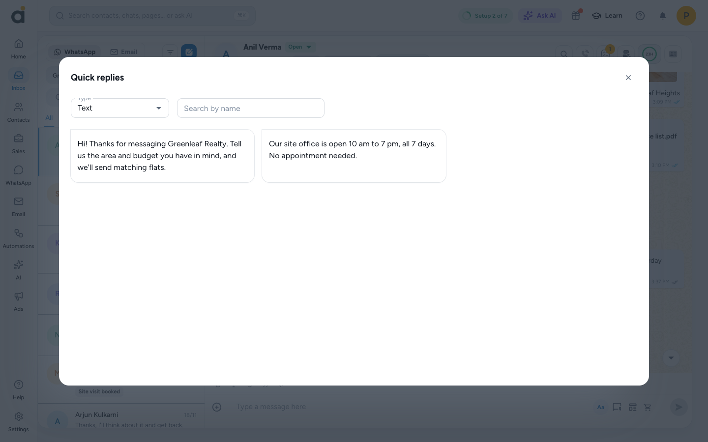

Clicking a quick reply **sends it straight away**. "No quick reply with that name" means none matches: make one in **WhatsApp → Quick replies** ([how](/help/snippet/create)).

### Send a product list or a WhatsApp Flow

- **Product list:** click the cart. Add a **Header Text** and **Body Text**, tick up to 30 products, and click **Send Product List**. Needs a Meta catalog linked to the number ([WhatsApp Commerce](/help/integrations/whatsapp-commerce)).
- **WhatsApp Flow** (a form inside WhatsApp): save the flow as an **Interactive** quick reply, then send it from **Quick replies**. A window asks **Pick a WhatsApp Flow** (only published flows show) and, for some flows, the **First screen**. See [WhatsApp Flows](/help/automation/whatsapp-flows).

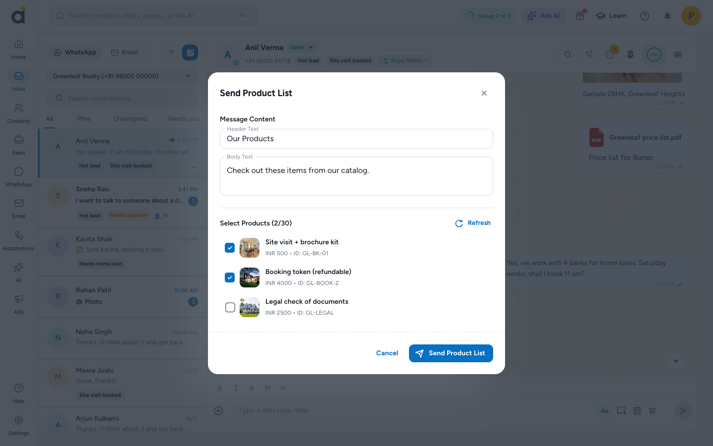

## Open and closed chats

Every chat is **Open** or **Closed**. Change it with the status next to the customer's name, or with **Mark as Closed / Mark as Open** in the chat's **⋯** menu.

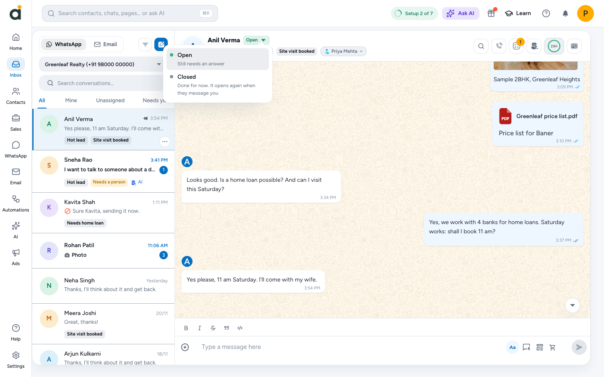

| Status | What it means | What happens |
| --- | --- | --- |
| **Open** | Still needs an answer | Shows in the default list. Every new chat starts open |
| **Closed** | Done for now | Leaves the default list (it shows a **Closed** badge until you refresh). Nothing is blocked: **when the customer writes again, the chat opens by itself** |
| **Broadcast only** | You sent this person a broadcast and they never replied | Set by AdsEra. Hidden from the default list; find these with the **Broadcast only** filter. When they reply, it becomes open |

<Note>
  There is no "Pending" status. Older versions of the app showed Open / Pending / Closed in the header, but that menu didn't change anything. It now shows only Open and Closed, and it really changes the chat.
</Note>

## The chat menu: pin, call, close

Point at a chat in the list (or open it) and click **⋯**:

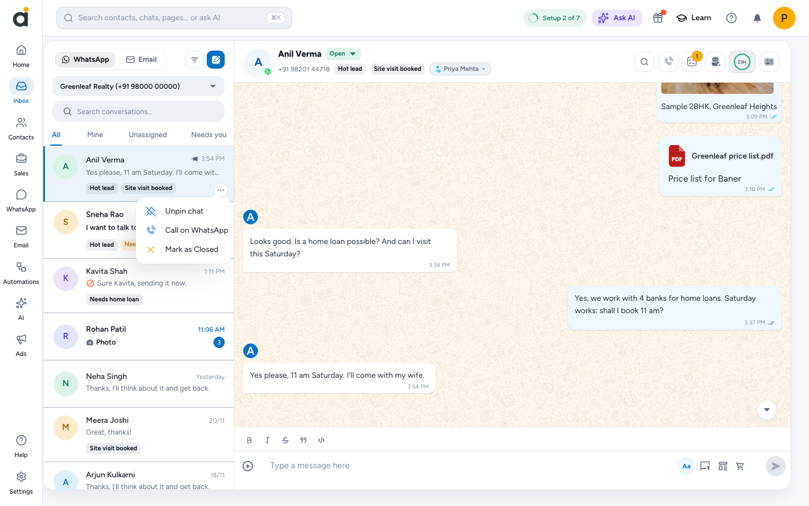

| Item | What it does |
| --- | --- |
| **Pin chat / Unpin chat** | Keeps it at the top of **your** list, in every tab. Teammates' lists don't change |
| **Call on WhatsApp** | Calls the customer. Grey until they allow calls. Not on the WhatsApp Business app number |
| **Mark as Closed / Mark as Open** | Closes or reopens the chat |

## Start a new chat

<Steps>
<Step title="Click the pencil">At the top of the chat list, click the pencil (**Start a new chat**). The empty inbox also has **New chat**.</Step>
<Step title="Type their WhatsApp number">Pick the **Country** and type the **Phone number**.</Step>
<Step title="Open chat">Click **Open chat**. If they're already a contact, you go to their chat. A new number is saved as a contact (assigned to you).</Step>
<Step title="Send a template">If they haven't written to you in the last 24 hours, start with **Send Template** ([why](/help/inbox/24-hour-window)).</Step>
</Steps>

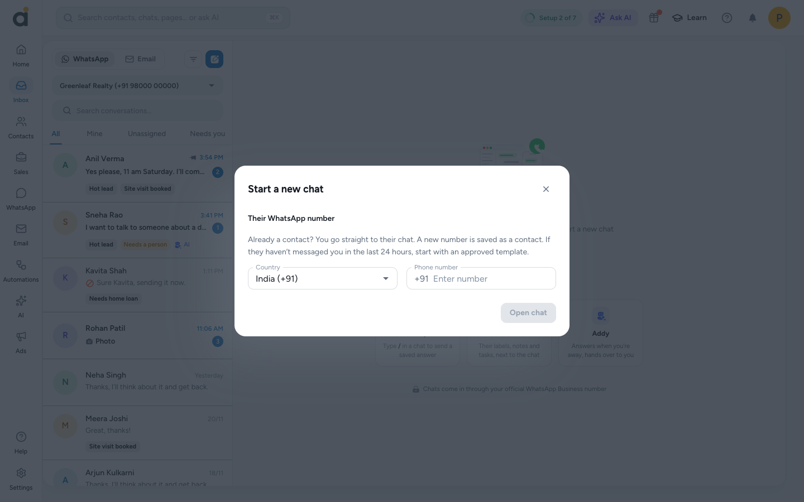

## When the customer opted out

If the customer sent your opt-out word (like STOP), the reply box says *This contact opted out of WhatsApp messages*. You can't message them until they send your opt-in word (like START). See [opt-in and opt-out](/help/channel/whatsapp/opt).

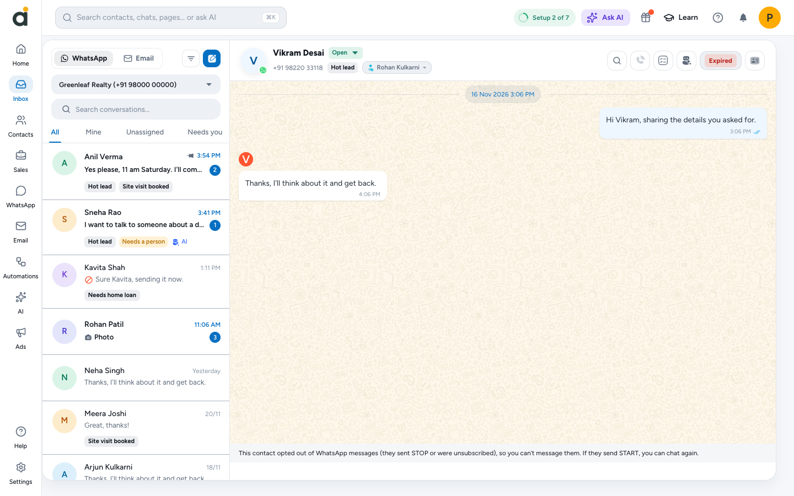

## Who sees which chats

- **Admins** see every chat on every number.
- **Team members** see only the numbers an admin added them to (**WhatsApp → Numbers & profile → Team access**). Their **Data visibility** (Settings → Team members) then decides which chats on those numbers:

  | Data visibility | Chats they see | First tab |
  | --- | --- | --- |
  | **All records** | Every chat | **All** |
  | **Assigned to them + unassigned** | Theirs and chats nobody has yet | **Visible** |
  | **Only assigned to them** | Only theirs (no **Unassigned** tab) | **Visible** |

- To open the inbox, a team member needs the **Chat** permission (*See chats & message history*; *Send messages* to reply). They don't need access to WhatsApp settings.

## Troubleshooting

| You see | Why | Fix |
| --- | --- | --- |
| No reply box, only **Send Template** | More than 24 hours since their last message | Send a template ([24-hour rule](/help/inbox/24-hour-window)) |
| **Take over** instead of the reply box | Addy or automatic replies are answering | Click **Take over** ([details](/help/inbox/team#take-over-from-addy-or-automatic-replies)) |
| "This contact opted out…" | They sent STOP | Wait for them to send START |
| A red ⊘ on a message | It wasn't delivered | Click it: [failed messages](/help/inbox/errors) |
| "Couldn't load this chat's contact" | The contact couldn't be loaded (often a missing Contacts permission) | Click **Try again**; ask an admin to give you Contacts access |
| A chat is missing | It's closed, filtered out, on another number, or not assigned to you | Check the number picker, **Clear all** in filters, and the **All** tab |
| Call button is grey | The customer hasn't allowed calls, or it's the WhatsApp Business app number | Send the call permission template ([calling](/help/channel/whatsapp/calling)) |

## FAQ

<AccordionGroup>
  <Accordion title="The customer says they didn't get my message.">
    Look at the ticks. One grey tick: sent, not yet delivered (their phone may be off). A red ⊘: it failed; click it to see why. Most common: more than 24 hours passed, so only a template can be sent.
  </Accordion>
  <Accordion title="Why can't I type in this chat?">
    Either 24 hours passed since their last message (send a template), Addy or automatic replies are answering (click **Take over**), or they opted out.
  </Accordion>
  <Accordion title="Can two team members reply to the same chat?">
    Yes, both can type. To avoid that, [assign the chat](/help/inbox/team) to one person. The name under the customer shows who has it.
  </Accordion>
  <Accordion title="Does closing a chat stop the customer from writing?">
    No. Closing only tidies your list. Their next message opens the chat again.
  </Accordion>
  <Accordion title="How do I stop Addy in one chat?">
    Click **Take over** above the chat, or the robot button in the header. See [Work as a team](/help/inbox/team).
  </Accordion>
  <Accordion title="Can AI write a reply for me here?">
    Not in the inbox: it has no AI draft button. AI-written drafts are in [Prospects](/help/sales/prospects) and in Closer's **Needs you** list, which open the same chat with the draft filled in. In the inbox, Addy can answer for you ([Addy](/help/ai/addy)), and the contact panel's [chat summary](/help/inbox/contact-panel) tells you what the customer wants.
  </Accordion>
  <Accordion title="Do I see the chats from my WhatsApp Business app?">
    Yes, if you connected the number you already use on the WhatsApp Business app ([Coexistence](/help/channel/whatsapp/connect)). Messages you send from the phone show here too.
  </Accordion>
</AccordionGroup>

## Related

<CardGroup cols={2}>
  <Card title="Filter and search chats" icon="filter" href="/help/inbox/filters" />
  <Card title="The 24-hour rule" icon="clock" href="/help/inbox/24-hour-window" />
  <Card title="Work as a team" icon="users" href="/help/inbox/team" />
  <Card title="Customer details panel" icon="address-card" href="/help/inbox/contact-panel" />
  <Card title="Why a message failed" icon="triangle-exclamation" href="/help/inbox/errors" />
  <Card title="Payments and orders in chat" icon="indian-rupee-sign" href="/help/inbox/payments" />
</CardGroup>
