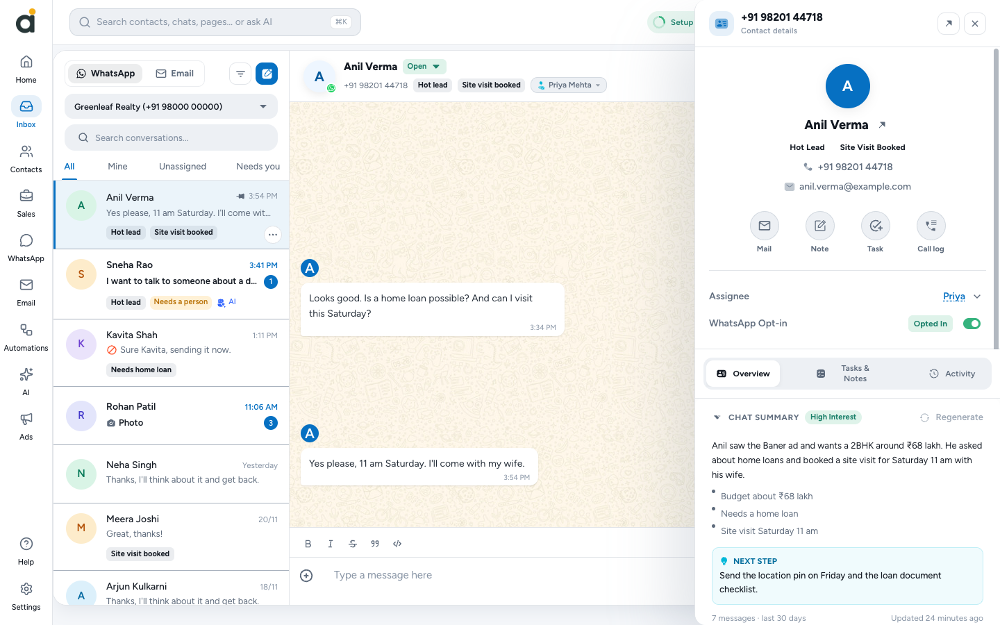
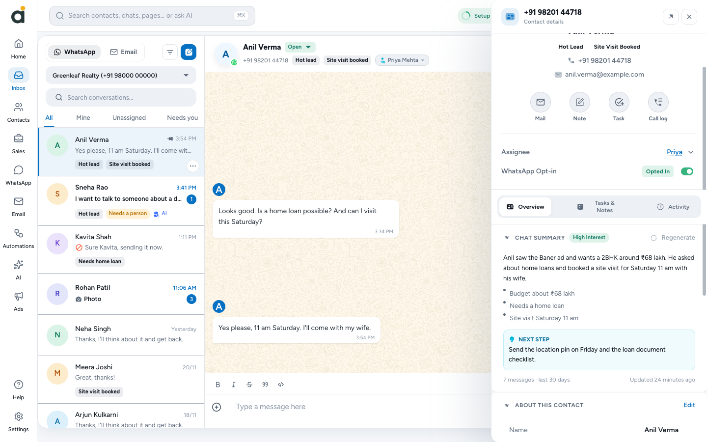
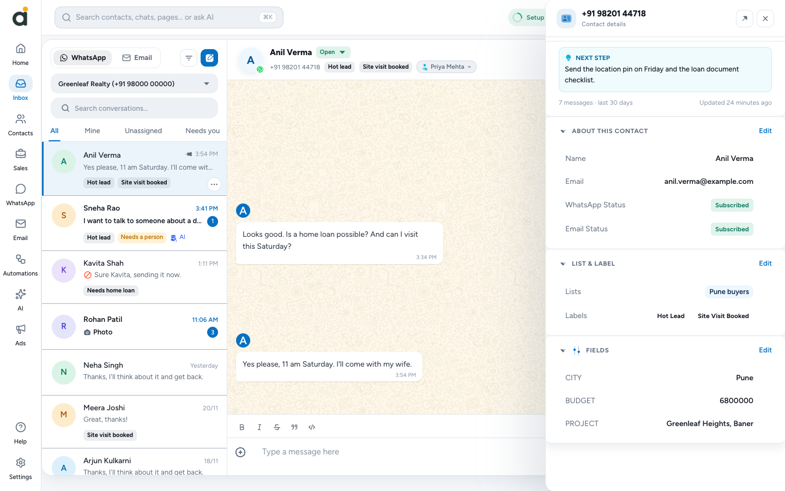
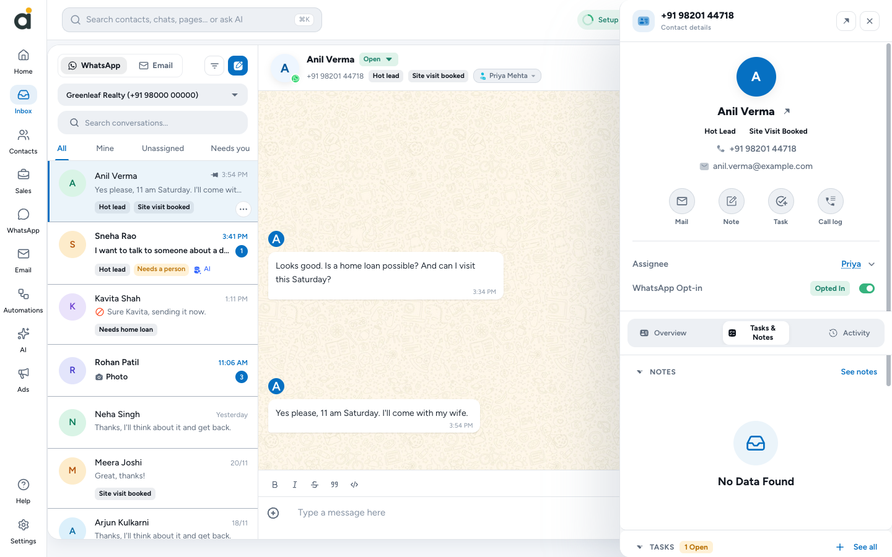
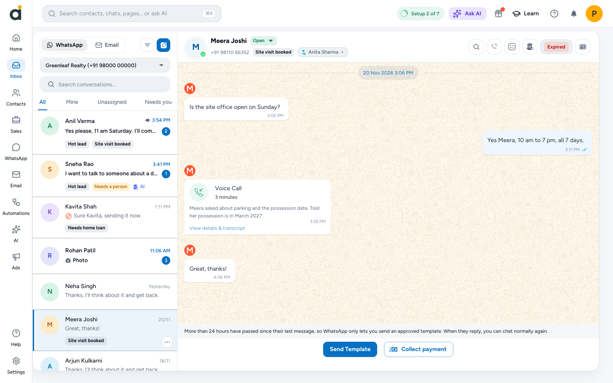
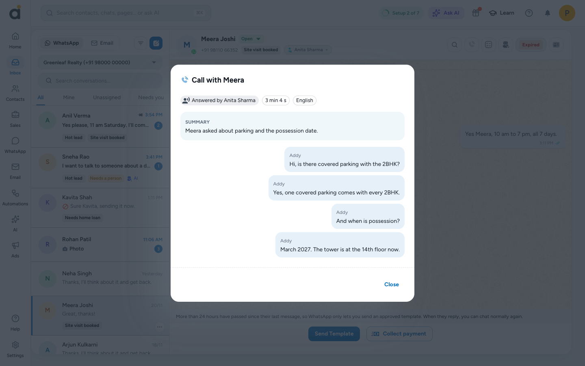
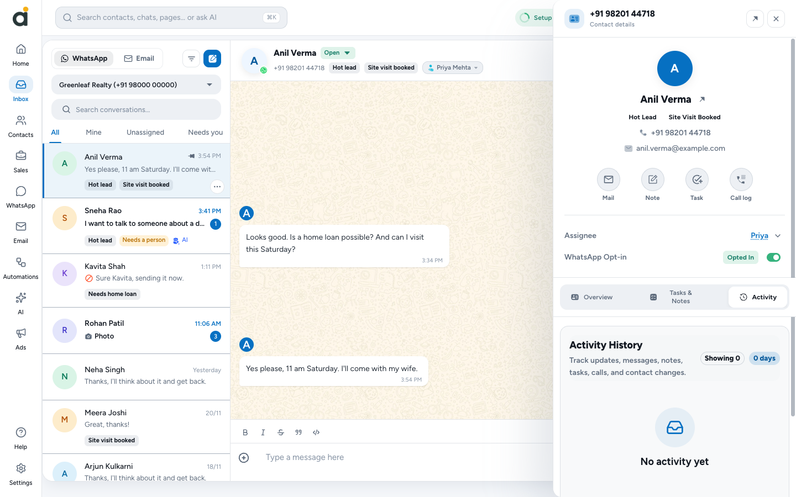

While you chat, the **contact panel** shows everything you know about the customer, and lets you change it.

**Where:** open a chat in **Inbox → WhatsApp** and click the **person icon** (**Contact details**) at the top right of the chat. Click it again, or the ✕, to close it.

## The top of the panel

| Item | What it does |
| --- | --- |
| ↗ (top right) | **Open the full contact page** in Contacts |
| ✕ | **Close contact details** |
| Name, labels, phone, email | Who they are. The ↗ next to the name also opens their contact page |
| **Mail** | Write them an email from your mailbox ([email](/help/email/inbox)). Needs their email address |
| **Note** | Add a note for your team. The customer never sees it |
| **Task** | Add a reminder, like "Call back Monday" ([tasks](/help/sales/tasks)) |
| **Call log** | Write down a phone call you had outside WhatsApp |
| **Assignee** | Who owns this customer (same as the chat's team member) |
| **WhatsApp Opt-in** | On: they can get your WhatsApp messages. Off: opted out, you can't message them |

## Overview tab

### Chat summary

AI reads the last 30 days of this WhatsApp chat and writes a short summary, the key points, the customer's mood and the **next step**. Click **Generate** (or **Regenerate** for a fresh one).

- It uses **AI credits** ([credit usage](/help/account/credit-usage)).
- You can make it **twice a day per customer**. The panel says when the next one is possible.

### About this contact

Name, email, **WhatsApp Status** and **Email Status** (**Subscribed** or **Unsubscribed**). Click **Edit** to change them.

### List & Label

| Field | What it's for | Example |
| --- | --- | --- |
| **Lists** | Groups you send [broadcasts](/help/campaign/wa/create) to | Pune buyers |
| **Labels** | Tags to sort and filter people | Hot lead, Site visit booked |

Click the pencil next to them to add or remove. It saves straight away, and the labels show in the chat list and header. Make new labels in **Contacts → Labels** ([how](/help/audiance/label)).

### Fields

Your own details about the customer, like **City**, **Budget** or **Project**. Click **Edit**, change them and save. Make new fields in **Contacts → Fields** ([how](/help/audiance/attribute)).

## Tasks & Notes tab

| Section | What it shows |
| --- | --- |
| **Notes** | Notes from your team. **See notes** opens them and lets you add one |
| **Tasks** | Open tasks for this customer. **See all** lists them; tick one when it's done |
| **Call logs** | WhatsApp calls and calls you logged. **See call logs** opens them, with recordings and transcripts for WhatsApp calls |

The **checklist button** in the chat header also adds a task; its number is the customer's open tasks.

### WhatsApp calls in the chat

Every WhatsApp call also shows in the chat as **Voice Call** with how long it lasted and a short summary. Click **View details & transcript** to see who answered (your team or Addy), the length, the language, AI credits used, the summary and what was said. Calling: [WhatsApp calling](/help/channel/whatsapp/calling).

## Activity tab

Everything that happened with this customer: emails, field changes, deals, form answers. Newest first.

## FAQ

<AccordionGroup>
  <Accordion title="Does the customer see my notes?">
    No. Notes, tasks, labels and fields are for your team only.
  </Accordion>
  <Accordion title="The summary button says I can't generate now.">
    Each customer's summary can be made twice in 24 hours. The message shows when the next one is allowed. It also needs AI credits.
  </Accordion>
  <Accordion title="I turned off WhatsApp Opt-in by mistake.">
    Turn it back on only if the customer agreed to get your messages. While it's off, the reply box says they opted out.
  </Accordion>
</AccordionGroup>

## Related

<CardGroup cols={2}>
  <Card title="WhatsApp chats" icon="comments" href="/help/inbox/chat" />
  <Card title="A contact's page" icon="user" href="/help/audiance/view" />
  <Card title="Labels" icon="tag" href="/help/audiance/label" />
  <Card title="Tasks" icon="list-check" href="/help/sales/tasks" />
</CardGroup>
