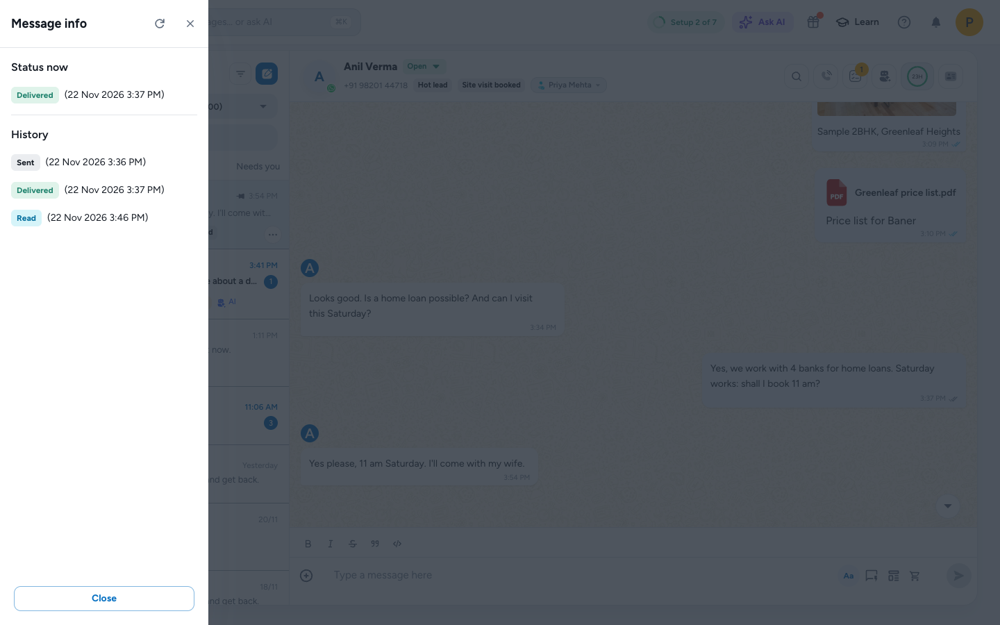
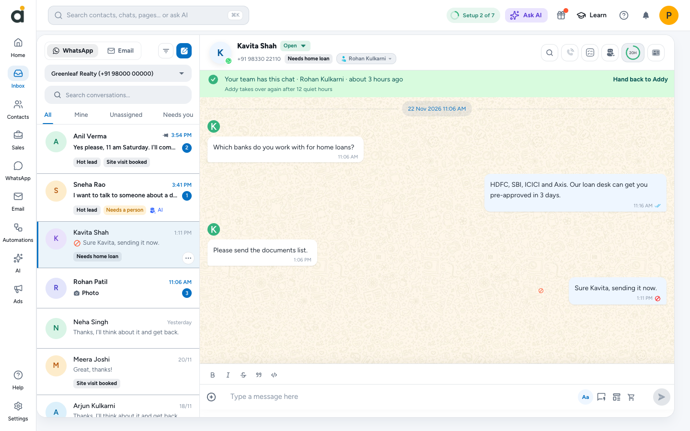
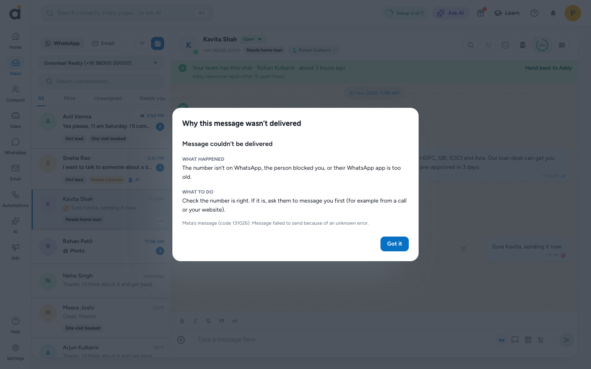

Every message you send from the inbox shows whether it reached the customer. When one fails, AdsEra tells you why in plain words and what to do.

**Where:** in any chat, **Inbox → WhatsApp**. [Open it →](https://app.adsera.in/dashboard/whatsapp/chat)

## The ticks

| You see | Meaning |
| --- | --- |
| ✓ grey | Sent to WhatsApp, not delivered yet (their phone may be off) |
| ✓✓ grey | Delivered to their phone |
| ✓✓ blue | Read (if the customer has read receipts on) |
| Red ⊘ | Failed. It never reached them |

The last message in the chat list shows the same ticks, so you can spot failures without opening each chat.

## Message info

Point at one of your messages and click **(i)**. **Message info** opens on the left:

| Section | What it shows |
| --- | --- |
| **Status now** | Sending, Sent, Delivered, Read, Replied or Failed, with the time |
| **Sent by** | *Addy, your WhatsApp AI agent* when Addy wrote it |
| **Sent from** | *WhatsApp Business App* when it was sent from your phone (Coexistence number) |
| **History** | Each step (sent, delivered, read) with its time, and Meta's error if it failed |
| **Link clicks** | When the customer clicked a link in it, with their device |

The round arrow at the top refreshes it.

## When a message fails

<Steps>
<Step title="Find the red sign">
  A failed message has a red ⊘ next to it (and in the chat list).

  
</Step>
<Step title="Click it">
  The window **Why this message wasn't delivered** opens with **What happened**, **What to do**, and Meta's own message with its code.

  
</Step>
<Step title="Fix it">Do what it says (table below), then send again.</Step>
</Steps>

## Every reason and its fix

| Title in AdsEra | Meta code | What happened | What to do |
| --- | --- | --- | --- |
| **More than 24 hours since their last message** | 131047 | Only templates may be sent after 24 hours | Send an approved template ([24-hour rule](/help/inbox/24-hour-window)) |
| **Message couldn't be delivered** | 131026 | The number isn't on WhatsApp, they blocked you, or their app is too old | Check the number. Ask them to message you first |
| **Meta held back this marketing message** | 131049 | They already got many marketing messages recently (from any business) | Don't resend now. Try after a day or more, or wait for them to write |
| **They stopped marketing messages** | 131050 | They told WhatsApp they don't want marketing | Send only utility messages, or wait for them to write |
| **Sending too fast** | 130429 | Your number went over Meta's speed limit | Wait a minute and resend. Use a [broadcast](/help/campaign/wa/create) for big sends |
| **Too many messages to this person** | 131056 | Many messages to one person in a short time | Wait a little |
| **File too big or wrong format** | 131053 | The file is over the limit or not allowed | Photos 5 MB, video/audio 16 MB, documents 100 MB. Compress it or send as a document |
| **Their photo or file couldn't be downloaded** | 131052 | Meta couldn't fetch a file the customer sent | Ask them to send it again |
| **This kind of message isn't supported** | 131051 | WhatsApp doesn't support that message type | Send it as text, a photo or a document |
| **Template details don't match** | 132000 | The details filled in don't match the template | Send it again and fill in every detail |
| **Template not found** | 132001 | Not approved, or not in this language | Check it's **Approved** in WhatsApp → Templates |
| **Template paused by Meta** | 132015 | People reported or ignored it | Use another template, or edit and resubmit it |
| **Meta payment problem** | 131042 | Meta couldn't charge your WhatsApp account | Fix the payment method in Meta Business Settings |
| **WhatsApp didn't deliver it** | other | A rarer reason | Read Meta's message under it. Try again in a few minutes; if it keeps failing, send the code to contact@adsera.in |

<Note>
  Broadcast reports use the same reasons. See [broadcast report](/help/campaign/wa/report).
</Note>

## FAQ

<AccordionGroup>
  <Accordion title="It has two grey ticks but the customer says they didn't see it.">
    Delivered means it's on their phone. They may have notifications off or archived your chat. Blue ticks only show if they have read receipts on.
  </Accordion>
  <Accordion title="Can I resend a failed message?">
    Fix the reason first (for example, send a template), then send it again. AdsEra doesn't resend failed chat messages by itself, unless you ticked "try again automatically" on a template.
  </Accordion>
  <Accordion title="Many messages fail with 131049.">
    That's Meta limiting marketing messages per person. Send fewer marketing templates, target people who engage, and use utility templates for updates.
  </Accordion>
</AccordionGroup>

## Related

<CardGroup cols={2}>
  <Card title="The 24-hour rule" icon="clock" href="/help/inbox/24-hour-window" />
  <Card title="WhatsApp troubleshooting" icon="wrench" href="/help/channel/whatsapp/troubleshooting" />
</CardGroup>
