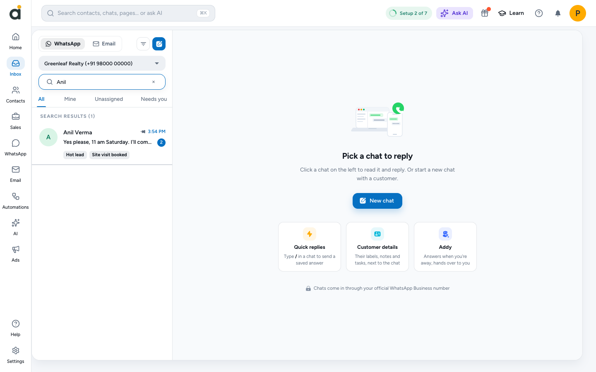
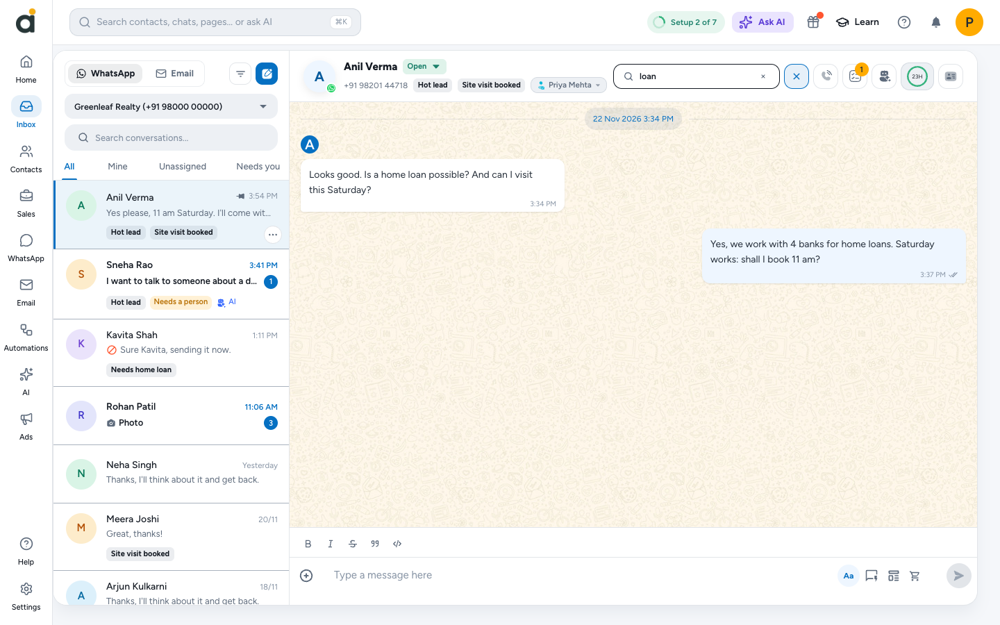
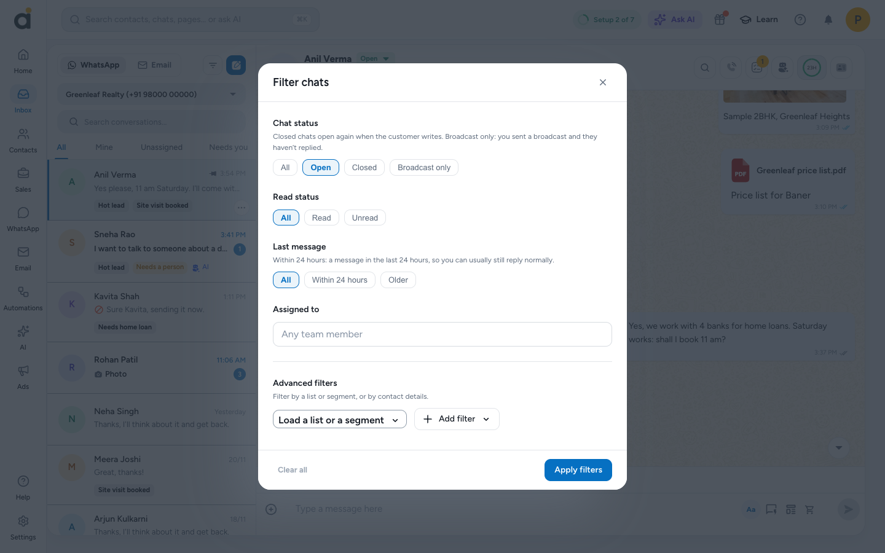
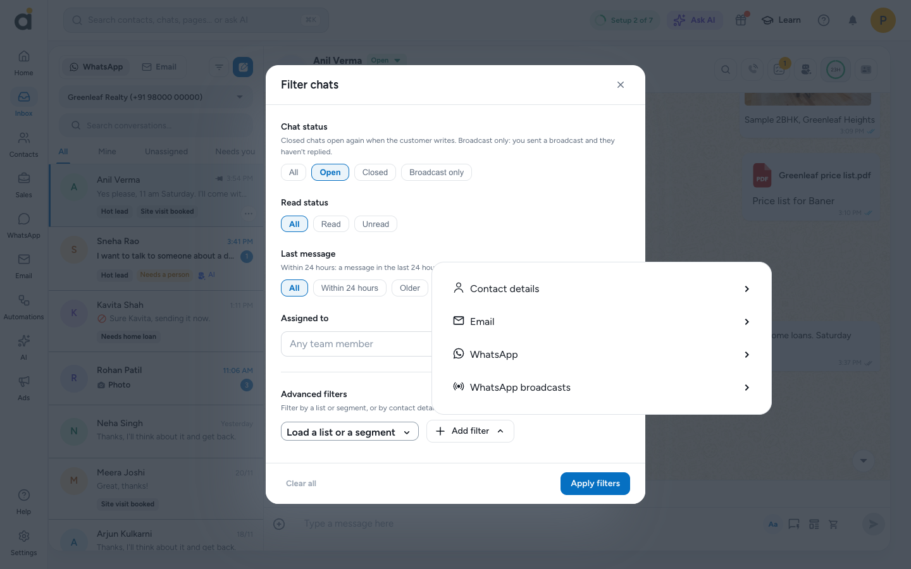

Use search when you know who you're looking for, and filters when you want a group of chats, like "unread chats from hot leads".

**Where:** **Inbox → WhatsApp**, top of the chat list. [Open it →](https://app.adsera.in/dashboard/whatsapp/chat)

## Search for a chat

Type part of a name or phone number in **Search conversations…** at the top of the chat list. Matching chats show in place of the list; click one to open it. Clear the box to see the list again.

## Search inside one chat

<Steps>
<Step title="Open the chat">Click the chat in the list.</Step>
<Step title="Click the magnifier">In the chat header, click **Search this chat**.</Step>
<Step title="Type a word">Like "loan" or "price". Only matching messages show. Click the magnifier again (or the ✕) to see the whole chat.</Step>
</Steps>

## Filter chats

Click the filter button at the top of the chat list. The **Filter chats** window opens.

| Filter | Choices | What it shows |
| --- | --- | --- |
| **Chat status** | **All**, **Open** (default), **Closed**, **Broadcast only** | Open chats need an answer; closed chats are done; *Broadcast only* = people who got a broadcast and never replied |
| **Read status** | **All**, **Read**, **Unread** | *Unread* = chats with messages nobody opened yet |
| **Last message** | **All**, **Within 24 hours**, **Older** | *Within 24 hours* = any message in the chat in the last day, so you can usually still reply normally. *Older* chats need a [template](/help/inbox/24-hour-window) |
| **Assigned to** (admins only) | Any team member | Only chats given to that person |
| **Advanced filters** | **Load a list or a segment**, **Add filter**, **Or another condition** | Chats of people in a list or [segment](/help/audiance/segment), or with a contact detail, label or broadcast you pick |

<Steps>
<Step title="Pick your choices">Click the chips you want. For example **Open** + **Unread**.</Step>
<Step title="Add a detail filter (optional)">Click **Add filter**, pick a field (like **City**, a **label**, or the **broadcasts** someone received with **Pick broadcasts**), then the condition and the value. **Or another condition** adds a second rule: a chat shows if it matches either one.</Step>
<Step title="Apply">Click **Apply filters**. The filter button shows a dot while filters are on.</Step>
</Steps>

**Clear all** puts everything back to the default: **Open** chats, nothing else.

<Note>
  The tabs **All / Mine / Unassigned / Needs you** work together with your filters. For example **Mine** + **Unread** shows your unread chats.
</Note>

## FAQ

<AccordionGroup>
  <Accordion title="I closed a chat and now I can't find it.">
    The default filter shows **Open** chats only. Open **Filter chats** and pick **Closed** (or **All**). Or search for the customer's name.
  </Accordion>
  <Accordion title="Why is a customer missing from the list?">
    Check the number picker (they may have written to your other number), the filter dot (filters are on), and the tab (**Mine** only shows your chats). Team members only see chats they're allowed to see.
  </Accordion>
  <Accordion title="Does 'Within 24 hours' mean I can send a normal message?">
    Usually. It looks at the last message from either side. The clock in the chat header is exact: it counts from the customer's last message.
  </Accordion>
</AccordionGroup>

## Related

<CardGroup cols={2}>
  <Card title="WhatsApp chats" icon="comments" href="/help/inbox/chat" />
  <Card title="Work as a team" icon="users" href="/help/inbox/team" />
</CardGroup>
