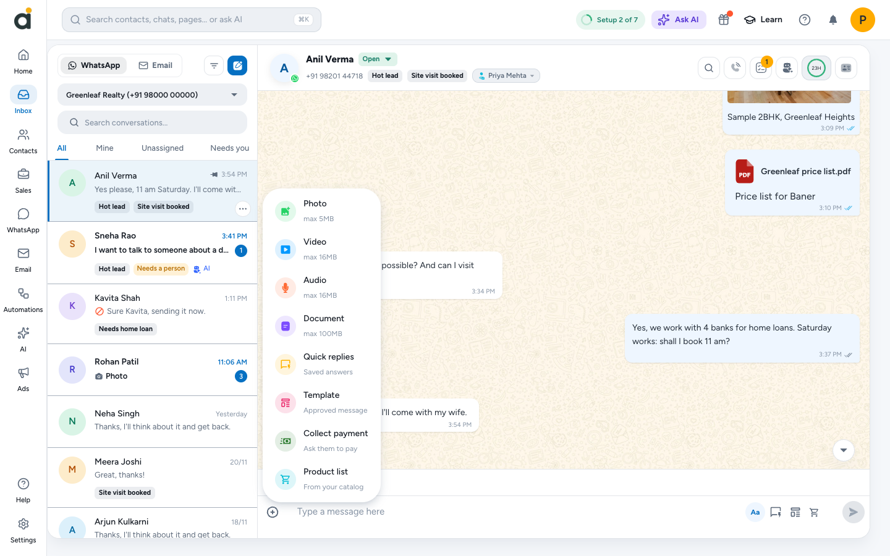
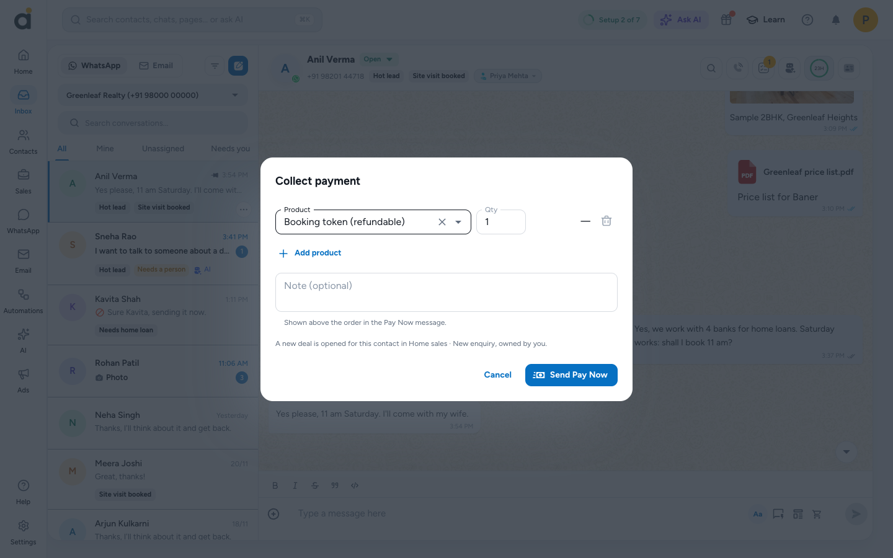
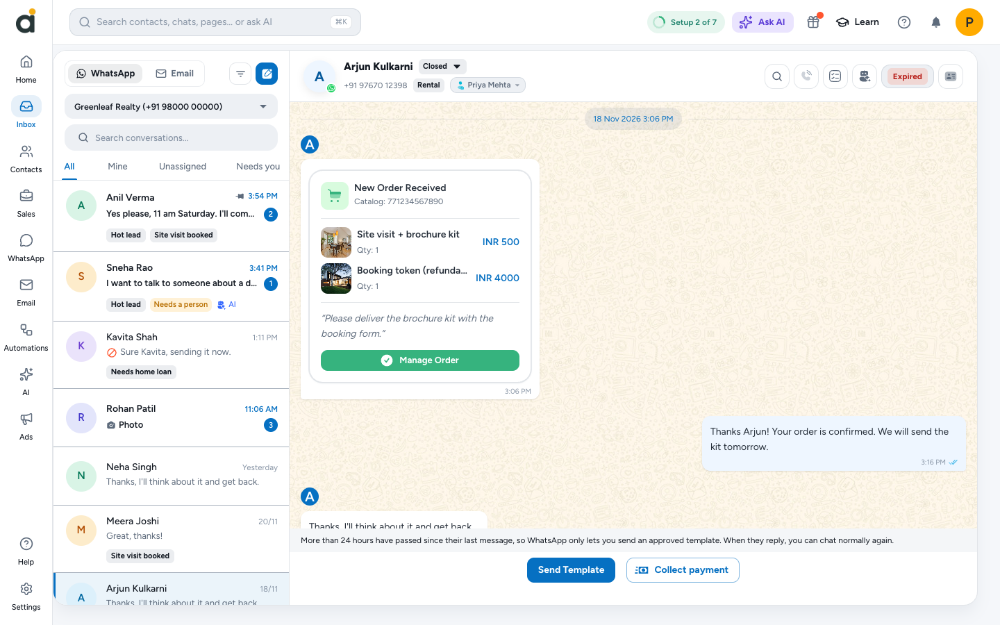
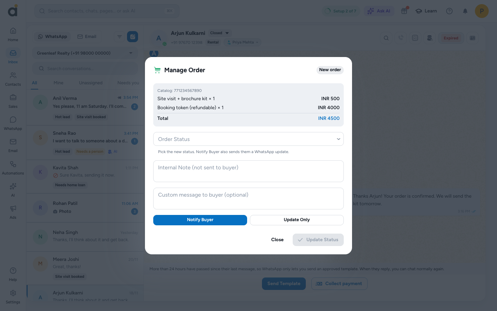

Two ways to sell inside a WhatsApp chat:

- **Collect payment**: you pick products and the customer gets a **Pay Now** message to pay inside WhatsApp.
- **Manage Order**: the customer ordered from your WhatsApp catalog; you confirm, ship or cancel it.

**Where:** in any chat, **Inbox → WhatsApp**. [Open it →](https://app.adsera.in/dashboard/whatsapp/chat)

## Collect a payment

**Before you start**

- Payments are set up for this WhatsApp number (Razorpay with WhatsApp Pay). See [WhatsApp Pay](/help/integrations/whatsapp-pay).
- You have products in **Sales → Products** ([products](/help/crm/product)).
- You have a deal [pipeline](/help/crm/pipeline) with at least one open stage: each payment from a chat opens a deal. AdsEra uses the pipeline named **Sales** (or your oldest one).

<Steps>
<Step title="Open Collect payment">
  In the chat, click **+** in the reply box, then **Collect payment**. After 24 hours, click **Collect payment** under the expired chat instead.

  
</Step>
<Step title="Pick products">
  In **Product**, search and pick a product. If it has several prices (like monthly or yearly), pick the **Billing option**. Set **Qty**. **Add product** adds another line; the bin removes one. The total, with GST and discounts, shows below.

  
</Step>
<Step title="Add a note or pick a template">Inside 24 hours: an optional **Note** (up to 900 characters). After 24 hours: pick a **Pay Now template** (an approved template with an order details button).</Step>
<Step title="Send">Click **Send Pay Now**. The customer gets the order with a **Pay Now** button.</Step>
</Steps>

| Field | What it does | Example | Required? |
| --- | --- | --- | --- |
| **Product** | What they pay for | Booking token (refundable) | Yes |
| **Billing option** | Which price, for products with several | Yearly | If shown |
| **Qty** | How many | 1 | Yes |
| **Note (optional)** | A line with the order | "Token for flat B-704" | No |
| **Pay Now template** | Used after 24 hours | order_payment | After 24 hours |

**What happens next:** a new deal opens for the customer in your pipeline's first open stage, owned by you. When they pay, the deal's payments section shows it as paid. See [deals](/help/crm/deal).

### When Send Pay Now is grey

| Message | Fix |
| --- | --- |
| *Create a deal pipeline with an open stage first* | Make a pipeline in **Sales → Pipelines** |
| *More than 24 hours have passed… no approved Pay Now template* | Make a template with an order details button in **WhatsApp → Templates**, or wait for the customer to write |
| A warning about payments on this number | Finish [WhatsApp Pay](/help/integrations/whatsapp-pay) setup for this number |

## Manage an order

When a customer orders from your WhatsApp catalog, the chat shows **New Order Received** with the products, prices and their note, and a **Manage Order** button.

<Steps>
<Step title="Click Manage Order">Under the order.</Step>
<Step title="Pick the new status">
  In **Order Status**: **Confirmed**, **Processing**, **Shipped**, **Delivered** or **Cancelled**. For **Shipped**, add the **Carrier**, **Tracking Number** and **Tracking URL** (all optional).

  
</Step>
<Step title="Add notes (optional)">**Internal Note** is only for your team. **Custom message to buyer** goes with their update.</Step>
<Step title="Tell them or not">**Notify Buyer** sends the customer a WhatsApp update. **Update Only** just saves the status.</Step>
<Step title="Update Status">Click **Update Status**. The badge at the top shows the new status (a new order shows **New order**).</Step>
</Steps>

## FAQ

<AccordionGroup>
  <Accordion title="Where do I see if they paid?">
    On the deal that opened for the payment (**Sales → Deals**, open the deal: its payments section shows paid, pending or needs review).
  </Accordion>
  <Accordion title="Can I send a payment link instead of Pay Now?">
    Collect payment in the chat sends Pay Now. To send a payment link, open the deal and use **Collect payment** there ([deals](/help/crm/deal)).
  </Accordion>
  <Accordion title="Why don't I see Manage Order?">
    Orders only come from customers who order from a Meta catalog linked to your number. See [WhatsApp Commerce](/help/integrations/whatsapp-commerce).
  </Accordion>
</AccordionGroup>

## Related

<CardGroup cols={2}>
  <Card title="WhatsApp Pay" icon="credit-card" href="/help/integrations/whatsapp-pay" />
  <Card title="WhatsApp Commerce" icon="cart-shopping" href="/help/integrations/whatsapp-commerce" />
  <Card title="WhatsApp chats" icon="comments" href="/help/inbox/chat" />
  <Card title="The 24-hour rule" icon="clock" href="/help/inbox/24-hour-window" />
</CardGroup>
