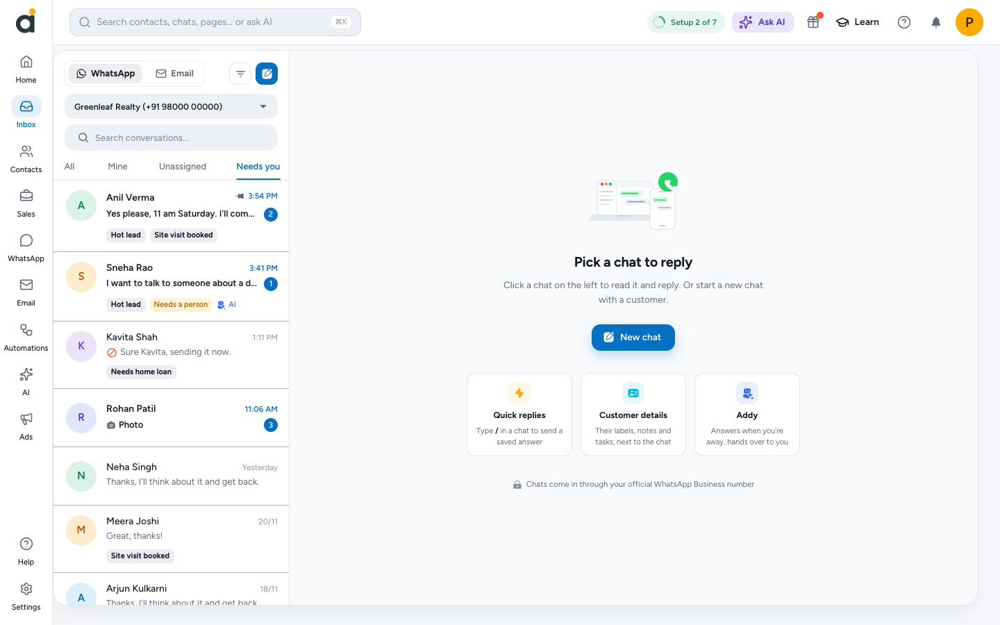
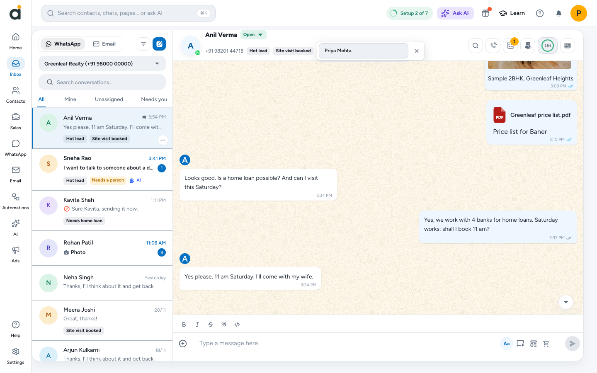
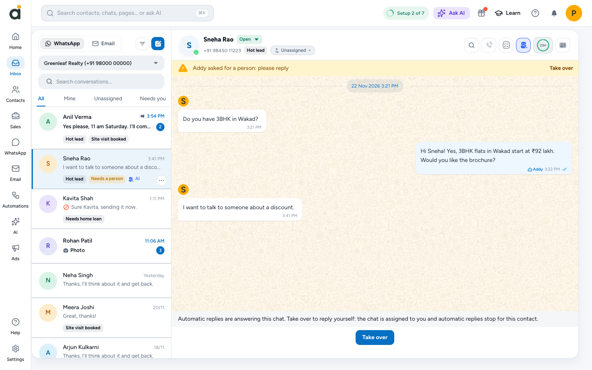
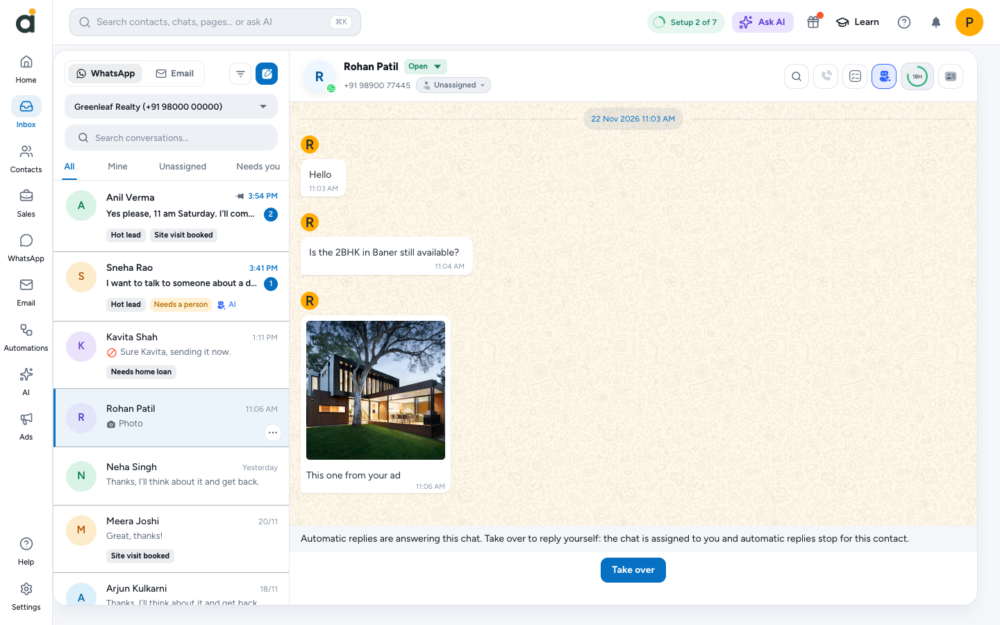
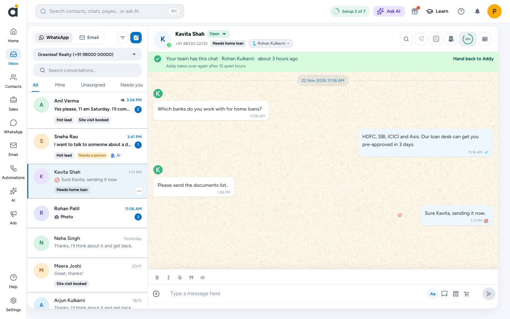

Several people can answer the same WhatsApp number. AdsEra keeps it tidy: each chat can be **assigned** to one team member, the tabs show who should answer what, and Addy or automatic replies step back the moment a person replies.

**Where:** **Inbox → WhatsApp**. [Open it →](https://app.adsera.in/dashboard/whatsapp/chat)

## The four tabs

| Tab | Shows | Use it to |
| --- | --- | --- |
| **All** (or **Visible**) | Every chat you're allowed to see on this number | See everything |
| **Mine** | Chats assigned to you | Your own to-do list |
| **Unassigned** | Chats nobody has taken yet | Pick up new leads |
| **Needs you** | Chats where Addy or the AI agent asked for a person | Answer what the bot couldn't |

**Visible** replaces **All** when an admin set your **Data visibility** to "assigned + unassigned" or "only assigned". Team members with "only assigned" don't see **Unassigned**. Your [filters](/help/inbox/filters) apply on every tab.

| Badge on a chat | Meaning |
| --- | --- |
| **Needs a person** (orange) | Addy or the AI agent asked for help. It goes away when someone takes over or replies |
| **AI** | Addy or the AI agent is answering right now |

## Assign a chat

<Steps>
<Step title="Open the chat">Click it in the list.</Step>
<Step title="Click the name under the customer">It shows the current team member, or **Unassigned**.</Step>
<Step title="Pick a team member">
  Type or pick a name in **Pick a team member…**. To unassign, clear it. The ✕ cancels.

  
</Step>
</Steps>

The chat moves to their **Mine** tab and they're notified. Assigning sets the contact's owner, so the same person also owns them in Contacts.

<Tip>
  New chats can be assigned automatically, one by one to your team (**Round-robin**) or always to one person: **WhatsApp → Numbers & profile → Team access** ([how](/help/channel/whatsapp/whatsapp)).
</Tip>

## Take over from Addy or automatic replies

AdsEra can answer chats by itself in two ways: **automatic replies** (your welcome message and keyword replies) and **Addy**, the AI agent. When one of them is answering, you see it above the reply box.

### Addy is answering

A blue bar says **Addy is answering this chat** (orange **Addy asked for a person: please reply** when it needs you), with **Take over**.

Click **Take over**: the bar turns green (**Your team has this chat**), Addy stops answering this chat and you reply yourself. Sending any message also takes over.

### Automatic replies are on

For a customer where automatic replies are on, inside 24 hours the reply box shows *Automatic replies are answering this chat…* and a **Take over** button.

**Take over** assigns the chat to you and turns automatic replies **off for this customer**, so they won't get keyword replies or the welcome message again until you turn them back on.

The **robot button** in the chat header shows and changes this for the customer:

| Robot button | Meaning |
| --- | --- |
| Highlighted | Automatic replies (and Addy, where it runs) are on for this customer |
| Plain | Off: only your team answers this customer |

### Hand back

When you're done, click **Hand back to Addy** on the green bar. Addy answers again from the customer's next message.

If you don't, Addy takes the chat back by itself after the quiet hours set in **AI → Addy** (24 hours unless you changed it). The bar says when: *Addy takes over again after 24 quiet hours*, or *Addy won't take it back on its own*.

| Bar | Meaning |
| --- | --- |
| **Addy is answering this chat** | Addy has it |
| **Addy asked for a person: please reply** | Addy needs you (also in **Needs you**) |
| **Addy is off right now (outside the hours set in its schedule)** | Your team answers until Addy's hours start |
| **Addy is out of AI credits** | Your team answers. Top up in **AI → AI credits** |
| **Your team has this chat** | A person took over |

For the Meta AI agent the bar says **The Meta AI agent is answering this chat**, with **Take over**, **Hand back to AI agent** and **Agent steps** (what it did). See [Meta AI agent](/help/integrations/meta-ai-agent).

## FAQ

<AccordionGroup>
  <Accordion title="A team member says they can't see a chat.">
    They only see numbers they were added to (**WhatsApp → Numbers & profile → Team access**) and, depending on their Data visibility, only chats assigned to them. Assign the chat to them, or change their Data visibility in **Settings → Team members**.
  </Accordion>
  <Accordion title="Does replying to a chat assign it to me?">
    Yes, when automatic replies were on for that customer: your first reply turns them off and assigns the chat to you. Otherwise the chat keeps its owner.
  </Accordion>
  <Accordion title="Can Addy and my team both reply?">
    No. As soon as someone takes over or replies, Addy stops for that chat until it's handed back.
  </Accordion>
  <Accordion title="How do I give each salesperson their own leads?">
    Set **Team access** on the number to **Round-robin** so new chats are shared out, and set each salesperson's **Data visibility** to **Only assigned to them**.
  </Accordion>
</AccordionGroup>

## Related

<CardGroup cols={2}>
  <Card title="WhatsApp chats" icon="comments" href="/help/inbox/chat" />
  <Card title="Addy, the WhatsApp AI agent" icon="robot" href="/help/ai/addy" />
  <Card title="Auto-replies" icon="reply" href="/help/autoreply/wa" />
  <Card title="Numbers & profile (Team access)" icon="phone" href="/help/channel/whatsapp/whatsapp" />
</CardGroup>
