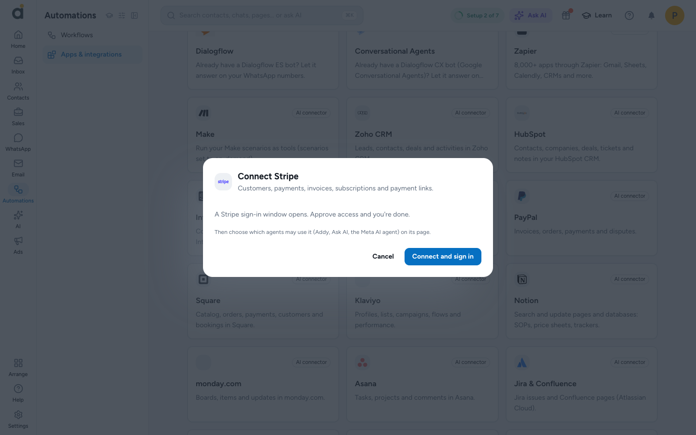
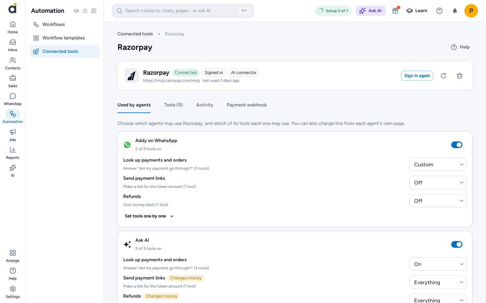
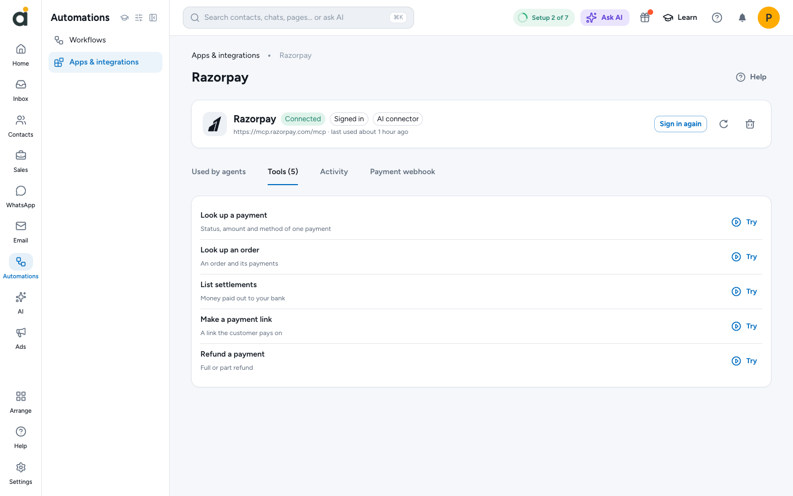
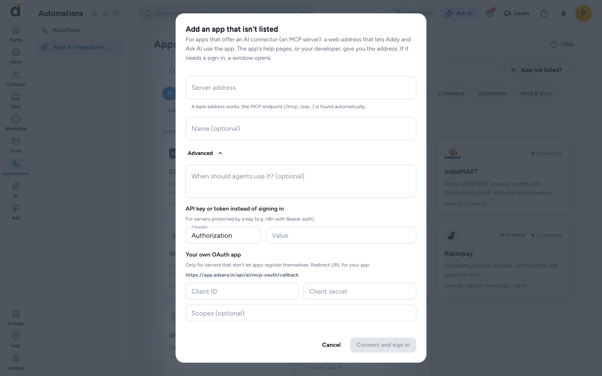

An **AI connector** lets your AI agents use another app. For example: Addy answers “did my token payment go through?” by checking **Razorpay**; Ask AI looks up a deal in **HubSpot**; Addy checks live stock in your **Shopify** store before promising delivery. You choose exactly what each agent may do.

**Where:** **Marketplace**. AI connectors have the **AI connector** tag. [Open it →](https://app.adsera.in/dashboard/marketplace/list)

**Ready-made connectors:** n8n, Zapier, Make, Zoho CRM, HubSpot, Intercom, Shopify, Razorpay, Stripe, PayPal, Square, Klaviyo, Notion, monday.com, Asana, Jira & Confluence, Linear, Slack, GitHub, Supabase and Sentry. Any other app that gives you an AI connector address (an “MCP server”) can be added with **App not listed?**.

<Note>
You need the **AI** permission to connect AI connectors and choose what agents may do.
</Note>

## Connect a ready-made app

<Steps>
<Step title="Click its card">
On Marketplace, click the app (it says **AI connector**). A connect window opens.

</Step>
<Step title="Fill what it asks, if anything">
Most apps need nothing: click **Connect and sign in**. A few ask for a detail (Shopify: your store address; Razorpay: the **Permission level**). Some have an optional key under advanced, used only if sign-in doesn't work.
</Step>
<Step title="Sign in and allow">
Sign in to the app in the window that opens and click **Allow**. AdsEra says *Signed in. The connection is ready.* and opens the app's page.
</Step>
</Steps>

## Choose what each agent may do

The app's page:

| Part | What it is |
| --- | --- |
| Top card | The app, **Connected** / **Needs sign-in** / **Error**, **Signed in** or **API key**, when it was last used. **Sign in again**, the refresh button (**Check its tools again**) and the bin (**Remove this app**) |
| **Used by agents** | One box per agent: **Addy on WhatsApp** (answers your customers), **Ask AI** (the assistant your team chats with) and the **Meta AI agent** (per WhatsApp number). Switch each on or off |
| Per kind of action | Like *Look up payments and orders*, *Send payment links*, *Refunds*: **Off**, **On**, **Custom** or **Everything**. **Changes money** marks the ones that move money. **Set tools one by one** opens the full list |
| **Tools (5)** | Everything the app lets agents do, with what each tool does |
| **Activity** | Every call an agent made: the agent, the tool, the result and time; calls, success rate, average time and the last error |
| **Payment webhook** (Razorpay only) | A web address to add in Razorpay, so AdsEra hears about every payment (confirms WhatsApp Pay payments and records why one failed) |

<Warning>
Leave **Changes money** actions (payment links, refunds) **Off** unless you're sure. The Meta AI agent can use tools without asking the customer first.
</Warning>

## Add an app that isn't listed

For apps that give you an AI connector (MCP) address: the app's help pages or your developer give it to you.

<Steps>
<Step title="Click App not listed?">
At the top of Marketplace.

</Step>
<Step title="Paste the Server address">
Like `https://mcp.yourtool.com`, or just `yourtool.com`: AdsEra finds the right address. **Name (optional)** is taken from it.
</Step>
<Step title="Advanced (optional)">
- **When should agents use it?**: a note for the agents, like *Check live stock before promising delivery*.
- **API key or token instead of signing in**: a **Header** (usually `Authorization`) and its **Value** (like `Bearer …`), for apps protected by a key, such as n8n.
- **Your own OAuth app**: **Client ID**, **Client secret** and **Scopes**, only for apps that don't let others register. Add the redirect address shown there in your app.
</Step>
<Step title="Click Connect and sign in">
(Or **Connect**, with a key.) Then choose what agents may do on its page.
</Step>
</Steps>

Keys and tokens are stored encrypted and never shown again.

## Troubleshooting

| You see | What to do |
| --- | --- |
| **Needs sign-in** | Its sign-in expired or was removed. Open it and click **Sign in again** |
| **Error** with a message like *The server didn't answer* | The app's server is down or the address changed. Try **Check its tools again** later; for a custom app, check the address |
| No tools after connecting | Click **Check its tools again**. If it uses a key, add it under **API key or token** |
| An agent doesn't use the app | Switch the agent on under **Used by agents** and turn on the actions it needs. A clear **When should agents use it?** note helps |

## Remove an app

Click the bin (**Remove this app**) on its page and confirm. Agents lose it at once. To cut access on the app's side too, remove AdsEra from the app's connected apps, or delete the key you gave it.

## Related

<CardGroup cols={2}>
<Card title="Marketplace" icon="puzzle-piece" href="/help/integrations/marketplace">Every app and what works today.</Card>
<Card title="Addy" icon="robot" href="/help/ai/addy">The WhatsApp AI agent.</Card>
</CardGroup>
