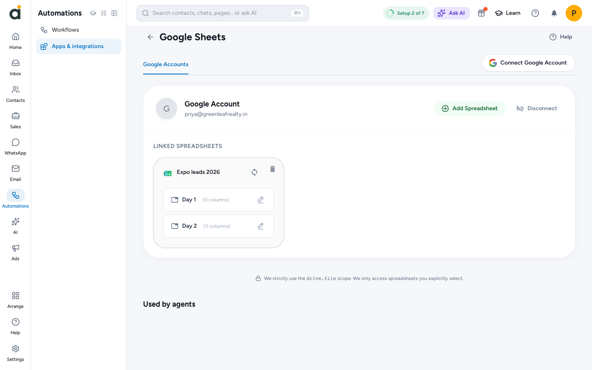
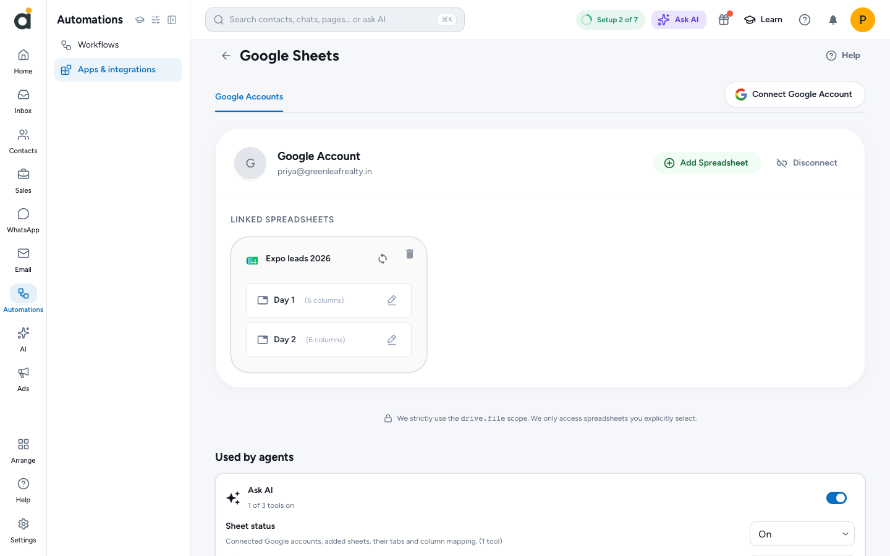

Link your Google spreadsheets to AdsEra to [import contacts](/help/audiance/google-sheets) from them, and to send a WhatsApp broadcast to a sheet's rows.

**Where:** **Automations → Apps & integrations → Google Sheets**.

<Info>
  AdsEra only uses Google's `drive.file` permission. It can open **only the spreadsheets you pick**, not the rest of your Google Drive.
</Info>

## Adding the integration

<Steps>
<Step title="Connect your Google account">
  Open **Automations → Apps & integrations → Google Sheets** and click **Connect Google Account**. Sign in with Google and allow access.
</Step>
<Step title="Add a spreadsheet">
  Click **Add Spreadsheet**. Google's file picker opens. Choose the spreadsheet. It appears under **Linked Spreadsheets**.
</Step>
<Step title="Map the columns">
  For each sheet, choose the **Mobile Number Column (For WhatsApp)**, the **Email column (optional)** and **Match columns to fields** (which sheet column goes into which contact field). Click the pencil next to a tab to open its settings.

  
</Step>
</Steps>

Changed the sheet's columns or added tabs? Click the sync icon (**Sync all tabs and fetch latest structure**).

## Using the integration

### Send a broadcast to a sheet

Full steps: [Broadcast to a Google Sheet](/help/campaign/wa/google-sheet).

1. In **WhatsApp → Broadcasts → New broadcast**, step 1, open the **Google Sheets Import** tab and switch on **Use Google Sheet Audience**.
2. Choose the **Google Account**, **Spreadsheet** and **Tab**.
3. Under **Automation Rules**, choose how rows are used:
   - **Run on Existing Rows**: the rows there now get it once, when the broadcast starts.
   - **Automated**: new and changed rows get it as they arrive. This needs the AdsEra script in the spreadsheet: AdsEra shows it after you save (**Google Sheets Automation Script**, also under the broadcast's **⋮ → View sheet script**).
4. Optionally, add a condition (a column **Equals** or **Not Equals** a value) to send only to matching rows.

### Ask AI

The **Used by agents** section sets what Ask AI may do with your linked sheets.

### Troubleshooting

<AccordionGroup>
<Accordion title="The spreadsheet isn't listed">
  AdsEra only sees spreadsheets you picked. Click **Add Spreadsheet** and choose it.
</Accordion>
<Accordion title="New columns don't show up">
  Click the sync icon on the spreadsheet to fetch the latest structure.
</Accordion>
</AccordionGroup>

## Removing the integration

- **Remove one spreadsheet:** click **Remove Sheet** on it and confirm.
- **Disconnect the Google account:** choose the account and disconnect it, then confirm. Every spreadsheet linked through it is removed.

Broadcasts that used a removed sheet can't fetch its rows again. Contacts already created stay in AdsEra. You can also remove AdsEra's access from your Google account at [myaccount.google.com/permissions](https://myaccount.google.com/permissions).
