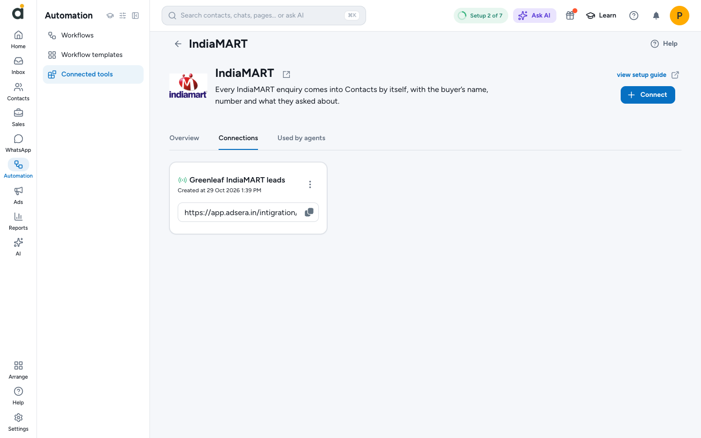
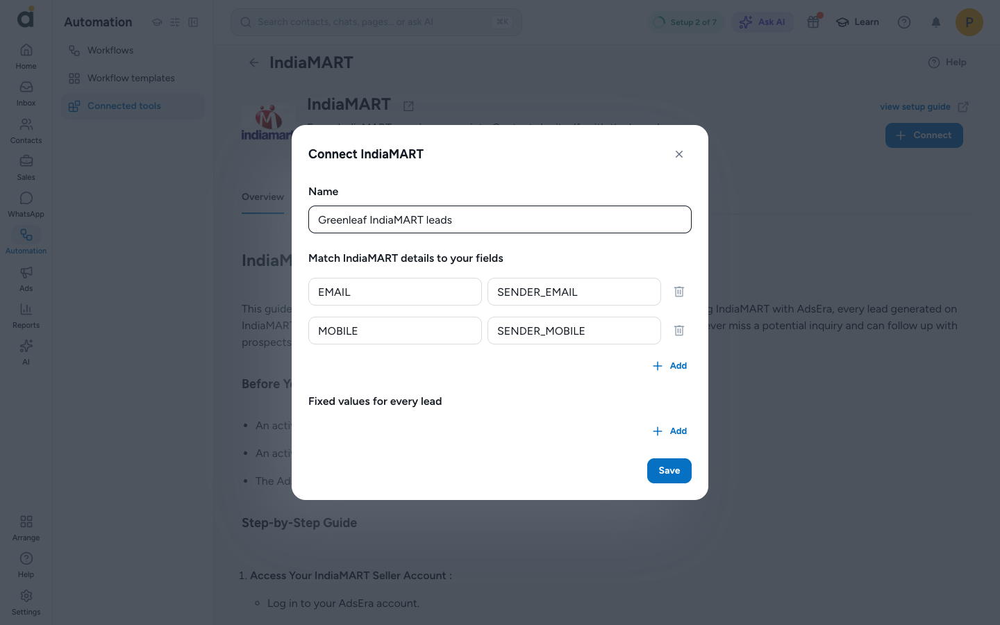
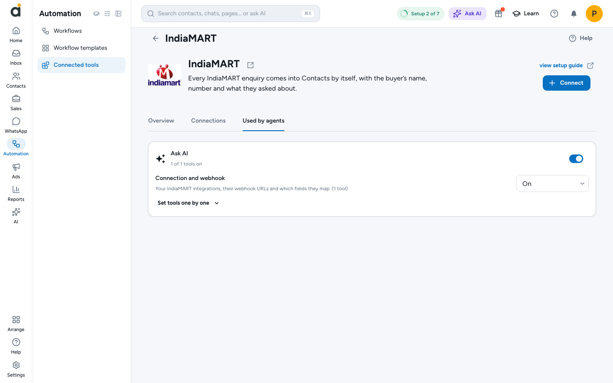

With IndiaMART connected, every lead you get on IndiaMART is sent to AdsEra as soon as it arrives. AdsEra creates or updates the contact, so you can follow up on WhatsApp straight away with a broadcast, a workflow or Addy.

## Adding the integration

### Before you begin

- An IndiaMART seller account with lead access and the **Push API** (lead forwarding) option.
- The **Integrations & data tables** permission in AdsEra (admins have it).

### Connect

<Steps>
<Step title="Create the connection in AdsEra">
  Open **Automation → Connected tools → IndiaMART** and click **Connect**. Enter a **Name** for the connection, match IndiaMART’s details to your fields (see below) and save.

  
</Step>
<Step title="Copy the webhook URL">
  The new connection card shows a URL like `https://app.adsera.in/intigration/indiaMart/webhook/<id>`. Click the copy icon.
</Step>
<Step title="Paste it in IndiaMART">
  In your IndiaMART seller panel, open the **Push API** / lead forwarding settings. Paste the URL as the push URL, enter **AdsEra** as the integration name and save.
</Step>
<Step title="Test it">
  Create a test lead in IndiaMART, or wait for a new one, and check that it appears under **Contacts** in AdsEra.
</Step>
</Steps>

### Matching the details

- Choose which IndiaMART fields hold the buyer's **phone** and **email**. AdsEra uses them to find the existing contact or create a new one.
- Under **Match IndiaMART details to your fields**, each row copies an **IndiaMART detail** (for example the buyer’s company, city or product) to an **AdsEra field** on the contact.
- You can also set fixed values that every IndiaMART lead gets, for example a field Source = IndiaMART (**Fixed values for every lead**).

## Using the integration

- New leads become contacts in AdsEra. Use them in segments, WhatsApp broadcasts, workflows and Addy.
- Click the menu on a connection card to edit its name or mapping.
- The **Used by agents** tab sets what Ask AI may do with your IndiaMART connections.
- The **Overview** tab repeats the setup steps, for when you're in IndiaMART's panel and need them again.

### Troubleshooting

<AccordionGroup>
<Accordion title="Leads don't arrive in AdsEra">
  Check that the push URL in IndiaMART is exactly the one on the connection card, with nothing missing at the end. Then check that the connection in AdsEra is still there and active.
</Accordion>
<Accordion title="Leads arrive but some fields are empty">
  Edit the connection and add the missing fields to the matching rows.
</Accordion>
</AccordionGroup>

## Removing the integration

1. In IndiaMART, remove the AdsEra push URL from the Push API settings.
2. In AdsEra, open **Automation → Connected tools → IndiaMART**, open the menu on the connection card and choose **Delete**.

AdsEra stops receiving leads from IndiaMART. **Contacts already created are kept.**
