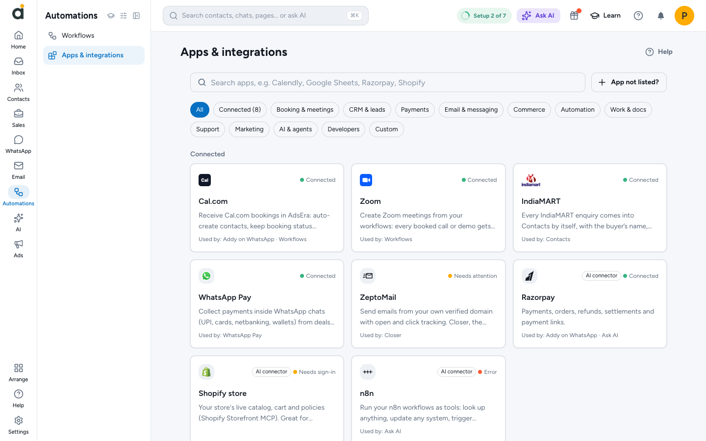
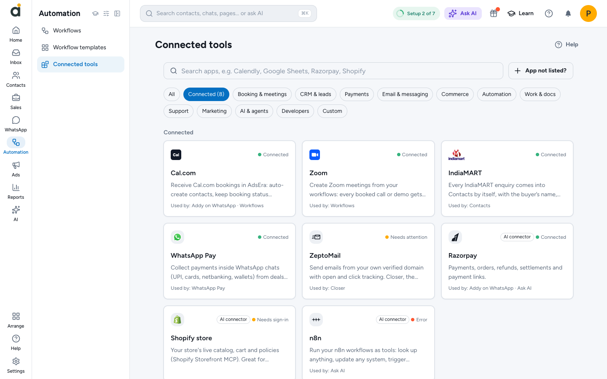
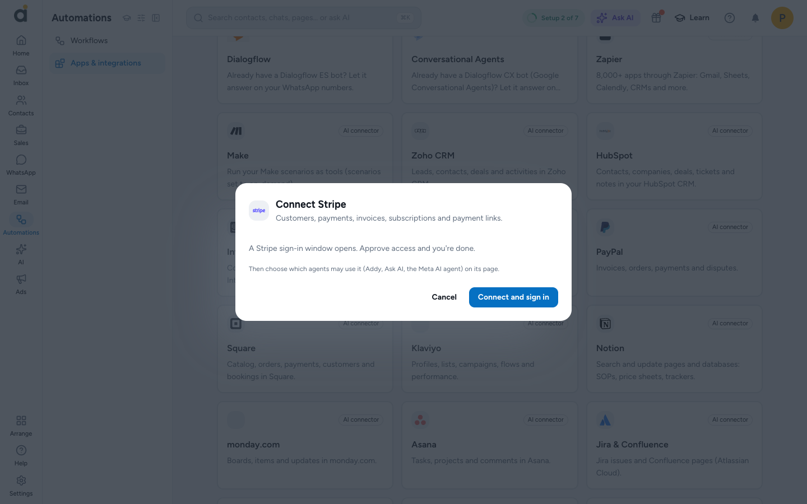

**Marketplace** is where you connect AdsEra to your other apps, once, for your whole company. Bookings, leads and payments then flow in by themselves, workflows can react to them, and your AI agents can use them.

**Where:** **Marketplace** in the left menu. [Open it →](https://app.adsera.in/dashboard/marketplace/list)

## Find an app

| Part | What it does |
| --- | --- |
| **Search apps** | Type a name, like Calendly, Razorpay or Google Sheets |
| **All**, **Connected (8)**, categories | **Connected** shows only what you use. Categories: Booking & meetings, CRM & leads, Payments, Email & messaging, Commerce, Automation, Work & docs, Support, Marketing, AI & agents, Developers, Custom |
| **Connected** section | Your connected apps, first |
| **All apps** | Everything else |
| **App not listed?** | Add any app that gives you an AI connector (MCP) address ([how](/help/integrations/ai-connectors#add-an-app-that-isnt-listed)) |

### What a card tells you

| On the card | Meaning |
| --- | --- |
| **Connected** (green) | Working |
| **Needs attention** (orange) | Connected but something needs a look (like ZeptoMail bounces). Open it |
| **Needs sign-in** (orange) | Sign in to the app again on its page |
| **Error** (red) | It stopped working. Open it to see why |
| **AI connector** | An app your AI agents (Addy, Ask AI, the Meta AI agent) can use. Clicking it opens a short connect window |
| **Coming soon** | Can't be connected yet |
| **Used by** | Which agents, workflows or features use it, like *Addy on WhatsApp · Flows* |

## Every app, and what works today

| App | What it does | Status |
| --- | --- | --- |
| [Cal.com](/help/integrations/calcom) | Bookings come in as contacts; workflows remind people; Addy can book | Works |
| [Calendly](/help/integrations/calendly) | The same, for Calendly | Works |
| [Zoom](/help/integrations/zoom) | A Zoom link for every booked call | Works |
| [IndiaMART](/help/integrations/indiamart) | Every IndiaMART enquiry becomes a contact | Works |
| [Google Sheets](/help/integrations/google-sheets) | Import contacts from a sheet; send broadcasts to a sheet's rows | Works |
| [WhatsApp Pay](/help/integrations/whatsapp-pay) | Collect payments inside WhatsApp (opens its own page) | Works |
| [ZeptoMail](/help/integrations/zeptomail) | Workflow and Closer emails from your own domain | Works |
| [Email account (SMTP)](/help/automation/email-accounts) | Workflow emails from any email address | Works |
| [WhatsApp Commerce](/help/integrations/whatsapp-commerce) | Your product catalog on WhatsApp (opens WhatsApp → WhatsApp Commerce) | Works |
| [Meta Ads](/help/integrations/meta-ads) | Click-to-WhatsApp ads and ad leads (opens Ads → Meta Ads) | Works |
| [Slack](/help/integrations/slack) | AdsEra alerts in a Slack channel | Works |
| [Meta AI Agent](/help/integrations/meta-ai-agent) | Meta's AI agent on your number (opens its own page) | Works |
| [Dialogflow / Conversational Agents](/help/integrations/dialogflow) | Your existing Dialogflow ES or CX bot answers on WhatsApp | Works |
| [AI connectors](/help/integrations/ai-connectors) (Razorpay, Shopify, n8n, Zapier, HubSpot, Zoho CRM, Notion…) | Your AI agents look things up and act in these apps | Works |
| WhatsEra | Older tool: an unofficial WhatsApp link. Use your official WhatsApp number instead | Older |
| [Pabbly](/help/integrations/pabbly) | Connect other apps through Pabbly Connect | **Coming soon**: its page opens but **Connect** is greyed out |

## Connect an app

<Steps>
<Step title="Click its card">
Built-in apps (Cal.com, IndiaMART, Slack…) open their own page with a **Connect** button and the steps. AI connectors open a short window:

</Step>
<Step title="Sign in or paste what it asks">
Most apps open their own sign-in window: sign in and click **Allow**. A few ask for a key you copy from the app (the page says where).
</Step>
<Step title="Check it on its page">
The card moves to **Connected**. Its page shows what came in (bookings, activity) and, for AI connectors, which agents may use it.
</Step>
</Steps>

## Who can use this page

Team members need the **Integrations & data tables** permission (Settings → Team members). AI connectors also need the **AI** permission. Admins have both.

## FAQ

<AccordionGroup>
<Accordion title="If I disconnect an app, do I lose my data?">
No. Contacts, bookings and messages that already came into AdsEra stay. AdsEra just stops receiving new ones.
</Accordion>
<Accordion title="Is Marketplace the same as the old Marketplace?">
Yes. It's the same page with a new name.
</Accordion>
<Accordion title="The app I use isn't here.">
If it offers an AI connector (MCP) address, add it with **App not listed?**. If it can call a web address, a workflow with the trigger **Another app sends data** can receive its data. Otherwise, tell us at contact@adsera.in.
</Accordion>
</AccordionGroup>

## Related

<CardGroup cols={2}>
<Card title="AI connectors" icon="robot" href="/help/integrations/ai-connectors">Let Addy and Ask AI use your apps.</Card>
<Card title="Workflows" icon="diagram-project" href="/help/automation/workflows">React to bookings, leads and payments.</Card>
</CardGroup>
