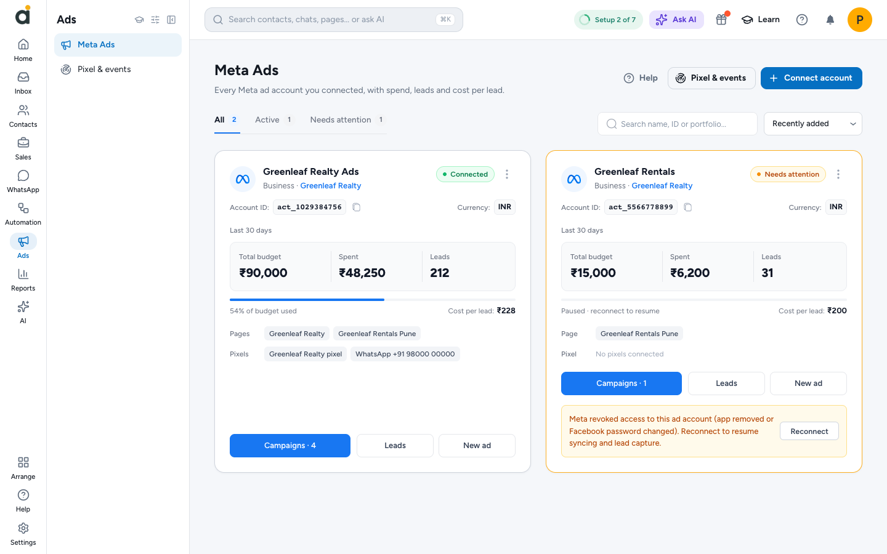

The **Ads** area (the megaphone in the left bar) connects your Meta (Facebook and Instagram) advertising to your WhatsApp, contacts and sales. A typical day: your ad opens a WhatsApp chat, Addy or your team answers, the lead is in Contacts and Prospects with the ad they came from, and when they book a visit or pay, AdsEra tells Meta, so the next ads find more people like them.

## What's in the Ads menu

| Menu item | What you do there | Guide |
| --- | --- | --- |
| **Meta Ads** | Connect ad accounts; see spend, leads and cost per lead; open an account's campaigns, reports and leads; build a new ad. | [Connect](/help/ads/connect) · [Which ads bring leads](/help/ads/results) · [Create a WhatsApp ad](/help/ads/create) |
| **Pixel & events** | Tell Meta which ad leads became customers. | [Pixel & events](/help/ads/pixel-events) |
| Facebook Pages (from an ad account) | Your Pages, posts and lead forms. | [Facebook Pages and lead forms](/help/ads/pages) |
| In the WhatsApp menu: **WhatsApp Commerce**, **WhatsApp Payments**, **Click-to-WhatsApp ads** | Your catalog and its orders, payments inside the chat, and a shortcut to a new WhatsApp ad. | [WhatsApp Commerce](/help/integrations/whatsapp-commerce) · [WhatsApp Pay](/help/integrations/whatsapp-pay) |

## Start here

<Steps>
<Step title="Connect your ad account">
**Ads → Meta Ads → Connect with Facebook**. Two minutes. [How →](/help/ads/connect)
</Step>
<Step title="See which ads bring leads">
**Leads** on the account's card: campaigns, ad sets and ads ranked by leads, with cost per lead. [How →](/help/ads/results)
</Step>
<Step title="Set up Pixel & events">
Switch on your lead sources, choose your pixel, add two rules (new lead → Lead; site visit → Schedule). [How →](/help/ads/pixel-events)
</Step>
<Step title="Build a WhatsApp ad">
**New ad** → 6 steps → publish (it starts paused). [How →](/help/ads/create)
</Step>
</Steps>

Every one of these has a **Do it with me** lesson in the app (**Learn → Ads & selling**): it highlights each button on the real page and tells you what to pick.

## Words you'll see

| Word | Plain meaning |
| --- | --- |
| **Ad account** | Where Meta keeps your ads and bills them (ID act_…). |
| **Campaign → ad set → ad** | A campaign has a goal; an ad set has the audience, budget and dates; an ad is the picture and text. |
| **WhatsApp ad** | An ad whose button opens a chat with your number (Meta calls it Click-to-WhatsApp). |
| **Lead form / instant form** | A form people fill in inside Facebook or Instagram. |
| **Pixel** | Where Meta keeps what you tell it about your leads. Events Manager calls it a **dataset**. |
| **CTR, CPC, CPM** | Clicks per 100 views; cost per click; cost per 1,000 views. |
| **Cost per lead** | Spend divided by leads. The number that matters. |

## Who can use it

Members with the **Meta business agent, ads & commerce** permission (Settings → Team members). Admins have it. Without it, the Ads menu doesn't show and its pages say you have no access.

<CardGroup cols={2}>
<Card title="Connect your Meta ad account" icon="link" href="/help/ads/connect" />
<Card title="Which ads bring leads" icon="chart-line" href="/help/ads/results" />
<Card title="Create a WhatsApp ad" icon="wand-magic-sparkles" href="/help/ads/create" />
<Card title="Pixel & events" icon="radar" href="/help/ads/pixel-events" />
</CardGroup>
