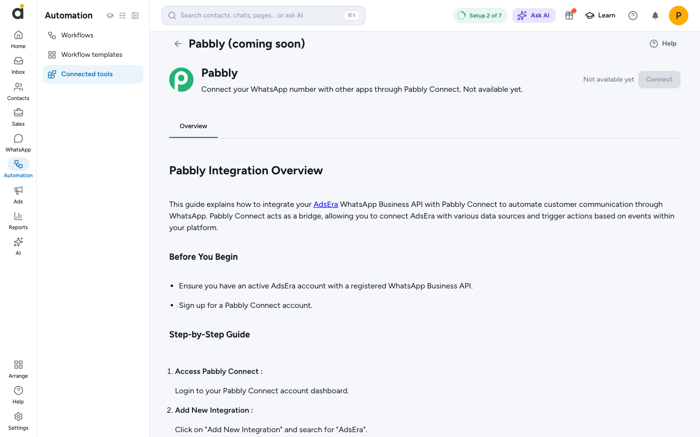
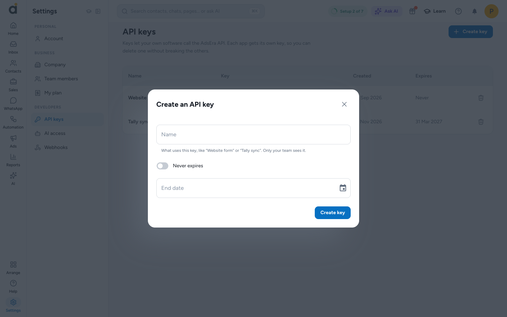
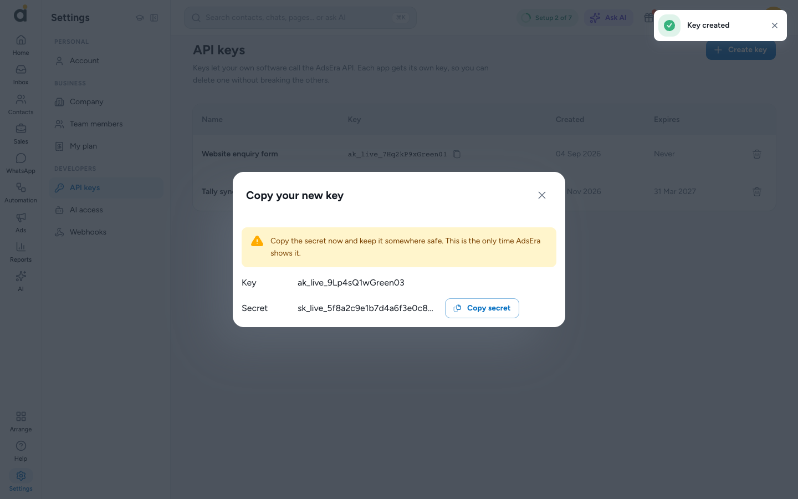

<Warning>
**Coming soon in AdsEra:** the Pabbly card under Connected tools opens a page marked *(coming soon)* with a greyed-out **Connect**: there is nothing to connect inside AdsEra yet. What this page describes works from Pabbly's side, using your AdsEra API key: no button in AdsEra is needed.
</Warning>

[Pabbly Connect](https://www.pabbly.com/connect/) links AdsEra with other apps. For example, when a form is filled, an order is placed or a lead is added to your CRM, Pabbly can send a WhatsApp template message through AdsEra.

## Adding the integration

### Before you begin

- An AdsEra account with a connected WhatsApp number and at least one approved template.
- A Pabbly Connect account.

### Connect

<Steps>
<Step title="Get your AdsEra API credentials">
  In AdsEra, open [**Settings → API keys**](https://app.adsera.in/setting/api-keys) and create a key. You get a **Key** and a **Secret**. See [API Authentication](/api-reference/introduction).

  

  The Secret shows only once. Copy both now:

  
</Step>
<Step title="Add AdsEra in Pabbly">
  In Pabbly Connect, create a workflow. Set up the trigger (the app and event that should start it), then add an action step and search for **AdsEra**.
</Step>
<Step title="Authorize">
  Paste your Key and Secret when Pabbly asks for the connection.
</Step>
<Step title="Choose the message">
  Pick the WhatsApp number and the approved template. Map data from the trigger (name, phone and so on) to the template's variables. Save and test the workflow.
</Step>
</Steps>

## Using the integration

Each time the trigger fires, Pabbly calls AdsEra and the message is sent. You can see it in **Chat** in AdsEra.

### Troubleshooting

<AccordionGroup>
<Accordion title="Pabbly says authentication failed">
  Check that you copied the Key and Secret exactly. If you made a new key in AdsEra, update it in Pabbly too.
</Accordion>
<Accordion title="The message isn't delivered">
  The template must be approved, and the phone number must include the country code. Check the message status in AdsEra **Chat**.
</Accordion>
</AccordionGroup>

## Removing the integration

Turn off or delete the Pabbly workflows that use AdsEra, and remove the AdsEra connection in Pabbly. To make sure the old credentials can't be used, delete that key under **Settings → API keys** and create a new one. Anything else that uses the old secret stops working, so update it there as well.
