WhatsApp Commerce puts your **product catalog** inside WhatsApp. Customers tap the shop icon in your chat, browse products, add them to a basket and send you the order, without leaving WhatsApp. You add products, see orders and update them in AdsEra.

**Where:** **Ads → WhatsApp Commerce**. [Open it →](https://app.adsera.in/dashboard/meta/commerce)

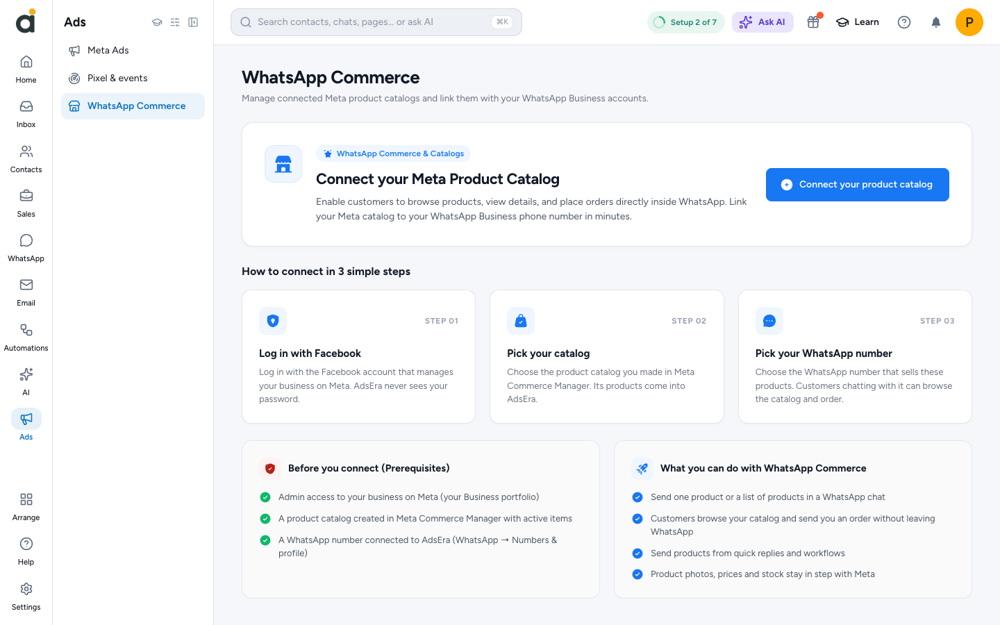

## Before you start

| You need | Why |
| --- | --- |
| A **product catalog** in Meta Commerce Manager with active items (or make products in AdsEra and sync them) | It is the list WhatsApp shows. |
| A **WhatsApp number** connected in AdsEra (WhatsApp → Numbers & profile) | Customers order from that number's chat. |
| **Admin access** to your business on Meta | To let AdsEra read and update the catalog. |

<Note>
WhatsApp Commerce needs the **Meta business agent, ads & commerce** permission (Settings → Team members). A number can have only one catalog.
</Note>

## Connect your catalog

<Steps>
<Step title="Click Connect your product catalog">
The page shows the three steps: log in with Facebook, pick your catalog, pick your WhatsApp number.
</Step>
<Step title="Log in with Facebook">
Click **Connect with Meta** and log in with the Facebook account that manages your catalog. AdsEra never sees your password.
</Step>
<Step title="Pick the WhatsApp number for each catalog">
Each catalog found shows with a number to pick. **Already connected** means it is linked; **Other business** means the number belongs to a different business on Meta; **For ads only** catalogs (like property listings) can't go on WhatsApp. **No WhatsApp number can take this catalog** means each of your numbers already has a catalog. **Refresh Catalogs** looks again.
</Step>
<Step title="Finish">
The catalog shows on the page as **Linked to WhatsApp**.
</Step>
</Steps>

## Your catalogs

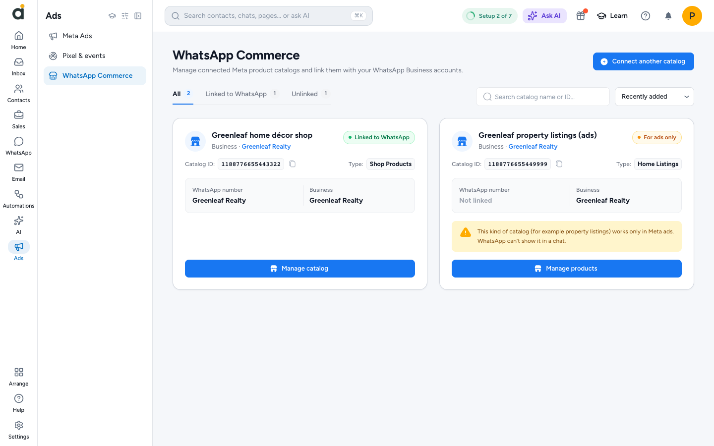

| Part | What it shows |
| --- | --- |
| **All / Linked to WhatsApp / Unlinked** | Filter the catalogs. |
| **Search catalog name or ID…**, **Recently added** | Find and order them. |
| Card | Name, business, **Catalog ID** (copy button), **Type** (**Shop products**, or the kind of listing), the **WhatsApp number** it sells on. |
| **Linked to WhatsApp** / **For ads only** | **For ads only** is a catalog Meta only allows in ads (property listings, hotels, flights…). WhatsApp can't show it. |
| **Manage catalog** / **Manage products** | Opens the catalog. |
| **Connect another catalog** | Adds one more. |

## One catalog

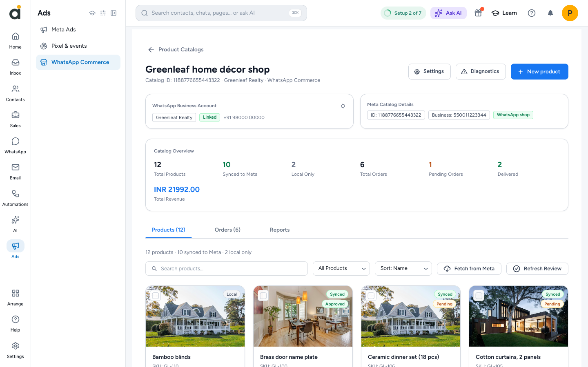

The top shows the **WhatsApp Business Account** it is linked to (**Linked**; the round arrow re-links it) and the **Meta Catalog Details** (ID, business, **WhatsApp shop** or **For Meta ads only**). Buttons: **Settings**, **Diagnostics**, **New product**.

**Catalog Overview**: **Total Products**, **Synced to Meta**, **Local Only** (only in AdsEra), **Total Orders**, **Pending Orders**, **Delivered**, **Total Revenue**.

### Products

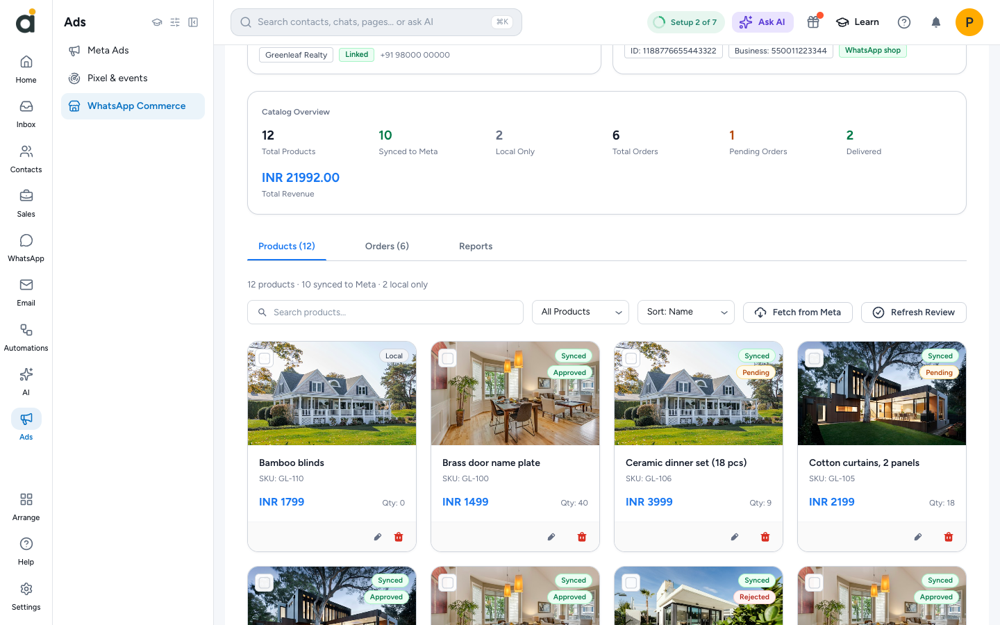

Each product card shows its picture, name, SKU, price and stock, with two badges: **Synced** (on Meta) or **Local** (only in AdsEra), and Meta's review: **Approved**, **Pending** or **Rejected**. Only approved products show on WhatsApp.

| Control | What it does |
| --- | --- |
| Search, **All Products / Synced to Meta / Local Only / Review Approved / Review Pending / Review Rejected** | Find products. |
| **Sort: Name / Price (Low to High) / Price (High to Low)** | Order them. |
| Tick boxes + sync | Send the ticked products to Meta. |
| **Fetch from Meta** | Brings in products made in Meta Commerce Manager. |
| **Refresh Review** | Gets Meta's latest review decision. |
| **New product** | Opens the product form (the same as Sales → Products): name, price, pictures, stock. |

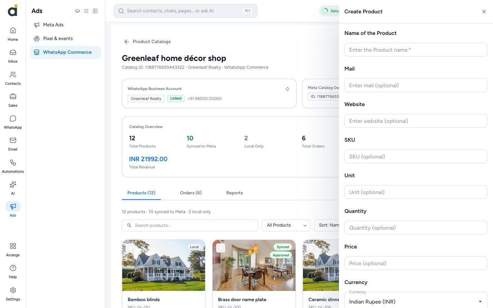

A rejected product shows Meta's reason. A common one: *Products need a "Product URL" to appear in Meta Dynamic Ads* — this affects ads only, not your WhatsApp shop; add the product's page link and sync again.

### Orders

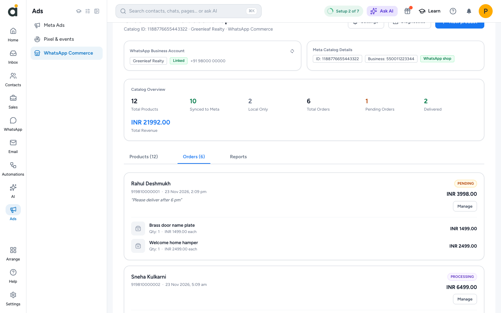

Totals (orders, revenue, delivered, pending, cancelled, and orders by status), then every order with the customer, items, amount and status. Click **Manage** on an order:

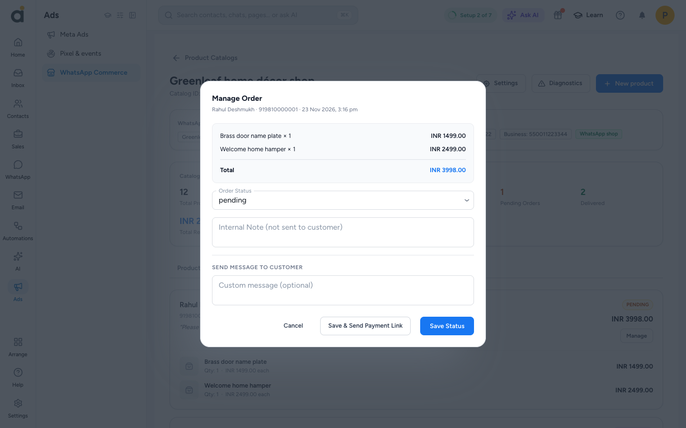

| Field | What it does |
| --- | --- |
| **Order Status** | pending, confirmed, processing, shipped, delivered, cancelled. |
| **Internal Note (not sent to customer)** | For your team. |
| **Tracking Info**: **Carrier**, **Tracking #**, **Tracking URL** | Shipping details (shown once the status is shipped). |
| **Send Message to Customer** → **Custom message (optional)** | A WhatsApp message with the update. |
| **Save Status** / **Save & Send Message** / **Save & Send Payment Link** | Save, and optionally message the customer or send a payment link ([WhatsApp Pay](/help/integrations/whatsapp-pay)). |

### Reports, Settings and Diagnostics

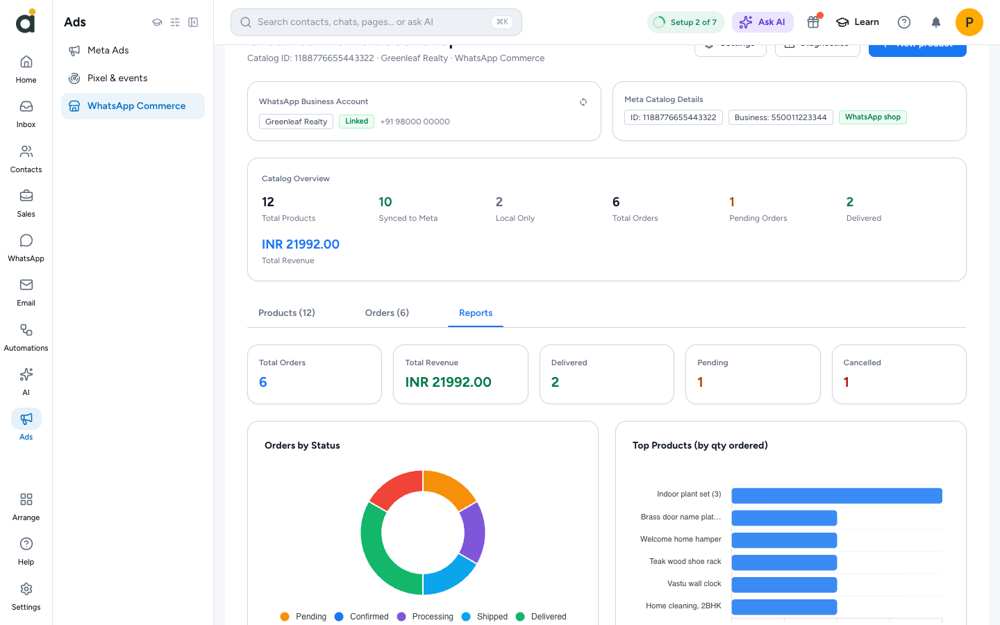

**Reports** shows total orders, revenue, delivered, pending and cancelled, **Orders by Status** and your **Top Products** by quantity ordered.

**Settings** shows whether the **Catalog Icon in Chat Header** and the **Add to Basket Button** are **On** for the number. To change them, open Meta's WhatsApp Manager → Catalogue.

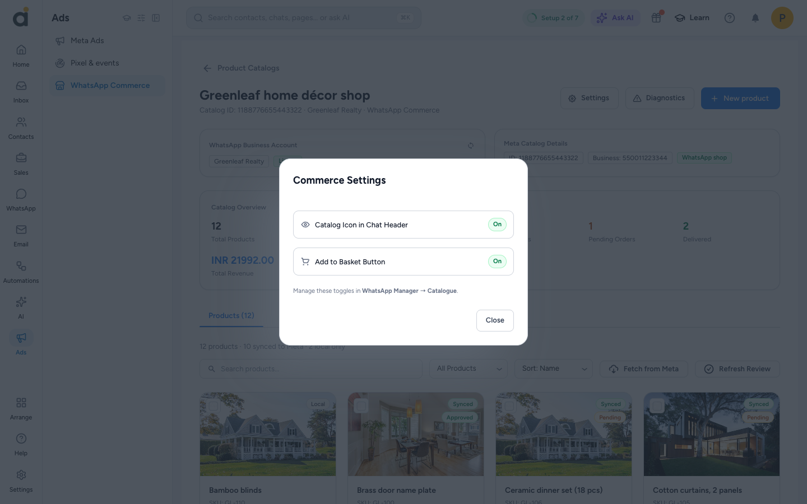

**Diagnostics** lists Meta's catalog issues, **ERROR** or **WARNING**, with how many products each affects (like pictures smaller than 500 × 500 pixels or missing descriptions). Fix the products and sync again.

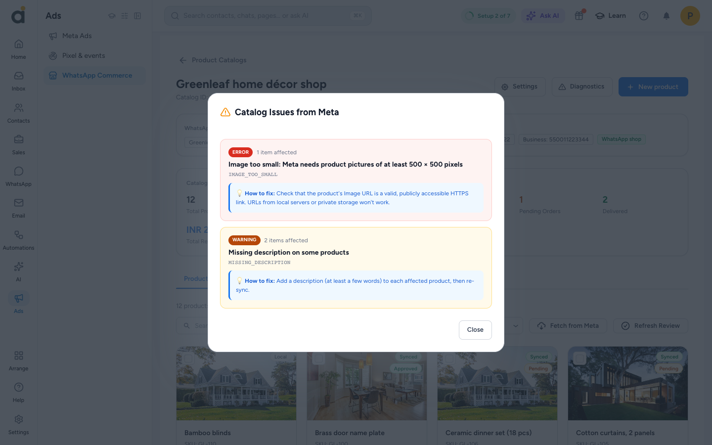

### A catalog that isn't linked yet

The page shows **Link a WhatsApp number**: pick one of your numbers and click **Link WhatsApp number**. If Meta already links the catalog to a number that AdsEra doesn't know about yet, a blue box says so: pick it and click **Link WhatsApp number**. A **For ads only** catalog has no Orders or Reports.

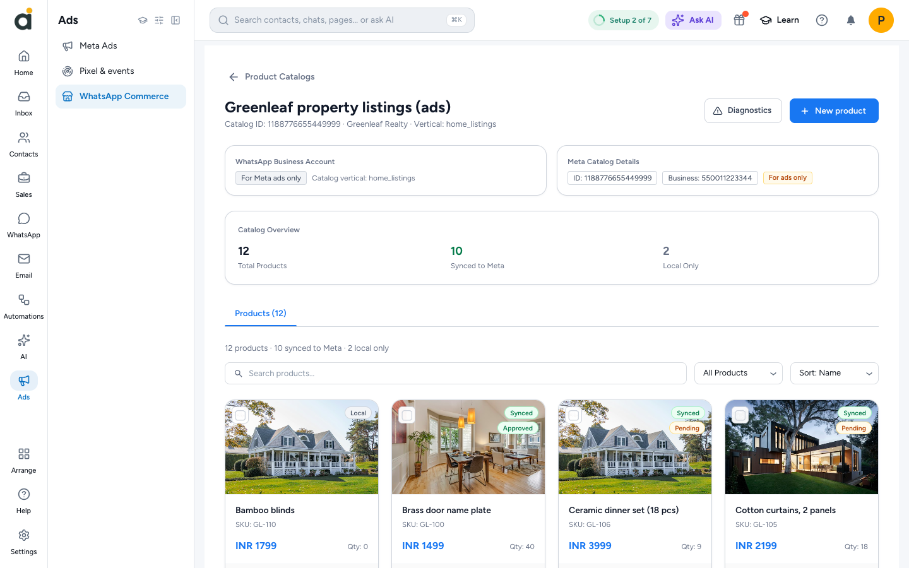

## Send products in a chat

In the Inbox, use the product list in the reply box, or a [quick reply](/help/snippet/interactive) with a product list, to send one product or several. Customers tap, add to basket and send the order; it shows under **Orders**.

## Troubleshooting

| Problem | Fix |
| --- | --- |
| No catalogs found after logging in | Make a catalog in Meta Commerce Manager, or allow catalog access in the Facebook window. |
| **No WhatsApp number can take this catalog** | Each number can have one catalog. Use another number or unlink the old catalog in Meta. |
| A product doesn't show on WhatsApp | It must be **Synced** and **Approved**. Click **Refresh Review**. |
| Customers don't see the shop icon | **Settings** shows **Off**: switch it on in Meta's WhatsApp Manager → Catalogue. |

## FAQs

<AccordionGroup>
<Accordion title="Does WhatsApp take payment for orders?">
Not by itself. Send a payment link from the order, or set up [WhatsApp Pay](/help/integrations/whatsapp-pay).
</Accordion>
<Accordion title="Can I use the same catalog for ads?">
Yes. A shop catalog works in Meta ads too. A "For ads only" catalog works only in ads.
</Accordion>
<Accordion title="Are there catalog message templates?">
No. AdsEra can't make catalog or product templates. Send products in an open chat (the 24 hours after the customer wrote), with the product list or a quick reply.
</Accordion>
</AccordionGroup>

## Related

<CardGroup cols={2}>
<Card title="WhatsApp Pay" icon="indian-rupee-sign" href="/help/integrations/whatsapp-pay">Take payments in the chat.</Card>
<Card title="Products" icon="box" href="/help/crm/product">Your products in Sales.</Card>
<Card title="Quick replies with a product list" icon="bolt" href="/help/snippet/interactive">Send products in one tap.</Card>
<Card title="Connect your Meta ad account" icon="link" href="/help/ads/connect">Ads from the same business.</Card>
</CardGroup>
