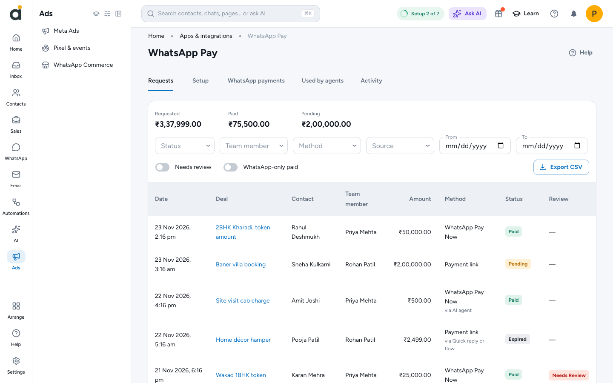
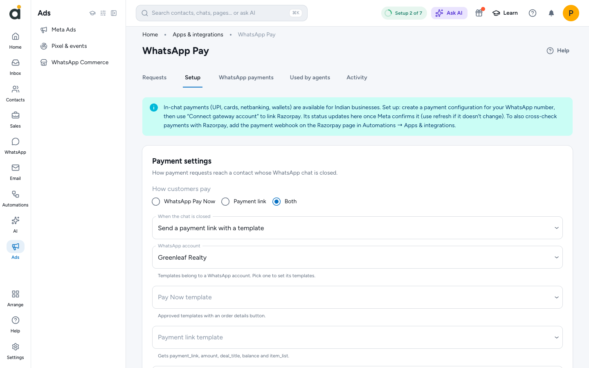
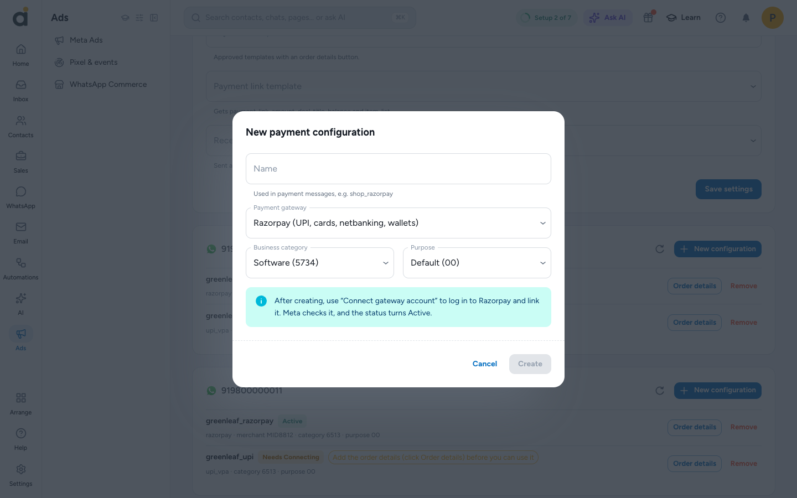
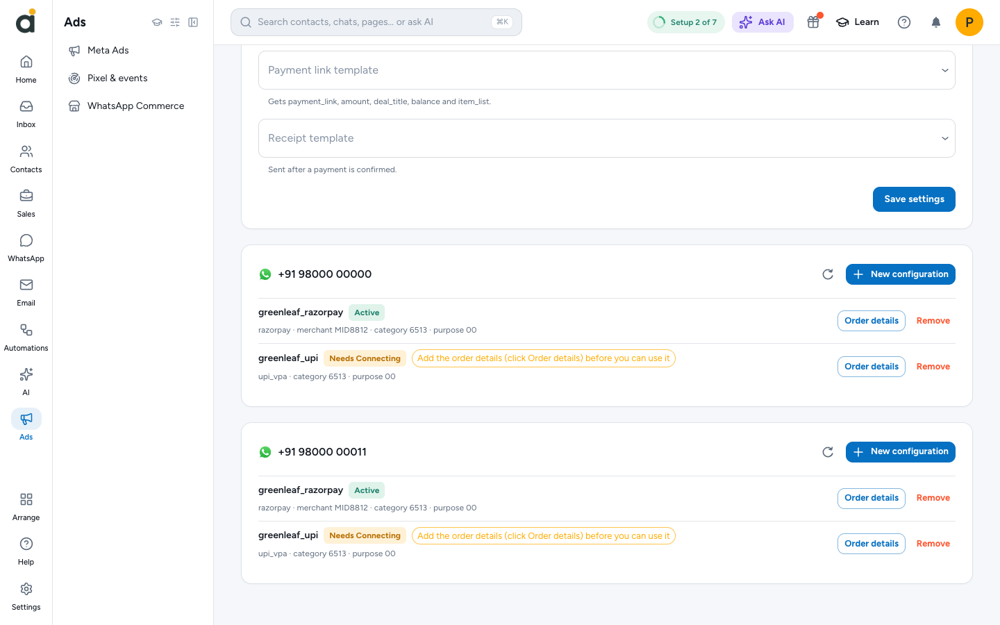
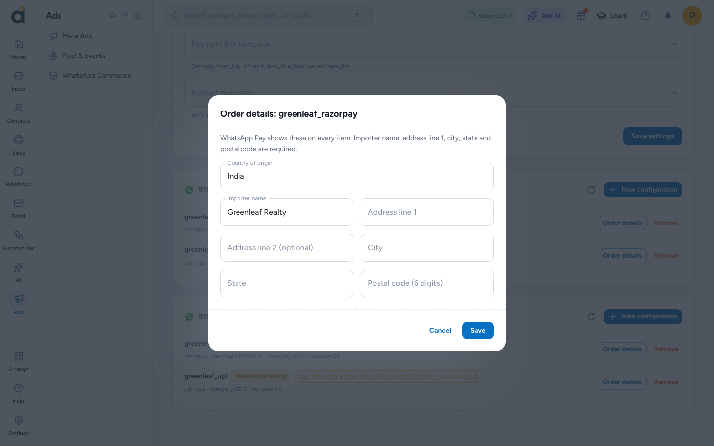
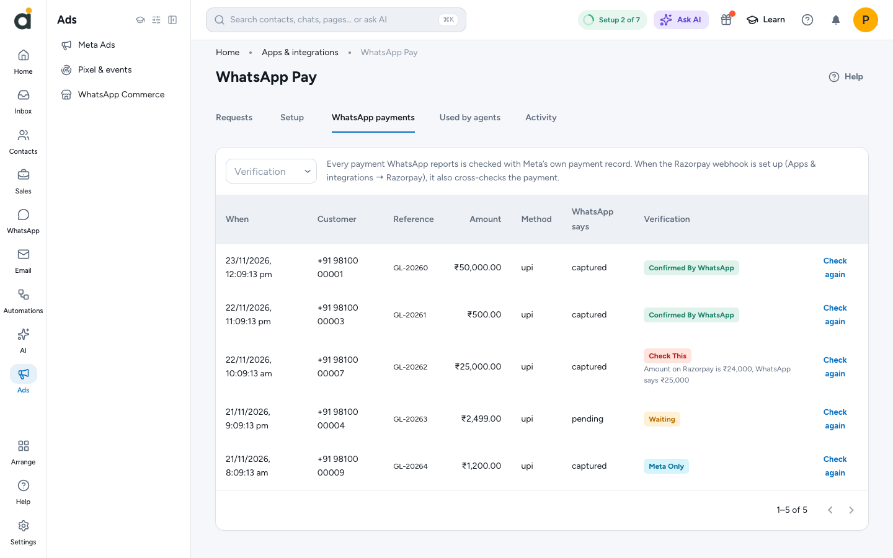

WhatsApp Pay lets customers pay you **inside the WhatsApp chat**: a **Pay Now** card opens UPI, cards, netbanking or wallets without leaving WhatsApp. You can also send a **payment link** (a Razorpay page). Requests are sent from a deal, from a chat (**Collect payment**), from quick replies and workflows, or by Addy when you allow it.

**Where:** **Automations → Apps & integrations → WhatsApp Pay** (it has no menu item of its own; it opens in the Ads area). Also from **Set up WhatsApp Pay** links in deals and chats. [Open it →](https://app.adsera.in/dashboard/meta/payments)

<Note>
WhatsApp Pay is for **Indian businesses** (Meta's rule). It needs a WhatsApp number connected in AdsEra, an account with a payment gateway (**Razorpay**, **PayU** or **Zaakpay**) or just a business UPI ID, and the **Meta business agent, ads & commerce** permission.
</Note>

## Set it up

<Steps>
<Step title="Open the Setup tab">

</Step>
<Step title="Click New configuration on your number">

| Field | What to put | Example |
| --- | --- | --- |
| **Name** | A short name, used in payment messages. Small letters and _ . | shop_razorpay |
| **Payment gateway** | **Razorpay** (UPI, cards, netbanking, wallets), **PayU**, **Zaakpay**, or **UPI ID only** | Razorpay |
| **Business UPI ID** | Only for **UPI ID only** | greenleaf@okhdfcbank |
| **Business category** | What your business does (Meta's category code shows in brackets) | Real estate (6513) |
| **Purpose** | Keep **Default (00)** unless your bank told you otherwise | Default |

Click **Create**. If Meta's payment terms aren't accepted for your WhatsApp account yet, a yellow box shows **Accept the terms**: click it, accept, and create again.
</Step>
<Step title="Connect your gateway">
On the new configuration click **Connect gateway account** and log in to Razorpay (or your gateway) to link it. Sending the link to whoever owns the Razorpay account? Use **Get connect link** / **New link**. Meta checks it and the status turns **Active**. The round arrow (**Refresh from Meta**) checks again.

</Step>
<Step title="Add the order details">
A chip *Add the order details (click Order details) before you can use it* shows until you do. Click **Order details** and fill in the **Country of origin** and the importer **name, address line 1, city, state and postal code** (6 digits). WhatsApp Pay shows them on every item; name and address line 1 come from your company details.

</Step>
<Step title="Choose how customers pay">
See **Payment settings** below, then **Save settings**.
</Step>
</Steps>

### Configuration statuses

| Status | Meaning | What to do |
| --- | --- | --- |
| **Active** | Ready: Pay Now cards can be sent from this number. | Nothing. |
| **Needs Connecting** | The gateway isn't linked yet. | **Connect gateway account**. |
| **Needs Testing** | The gateway is linked; Meta hasn't finished checking it. | Click **Refresh from Meta** later. |

**Remove** deletes a configuration (it asks first). Payment messages using it stop working; requests and payments already recorded stay.

## Payment settings

| Setting | Choices | What it does |
| --- | --- | --- |
| **How customers pay** | **WhatsApp Pay Now**, **Payment link**, **Both** | Pay Now = a card in the chat. Payment link = a Razorpay page. Both = they choose. Payment links need Razorpay connected (Apps & integrations → Razorpay). |
| **When the chat is closed** | **Don't send**, **Send Pay Now with a template**, **Send a payment link with a template** | After 24 hours since the customer last wrote, WhatsApp only allows approved templates. |
| **WhatsApp account** | Your numbers' accounts | Templates belong to an account: pick one to set its templates. |
| **Pay Now template** | Your approved templates with an order details button | Used when the chat is closed. |
| **Payment link template** | Your approved templates | Gets payment_link, amount, deal_title, balance and item_list. |
| **Receipt template** | Your approved templates | Sent after a payment is confirmed. |

## Requests

**Requested**, **Paid** and **Pending** totals for the filters you pick. Filters: **Status**, **Team member**, **Method**, **Source** (sales rep, quick reply or flow, AI agent), **From**, **To**, **Needs review** (payments that don't add up, like a different amount paid) and **WhatsApp-only paid** (WhatsApp says paid by Pay Now, but Razorpay has no matching payment: check before you deliver).

| Column | Meaning |
| --- | --- |
| **Date**, **Deal**, **Contact**, **Team member** | Who it was for and who sent it. Click the deal to open it. |
| **Amount**, **Method** | WhatsApp Pay Now or Payment link, and *via* who made it if not a team member. |
| **Status** | **Pending**, **Paid**, **Failed**, **Expired**, **Cancelled**, with **Test** for test requests and a cross-check chip. |
| **Review** | **Needs review**: hover for why. |

**Export CSV** downloads the list (up to 5,000 rows).

## WhatsApp payments

Every payment WhatsApp reports: **When**, **Customer**, **Reference**, **Amount**, **Method**, **WhatsApp says** and **Verification**. Filter by **Verification**. **Check again** asks Meta once more.

| Verification | Meaning | What to do |
| --- | --- | --- |
| **Confirmed by WhatsApp** | Meta's own payment record says it was paid (and Razorpay agrees, if its webhook is set up). | Deliver. |
| **Check this** | Meta and Razorpay disagree; the reason shows under it (like a different amount). | Check your Razorpay dashboard before you deliver. |
| **Waiting** | Not paid yet, or the confirmation hasn't come. | Wait, or ask the customer. |
| **Meta only** | Only Meta's record was checked so far. | **Check again**. |
| **Couldn't check** | A check failed. | **Check again**. |

<Tip>
Add the Razorpay payment webhook (**Automations → Apps & integrations → Razorpay**) so AdsEra also cross-checks every payment with Razorpay.
</Tip>

## Used by agents and Activity

**Used by agents** sets what Addy and Ask AI may do with payments (for example, send a payment request in a chat). **Activity** lists what the integration did.

## Troubleshooting

| Problem | Fix |
| --- | --- |
| **Accept the terms** when creating | Click it, accept Meta's WhatsApp payments terms, then create again. |
| The configuration stays **Needs Connecting** | Finish **Connect gateway account** with the gateway account's owner, then **Refresh from Meta**. |
| Pay Now can't be sent: *Add order details to the WhatsApp payment configuration* | Click **Order details** and fill in the required fields. |
| *This number has no active WhatsApp Pay configuration* | Create one on that number and connect the gateway. |
| A payment shows **Check this** or **Needs review** | Check it in your gateway's dashboard before delivering. |
| The number shows *not available* | WhatsApp Pay works only for Indian numbers and businesses. |

## FAQs

<AccordionGroup>
<Accordion title="Does AdsEra take a cut?">
No. The gateway (Razorpay, PayU, Zaakpay) charges its own fee and pays you directly.
</Accordion>
<Accordion title="How do I send a payment request?">
From a deal (**Collect payment**), from a chat (**Collect payment** in the reply box), from a quick reply or workflow, or let Addy do it (**Used by agents**). See [Collect a payment in a chat](/help/inbox/payments) and [Deal payments](/help/crm/deal-payments).
</Accordion>
<Accordion title="Pay Now or a payment link?">
Pay Now is quickest (it stays in WhatsApp). A payment link works for any amount the gateway allows and when the chat is closed with a template. **Both** lets the customer choose.
</Accordion>
</AccordionGroup>

## Related

<CardGroup cols={2}>
<Card title="Collect a payment in a chat" icon="comments-dollar" href="/help/inbox/payments">From the Inbox.</Card>
<Card title="Deal payments" icon="handshake" href="/help/crm/deal-payments">Advances and balances on a deal.</Card>
<Card title="WhatsApp Commerce" icon="cart-shopping" href="/help/integrations/whatsapp-commerce">Orders from your catalog.</Card>
<Card title="Apps & integrations" icon="puzzle-piece" href="/help/integrations/marketplace">Razorpay and other apps.</Card>
</CardGroup>
