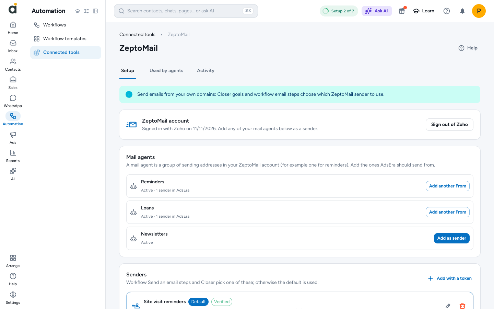
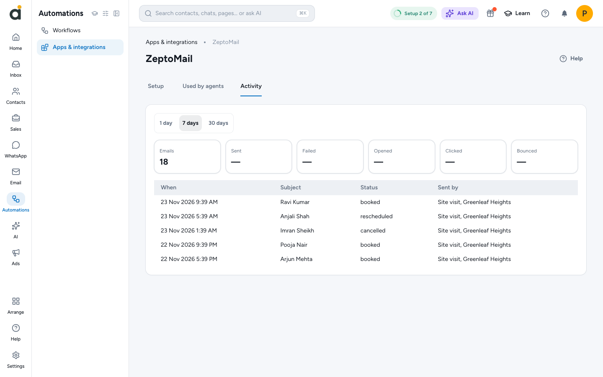
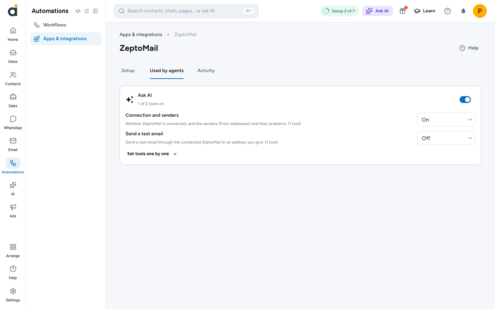

ZeptoMail (by Zoho) sends AdsEra's automated one-to-one emails from **your own domain**: a workflow's **Send an email** step and Closer's follow-ups pick which ZeptoMail sender to use, and opens, clicks and bounces come back to AdsEra.

<Note>
Each email goes to one person when a workflow or Closer reaches them. AdsEra doesn't send email campaigns or newsletters.
</Note>

**Where:** **Marketplace → ZeptoMail**.

## Adding the integration

### Before you begin

- A [ZeptoMail](https://www.zoho.com/zeptomail/) account with your sending domain **verified**.
- The **Integrations & data tables** permission in AdsEra (admins have it).

Open **Marketplace → ZeptoMail → Setup**. There are two ways to add a sender.

<Tabs>
<Tab title="Sign in with Zoho (recommended)">
1. Under **ZeptoMail account**, pick **Your Zoho region** (India for zoho.in accounts) and click **Sign in with Zoho**. Approve access on Zoho's page.
2. Under **Mail agents**, AdsEra lists your ZeptoMail mail agents. A mail agent is a group of sending addresses in your ZeptoMail account (for example one for reminders).
3. Click **Add as sender** on a mail agent and fill in the sender (see the fields below).
</Tab>
<Tab title="Add with a token">
1. In ZeptoMail, open your mail agent → **SMTP/API** and copy the **Send Mail token** (it starts with `Zoho-enczapikey`).
2. In AdsEra, under **Senders**, click **Add with a token**.
3. Paste the **Send Mail token**, choose the **Zoho region** and fill in the sender.
</Tab>
</Tabs>

**Sender fields:**

| Field | Notes |
| --- | --- |
| Name (for your team) | For example, "Lead nurture". Only your team sees it. |
| From address | Must be on a domain verified in ZeptoMail, for example `hello@yourdomain.com`. |
| From name | What recipients see, for example "Riya from Acme". |
| Reply-to | Optional. |
| Bounce address | Optional. |
| Use as the default sender | Used when a goal or workflow doesn't pick a sender. |

Click **Save sender**.

### Finish setup

<Steps>
<Step title="Send a test">
  Enter your email address on the sender and click **Send test**. The sender shows **Verified** once a test goes through.
</Step>
<Step title="Turn on tracking">
  Copy the sender's **Tracking webhook** URL. In ZeptoMail, open that mail agent → **Webhooks** and add it. Opens, clicks and bounces then show in AdsEra.
</Step>
</Steps>

## Using the integration

- **Closer** and **workflow email steps** let you choose a ZeptoMail sender. If you don't pick one, the default sender is used.
- The **Activity** tab shows emails, sent, failed, opened, clicked and bounced counts, with each email's subject, status and who sent it.

- The **Used by agents** tab sets what Ask AI may do with ZeptoMail.

### Troubleshooting

<AccordionGroup>
<Accordion title="The sender shows &quot;Needs attention&quot;">
  The message under the sender shows ZeptoMail's error. The usual causes are a From address on a domain that isn't verified in ZeptoMail, a revoked token, or the wrong Zoho region. Edit the sender, fix the problem and click **Send test** again.
</Accordion>
<Accordion title="Opens and clicks don't show up">
  Check that the sender's **Tracking webhook** URL is added under that mail agent's **Webhooks** in ZeptoMail.
</Accordion>
<Accordion title="&quot;Zoho sign-in isn't set up on this server&quot;">
  Use **Add with a token** instead.
</Accordion>
</AccordionGroup>

## Removing the integration

- **Remove a sender:** click the trash icon on the sender and confirm. Goals and workflows that used it switch to the default sender.
- **Sign out of Zoho:** click **Sign out of Zoho**. Senders you already added keep working, but you can't add mail agents until you sign in again.

To stop sending through ZeptoMail completely, remove every sender. You can also delete the Send Mail token in ZeptoMail, after which emails from that sender fail.
