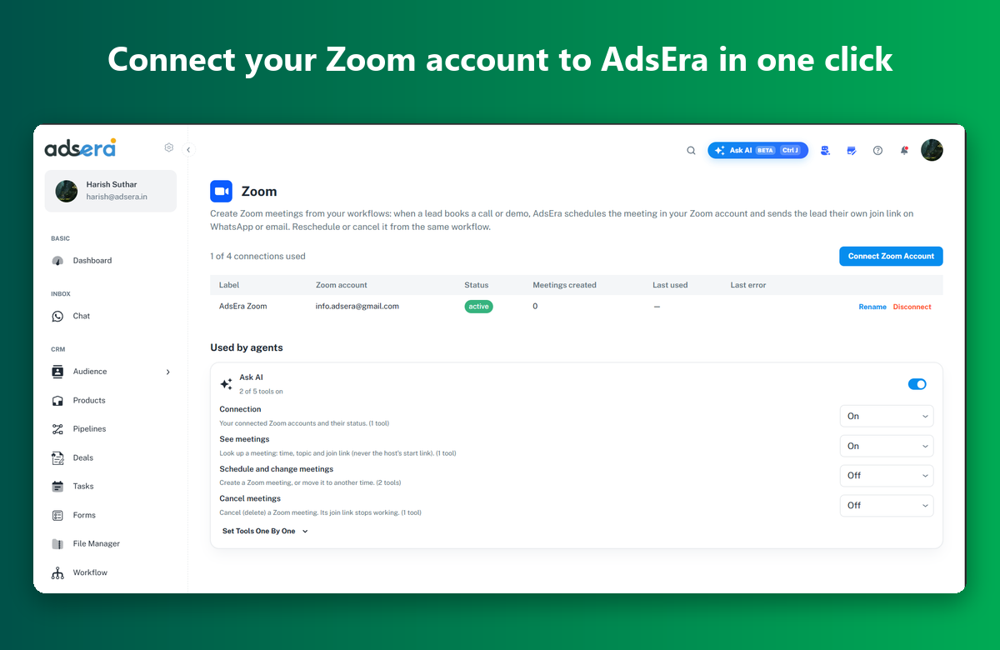

<Info>
  **Pre-release:** the AdsEra app for Zoom is in review for the Zoom App Marketplace. Until it is listed, connect Zoom from inside AdsEra as described below. This page will stay at this address after the app is published.
</Info>

The Zoom integration lets AdsEra create meetings in your own Zoom account:

- **Addy on WhatsApp** offers your customers free times, books the one they pick as a Zoom meeting and sends them the join link in the chat.
- **Ask AI** (the assistant inside AdsEra) can list your Zoom connections, look up a meeting, and, if you allow it, schedule, move or cancel meetings.

AdsEra only works with meetings it creates. It never reads your recordings, meeting chat, transcripts, participant lists or Zoom contacts, and it never stores the host's start link.

---

## Adding the app

### Before you begin

<Steps>
<Step title="An AdsEra account">
  You need an AdsEra account at [app.adsera.in](https://app.adsera.in) with access to **Marketplace** (the Automation permission). Account owners and admins have it by default.
</Step>
<Step title="A Zoom account">
  Any Zoom account that can schedule meetings. Meetings are created in the account you sign in with, under that user's Zoom plan and its limits (for example, the meeting length limit on free Zoom accounts).
</Step>
<Step title="A free connection on your plan">
  Your AdsEra plan sets how many Zoom accounts you can connect. The Zoom page shows how many you have used, for example "1 of 4 connections used".
</Step>
</Steps>

### Connect from AdsEra

1. Log in to [AdsEra](https://app.adsera.in) and open **Marketplace → Zoom** (or go straight to [app.adsera.in/dashboard/marketplace/zoom](https://app.adsera.in/dashboard/marketplace/zoom)).
2. Click **Connect Zoom Account**.
3. Zoom opens its sign-in page. Sign in with the Zoom account you want AdsEra to use.
4. Zoom shows what AdsEra is asking for. Review it and click **Allow**.
5. Zoom sends you back to AdsEra and you see **"Zoom connected"**. Your Zoom account appears in the list with the status **active**.

<Tip>
  Connected several Zoom accounts? Click **Rename** to give each one a clear label, such as "Sales Zoom".
</Tip>

### Install from the Zoom App Marketplace

Once the app is listed, you can also start from Zoom:

1. In the [Zoom App Marketplace](https://marketplace.zoom.us), find **AdsEra** and click **Add**, then **Allow**.
2. Zoom sends you to AdsEra. Log in if asked.
3. AdsEra shows *"You added AdsEra from the Zoom Marketplace. Connect your Zoom account to this AdsEra account?"*. Click **Connect**.
4. Zoom confirms the account and sends you back with **"Zoom connected"**.

### What AdsEra can access

| Access | Why |
| --- | --- |
| Your Zoom profile: user ID, account ID, email, name and timezone | To show which Zoom account is connected and to schedule meetings in the right timezone. Read once when you connect. |
| Create, view, update and delete meetings | To book, look up, move and cancel the meetings AdsEra creates. |

Your Zoom login tokens are encrypted (AES-256-GCM) and are never shown in the app or sent to AI models.

---

## Using the app

### Let Addy book Zoom meetings in WhatsApp

<Steps>
<Step title="Set your booking hours">
  On **Marketplace → Zoom**, click **Booking for Addy** next to the Zoom account. Set:
  - **Hours**: tick the days and set *From* and *To*, or tick **Use Addy's business hours**.
  - **Timezone** (empty uses Addy's timezone).
  - **Meeting length**, **Gap between meetings** and **Minimum notice**, in minutes.
  - **Book up to (days ahead)** and **Max meetings a day** (0 means no limit).
  - **Meeting topic**: `{business}` and `{name}` are filled in for each meeting.

  Click **Save**.
</Step>
<Step title="Turn on Zoom booking for Addy">
  Open **Addy → Goals → Book appointments**. Switch on **Offer bookings**, choose **Book in the chat (Zoom)** and pick the Zoom account. Save Addy.
</Step>
<Step title="Customers book in the chat">
  When a customer asks for a call or demo, Addy offers free times inside your booking hours. When the customer picks one, Addy creates the Zoom meeting and sends the join link in the chat. Addy only needs the customer's name.

  Addy never offers a time that is already taken by another Zoom, Cal.com or Calendly booking. A customer can ask Addy later for the time and join link of the meetings they booked.
</Step>
</Steps>

### Use Zoom with Ask AI

Ask AI is the assistant button at the top of every AdsEra page. With Zoom connected, you can ask things like:

- *"Which Zoom accounts are connected?"*
- *"What's the join link for meeting 8123 4567 890?"*
- *"Schedule a 30-minute Zoom call with Priya tomorrow at 4 pm."*
- *"Move that meeting to Friday 11 am"* or *"Cancel it."*

Choose what Ask AI may do under **Used by agents** on the Zoom page:

| Tool group | What it does | Default |
| --- | --- | --- |
| Connection | See your connected Zoom accounts and their status | On |
| See meetings | Look up a meeting's time, topic and join link (never the host's start link) | On |
| Schedule and change meetings | Create a meeting, or move it to another time | **Off** |
| Cancel meetings | Delete a meeting; its join link stops working | **Off** |

Turn on the last two only if you want Ask AI to change meetings. Ask AI confirms with you before it cancels a meeting.

### Troubleshooting

<AccordionGroup>
<Accordion title="&quot;Zoom could not be connected&quot; after signing in">
  Click **Connect Zoom Account** and try again: the sign-in link is valid for 10 minutes, so a page left open too long fails. If you clicked **Cancel** or **Deny** on Zoom's page, start again and click **Allow**. If your Zoom account is managed by a company, your Zoom admin may need to approve the app first.
</Accordion>
<Accordion title="&quot;Your plan allows N Zoom connections&quot;">
  You have used every Zoom connection on your plan. Disconnect an account you no longer use, or upgrade your AdsEra plan.
</Accordion>
<Accordion title="The status shows &quot;error&quot;">
  Zoom stopped accepting AdsEra's login, for example after a Zoom password change or the app being removed in Zoom. The **Last error** column shows Zoom's message. Click **Reconnect** and sign in again.
</Accordion>
<Accordion title="Addy doesn't offer any times">
  Check **Booking for Addy**: at least one day must be ticked, *Book up to (days ahead)* must be more than 0, and *Max meetings a day* may already be reached. A long *Minimum notice* can also push every slot of the day out. Also check that **Book in the chat (Zoom)** is chosen on Addy's Goals tab with the right Zoom account.
</Accordion>
<Accordion title="A meeting can't be scheduled for a time that has passed">
  AdsEra refuses start times in the past. Pick a later time, and check the timezone shown under your Zoom account.
</Accordion>
<Accordion title="Ask AI says it can't schedule or cancel meetings">
  Those tools are off by default. Turn on **Schedule and change meetings** or **Cancel meetings** under **Used by agents** on the Zoom page.
</Accordion>
</AccordionGroup>

Still stuck? Email [contact@adsera.in](mailto:contact@adsera.in) with your AdsEra account email and what you see.

---

## Removing the app

You can disconnect from AdsEra or remove the app from Zoom. Either way does the same thing.

### Disconnect in AdsEra

1. Open **Marketplace → Zoom**.
2. Click **Disconnect** next to the Zoom account.
3. Confirm. You see **"Disconnected and deleted"**.

### Remove the app from Zoom

1. Sign in to the [Zoom App Marketplace](https://marketplace.zoom.us).
2. Click **Manage → Added Apps** (or search for AdsEra).
3. Click **Remove** next to AdsEra and confirm.

### What happens when you remove it

- AdsEra revokes its Zoom login and **deletes the connection straight away**: the login tokens and your Zoom user ID, account ID, email, name and timezone. AdsEra makes no further calls to Zoom for that account.
- **Addy stops booking Zoom meetings** with that account. Pick another booking option on Addy's Goals tab, or connect Zoom again.
- **Ask AI loses its Zoom tools** for that account.
- **Meetings already created stay in your Zoom account**, and their join links keep working. Cancel them in Zoom if you no longer want them.
- AdsEra keeps the record of meetings it booked (time, topic, join link and the customer's name and phone) so your chat history still makes sense. To have all your Zoom-related data deleted, email [contact@adsera.in](mailto:contact@adsera.in). We complete deletion within 1 day.

To use Zoom again later, connect it as new from **Marketplace → Zoom**.

---

## Privacy and support

- Privacy: [adsera.in/privacy](https://adsera.in/privacy)
- Support and data requests: [contact@adsera.in](mailto:contact@adsera.in)
- Security issues: [info@adsera.in](mailto:info@adsera.in)
