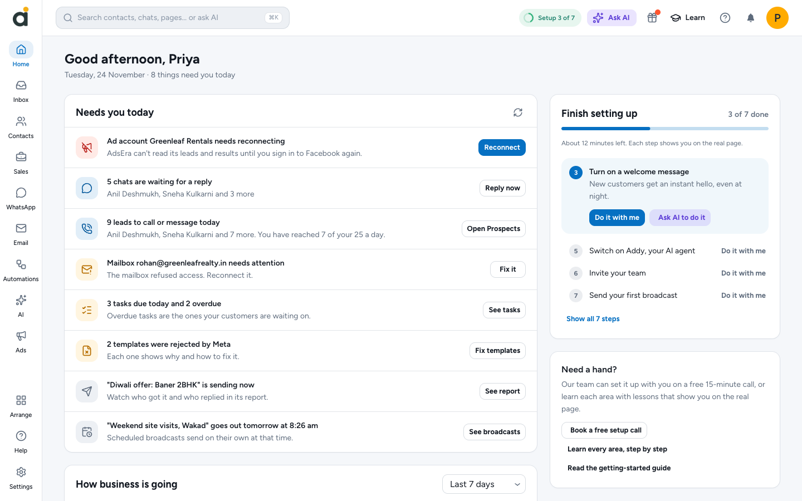
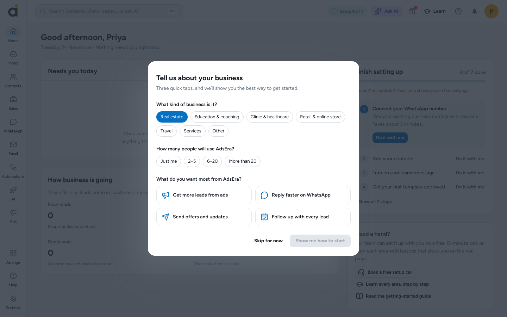
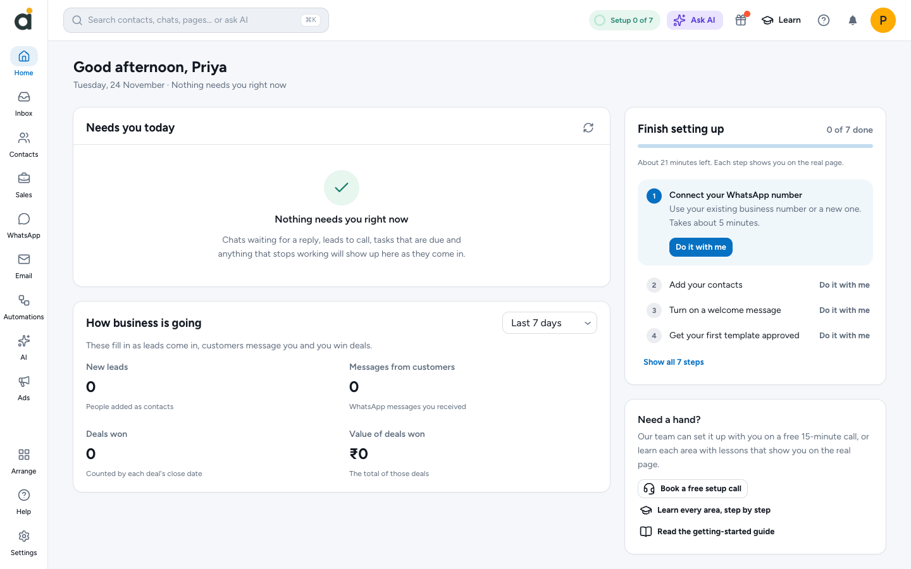

## What is AdsEra?

**AdsEra** is a WhatsApp-first platform for selling and supporting customers. It brings your WhatsApp numbers, AI agents, team inbox, contacts and sales, broadcasts, automations, payments and Meta ads into one place. A lead that comes in from an ad, a form or a chat is answered at once, followed up until they buy, and tracked from first message to payment.

**New here?** Follow [your first day](#your-first-day) below. Every step has a lesson that shows you on the real page.

---

## Your first day

<Steps>
  <Step title="Answer three quick questions">
    The first time you open AdsEra, it asks what kind of business you run, how many people will use it and what you want most. Your answer puts the most useful setup steps first.

    
  </Step>
  <Step title="Finish setting up: 7 steps">
    **Home** shows **Finish setting up** on the right. Click **Do it with me** on the highlighted step: AdsEra opens the right page and points at each click. Or click **Ask AI to do it** and let Ask AI set it up with you.

    1. Connect your WhatsApp number. See [Connecting WhatsApp](/help/channel/whatsapp/connect).
    2. Add your contacts. See [Contacts](/help/audiance/audiance).
    3. Turn on a welcome message. See [Auto-replies](/help/autoreply/wa).
    4. Get your first template approved. See [WhatsApp templates](/help/template/wa).
    5. Switch on Addy, your AI agent. See [Addy](/help/ai/addy).
    6. Invite your team. See [Team members](/help/account/team).
    7. Send your first broadcast. See [Create a broadcast](/help/campaign/wa/create).

    
  </Step>
  <Step title="Start each day on Home">
    **Needs you today** lists what is waiting for you, most urgent first: chats waiting for a reply, leads to call, tasks due, broadcasts sending, and anything that stopped working. The first row’s blue button is the thing to do next. See [Your Home page](/help/dashboard).
  </Step>
  <Step title="Learn the rest as you go">
    Click **Learn** in the top bar for a course on every area, or **?** on any page for everything you can do there, each with **Do it with me**. See [Learn with the Education hub](/help/introduction/education-hub).
  </Step>
</Steps>

<Tip>
  Stuck? Click **Ask AI** at the top of any page (or press **Ctrl J**) and say what you want in your own words. Or **Book a free setup call** from Home or Help: our team sets it up with you in 15 minutes.
</Tip>

---

## What you can do

<CardGroup cols={2}>
  <Card title="AI agents" icon="robot" href="/help/ai/addy">
    **Addy** answers customers on WhatsApp 24/7: it qualifies leads, books meetings, sells products and hands over to your team. **Closer** follows up every lead until they buy. **Ask AI** does the work inside AdsEra for you.
  </Card>
  <Card title="Team inbox and calling" icon="comments" href="/help/inbox/chat">
    Every WhatsApp chat and email in one inbox, with assignment, quick replies, templates, payments and WhatsApp voice calls.
  </Card>
  <Card title="Contacts and sales" icon="handshake" href="/help/sales/prospects">
    Contacts, deals, pipelines, products, tasks and meetings, plus **Prospects**, a daily list that tells each salesperson who to call next.
  </Card>
  <Card title="Broadcasts" icon="paper-plane" href="/help/campaign/wa/list">
    Send WhatsApp template broadcasts to lists, segments or a Google Sheet, and see who got, read and replied.
  </Card>
  <Card title="Automation" icon="diagram-project" href="/help/automation/workflows">
    **Workflows** react to leads, messages, forms, bookings and payments. **WhatsApp Flows** collect details inside the chat.
  </Card>
  <Card title="Payments and selling" icon="indian-rupee-sign" href="/help/integrations/whatsapp-pay">
    Collect payments inside WhatsApp with **WhatsApp Pay**, and sell from your catalogue with **WhatsApp Commerce**.
  </Card>
  <Card title="Meta ads" icon="bullhorn" href="/help/integrations/meta-ads">
    Build click-to-WhatsApp and lead ads, see which ads bring leads, and send results back to Meta.
  </Card>
  <Card title="Integrations and API" icon="plug" href="/help/integrations/marketplace">
    Cal.com, Calendly, Zoom, Slack, IndiaMART, Google Sheets and more, and an [API](/api-reference/introduction) for developers.
  </Card>
</CardGroup>

---

## Who AdsEra is for

<CardGroup cols={2}>
  <Card title="Business owners" icon="store">
    See what needs you today in one look, and let Addy answer while you run the business.
  </Card>
  <Card title="Sales teams" icon="chart-line">
    Reply to every lead in seconds, work a daily call list, and get paid inside WhatsApp.
  </Card>
  <Card title="Marketers" icon="bullhorn">
    Run Meta ads that start WhatsApp chats, broadcast to segments, and see which ads turn into sales.
  </Card>
  <Card title="Developers" icon="code">
    Send messages, templates and calls from your own systems with the AdsEra API and webhooks.
  </Card>
</CardGroup>

---

## Find your way around

Areas are on the **icon rail** at the far left; an area’s pages are in the **side menu** next to it. Reorder or hide areas with **Arrange**, and a side menu’s pages with its sliders icon. See [Find your way around](/help/introduction/getting-around).

## Plans and credits

See [Pricing & Plans](/help/introduction/price) for plans and add-ons, and [AI credits](/help/ai/credits) for how AI is billed. WhatsApp conversation charges are billed by Meta.

Ready? [**Create your AdsEra account**](https://app.adsera.in/auth/register)
